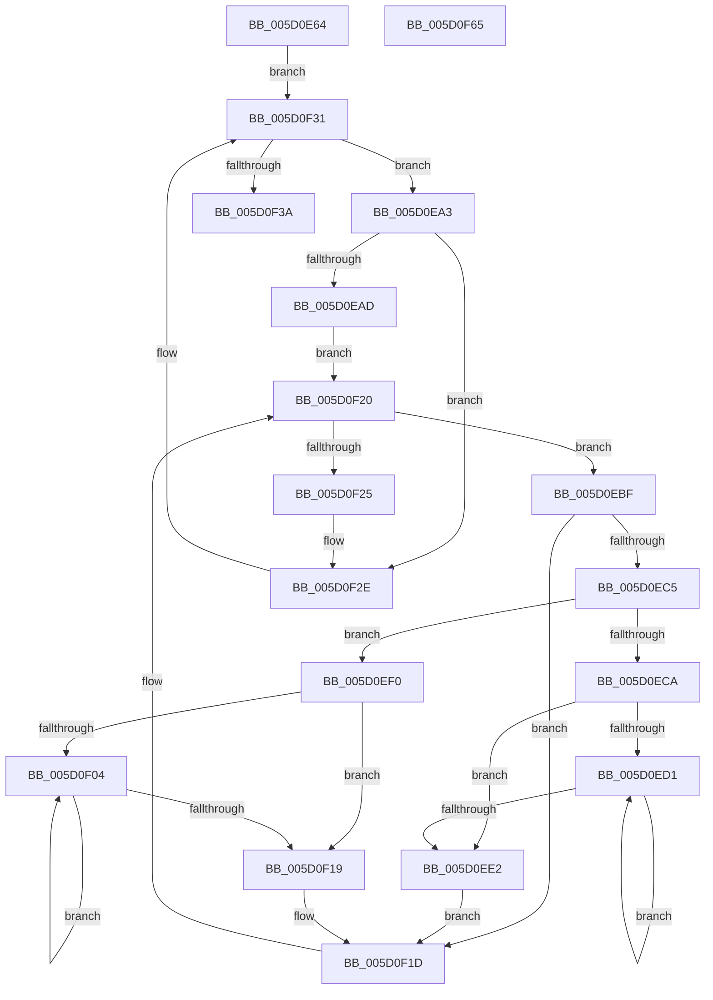

# PopPowerLimitSxTransition

- RVA: `0x005D0E64`–`0x005D0F66` (길이 `258` bytes)
- VA: `0x00000001405D0E64`
- 실행 섹션: `.text`
- PDB 이름 있음: `예`; PDB Function 태그: `아니요`
- unwind 정보 RVA: `0x0008A350`
- 디코드: `72`개 명령, `258/258` bytes 표시
- 미해석 바이트: `0` (있으면 어셈블리에 `.byte`로 보존)

> 이 문서는 커널 이미지의 기계어와 PDB 기호를 분석해 생성했습니다. 4번과 5번은 함수 원형과 자료형을 바이너리 사용 방식에서 추정한 C 해석이며 원본 소스 복구 결과는 아닙니다.

## 1. Dependencies

- 직접 호출 지점: **6**; 고유 호출 대상: **4**
- 직접 호출자로 확인된 함수: **2**
- RIP 상대 이미지 참조: **2**

### Outgoing calls
- `0x005D0E8B` → [PopAcquireRwLockExclusive](../43/PopAcquireRwLockExclusive_function_00430B44.md) (function, `0x00430B44`)
- `0x005D0EB1` → [PopAcquireRwLockExclusive](../43/PopAcquireRwLockExclusive_function_00430B44.md) (function, `0x00430B44`)
- `0x005D0ED6` → [PopUpdatePowerLimitTimeTracking](PopUpdatePowerLimitTimeTracking_function_005D0F6C.md) (function, `0x005D0F6C`)
- `0x005D0EE5` → [PopTracePowerLimitHistogram](PopTracePowerLimitHistogram_function_005D7B10.md) (function, `0x005D7B10`)
- `0x005D0F29` → [PopReleaseRwLock](../2D/PopReleaseRwLock_function_002DFBBC.md) (function, `0x002DFBBC`)
- `0x005D0F41` → [PopReleaseRwLock](../2D/PopReleaseRwLock_function_002DFBBC.md) (function, `0x002DFBBC`)

### Direct callers
- [PopThermalSxEntry](../4E/PopThermalSxEntry_function_004E3D20.md) at `0x004E3DFC`
- [PopThermalSxExit](PopThermalSxExit_function_005D55F8.md) at `0x005D574D`

### Static image references
- `0x005D0E84` → RVA `0x00F0BB50` (`.data`; read)
- `0x005D0E90` → RVA `0x00F0BB60` (`.data`; read)

## 2. Other-region calls and transfers

- 다른 실행 섹션으로 향하는 call: **0**
- 별도 외부 분기/꼬리 이동을 확인하지 못했습니다.

## 3. Assembly (complete function range)

```asm
005D0E64  48 8B C4                        mov rax, rsp
005D0E67  48 89 58 08                     mov qword ptr [rax + 8], rbx
005D0E6B  48 89 68 10                     mov qword ptr [rax + 0x10], rbp
005D0E6F  48 89 70 18                     mov qword ptr [rax + 0x18], rsi
005D0E73  48 89 78 20                     mov qword ptr [rax + 0x20], rdi
005D0E77  41 55                           push r13
005D0E79  41 56                           push r14
005D0E7B  41 57                           push r15
005D0E7D  48 83 EC 20                     sub rsp, 0x20
005D0E81  44 8A F9                        mov r15b, cl
005D0E84  48 8D 0D C5 AC 93 00            lea rcx, [rip + 0x93acc5]
005D0E8B  E8 B4 FC E5 FF                  call 0x140430b44
005D0E90  48 8B 3D C9 AC 93 00            mov rdi, qword ptr [rip + 0x93acc9]
005D0E97  4C 8D 2D C2 AC 93 00            lea r13, [rip + 0x93acc2]
005D0E9E  E9 8E 00 00 00                  jmp 0x1405d0f31
005D0EA3  80 7F 30 00                     cmp byte ptr [rdi + 0x30], 0
005D0EA7  0F 84 81 00 00 00               je 0x1405d0f2e
005D0EAD  48 8D 4F 20                     lea rcx, [rdi + 0x20]
005D0EB1  E8 8E FC E5 FF                  call 0x140430b44
005D0EB6  4C 8D 77 10                     lea r14, [rdi + 0x10]
005D0EBA  49 8B 1E                        mov rbx, qword ptr [r14]
005D0EBD  EB 61                           jmp 0x1405d0f20
005D0EBF  80 7B 10 00                     cmp byte ptr [rbx + 0x10], 0
005D0EC3  74 58                           je 0x1405d0f1d
005D0EC5  45 84 FF                        test r15b, r15b
005D0EC8  74 26                           je 0x1405d0ef0
005D0ECA  33 F6                           xor esi, esi
005D0ECC  39 73 20                        cmp dword ptr [rbx + 0x20], esi
005D0ECF  76 11                           jbe 0x1405d0ee2
005D0ED1  8B D6                           mov edx, esi
005D0ED3  48 8B CB                        mov rcx, rbx
005D0ED6  E8 91 00 00 00                  call 0x1405d0f6c
005D0EDB  FF C6                           inc esi
005D0EDD  3B 73 20                        cmp esi, dword ptr [rbx + 0x20]
005D0EE0  72 EF                           jb 0x1405d0ed1
005D0EE2  48 8B CB                        mov rcx, rbx
005D0EE5  E8 26 6C 00 00                  call 0x1405d7b10
005D0EEA  C6 43 30 00                     mov byte ptr [rbx + 0x30], 0
005D0EEE  EB 2D                           jmp 0x1405d0f1d
005D0EF0  49 B8 08 00 00 00 80 F7 FF FF   movabs r8, 0xfffff78000000008
005D0EFA  33 D2                           xor edx, edx
005D0EFC  4D 8B 00                        mov r8, qword ptr [r8]
005D0EFF  39 53 20                        cmp dword ptr [rbx + 0x20], edx
005D0F02  76 15                           jbe 0x1405d0f19
005D0F04  8B C2                           mov eax, edx
005D0F06  FF C2                           inc edx
005D0F08  48 6B C8 68                     imul rcx, rax, 0x68
005D0F0C  48 8B 43 38                     mov rax, qword ptr [rbx + 0x38]
005D0F10  4C 89 04 01                     mov qword ptr [rcx + rax], r8
005D0F14  3B 53 20                        cmp edx, dword ptr [rbx + 0x20]
005D0F17  72 EB                           jb 0x1405d0f04
005D0F19  C6 43 30 01                     mov byte ptr [rbx + 0x30], 1
005D0F1D  48 8B 1B                        mov rbx, qword ptr [rbx]
005D0F20  49 3B DE                        cmp rbx, r14
005D0F23  75 9A                           jne 0x1405d0ebf
005D0F25  48 8D 4F 20                     lea rcx, [rdi + 0x20]
005D0F29  E8 8E EC D0 FF                  call 0x1402dfbbc
005D0F2E  48 8B 3F                        mov rdi, qword ptr [rdi]
005D0F31  49 3B FD                        cmp rdi, r13
005D0F34  0F 85 69 FF FF FF               jne 0x1405d0ea3
005D0F3A  48 8D 0D 0F AC 93 00            lea rcx, [rip + 0x93ac0f]
005D0F41  E8 76 EC D0 FF                  call 0x1402dfbbc
005D0F46  48 8B 5C 24 40                  mov rbx, qword ptr [rsp + 0x40]
005D0F4B  48 8B 6C 24 48                  mov rbp, qword ptr [rsp + 0x48]
005D0F50  48 8B 74 24 50                  mov rsi, qword ptr [rsp + 0x50]
005D0F55  48 8B 7C 24 58                  mov rdi, qword ptr [rsp + 0x58]
005D0F5A  48 83 C4 20                     add rsp, 0x20
005D0F5E  41 5F                           pop r15
005D0F60  41 5E                           pop r14
005D0F62  41 5D                           pop r13
005D0F64  C3                              ret
005D0F65  CC                              int3
```

## 4. C-style interpretation (structured pseudocode)

```c
__int64 __fastcall PopPowerLimitSxTransition(unsigned __int8 a1)
{
    __int64 result;
    __int64 v_rsi;
    __int64 v_rsp;
    unsigned __int64 v_stack_p10;
    unsigned __int64 v_stack_p18;
    unsigned __int64 v_stack_p20;
    unsigned __int64 v_stack_p8;

    *(unsigned __int64 *)(v_rsp + 8) = v_rbx;
    *(unsigned __int64 *)(v_rsp + 16) = v_rbp;
    *(unsigned __int64 *)(v_rsp + 24) = v_rsi;
    *(unsigned __int64 *)(v_rsp + 32) = v_rdi;
    v_rsp = (v_rsp) - (32);
    result = PopAcquireRwLockExclusive(v_rip + 9678021, a2, a3, a4);
    goto loc_005D0F31;
loc_005D0EA3:
    if ((*(unsigned __int8 *)(*(unsigned __int64 *)(v_rip + 9678025) + 48)) == 0) goto loc_005D0F2E;
    result = PopAcquireRwLockExclusive(*(unsigned __int64 *)(v_rip + 9678025) + 32, a2, a3, a4);
    goto loc_005D0F20;
loc_005D0EBF:
    if ((*(unsigned __int8 *)(*(unsigned __int64 *)(*(unsigned __int64 *)(v_rip + 9678025) + 16) + 16)) == 0) goto loc_005D0F1D;
    if (a1 == 0) goto loc_005D0EF0;
    v_rsi = 0;
    if ((*(unsigned int *)(*(unsigned __int64 *)(*(unsigned __int64 *)(v_rip + 9678025) + 16) + 32)) <= 0) goto loc_005D0EE2;
loc_005D0ED1:
    result = PopUpdatePowerLimitTimeTracking(*(unsigned __int64 *)(*(unsigned __int64 *)(v_rip + 9678025) + 16), 0, a3, a4);
    v_rsi = (unsigned int)((v_rsi) + 1);
    if (((unsigned int)(v_rsi)) < (*(unsigned int *)(*(unsigned __int64 *)(*(unsigned __int64 *)(v_rip + 9678025) + 16) + 32))) goto loc_005D0ED1;
loc_005D0EE2:
    result = PopTracePowerLimitHistogram(*(unsigned __int64 *)(*(unsigned __int64 *)(v_rip + 9678025) + 16), 0, a3, a4);
    *(unsigned __int8 *)(*(unsigned __int64 *)(*(unsigned __int64 *)(v_rip + 9678025) + 16) + 48) = 0;
    goto loc_005D0F1D;
loc_005D0EF0:
    a2 = 0;
    if ((*(unsigned int *)(*(unsigned __int64 *)(*(unsigned __int64 *)(v_rip + 9678025) + 16) + 32)) <= 0) goto loc_005D0F19;
loc_005D0F04:
    a2 = (unsigned int)((a2) + 1);
    a1 = (*(unsigned __int64 *)(*(unsigned __int64 *)(v_rip + 9678025) + 16)) * (0);
    *(unsigned __int64 *)(a1 + *(unsigned __int64 *)(*(unsigned __int64 *)(*(unsigned __int64 *)(v_rip + 9678025) + 16) + 56) * 1) = *(unsigned __int64 *)(a3);
    if (((unsigned int)(a2)) < (*(unsigned int *)(*(unsigned __int64 *)(*(unsigned __int64 *)(v_rip + 9678025) + 16) + 32))) goto loc_005D0F04;
loc_005D0F19:
    *(unsigned __int8 *)(*(unsigned __int64 *)(*(unsigned __int64 *)(v_rip + 9678025) + 16) + 48) = 1;
loc_005D0F1D:
loc_005D0F20:
    if ((*(unsigned __int64 *)(*(unsigned __int64 *)(*(unsigned __int64 *)(v_rip + 9678025) + 16))) != (*(unsigned __int64 *)(v_rip + 9678025) + 16)) goto loc_005D0EBF;
    result = PopReleaseRwLock(*(unsigned __int64 *)(v_rip + 9678025) + 32, a2, *(unsigned __int64 *)(a3), a4);
loc_005D0F2E:
loc_005D0F31:
    if ((*(unsigned __int64 *)(*(unsigned __int64 *)(v_rip + 9678025))) != (v_rip + 9678018)) goto loc_005D0EA3;
    result = PopReleaseRwLock(v_rip + 9677839, a2, *(unsigned __int64 *)(a3), a4);
    v_rsp = (v_rsp) + (32);
    return result;
}
```

## 5. (Beta) C Style

```c
int64_t PopPowerLimitSxTransition(uint8_t Arg1)
{
    int64_t result;
    int64_t local_rsi;
    int64_t local_rsp;
    uint64_t v_stack_p10;
    uint64_t v_stack_p18;
    uint64_t v_stack_p20;
    uint64_t v_stack_p8;

    *(uint64_t *)(local_rsp + 0x8) = local_rbx;
    *(uint64_t *)(local_rsp + 0x10) = local_rbp;
    *(uint64_t *)(local_rsp + 0x18) = local_rsi;
    *(uint64_t *)(local_rsp + 0x20) = local_rdi;
    local_rsp = (local_rsp) - (32);
    result = PopAcquireRwLockExclusive(v_rip + 9678021, a2, a3, a4);
    goto loc_005D0F31;
loc_005D0EA3:
    if ((*(uint8_t *)(*(uint64_t *)(v_rip + 0x93ACC9) + 0x30)) == 0) goto loc_005D0F2E;
    result = PopAcquireRwLockExclusive(*(uint64_t *)(v_rip + 0x93ACC9) + 32, a2, a3, a4);
    goto loc_005D0F20;
loc_005D0EBF:
    if ((*(uint8_t *)(*(uint64_t *)(*(uint64_t *)(v_rip + 0x93ACC9) + 0x10) + 0x10)) == 0) goto loc_005D0F1D;
    if (Arg1 == 0) goto loc_005D0EF0;
    local_rsi = 0;
    if ((*(uint32_t *)(*(uint64_t *)(*(uint64_t *)(v_rip + 0x93ACC9) + 0x10) + 0x20)) <= 0) goto loc_005D0EE2;
loc_005D0ED1:
    result = PopUpdatePowerLimitTimeTracking(*(uint64_t *)(*(uint64_t *)(v_rip + 0x93ACC9) + 0x10), 0, a3, a4);
    local_rsi = (uint32_t)((local_rsi) + 1);
    if (((uint32_t)(local_rsi)) < (*(uint32_t *)(*(uint64_t *)(*(uint64_t *)(v_rip + 0x93ACC9) + 0x10) + 0x20))) goto loc_005D0ED1;
loc_005D0EE2:
    result = PopTracePowerLimitHistogram(*(uint64_t *)(*(uint64_t *)(v_rip + 0x93ACC9) + 0x10), 0, a3, a4);
    *(uint8_t *)(*(uint64_t *)(*(uint64_t *)(v_rip + 0x93ACC9) + 0x10) + 0x30) = 0;
    goto loc_005D0F1D;
loc_005D0EF0:
    a2 = 0;
    if ((*(uint32_t *)(*(uint64_t *)(*(uint64_t *)(v_rip + 0x93ACC9) + 0x10) + 0x20)) <= 0) goto loc_005D0F19;
loc_005D0F04:
    a2 = (uint32_t)((a2) + 1);
    Arg1 = (*(uint64_t *)(*(uint64_t *)(v_rip + 0x93ACC9) + 0x10)) * (0);
    *(uint64_t *)(Arg1 + *(uint64_t *)(*(uint64_t *)(*(uint64_t *)(v_rip + 0x93ACC9) + 0x10) + 0x38) * 1) = *(uint64_t *)(a3);
    if (((uint32_t)(a2)) < (*(uint32_t *)(*(uint64_t *)(*(uint64_t *)(v_rip + 0x93ACC9) + 0x10) + 0x20))) goto loc_005D0F04;
loc_005D0F19:
    *(uint8_t *)(*(uint64_t *)(*(uint64_t *)(v_rip + 0x93ACC9) + 0x10) + 0x30) = 1;
loc_005D0F1D:
loc_005D0F20:
    if ((*(uint64_t *)(*(uint64_t *)(*(uint64_t *)(v_rip + 0x93ACC9) + 0x10))) != (*(uint64_t *)(v_rip + 0x93ACC9) + 16)) goto loc_005D0EBF;
    result = PopReleaseRwLock(*(uint64_t *)(v_rip + 0x93ACC9) + 32, a2, *(uint64_t *)(a3), a4);
loc_005D0F2E:
loc_005D0F31:
    if ((*(uint64_t *)(*(uint64_t *)(v_rip + 0x93ACC9))) != (v_rip + 9678018)) goto loc_005D0EA3;
    result = PopReleaseRwLock(v_rip + 9677839, a2, *(uint64_t *)(a3), a4);
    local_rsp = (local_rsp) + (32);
    return result;
}
```

## 6. Execution-region graph

[열기: 2D/3D 그래프와 함수 탐색 컨트롤 패널](../../../control-panel.html?section=text&rva=0x005D0E64&view=graph)

- 2D 그래프는 위에서 아래로 흐르고, 3D 그래프는 빈 공간을 드래그해 회전합니다. Shift+드래그는 이동, 휠은 확대·축소, 함수 노드 선택은 대상 보고서 이동입니다.

### Static fallback


