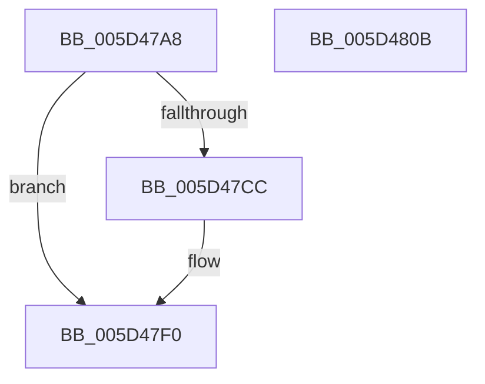

# PopPowerSettingPendingUpdateWatchdog

- RVA: `0x005D47A8`–`0x005D480C` (길이 `100` bytes)
- VA: `0x00000001405D47A8`
- 실행 섹션: `.text`
- PDB 이름 있음: `예`; PDB Function 태그: `아니요`
- unwind 정보 RVA: `0x0005CAAC`
- 디코드: `25`개 명령, `100/100` bytes 표시
- 미해석 바이트: `0` (있으면 어셈블리에 `.byte`로 보존)

> 이 문서는 커널 이미지의 기계어와 PDB 기호를 분석해 생성했습니다. 4번과 5번은 함수 원형과 자료형을 바이너리 사용 방식에서 추정한 C 해석이며 원본 소스 복구 결과는 아닙니다.

## 1. Dependencies

- 직접 호출 지점: **2**; 고유 호출 대상: **2**
- 직접 호출자로 확인된 함수: **1**
- RIP 상대 이미지 참조: **2**

### Outgoing calls
- `0x005D47BE` → [KeAcquireSpinLockRaiseToDpc](../20/KeAcquireSpinLockRaiseToDpc_function_00208470.md) (function, `0x00208470`)
- `0x005D47F9` → [KeReleaseSpinLock](../39/KeReleaseSpinLock_function_00392BA0.md) (function, `0x00392BA0`)

### Direct callers
- [PopDeepSleepWatchdogTakeAction](../../page/77/PopDeepSleepWatchdogTakeAction_function_007731F8.md) at `0x0077321B`

### Static image references
- `0x005D47B7` → RVA `0x00F0C6B0` (`.data`; read)
- `0x005D47C3` → RVA `0x00F0C698` (`.data`; read)

## 2. Other-region calls and transfers

- 다른 실행 섹션으로 향하는 call: **0**
- 별도 외부 분기/꼬리 이동을 확인하지 못했습니다.

## 3. Assembly (complete function range)

```asm
005D47A8  48 89 5C 24 08                  mov qword ptr [rsp + 8], rbx
005D47AD  57                              push rdi
005D47AE  48 83 EC 20                     sub rsp, 0x20
005D47B2  48 8B F9                        mov rdi, rcx
005D47B5  33 DB                           xor ebx, ebx
005D47B7  48 8D 0D F2 7E 93 00            lea rcx, [rip + 0x937ef2]
005D47BE  E8 AD 3C C3 FF                  call 0x140208470
005D47C3  48 39 1D CE 7E 93 00            cmp qword ptr [rip + 0x937ece], rbx
005D47CA  74 24                           je 0x1405d47f0
005D47CC  48 BA 08 00 00 00 80 F7 FF FF   movabs rdx, 0xfffff78000000008
005D47D6  0F B6 DB                        movzx ebx, bl
005D47D9  41 B9 01 00 00 00               mov r9d, 1
005D47DF  48 8B 12                        mov rdx, qword ptr [rdx]
005D47E2  48 2B 15 AF 7E 93 00            sub rdx, qword ptr [rip + 0x937eaf]
005D47E9  48 3B D7                        cmp rdx, rdi
005D47EC  41 0F 43 D9                     cmovae ebx, r9d
005D47F0  8A D0                           mov dl, al
005D47F2  48 8D 0D B7 7E 93 00            lea rcx, [rip + 0x937eb7]
005D47F9  E8 A2 E3 DB FF                  call 0x140392ba0
005D47FE  8A C3                           mov al, bl
005D4800  48 8B 5C 24 30                  mov rbx, qword ptr [rsp + 0x30]
005D4805  48 83 C4 20                     add rsp, 0x20
005D4809  5F                              pop rdi
005D480A  C3                              ret
005D480B  CC                              int3
```

## 4. C-style interpretation (structured pseudocode)

```c
__int64 __fastcall PopPowerSettingPendingUpdateWatchdog(__int64 a1)
{
    __int64 result;
    __int64 v_rbx;
    __int64 v_rsp;
    unsigned __int64 v_stack_p8;

    v_stack_p8 = v_rbx;
    v_rsp = (v_rsp) - (32);
    v_rbx = 0;
    result = KeAcquireSpinLockRaiseToDpc(v_rip + 9666290, a2, a3, a4);
    if ((*(unsigned __int64 *)(v_rip + 9666254)) != 0) {
        v_rbx = 0;
        a4 = 1;
        a2 = *(unsigned __int64 *)(a2);
        a2 = (a2) - (*(unsigned __int64 *)(v_rip + 9666223));
        if (a2 >= a1) { v_rbx = (unsigned int)(a4); }
    }
    result = KeReleaseSpinLock(v_rip + 9666231, (unsigned __int8)(result), a3, a4);
    v_rsp = (v_rsp) + (32);
    return (unsigned __int8)(v_rbx);
}
```

## 5. (Beta) C Style

```c
int64_t PopPowerSettingPendingUpdateWatchdog(int64_t Arg1)
{
    int64_t result;
    int64_t local_rbx;
    int64_t local_rsp;
    uint64_t v_stack_p8;

    v_stack_p8 = local_rbx;
    local_rsp = (local_rsp) - (32);
    local_rbx = 0;
    result = KeAcquireSpinLockRaiseToDpc(v_rip + 9666290, a2, a3, a4);
    if ((*(uint64_t *)(v_rip + 0x937ECE)) != 0) {
        local_rbx = 0;
        a4 = 1;
        a2 = *(uint64_t *)(a2);
        a2 = (a2) - (*(uint64_t *)(v_rip + 0x937EAF));
        if (a2 >= Arg1) { local_rbx = (uint32_t)(a4); }
    }
    result = KeReleaseSpinLock(v_rip + 9666231, (uint8_t)(result), a3, a4);
    local_rsp = (local_rsp) + (32);
    return (uint8_t)(local_rbx);
}
```

## 6. Execution-region graph

[열기: 2D/3D 그래프와 함수 탐색 컨트롤 패널](../../../control-panel.html?section=text&rva=0x005D47A8&view=graph)

- 2D 그래프는 위에서 아래로 흐르고, 3D 그래프는 빈 공간을 드래그해 회전합니다. Shift+드래그는 이동, 휠은 확대·축소, 함수 노드 선택은 대상 보고서 이동입니다.

### Static fallback


