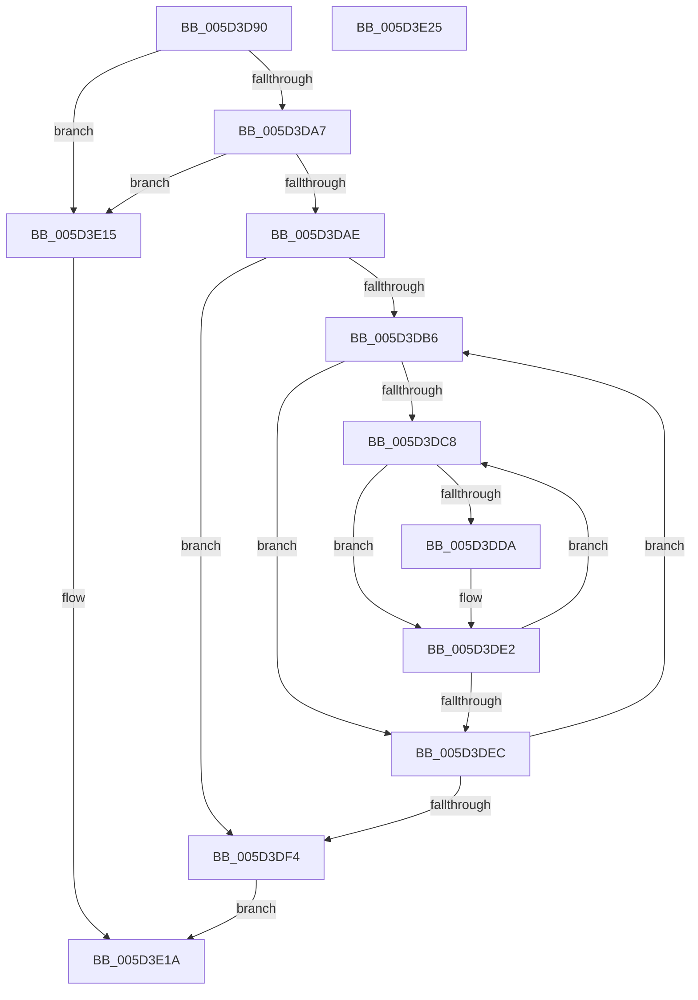

# PopProcessorNotifyLpiCoordinatedStatesNotification

- RVA: `0x005D3D90`–`0x005D3E26` (길이 `150` bytes)
- VA: `0x00000001405D3D90`
- 실행 섹션: `.text`
- PDB 이름 있음: `예`; PDB Function 태그: `아니요`
- unwind 정보 RVA: `0x0005CAAC`
- 디코드: `46`개 명령, `150/150` bytes 표시
- 미해석 바이트: `0` (있으면 어셈블리에 `.byte`로 보존)

> 이 문서는 커널 이미지의 기계어와 PDB 기호를 분석해 생성했습니다. 4번과 5번은 함수 원형과 자료형을 바이너리 사용 방식에서 추정한 C 해석이며 원본 소스 복구 결과는 아닙니다.

## 1. Dependencies

- 직접 호출 지점: **1**; 고유 호출 대상: **1**
- 직접 호출자로 확인된 함수: **0**
- RIP 상대 이미지 참조: **0**

### Outgoing calls
- `0x005D3E03` → [guard_dispatch_icall](../6B/guard_dispatch_icall_function_006BAAD0.md) (function, `0x006BAAD0`)

### Direct callers
- 이 함수 시작 RVA로 연결되는 직접 call은 확인되지 않았습니다. 간접 호출은 완전히 역산할 수 없습니다.

### Static image references
- 디코드된 RIP-relative 메모리 참조가 없습니다.

## 2. Other-region calls and transfers

- 다른 실행 섹션으로 향하는 call: **0**
- 별도 외부 분기/꼬리 이동을 확인하지 못했습니다.

## 3. Assembly (complete function range)

```asm
005D3D90  48 89 5C 24 08                  mov qword ptr [rsp + 8], rbx
005D3D95  57                              push rdi
005D3D96  48 83 EC 20                     sub rsp, 0x20
005D3D9A  4C 8B 59 40                     mov r11, qword ptr [rcx + 0x40]
005D3D9E  48 8B 79 48                     mov rdi, qword ptr [rcx + 0x48]
005D3DA2  4D 85 DB                        test r11, r11
005D3DA5  74 6E                           je 0x1405d3e15
005D3DA7  49 83 7B 68 00                  cmp qword ptr [r11 + 0x68], 0
005D3DAC  74 67                           je 0x1405d3e15
005D3DAE  45 33 C0                        xor r8d, r8d
005D3DB1  44 39 02                        cmp dword ptr [rdx], r8d
005D3DB4  76 3E                           jbe 0x1405d3df4
005D3DB6  4F 8D 0C 40                     lea r9, [r8 + r8*2]
005D3DBA  45 33 D2                        xor r10d, r10d
005D3DBD  49 C1 E1 05                     shl r9, 5
005D3DC1  45 39 54 11 58                  cmp dword ptr [r9 + rdx + 0x58], r10d
005D3DC6  76 24                           jbe 0x1405d3dec
005D3DC8  49 8B 5C 11 60                  mov rbx, qword ptr [r9 + rdx + 0x60]
005D3DCD  4B 8D 0C 52                     lea rcx, [r10 + r10*2]
005D3DD1  48 8B 04 CB                     mov rax, qword ptr [rbx + rcx*8]
005D3DD5  48 85 C0                        test rax, rax
005D3DD8  74 08                           je 0x1405d3de2
005D3DDA  48 8B 40 48                     mov rax, qword ptr [rax + 0x48]
005D3DDE  48 89 04 CB                     mov qword ptr [rbx + rcx*8], rax
005D3DE2  41 FF C2                        inc r10d
005D3DE5  45 3B 54 11 58                  cmp r10d, dword ptr [r9 + rdx + 0x58]
005D3DEA  72 DC                           jb 0x1405d3dc8
005D3DEC  41 FF C0                        inc r8d
005D3DEF  44 3B 02                        cmp r8d, dword ptr [rdx]
005D3DF2  72 C2                           jb 0x1405d3db6
005D3DF4  49 8B 43 68                     mov rax, qword ptr [r11 + 0x68]
005D3DF8  4C 8B C2                        mov r8, rdx
005D3DFB  BA 24 00 00 00                  mov edx, 0x24
005D3E00  48 8B CF                        mov rcx, rdi
005D3E03  E8 C8 6C 0E 00                  call 0x1406baad0
005D3E08  F6 D8                           neg al
005D3E0A  1B C0                           sbb eax, eax
005D3E0C  F7 D0                           not eax
005D3E0E  25 BB 00 00 C0                  and eax, 0xc00000bb
005D3E13  EB 05                           jmp 0x1405d3e1a
005D3E15  B8 02 00 00 C0                  mov eax, 0xc0000002
005D3E1A  48 8B 5C 24 30                  mov rbx, qword ptr [rsp + 0x30]
005D3E1F  48 83 C4 20                     add rsp, 0x20
005D3E23  5F                              pop rdi
005D3E24  C3                              ret
005D3E25  CC                              int3
```

## 4. C-style interpretation (structured pseudocode)

```c
__int64 __fastcall PopProcessorNotifyLpiCoordinatedStatesNotification(__int64 a1, __int64 a2, int a3)
{
    __int64 result;
    __int64 v_r10;
    __int64 v_rsp;
    unsigned __int64 v_stack_p8;

    v_stack_p8 = v_rbx;
    v_rsp = (v_rsp) - (32);
    if (*(unsigned __int64 *)(a1 + 64) == 0) goto loc_005D3E15;
    if ((*(unsigned __int64 *)(*(unsigned __int64 *)(a1 + 64) + 104)) == 0) goto loc_005D3E15;
    a3 = 0;
    if ((*(unsigned int *)(a2)) <= 0) goto loc_005D3DF4;
loc_005D3DB6:
    v_r10 = 0;
    a4 = (a3 + a3 * 2) << (5);
    if ((*(unsigned int *)(a4 + a2 * 1 + 88)) <= 0) goto loc_005D3DEC;
loc_005D3DC8:
    result = *(unsigned __int64 *)(*(unsigned __int64 *)(a4 + a2 * 1 + 96) + v_r10 + v_r10 * 2 * 8);
    if (*(unsigned __int64 *)(*(unsigned __int64 *)(a4 + a2 * 1 + 96) + v_r10 + v_r10 * 2 * 8) != 0) {
        result = *(unsigned __int64 *)(*(unsigned __int64 *)(*(unsigned __int64 *)(a4 + a2 * 1 + 96) + v_r10 + v_r10 * 2 * 8) + 72);
        *(unsigned __int64 *)(*(unsigned __int64 *)(a4 + a2 * 1 + 96) + v_r10 + v_r10 * 2 * 8) = result;
    }
    v_r10 = (unsigned int)((v_r10) + 1);
    if (((unsigned int)(v_r10)) < (*(unsigned int *)(a4 + a2 * 1 + 88))) goto loc_005D3DC8;
loc_005D3DEC:
    a3 = (unsigned int)((a3) + 1);
    if (a3 < (*(unsigned int *)(a2))) goto loc_005D3DB6;
loc_005D3DF4:
    result = guard_dispatch_icall(*(unsigned __int64 *)(a1 + 72), 36, a2, a4);
    result = (unsigned __int8)(-(result));
    result = (unsigned int)(~(result));
    result = (unsigned int)((result) & (0xC00000BBULL));
    goto loc_005D3E1A;
loc_005D3E15:
loc_005D3E1A:
    v_rsp = (v_rsp) + (32);
    return (unsigned int)(0xC0000002ULL);
}
```

## 5. (Beta) C Style

```c
int64_t PopProcessorNotifyLpiCoordinatedStatesNotification(void *Arg1, void *Arg2, int32_t Arg3)
{
    uint8_t *arg1 = (uint8_t *)Arg1;
    uint8_t *arg2 = (uint8_t *)Arg2;

    int64_t result;
    int64_t local_r10;
    int64_t local_rsp;
    uint64_t v_stack_p8;

    v_stack_p8 = local_rbx;
    local_rsp = (local_rsp) - (32);
    if (*(uint64_t *)(arg1 + 0x40) == 0) goto loc_005D3E15;
    if ((*(uint64_t *)(*(uint64_t *)(arg1 + 0x40) + 0x68)) == 0) goto loc_005D3E15;
    Arg3 = 0;
    if ((*(uint32_t *)(arg2)) <= 0) goto loc_005D3DF4;
loc_005D3DB6:
    local_r10 = 0;
    a4 = (Arg3 + Arg3 * 2) << (5);
    if ((*(uint32_t *)(a4 + arg2 * 1 + 0x58)) <= 0) goto loc_005D3DEC;
loc_005D3DC8:
    result = *(uint64_t *)(*(uint64_t *)(a4 + arg2 * 1 + 0x60) + local_r10 + local_r10 * 2 * 8);
    if (*(uint64_t *)(*(uint64_t *)(a4 + arg2 * 1 + 0x60) + local_r10 + local_r10 * 2 * 8) != 0) {
        result = *(uint64_t *)(*(uint64_t *)(*(uint64_t *)(a4 + arg2 * 1 + 0x60) + local_r10 + local_r10 * 2 * 8) + 0x48);
        *(uint64_t *)(*(uint64_t *)(a4 + arg2 * 1 + 0x60) + local_r10 + local_r10 * 2 * 8) = result;
    }
    local_r10 = (uint32_t)((local_r10) + 1);
    if (((uint32_t)(local_r10)) < (*(uint32_t *)(a4 + arg2 * 1 + 0x58))) goto loc_005D3DC8;
loc_005D3DEC:
    Arg3 = (uint32_t)((Arg3) + 1);
    if (Arg3 < (*(uint32_t *)(arg2))) goto loc_005D3DB6;
loc_005D3DF4:
    result = guard_dispatch_icall(*(uint64_t *)(arg1 + 0x48), 36, Arg2, a4);
    result = (uint8_t)(-(result));
    result = (uint32_t)(~(result));
    result = (uint32_t)((result) & (0xC00000BBULL));
    goto loc_005D3E1A;
loc_005D3E15:
loc_005D3E1A:
    local_rsp = (local_rsp) + (32);
    return (uint32_t)(0xC0000002ULL);
}
```

### 관측된 메모리 오프셋

구조체 형식이 확인되지 않은 접근은 인자 기준의 오프셋으로만 기록했습니다.

| 기준 인자 | 오프셋 표현 | 폭 (bit) | 접근 |
|---|---:|---:|---|
| `Arg1` | `+ 0x40` | `64` | `R` |
| `Arg1` | `+ 0x48` | `64` | `R` |
| `Arg2` | `+ 0x0` | `32` | `R` |

## 6. Execution-region graph

[열기: 2D/3D 그래프와 함수 탐색 컨트롤 패널](../../../control-panel.html?section=text&rva=0x005D3D90&view=graph)

- 2D 그래프는 위에서 아래로 흐르고, 3D 그래프는 빈 공간을 드래그해 회전합니다. Shift+드래그는 이동, 휠은 확대·축소, 함수 노드 선택은 대상 보고서 이동입니다.

### Static fallback


