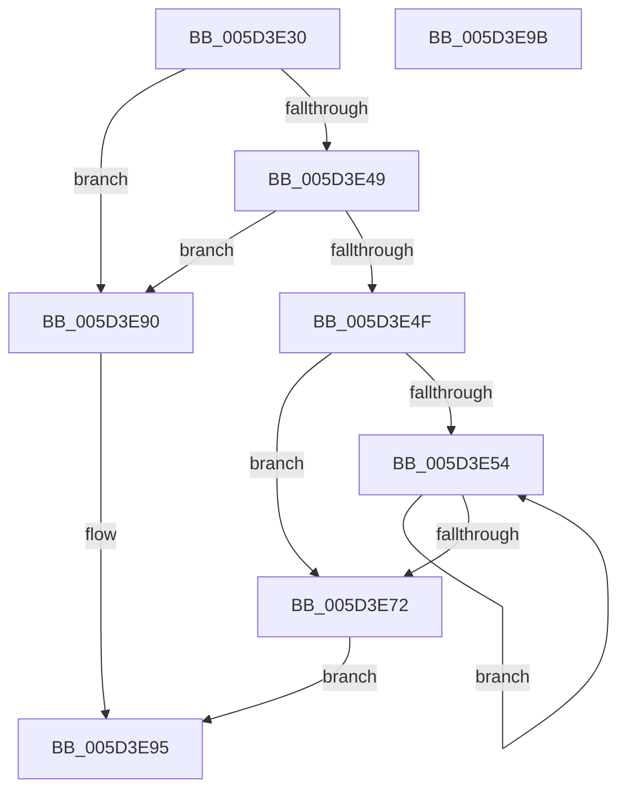

# PopProcessorParkMaskNotification

- RVA: `0x005D3E30`–`0x005D3E9C` (길이 `108` bytes)
- VA: `0x00000001405D3E30`
- 실행 섹션: `.text`
- PDB 이름 있음: `예`; PDB Function 태그: `아니요`
- unwind 정보 RVA: `0x0005CF00`
- 디코드: `35`개 명령, `108/108` bytes 표시
- 미해석 바이트: `0` (있으면 어셈블리에 `.byte`로 보존)

> 이 문서는 커널 이미지의 기계어와 PDB 기호를 분석해 생성했습니다. 4번과 5번은 함수 원형과 자료형을 바이너리 사용 방식에서 추정한 C 해석이며 원본 소스 복구 결과는 아닙니다.

## 1. Dependencies

- 직접 호출 지점: **1**; 고유 호출 대상: **1**
- 직접 호출자로 확인된 함수: **0**
- RIP 상대 이미지 참조: **0**

### Outgoing calls
- `0x005D3E7E` → [guard_dispatch_icall](../6B/guard_dispatch_icall_function_006BAAD0.md) (function, `0x006BAAD0`)

### Direct callers
- 이 함수 시작 RVA로 연결되는 직접 call은 확인되지 않았습니다. 간접 호출은 완전히 역산할 수 없습니다.

### Static image references
- 디코드된 RIP-relative 메모리 참조가 없습니다.

## 2. Other-region calls and transfers

- 다른 실행 섹션으로 향하는 call: **0**
- 별도 외부 분기/꼬리 이동을 확인하지 못했습니다.

## 3. Assembly (complete function range)

```asm
005D3E30  40 53                           push rbx
005D3E32  48 83 EC 20                     sub rsp, 0x20
005D3E36  48 8B 59 40                     mov rbx, qword ptr [rcx + 0x40]
005D3E3A  45 33 D2                        xor r10d, r10d
005D3E3D  48 8B 49 48                     mov rcx, qword ptr [rcx + 0x48]
005D3E41  4C 8B DA                        mov r11, rdx
005D3E44  48 85 DB                        test rbx, rbx
005D3E47  74 47                           je 0x1405d3e90
005D3E49  4C 39 53 68                     cmp qword ptr [rbx + 0x68], r10
005D3E4D  74 41                           je 0x1405d3e90
005D3E4F  44 39 12                        cmp dword ptr [rdx], r10d
005D3E52  76 1E                           jbe 0x1405d3e72
005D3E54  4D 8B 43 10                     mov r8, qword ptr [r11 + 0x10]
005D3E58  45 8B CA                        mov r9d, r10d
005D3E5B  41 FF C2                        inc r10d
005D3E5E  4D 03 C9                        add r9, r9
005D3E61  4B 8B 04 C8                     mov rax, qword ptr [r8 + r9*8]
005D3E65  48 8B 50 48                     mov rdx, qword ptr [rax + 0x48]
005D3E69  4B 89 14 C8                     mov qword ptr [r8 + r9*8], rdx
005D3E6D  45 3B 13                        cmp r10d, dword ptr [r11]
005D3E70  72 E2                           jb 0x1405d3e54
005D3E72  48 8B 43 68                     mov rax, qword ptr [rbx + 0x68]
005D3E76  4D 8B C3                        mov r8, r11
005D3E79  BA 20 00 00 00                  mov edx, 0x20
005D3E7E  E8 4D 6C 0E 00                  call 0x1406baad0
005D3E83  F6 D8                           neg al
005D3E85  1B C0                           sbb eax, eax
005D3E87  F7 D0                           not eax
005D3E89  25 BB 00 00 C0                  and eax, 0xc00000bb
005D3E8E  EB 05                           jmp 0x1405d3e95
005D3E90  B8 02 00 00 C0                  mov eax, 0xc0000002
005D3E95  48 83 C4 20                     add rsp, 0x20
005D3E99  5B                              pop rbx
005D3E9A  C3                              ret
005D3E9B  CC                              int3
```

## 4. C-style interpretation (structured pseudocode)

```c
__int64 __fastcall PopProcessorParkMaskNotification(__int64 a1, __int64 a2)
{
    __int64 result;
    __int64 v_r10;
    __int64 v_rsp;

    v_rsp = (v_rsp) - (32);
    v_r10 = 0;
    if (*(unsigned __int64 *)(a1 + 64) == 0) goto loc_005D3E90;
    if ((*(unsigned __int64 *)(*(unsigned __int64 *)(a1 + 64) + 104)) == 0) goto loc_005D3E90;
    if ((*(unsigned int *)(a2)) <= 0) goto loc_005D3E72;
loc_005D3E54:
    v_r10 = (unsigned int)((v_r10) + 1);
    a4 = (0) + (0);
    *(unsigned __int64 *)(*(unsigned __int64 *)(a2 + 16) + a4 * 8) = *(unsigned __int64 *)(*(unsigned __int64 *)(*(unsigned __int64 *)(a2 + 16) + a4 * 8) + 72);
    if (((unsigned int)(v_r10)) < (*(unsigned int *)(a2))) goto loc_005D3E54;
loc_005D3E72:
    result = guard_dispatch_icall(*(unsigned __int64 *)(a1 + 72), 32, a2, a4);
    result = (unsigned __int8)(-(result));
    result = (unsigned int)(~(result));
    result = (unsigned int)((result) & (0xC00000BBULL));
    goto loc_005D3E95;
loc_005D3E90:
loc_005D3E95:
    v_rsp = (v_rsp) + (32);
    return (unsigned int)(0xC0000002ULL);
}
```

## 5. (Beta) C Style

```c
int64_t PopProcessorParkMaskNotification(void *Arg1, void *Arg2)
{
    uint8_t *arg1 = (uint8_t *)Arg1;
    uint8_t *arg2 = (uint8_t *)Arg2;

    int64_t result;
    int64_t local_r10;
    int64_t local_rsp;

    local_rsp = (local_rsp) - (32);
    local_r10 = 0;
    if (*(uint64_t *)(arg1 + 0x40) == 0) goto loc_005D3E90;
    if ((*(uint64_t *)(*(uint64_t *)(arg1 + 0x40) + 0x68)) == 0) goto loc_005D3E90;
    if ((*(uint32_t *)(arg2)) <= 0) goto loc_005D3E72;
loc_005D3E54:
    local_r10 = (uint32_t)((local_r10) + 1);
    a4 = (0) + (0);
    *(uint64_t *)(*(uint64_t *)(arg2 + 0x10) + a4 * 8) = *(uint64_t *)(*(uint64_t *)(*(uint64_t *)(arg2 + 0x10) + a4 * 8) + 0x48);
    if (((uint32_t)(local_r10)) < (*(uint32_t *)(arg2))) goto loc_005D3E54;
loc_005D3E72:
    result = guard_dispatch_icall(*(uint64_t *)(arg1 + 0x48), 32, Arg2, a4);
    result = (uint8_t)(-(result));
    result = (uint32_t)(~(result));
    result = (uint32_t)((result) & (0xC00000BBULL));
    goto loc_005D3E95;
loc_005D3E90:
loc_005D3E95:
    local_rsp = (local_rsp) + (32);
    return (uint32_t)(0xC0000002ULL);
}
```

### 관측된 메모리 오프셋

구조체 형식이 확인되지 않은 접근은 인자 기준의 오프셋으로만 기록했습니다.

| 기준 인자 | 오프셋 표현 | 폭 (bit) | 접근 |
|---|---:|---:|---|
| `Arg1` | `+ 0x40` | `64` | `R` |
| `Arg1` | `+ 0x48` | `64` | `R` |
| `Arg2` | `+ 0x0` | `32` | `R` |
| `Arg2` | `+ 0x10` | `64` | `R` |

## 6. Execution-region graph

[열기: 2D/3D 그래프와 함수 탐색 컨트롤 패널](../../../control-panel.html?section=text&rva=0x005D3E30&view=graph)

- 2D 그래프는 위에서 아래로 흐르고, 3D 그래프는 빈 공간을 드래그해 회전합니다. Shift+드래그는 이동, 휠은 확대·축소, 함수 노드 선택은 대상 보고서 이동입니다.

### Static fallback


