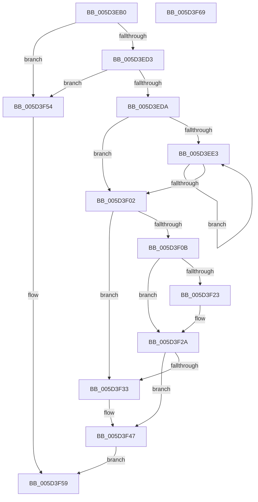

# PopProcessorParkNotification

- RVA: `0x005D3EB0`–`0x005D3F6A` (길이 `186` bytes)
- VA: `0x00000001405D3EB0`
- 실행 섹션: `.text`
- PDB 이름 있음: `예`; PDB Function 태그: `아니요`
- unwind 정보 RVA: `0x00060BC4`
- 디코드: `52`개 명령, `186/186` bytes 표시
- 미해석 바이트: `0` (있으면 어셈블리에 `.byte`로 보존)

> 이 문서는 커널 이미지의 기계어와 PDB 기호를 분석해 생성했습니다. 4번과 5번은 함수 원형과 자료형을 바이너리 사용 방식에서 추정한 C 해석이며 원본 소스 복구 결과는 아닙니다.

## 1. Dependencies

- 직접 호출 지점: **2**; 고유 호출 대상: **1**
- 직접 호출자로 확인된 함수: **0**
- RIP 상대 이미지 참조: **2**

### Outgoing calls
- `0x005D3F1A` → [guard_dispatch_icall](../6B/guard_dispatch_icall_function_006BAAD0.md) (function, `0x006BAAD0`)
- `0x005D3F42` → [guard_dispatch_icall](../6B/guard_dispatch_icall_function_006BAAD0.md) (function, `0x006BAAD0`)

### Direct callers
- 이 함수 시작 RVA로 연결되는 직접 call은 확인되지 않았습니다. 간접 호출은 완전히 역산할 수 없습니다.

### Static image references
- `0x005D3F02` → RVA `0x00E676C0` (`.data`; read)
- `0x005D3F23` → RVA `0x00E676C0` (`.data`; write)

## 2. Other-region calls and transfers

- 다른 실행 섹션으로 향하는 call: **0**
- 별도 외부 분기/꼬리 이동을 확인하지 못했습니다.

## 3. Assembly (complete function range)

```asm
005D3EB0  48 89 5C 24 08                  mov qword ptr [rsp + 8], rbx
005D3EB5  48 89 74 24 10                  mov qword ptr [rsp + 0x10], rsi
005D3EBA  57                              push rdi
005D3EBB  48 83 EC 20                     sub rsp, 0x20
005D3EBF  48 8B 59 40                     mov rbx, qword ptr [rcx + 0x40]
005D3EC3  48 8B FA                        mov rdi, rdx
005D3EC6  48 8B 71 48                     mov rsi, qword ptr [rcx + 0x48]
005D3ECA  48 85 DB                        test rbx, rbx
005D3ECD  0F 84 81 00 00 00               je 0x1405d3f54
005D3ED3  48 83 7B 68 00                  cmp qword ptr [rbx + 0x68], 0
005D3ED8  74 7A                           je 0x1405d3f54
005D3EDA  45 33 C9                        xor r9d, r9d
005D3EDD  44 39 4A 04                     cmp dword ptr [rdx + 4], r9d
005D3EE1  76 1F                           jbe 0x1405d3f02
005D3EE3  48 8B 57 08                     mov rdx, qword ptr [rdi + 8]
005D3EE7  45 8B C1                        mov r8d, r9d
005D3EEA  41 FF C1                        inc r9d
005D3EED  4D 03 C0                        add r8, r8
005D3EF0  4A 8B 04 C2                     mov rax, qword ptr [rdx + r8*8]
005D3EF4  48 8B 48 48                     mov rcx, qword ptr [rax + 0x48]
005D3EF8  4A 89 0C C2                     mov qword ptr [rdx + r8*8], rcx
005D3EFC  44 3B 4F 04                     cmp r9d, dword ptr [rdi + 4]
005D3F00  72 E1                           jb 0x1405d3ee3
005D3F02  80 3D B7 37 89 00 00            cmp byte ptr [rip + 0x8937b7], 0
005D3F09  75 28                           jne 0x1405d3f33
005D3F0B  48 8B 43 68                     mov rax, qword ptr [rbx + 0x68]
005D3F0F  4C 8B C7                        mov r8, rdi
005D3F12  BA 1F 00 00 00                  mov edx, 0x1f
005D3F17  48 8B CE                        mov rcx, rsi
005D3F1A  E8 B1 6B 0E 00                  call 0x1406baad0
005D3F1F  84 C0                           test al, al
005D3F21  75 07                           jne 0x1405d3f2a
005D3F23  C6 05 96 37 89 00 01            mov byte ptr [rip + 0x893796], 1
005D3F2A  80 3D 8F 37 89 00 00            cmp byte ptr [rip + 0x89378f], 0
005D3F31  74 14                           je 0x1405d3f47
005D3F33  48 8B 43 68                     mov rax, qword ptr [rbx + 0x68]
005D3F37  4C 8B C7                        mov r8, rdi
005D3F3A  BA 0E 00 00 00                  mov edx, 0xe
005D3F3F  48 8B CE                        mov rcx, rsi
005D3F42  E8 89 6B 0E 00                  call 0x1406baad0
005D3F47  F6 D8                           neg al
005D3F49  1B C0                           sbb eax, eax
005D3F4B  F7 D0                           not eax
005D3F4D  25 BB 00 00 C0                  and eax, 0xc00000bb
005D3F52  EB 05                           jmp 0x1405d3f59
005D3F54  B8 02 00 00 C0                  mov eax, 0xc0000002
005D3F59  48 8B 5C 24 30                  mov rbx, qword ptr [rsp + 0x30]
005D3F5E  48 8B 74 24 38                  mov rsi, qword ptr [rsp + 0x38]
005D3F63  48 83 C4 20                     add rsp, 0x20
005D3F67  5F                              pop rdi
005D3F68  C3                              ret
005D3F69  CC                              int3
```

## 4. C-style interpretation (structured pseudocode)

```c
__int64 __fastcall PopProcessorParkNotification(__int64 a1, __int64 a2, __int64 a3, int a4)
{
    __int64 result;
    __int64 v_rsp;
    unsigned __int64 v_stack_p10;
    unsigned __int64 v_stack_p8;

    v_stack_p8 = v_rbx;
    v_stack_p10 = v_rsi;
    v_rsp = (v_rsp) - (32);
    if (*(unsigned __int64 *)(a1 + 64) == 0) goto loc_005D3F54;
    if ((*(unsigned __int64 *)(*(unsigned __int64 *)(a1 + 64) + 104)) == 0) goto loc_005D3F54;
    a4 = 0;
    if ((*(unsigned int *)(a2 + 4)) <= 0) goto loc_005D3F02;
loc_005D3EE3:
    a4 = (unsigned int)((a4) + 1);
    a3 = (0) + (0);
    *(unsigned __int64 *)(*(unsigned __int64 *)(a2 + 8) + a3 * 8) = *(unsigned __int64 *)(*(unsigned __int64 *)(*(unsigned __int64 *)(a2 + 8) + a3 * 8) + 72);
    if (a4 < (*(unsigned int *)(a2 + 4))) goto loc_005D3EE3;
loc_005D3F02:
    if ((*(unsigned __int8 *)(v_rip + 8992695)) != 0) goto loc_005D3F33;
    result = guard_dispatch_icall(*(unsigned __int64 *)(a1 + 72), 31, a2, a4);
    if ((unsigned __int8)(result) == 0) {
        *(unsigned __int8 *)(v_rip + 8992662) = 1;
    }
    if ((*(unsigned __int8 *)(v_rip + 8992655)) != 0) {
        result = *(unsigned __int64 *)(*(unsigned __int64 *)(a1 + 64) + 104);
        a3 = a2;
        a2 = 14;
        a1 = *(unsigned __int64 *)(a1 + 72);
        result = guard_dispatch_icall(a1, a2, a3, a4);
    }
    result = (unsigned __int8)(-(result));
    result = (unsigned int)(~(result));
    result = (unsigned int)((result) & (0xC00000BBULL));
    goto loc_005D3F59;
loc_005D3F54:
loc_005D3F59:
    v_rsp = (v_rsp) + (32);
    return (unsigned int)(0xC0000002ULL);
}
```

## 5. (Beta) C Style

```c
int64_t PopProcessorParkNotification(void *Arg1, void *Arg2, int64_t Arg3, int32_t Arg4)
{
    uint8_t *arg1 = (uint8_t *)Arg1;
    uint8_t *arg2 = (uint8_t *)Arg2;

    int64_t result;
    int64_t local_rsp;
    uint64_t v_stack_p10;
    uint64_t v_stack_p8;

    v_stack_p8 = local_rbx;
    v_stack_p10 = local_rsi;
    local_rsp = (local_rsp) - (32);
    if (*(uint64_t *)(arg1 + 0x40) == 0) goto loc_005D3F54;
    if ((*(uint64_t *)(*(uint64_t *)(arg1 + 0x40) + 0x68)) == 0) goto loc_005D3F54;
    Arg4 = 0;
    if ((*(uint32_t *)(arg2 + 0x4)) <= 0) goto loc_005D3F02;
loc_005D3EE3:
    Arg4 = (uint32_t)((Arg4) + 1);
    Arg3 = (0) + (0);
    *(uint64_t *)(*(uint64_t *)(arg2 + 0x8) + Arg3 * 8) = *(uint64_t *)(*(uint64_t *)(*(uint64_t *)(arg2 + 0x8) + Arg3 * 8) + 0x48);
    if (Arg4 < (*(uint32_t *)(arg2 + 0x4))) goto loc_005D3EE3;
loc_005D3F02:
    if ((*(uint8_t *)(v_rip + 0x8937B7)) != 0) goto loc_005D3F33;
    result = guard_dispatch_icall(*(uint64_t *)(arg1 + 0x48), 31, Arg2, Arg4);
    if ((uint8_t)(result) == 0) {
        *(uint8_t *)(v_rip + 0x893796) = 1;
    }
    if ((*(uint8_t *)(v_rip + 0x89378F)) != 0) {
        result = *(uint64_t *)(*(uint64_t *)(arg1 + 0x40) + 0x68);
        Arg3 = Arg2;
        Arg2 = 14;
        Arg1 = *(uint64_t *)(arg1 + 0x48);
        result = guard_dispatch_icall(Arg1, Arg2, Arg3, Arg4);
    }
    result = (uint8_t)(-(result));
    result = (uint32_t)(~(result));
    result = (uint32_t)((result) & (0xC00000BBULL));
    goto loc_005D3F59;
loc_005D3F54:
loc_005D3F59:
    local_rsp = (local_rsp) + (32);
    return (uint32_t)(0xC0000002ULL);
}
```

### 관측된 메모리 오프셋

구조체 형식이 확인되지 않은 접근은 인자 기준의 오프셋으로만 기록했습니다.

| 기준 인자 | 오프셋 표현 | 폭 (bit) | 접근 |
|---|---:|---:|---|
| `Arg1` | `+ 0x40` | `64` | `R` |
| `Arg1` | `+ 0x48` | `64` | `R` |
| `Arg2` | `+ 0x4` | `32` | `R` |
| `Arg2` | `+ 0x8` | `64` | `R` |

## 6. Execution-region graph

[열기: 2D/3D 그래프와 함수 탐색 컨트롤 패널](../../../control-panel.html?section=text&rva=0x005D3EB0&view=graph)

- 2D 그래프는 위에서 아래로 흐르고, 3D 그래프는 빈 공간을 드래그해 회전합니다. Shift+드래그는 이동, 휠은 확대·축소, 함수 노드 선택은 대상 보고서 이동입니다.

### Static fallback


