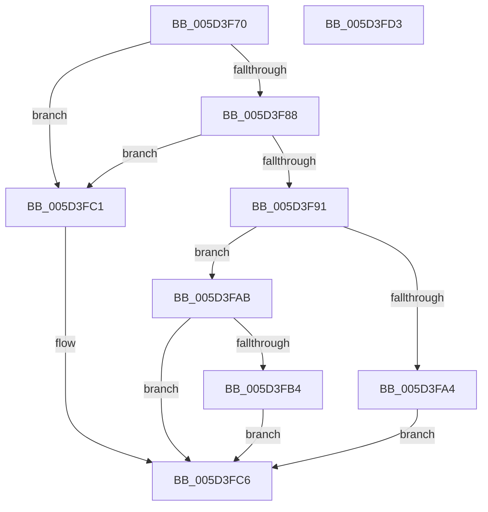

# PopProcessorQueryCoordinatedDependencyNotification

- RVA: `0x005D3F70`–`0x005D3FD4` (길이 `100` bytes)
- VA: `0x00000001405D3F70`
- 실행 섹션: `.text`
- PDB 이름 있음: `예`; PDB Function 태그: `아니요`
- unwind 정보 RVA: `0x0005CAAC`
- 디코드: `32`개 명령, `100/100` bytes 표시
- 미해석 바이트: `0` (있으면 어셈블리에 `.byte`로 보존)

> 이 문서는 커널 이미지의 기계어와 PDB 기호를 분석해 생성했습니다. 4번과 5번은 함수 원형과 자료형을 바이너리 사용 방식에서 추정한 C 해석이며 원본 소스 복구 결과는 아닙니다.

## 1. Dependencies

- 직접 호출 지점: **1**; 고유 호출 대상: **1**
- 직접 호출자로 확인된 함수: **0**
- RIP 상대 이미지 참조: **0**

### Outgoing calls
- `0x005D3F9B` → [guard_dispatch_icall](../6B/guard_dispatch_icall_function_006BAAD0.md) (function, `0x006BAAD0`)

### Direct callers
- 이 함수 시작 RVA로 연결되는 직접 call은 확인되지 않았습니다. 간접 호출은 완전히 역산할 수 없습니다.

### Static image references
- 디코드된 RIP-relative 메모리 참조가 없습니다.

## 2. Other-region calls and transfers

- 다른 실행 섹션으로 향하는 call: **0**
- 별도 외부 분기/꼬리 이동을 확인하지 못했습니다.

## 3. Assembly (complete function range)

```asm
005D3F70  48 89 5C 24 08                  mov qword ptr [rsp + 8], rbx
005D3F75  57                              push rdi
005D3F76  48 83 EC 20                     sub rsp, 0x20
005D3F7A  48 8B 41 40                     mov rax, qword ptr [rcx + 0x40]
005D3F7E  33 DB                           xor ebx, ebx
005D3F80  48 8B FA                        mov rdi, rdx
005D3F83  48 85 C0                        test rax, rax
005D3F86  74 39                           je 0x1405d3fc1
005D3F88  48 8B 40 68                     mov rax, qword ptr [rax + 0x68]
005D3F8C  48 85 C0                        test rax, rax
005D3F8F  74 30                           je 0x1405d3fc1
005D3F91  48 8B 49 48                     mov rcx, qword ptr [rcx + 0x48]
005D3F95  4C 8B C2                        mov r8, rdx
005D3F98  8D 53 1E                        lea edx, [rbx + 0x1e]
005D3F9B  E8 30 6B 0E 00                  call 0x1406baad0
005D3FA0  84 C0                           test al, al
005D3FA2  75 07                           jne 0x1405d3fab
005D3FA4  BB BB 00 00 C0                  mov ebx, 0xc00000bb
005D3FA9  EB 1B                           jmp 0x1405d3fc6
005D3FAB  48 8B 47 10                     mov rax, qword ptr [rdi + 0x10]
005D3FAF  48 85 C0                        test rax, rax
005D3FB2  74 12                           je 0x1405d3fc6
005D3FB4  48 8B 80 C0 00 00 00            mov rax, qword ptr [rax + 0xc0]
005D3FBB  48 89 47 10                     mov qword ptr [rdi + 0x10], rax
005D3FBF  EB 05                           jmp 0x1405d3fc6
005D3FC1  BB 02 00 00 C0                  mov ebx, 0xc0000002
005D3FC6  8B C3                           mov eax, ebx
005D3FC8  48 8B 5C 24 30                  mov rbx, qword ptr [rsp + 0x30]
005D3FCD  48 83 C4 20                     add rsp, 0x20
005D3FD1  5F                              pop rdi
005D3FD2  C3                              ret
005D3FD3  CC                              int3
```

## 4. C-style interpretation (structured pseudocode)

```c
__int64 __fastcall PopProcessorQueryCoordinatedDependencyNotification(__int64 a1, __int64 a2)
{
    __int64 result;
    __int64 v_rbx;
    __int64 v_rsp;
    unsigned __int64 v_stack_p8;

    v_stack_p8 = v_rbx;
    v_rsp = (v_rsp) - (32);
    v_rbx = 0;
    if (*(unsigned __int64 *)(a1 + 64) == 0) goto loc_005D3FC1;
    if (*(unsigned __int64 *)(*(unsigned __int64 *)(a1 + 64) + 104) == 0) goto loc_005D3FC1;
    result = guard_dispatch_icall(*(unsigned __int64 *)(a1 + 72), v_rbx + 30, a2, a4);
    if ((unsigned __int8)(result) != 0) goto loc_005D3FAB;
    goto loc_005D3FC6;
loc_005D3FAB:
    if (*(unsigned __int64 *)(a2 + 16) == 0) goto loc_005D3FC6;
    *(unsigned __int64 *)(a2 + 16) = *(unsigned __int64 *)(*(unsigned __int64 *)(a2 + 16) + 192);
    goto loc_005D3FC6;
loc_005D3FC1:
loc_005D3FC6:
    v_rsp = (v_rsp) + (32);
    return (unsigned int)((unsigned int)((unsigned int)(0xC0000002ULL)));
}
```

## 5. (Beta) C Style

```c
int64_t PopProcessorQueryCoordinatedDependencyNotification(void *Arg1, void *Arg2)
{
    uint8_t *arg1 = (uint8_t *)Arg1;
    uint8_t *arg2 = (uint8_t *)Arg2;

    int64_t result;
    int64_t local_rbx;
    int64_t local_rsp;
    uint64_t v_stack_p8;

    v_stack_p8 = local_rbx;
    local_rsp = (local_rsp) - (32);
    local_rbx = 0;
    if (*(uint64_t *)(arg1 + 0x40) == 0) goto loc_005D3FC1;
    if (*(uint64_t *)(*(uint64_t *)(arg1 + 0x40) + 0x68) == 0) goto loc_005D3FC1;
    result = guard_dispatch_icall(*(uint64_t *)(arg1 + 0x48), local_rbx + 30, Arg2, a4);
    if ((uint8_t)(result) != 0) goto loc_005D3FAB;
    goto loc_005D3FC6;
loc_005D3FAB:
    if (*(uint64_t *)(arg2 + 0x10) == 0) goto loc_005D3FC6;
    *(uint64_t *)(arg2 + 0x10) = *(uint64_t *)(*(uint64_t *)(arg2 + 0x10) + 0xC0);
    goto loc_005D3FC6;
loc_005D3FC1:
loc_005D3FC6:
    local_rsp = (local_rsp) + (32);
    return (uint32_t)((uint32_t)((uint32_t)(0xC0000002ULL)));
}
```

### 관측된 메모리 오프셋

구조체 형식이 확인되지 않은 접근은 인자 기준의 오프셋으로만 기록했습니다.

| 기준 인자 | 오프셋 표현 | 폭 (bit) | 접근 |
|---|---:|---:|---|
| `Arg1` | `+ 0x40` | `64` | `R` |
| `Arg1` | `+ 0x48` | `64` | `R` |
| `Arg2` | `+ 0x10` | `64` | `R` |
| `Arg2` | `+ 0x10` | `64` | `W` |

## 6. Execution-region graph

[열기: 2D/3D 그래프와 함수 탐색 컨트롤 패널](../../../control-panel.html?section=text&rva=0x005D3F70&view=graph)

- 2D 그래프는 위에서 아래로 흐르고, 3D 그래프는 빈 공간을 드래그해 회전합니다. Shift+드래그는 이동, 휠은 확대·축소, 함수 노드 선택은 대상 보고서 이동입니다.

### Static fallback


