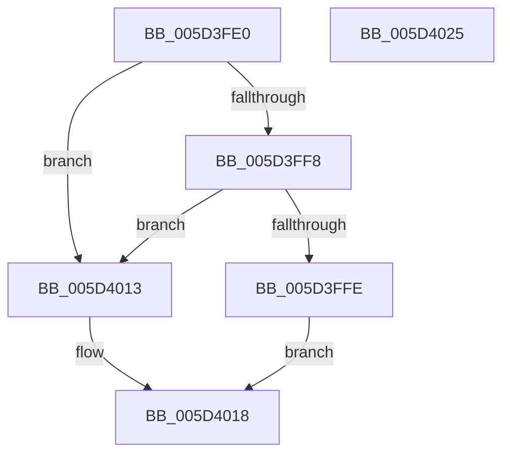

# PopProcessorSetPep

- RVA: `0x005D3FE0`–`0x005D4026` (길이 `70` bytes)
- VA: `0x00000001405D3FE0`
- 실행 섹션: `.text`
- PDB 이름 있음: `예`; PDB Function 태그: `아니요`
- unwind 정보 RVA: `0x0005CAAC`
- 디코드: `21`개 명령, `70/70` bytes 표시
- 미해석 바이트: `0` (있으면 어셈블리에 `.byte`로 보존)

> 이 문서는 커널 이미지의 기계어와 PDB 기호를 분석해 생성했습니다. 4번과 5번은 함수 원형과 자료형을 바이너리 사용 방식에서 추정한 C 해석이며 원본 소스 복구 결과는 아닙니다.

## 1. Dependencies

- 직접 호출 지점: **1**; 고유 호출 대상: **1**
- 직접 호출자로 확인된 함수: **0**
- RIP 상대 이미지 참조: **1**

### Outgoing calls
- `0x005D4005` → [KeGetPrcb](../2D/KeGetPrcb_function_002D85D0.md) (function, `0x002D85D0`)

### Direct callers
- 이 함수 시작 RVA로 연결되는 직접 call은 확인되지 않았습니다. 간접 호출은 완전히 역산할 수 없습니다.

### Static image references
- `0x005D3FFE` → RVA `0x00E676B8` (`.data`; write)

## 2. Other-region calls and transfers

- 다른 실행 섹션으로 향하는 call: **0**
- 별도 외부 분기/꼬리 이동을 확인하지 못했습니다.

## 3. Assembly (complete function range)

```asm
005D3FE0  48 89 5C 24 08                  mov qword ptr [rsp + 8], rbx
005D3FE5  57                              push rdi
005D3FE6  48 83 EC 20                     sub rsp, 0x20
005D3FEA  48 8B 42 40                     mov rax, qword ptr [rdx + 0x40]
005D3FEE  33 DB                           xor ebx, ebx
005D3FF0  48 8B FA                        mov rdi, rdx
005D3FF3  48 85 C0                        test rax, rax
005D3FF6  74 1B                           je 0x1405d4013
005D3FF8  48 39 58 68                     cmp qword ptr [rax + 0x68], rbx
005D3FFC  74 15                           je 0x1405d4013
005D3FFE  48 89 05 B3 36 89 00            mov qword ptr [rip + 0x8936b3], rax
005D4005  E8 C6 45 D0 FF                  call 0x1402d85d0
005D400A  48 89 B8 28 8A 00 00            mov qword ptr [rax + 0x8a28], rdi
005D4011  EB 05                           jmp 0x1405d4018
005D4013  BB 02 00 00 C0                  mov ebx, 0xc0000002
005D4018  8B C3                           mov eax, ebx
005D401A  48 8B 5C 24 30                  mov rbx, qword ptr [rsp + 0x30]
005D401F  48 83 C4 20                     add rsp, 0x20
005D4023  5F                              pop rdi
005D4024  C3                              ret
005D4025  CC                              int3
```

## 4. C-style interpretation (structured pseudocode)

```c
__int64 __fastcall PopProcessorSetPep(__int64 a1, __int64 a2)
{
    __int64 result;
    __int64 v_rbx;
    __int64 v_rsp;
    unsigned __int64 v_stack_p8;

    v_stack_p8 = v_rbx;
    v_rsp = (v_rsp) - (32);
    v_rbx = 0;
    if (*(unsigned __int64 *)(a2 + 64) == 0) goto loc_005D4013;
    if ((*(unsigned __int64 *)(*(unsigned __int64 *)(a2 + 64) + 104)) == 0) goto loc_005D4013;
    *(unsigned __int64 *)(v_rip + 8992435) = *(unsigned __int64 *)(a2 + 64);
    result = KeGetPrcb(a1, a2, a3, a4);
    *(unsigned __int64 *)(result + 35368) = a2;
    goto loc_005D4018;
loc_005D4013:
loc_005D4018:
    v_rsp = (v_rsp) + (32);
    return (unsigned int)((unsigned int)((unsigned int)(0xC0000002ULL)));
}
```

## 5. (Beta) C Style

```c
int64_t PopProcessorSetPep(int64_t Arg1, void *Arg2)
{
    uint8_t *arg2 = (uint8_t *)Arg2;

    int64_t result;
    int64_t local_rbx;
    int64_t local_rsp;
    uint64_t v_stack_p8;

    v_stack_p8 = local_rbx;
    local_rsp = (local_rsp) - (32);
    local_rbx = 0;
    if (*(uint64_t *)(arg2 + 0x40) == 0) goto loc_005D4013;
    if ((*(uint64_t *)(*(uint64_t *)(arg2 + 0x40) + 0x68)) == 0) goto loc_005D4013;
    *(uint64_t *)(v_rip + 0x8936B3) = *(uint64_t *)(arg2 + 0x40);
    result = KeGetPrcb(Arg1, Arg2, a3, a4);
    *(void **)(result + 0x8A28) = Arg2;
    goto loc_005D4018;
loc_005D4013:
loc_005D4018:
    local_rsp = (local_rsp) + (32);
    return (uint32_t)((uint32_t)((uint32_t)(0xC0000002ULL)));
}
```

### 관측된 메모리 오프셋

구조체 형식이 확인되지 않은 접근은 인자 기준의 오프셋으로만 기록했습니다.

| 기준 인자 | 오프셋 표현 | 폭 (bit) | 접근 |
|---|---:|---:|---|
| `Arg2` | `+ 0x40` | `64` | `R` |

## 6. Execution-region graph

[열기: 2D/3D 그래프와 함수 탐색 컨트롤 패널](../../../control-panel.html?section=text&rva=0x005D3FE0&view=graph)

- 2D 그래프는 위에서 아래로 흐르고, 3D 그래프는 빈 공간을 드래그해 회전합니다. Shift+드래그는 이동, 휠은 확대·축소, 함수 노드 선택은 대상 보고서 이동입니다.

### Static fallback


