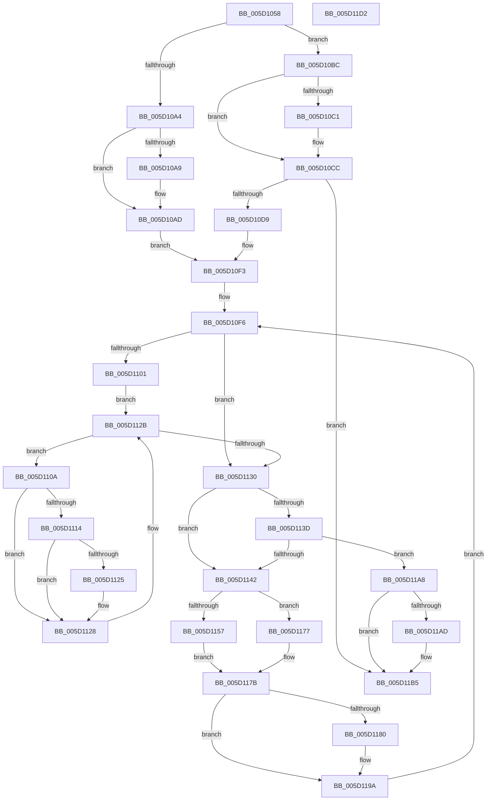

# PopPropogateCoolingChangeV2

- RVA: `0x005D1058`–`0x005D11D3` (길이 `379` bytes)
- VA: `0x00000001405D1058`
- 실행 섹션: `.text`
- PDB 이름 있음: `예`; PDB Function 태그: `아니요`
- unwind 정보 RVA: `0x00075C18`
- 디코드: `108`개 명령, `379/379` bytes 표시
- 미해석 바이트: `0` (있으면 어셈블리에 `.byte`로 보존)

> 이 문서는 커널 이미지의 기계어와 PDB 기호를 분석해 생성했습니다. 4번과 5번은 함수 원형과 자료형을 바이너리 사용 방식에서 추정한 C 해석이며 원본 소스 복구 결과는 아닙니다.

## 1. Dependencies

- 직접 호출 지점: **13**; 고유 호출 대상: **8**
- 직접 호출자로 확인된 함수: **1**
- RIP 상대 이미지 참조: **0**

### Outgoing calls
- `0x005D1097` → [KeAbPreAcquire](../21/KeAbPreAcquire_function_00210230.md) (function, `0x00210230`)
- `0x005D10C7` → [KeAbPostReleaseEx](../26/KeAbPostReleaseEx_function_00262210.md) (function, `0x00262210`)
- `0x005D10CC` → [KeLeaveCriticalRegion](../25/KeLeaveCriticalRegion_function_0025D8B0.md) (function, `0x0025D8B0`)
- `0x005D10DD` → [PopReleaseRwLock](../2D/PopReleaseRwLock_function_002DFBBC.md) (function, `0x002DFBBC`)
- `0x005D10E5` → [PopAcquireRwLockExclusive](../43/PopAcquireRwLockExclusive_function_00430B44.md) (function, `0x00430B44`)
- `0x005D10EE` → [PopAcquireRwLockExclusive](../43/PopAcquireRwLockExclusive_function_00430B44.md) (function, `0x00430B44`)
- `0x005D114D` → [PopReleaseRwLock](../2D/PopReleaseRwLock_function_002DFBBC.md) (function, `0x002DFBBC`)
- `0x005D115A` → [PopDiagTraceCoolingExtensionPassiveUpdate](../../page/AA/PopDiagTraceCoolingExtensionPassiveUpdate_function_00AAE490.md) (function, `0x00AAE490`)
- `0x005D1170` → [guard_dispatch_icall](../6B/guard_dispatch_icall_function_006BAAD0.md) (function, `0x006BAAD0`)
- `0x005D1183` → [PopDiagTraceCoolingExtensionActiveUpdate](../../page/76/PopDiagTraceCoolingExtensionActiveUpdate_function_00760FFC.md) (function, `0x00760FFC`)
- `0x005D1195` → [guard_dispatch_icall](../6B/guard_dispatch_icall_function_006BAAD0.md) (function, `0x006BAAD0`)
- `0x005D119E` → [PopAcquireRwLockExclusive](../43/PopAcquireRwLockExclusive_function_00430B44.md) (function, `0x00430B44`)
- `0x005D11B0` → [PopReleaseRwLock](../2D/PopReleaseRwLock_function_002DFBBC.md) (function, `0x002DFBBC`)

### Direct callers
- [PopPropogateCoolingChange](../4E/PopPropogateCoolingChange_function_004E8FA0.md) at `0x004E90DD`

### Static image references
- 디코드된 RIP-relative 메모리 참조가 없습니다.

## 2. Other-region calls and transfers

- 다른 실행 섹션으로 향하는 call: **2**
  - `0x005D115A` → [PopDiagTraceCoolingExtensionPassiveUpdate](../../page/AA/PopDiagTraceCoolingExtensionPassiveUpdate_function_00AAE490.md) (`.text` → `PAGE`)
  - `0x005D1183` → [PopDiagTraceCoolingExtensionActiveUpdate](../../page/76/PopDiagTraceCoolingExtensionActiveUpdate_function_00760FFC.md) (`.text` → `PAGE`)
- 별도 외부 분기/꼬리 이동을 확인하지 못했습니다.

## 3. Assembly (complete function range)

```asm
005D1058  48 89 5C 24 08                  mov qword ptr [rsp + 8], rbx
005D105D  48 89 6C 24 10                  mov qword ptr [rsp + 0x10], rbp
005D1062  48 89 74 24 18                  mov qword ptr [rsp + 0x18], rsi
005D1067  57                              push rdi
005D1068  41 54                           push r12
005D106A  41 55                           push r13
005D106C  41 56                           push r14
005D106E  41 57                           push r15
005D1070  48 83 EC 20                     sub rsp, 0x20
005D1074  65 48 8B 04 25 88 01 00 00      mov rax, qword ptr gs:[0x188]
005D107D  48 8D 71 30                     lea rsi, [rcx + 0x30]
005D1081  8A DA                           mov bl, dl
005D1083  48 8B F9                        mov rdi, rcx
005D1086  33 D2                           xor edx, edx
005D1088  48 8B CE                        mov rcx, rsi
005D108B  66 FF 88 E4 01 00 00            dec word ptr [rax + 0x1e4]
005D1092  90                              nop
005D1093  44 8D 42 01                     lea r8d, [rdx + 1]
005D1097  E8 94 F1 C3 FF                  call 0x140210230
005D109C  F0 48 0F BA 2E 00               lock bts qword ptr [rsi], 0
005D10A2  72 18                           jb 0x1405d10bc
005D10A4  48 85 C0                        test rax, rax
005D10A7  74 04                           je 0x1405d10ad
005D10A9  C6 40 0A 01                     mov byte ptr [rax + 0xa], 1
005D10AD  65 48 8B 04 25 88 01 00 00      mov rax, qword ptr gs:[0x188]
005D10B6  48 89 46 08                     mov qword ptr [rsi + 8], rax
005D10BA  EB 37                           jmp 0x1405d10f3
005D10BC  48 85 C0                        test rax, rax
005D10BF  74 0B                           je 0x1405d10cc
005D10C1  48 8B D0                        mov rdx, rax
005D10C4  48 8B CE                        mov rcx, rsi
005D10C7  E8 44 11 C9 FF                  call 0x140262210
005D10CC  E8 DF C7 C8 FF                  call 0x14025d8b0
005D10D1  84 DB                           test bl, bl
005D10D3  0F 84 DC 00 00 00               je 0x1405d11b5
005D10D9  48 8D 4F 20                     lea rcx, [rdi + 0x20]
005D10DD  E8 DA EA D0 FF                  call 0x1402dfbbc
005D10E2  48 8B CE                        mov rcx, rsi
005D10E5  E8 5A FA E5 FF                  call 0x140430b44
005D10EA  48 8D 4F 20                     lea rcx, [rdi + 0x20]
005D10EE  E8 51 FA E5 FF                  call 0x140430b44
005D10F3  41 B4 01                        mov r12b, 1
005D10F6  40 32 ED                        xor bpl, bpl
005D10F9  B3 64                           mov bl, 0x64
005D10FB  40 38 6F 50                     cmp byte ptr [rdi + 0x50], bpl
005D10FF  74 2F                           je 0x1405d1130
005D1101  48 8D 57 10                     lea rdx, [rdi + 0x10]
005D1105  48 8B 0A                        mov rcx, qword ptr [rdx]
005D1108  EB 21                           jmp 0x1405d112b
005D110A  80 79 12 00                     cmp byte ptr [rcx + 0x12], 0
005D110E  44 0F B6 C3                     movzx r8d, bl
005D1112  74 14                           je 0x1405d1128
005D1114  0F B6 59 10                     movzx ebx, byte ptr [rcx + 0x10]
005D1118  41 3A D8                        cmp bl, r8b
005D111B  41 0F 43 D8                     cmovae ebx, r8d
005D111F  80 79 11 00                     cmp byte ptr [rcx + 0x11], 0
005D1123  74 03                           je 0x1405d1128
005D1125  40 B5 01                        mov bpl, 1
005D1128  48 8B 09                        mov rcx, qword ptr [rcx]
005D112B  48 3B CA                        cmp rcx, rdx
005D112E  75 DA                           jne 0x1405d110a
005D1130  44 8A 6F 51                     mov r13b, byte ptr [rdi + 0x51]
005D1134  44 8A 77 52                     mov r14b, byte ptr [rdi + 0x52]
005D1138  41 3A ED                        cmp bpl, r13b
005D113B  75 05                           jne 0x1405d1142
005D113D  41 3A DE                        cmp bl, r14b
005D1140  74 66                           je 0x1405d11a8
005D1142  48 8D 4F 20                     lea rcx, [rdi + 0x20]
005D1146  40 88 6F 51                     mov byte ptr [rdi + 0x51], bpl
005D114A  88 5F 52                        mov byte ptr [rdi + 0x52], bl
005D114D  E8 6A EA D0 FF                  call 0x1402dfbbc
005D1152  41 3A DE                        cmp bl, r14b
005D1155  74 20                           je 0x1405d1177
005D1157  48 8B CF                        mov rcx, rdi
005D115A  E8 31 D3 4D 00                  call 0x140aae490
005D115F  48 8B 87 98 00 00 00            mov rax, qword ptr [rdi + 0x98]
005D1166  4C 8D 77 70                     lea r14, [rdi + 0x70]
005D116A  49 8B 0E                        mov rcx, qword ptr [r14]
005D116D  0F B6 D3                        movzx edx, bl
005D1170  E8 5B 99 0E 00                  call 0x1406baad0
005D1175  EB 04                           jmp 0x1405d117b
005D1177  4C 8D 77 70                     lea r14, [rdi + 0x70]
005D117B  41 3A ED                        cmp bpl, r13b
005D117E  74 1A                           je 0x1405d119a
005D1180  48 8B CF                        mov rcx, rdi
005D1183  E8 74 FE 18 00                  call 0x140760ffc
005D1188  48 8B 87 90 00 00 00            mov rax, qword ptr [rdi + 0x90]
005D118F  40 8A D5                        mov dl, bpl
005D1192  49 8B 0E                        mov rcx, qword ptr [r14]
005D1195  E8 36 99 0E 00                  call 0x1406baad0
005D119A  48 8D 4F 20                     lea rcx, [rdi + 0x20]
005D119E  E8 A1 F9 E5 FF                  call 0x140430b44
005D11A3  E9 4E FF FF FF                  jmp 0x1405d10f6
005D11A8  45 84 E4                        test r12b, r12b
005D11AB  74 08                           je 0x1405d11b5
005D11AD  48 8B CE                        mov rcx, rsi
005D11B0  E8 07 EA D0 FF                  call 0x1402dfbbc
005D11B5  48 8B 5C 24 50                  mov rbx, qword ptr [rsp + 0x50]
005D11BA  48 8B 6C 24 58                  mov rbp, qword ptr [rsp + 0x58]
005D11BF  48 8B 74 24 60                  mov rsi, qword ptr [rsp + 0x60]
005D11C4  48 83 C4 20                     add rsp, 0x20
005D11C8  41 5F                           pop r15
005D11CA  41 5E                           pop r14
005D11CC  41 5D                           pop r13
005D11CE  41 5C                           pop r12
005D11D0  5F                              pop rdi
005D11D1  C3                              ret
005D11D2  CC                              int3
```

## 4. C-style interpretation (structured pseudocode)

```c
__int64 __fastcall PopPropogateCoolingChangeV2(__int64 a1, int a2)
{
    __int64 result;
    __int64 v_rbp;
    __int64 v_rbx;
    __int64 v_rsp;
    unsigned __int64 v_stack_p10;
    unsigned __int64 v_stack_p18;
    unsigned __int64 v_stack_p8;

    v_stack_p8 = v_rbx;
    v_stack_p10 = v_rbp;
    v_stack_p18 = v_rsi;
    v_rsp = (v_rsp) - (32);
    a2 = 0;
    result = KeAbPreAcquire(a1 + 48, a2, a2 + 1, a4);
    if (condition_is_below) goto loc_005D10BC;
    if (result != 0) {
        *(unsigned __int8 *)(result + 10) = 1;
    }
    *(unsigned __int64 *)(a1 + 48 + 8) = *(unsigned __int64 *)(gs_base + (0 + 392));
    goto loc_005D10F3;
loc_005D10BC:
    result = *(unsigned __int64 *)(gs_base + (0 + 392));
    if (*(unsigned __int64 *)(gs_base + (0 + 392)) != 0) {
        a2 = *(unsigned __int64 *)(gs_base + (0 + 392));
        a1 = a1 + 48;
        result = KeAbPostReleaseEx(a1, a2, a2 + 1, a4);
    }
    result = KeLeaveCriticalRegion(a1, a2, a2 + 1, a4);
    if ((unsigned __int8)((unsigned __int8)(a2)) == 0) goto loc_005D11B5;
    result = PopReleaseRwLock(a1 + 32, a2, a2 + 1, a4);
    result = PopAcquireRwLockExclusive(a1 + 48, a2, a2 + 1, a4);
    result = PopAcquireRwLockExclusive(a1 + 32, a2, a2 + 1, a4);
loc_005D10F3:
loc_005D10F6:
    v_rbp = 0;
    if ((*(unsigned __int8 *)(a1 + 80)) == 0) goto loc_005D1130;
    goto loc_005D112B;
loc_005D110A:
    if ((*(unsigned __int8 *)(*(unsigned __int64 *)(a1 + 16) + 18)) == 0) goto loc_005D1128;
    v_rbx = *(unsigned __int8 *)(*(unsigned __int64 *)(a1 + 16) + 16);
    if (((unsigned __int8)(*(unsigned __int8 *)(*(unsigned __int64 *)(a1 + 16) + 16))) >= 100) { v_rbx = 100; }
    if ((*(unsigned __int8 *)(*(unsigned __int64 *)(a1 + 16) + 17)) != 0) {
        v_rbp = 1;
    }
loc_005D112B:
    if ((*(unsigned __int64 *)(*(unsigned __int64 *)(a1 + 16))) != (a1 + 16)) goto loc_005D110A;
loc_005D1130:
    if (((unsigned __int8)(v_rbp)) != ((unsigned __int8)(*(unsigned __int8 *)(a1 + 81)))) goto loc_005D1142;
    if (((unsigned __int8)(v_rbx)) == ((unsigned __int8)(*(unsigned __int8 *)(a1 + 82)))) goto loc_005D11A8;
loc_005D1142:
    *(unsigned __int8 *)(a1 + 81) = (unsigned __int8)(v_rbp);
    *(unsigned __int8 *)(a1 + 82) = (unsigned __int8)(v_rbx);
    result = PopReleaseRwLock(a1 + 32, a1 + 16, 100, a4);
    if (((unsigned __int8)(v_rbx)) == ((unsigned __int8)(*(unsigned __int8 *)(a1 + 82)))) goto loc_005D1177;
    result = PopDiagTraceCoolingExtensionPassiveUpdate(a1, a1 + 16, 100, a4);
    result = guard_dispatch_icall(*(unsigned __int64 *)(a1 + 112), (unsigned __int8)(v_rbx), 100, a4);
    goto loc_005D117B;
loc_005D1177:
loc_005D117B:
    if (((unsigned __int8)(v_rbp)) != ((unsigned __int8)(*(unsigned __int8 *)(a1 + 81)))) {
        a1 = a1;
        result = PopDiagTraceCoolingExtensionActiveUpdate(a1, (unsigned __int8)(v_rbx), 100, a4);
        result = *(unsigned __int64 *)(a1 + 144);
        a2 = (unsigned __int8)(v_rbp);
        a1 = *(unsigned __int64 *)(a1 + 112);
        result = guard_dispatch_icall(a1, a2, 100, a4);
    }
    result = PopAcquireRwLockExclusive(a1 + 32, a2, 100, a4);
    goto loc_005D10F6;
loc_005D11A8:
    if (1 != 0) {
        a1 = a1 + 48;
        result = PopReleaseRwLock(a1, a2, 100, a4);
    }
    v_rsp = (v_rsp) + (32);
    return result;
}
```

## 5. (Beta) C Style

```c
int64_t PopPropogateCoolingChangeV2(void *Arg1, int32_t Arg2)
{
    uint8_t *arg1 = (uint8_t *)Arg1;

    int64_t result;
    int64_t local_rbp;
    int64_t local_rbx;
    int64_t local_rsp;
    uint64_t v_stack_p10;
    uint64_t v_stack_p18;
    uint64_t v_stack_p8;

    v_stack_p8 = local_rbx;
    v_stack_p10 = local_rbp;
    v_stack_p18 = local_rsi;
    local_rsp = (local_rsp) - (32);
    Arg2 = 0;
    result = KeAbPreAcquire(Arg1 + 48, Arg2, Arg2 + 1, a4);
    if (condition_is_below) goto loc_005D10BC;
    if (result != 0) {
        *(uint8_t *)(result + 0xA) = 1;
    }
    *(uint64_t *)(arg1 + 0x30 + 0x8) = *(uint64_t *)(gs_base + (0 + 0x188));
    goto loc_005D10F3;
loc_005D10BC:
    result = *(uint64_t *)(gs_base + (0 + 0x188));
    if (*(uint64_t *)(gs_base + (0 + 0x188)) != 0) {
        Arg2 = *(uint64_t *)(gs_base + (0 + 0x188));
        Arg1 = Arg1 + 48;
        result = KeAbPostReleaseEx(Arg1, Arg2, Arg2 + 1, a4);
    }
    result = KeLeaveCriticalRegion(Arg1, Arg2, Arg2 + 1, a4);
    if ((uint8_t)((uint8_t)(Arg2)) == 0) goto loc_005D11B5;
    result = PopReleaseRwLock(Arg1 + 32, Arg2, Arg2 + 1, a4);
    result = PopAcquireRwLockExclusive(Arg1 + 48, Arg2, Arg2 + 1, a4);
    result = PopAcquireRwLockExclusive(Arg1 + 32, Arg2, Arg2 + 1, a4);
loc_005D10F3:
loc_005D10F6:
    local_rbp = 0;
    if ((*(uint8_t *)(arg1 + 0x50)) == 0) goto loc_005D1130;
    goto loc_005D112B;
loc_005D110A:
    if ((*(uint8_t *)(*(uint64_t *)(arg1 + 0x10) + 0x12)) == 0) goto loc_005D1128;
    local_rbx = *(uint8_t *)(*(uint64_t *)(arg1 + 0x10) + 0x10);
    if (((uint8_t)(*(uint8_t *)(*(uint64_t *)(arg1 + 0x10) + 0x10))) >= 100) { local_rbx = 100; }
    if ((*(uint8_t *)(*(uint64_t *)(arg1 + 0x10) + 0x11)) != 0) {
        local_rbp = 1;
    }
loc_005D112B:
    if ((*(uint64_t *)(*(uint64_t *)(arg1 + 0x10))) != (Arg1 + 16)) goto loc_005D110A;
loc_005D1130:
    if (((uint8_t)(local_rbp)) != ((uint8_t)(*(uint8_t *)(arg1 + 0x51)))) goto loc_005D1142;
    if (((uint8_t)(local_rbx)) == ((uint8_t)(*(uint8_t *)(arg1 + 0x52)))) goto loc_005D11A8;
loc_005D1142:
    *(uint8_t *)(arg1 + 0x51) = (uint8_t)(local_rbp);
    *(uint8_t *)(arg1 + 0x52) = (uint8_t)(local_rbx);
    result = PopReleaseRwLock(Arg1 + 32, Arg1 + 16, 100, a4);
    if (((uint8_t)(local_rbx)) == ((uint8_t)(*(uint8_t *)(arg1 + 0x52)))) goto loc_005D1177;
    result = PopDiagTraceCoolingExtensionPassiveUpdate(Arg1, Arg1 + 16, 100, a4);
    result = guard_dispatch_icall(*(uint64_t *)(arg1 + 0x70), (uint8_t)(local_rbx), 100, a4);
    goto loc_005D117B;
loc_005D1177:
loc_005D117B:
    if (((uint8_t)(local_rbp)) != ((uint8_t)(*(uint8_t *)(arg1 + 0x51)))) {
        Arg1 = Arg1;
        result = PopDiagTraceCoolingExtensionActiveUpdate(Arg1, (uint8_t)(local_rbx), 100, a4);
        result = *(uint64_t *)(arg1 + 0x90);
        Arg2 = (uint8_t)(local_rbp);
        Arg1 = *(uint64_t *)(arg1 + 0x70);
        result = guard_dispatch_icall(Arg1, Arg2, 100, a4);
    }
    result = PopAcquireRwLockExclusive(Arg1 + 32, Arg2, 100, a4);
    goto loc_005D10F6;
loc_005D11A8:
    if (1 != 0) {
        Arg1 = Arg1 + 48;
        result = PopReleaseRwLock(Arg1, Arg2, 100, a4);
    }
    local_rsp = (local_rsp) + (32);
    return result;
}
```

### 관측된 메모리 오프셋

구조체 형식이 확인되지 않은 접근은 인자 기준의 오프셋으로만 기록했습니다.

| 기준 인자 | 오프셋 표현 | 폭 (bit) | 접근 |
|---|---:|---:|---|
| `Arg1` | `+ 0x0` | `64` | `R` |
| `Arg1` | `+ 0x0` | `64` | `R/W` |
| `Arg1` | `+ 0x8` | `64` | `W` |
| `Arg1` | `+ 0x10` | `64` | `R` |
| `Arg1` | `+ 0x20` | `64` | `R` |
| `Arg1` | `+ 0x30` | `64` | `R` |
| `Arg1` | `+ 0x50` | `8` | `R` |
| `Arg1` | `+ 0x51` | `8` | `R` |
| `Arg1` | `+ 0x51` | `8` | `W` |
| `Arg1` | `+ 0x52` | `8` | `R` |
| `Arg1` | `+ 0x52` | `8` | `W` |
| `Arg1` | `+ 0x70` | `64` | `R` |
| `Arg1` | `+ 0x90` | `64` | `R` |
| `Arg1` | `+ 0x98` | `64` | `R` |

## 6. Execution-region graph

[열기: 2D/3D 그래프와 함수 탐색 컨트롤 패널](../../../control-panel.html?section=text&rva=0x005D1058&view=graph)

- 2D 그래프는 위에서 아래로 흐르고, 3D 그래프는 빈 공간을 드래그해 회전합니다. Shift+드래그는 이동, 휠은 확대·축소, 함수 노드 선택은 대상 보고서 이동입니다.

### Static fallback


