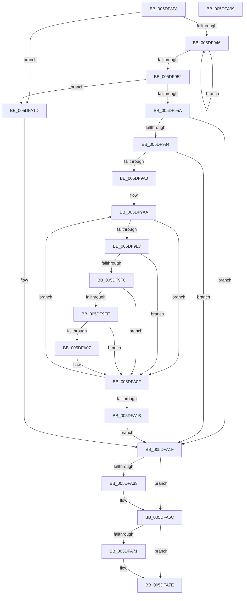

# PopRecordPepWorkorderBlackboxInformation

- RVA: `0x005DF8F8`–`0x005DFA9A` (길이 `418` bytes)
- VA: `0x00000001405DF8F8`
- 실행 섹션: `.text`
- PDB 이름 있음: `예`; PDB Function 태그: `아니요`
- unwind 정보 RVA: `0x000CD97C`
- 디코드: `106`개 명령, `418/418` bytes 표시
- 미해석 바이트: `0` (있으면 어셈블리에 `.byte`로 보존)

> 이 문서는 커널 이미지의 기계어와 PDB 기호를 분석해 생성했습니다. 4번과 5번은 함수 원형과 자료형을 바이너리 사용 방식에서 추정한 C 해석이며 원본 소스 복구 결과는 아닙니다.

## 1. Dependencies

- 직접 호출 지점: **5**; 고유 호출 대상: **5**
- 직접 호출자로 확인된 함수: **1**
- RIP 상대 이미지 참조: **2**

### Outgoing calls
- `0x005DF927` → [KeAcquireSpinLockRaiseToDpc](../20/KeAcquireSpinLockRaiseToDpc_function_00208470.md) (function, `0x00208470`)
- `0x005DF973` → [ExAllocatePool2](../../poolcode/B8/ExAllocatePool2_function_00B820F0.md) (function, `0x00B820F0`)
- `0x005DFA29` → [KeReleaseSpinLock](../39/KeReleaseSpinLock_function_00392BA0.md) (function, `0x00392BA0`)
- `0x005DFA67` → [NtPowerInformation](../../page/95/NtPowerInformation_function_00955D80.md) (function, `0x00955D80`)
- `0x005DFA79` → [ExFreePoolWithTag](../../poolcode/B8/ExFreePoolWithTag_function_00B82870.md) (function, `0x00B82870`)

### Direct callers
- [PopRecordPoBlackboxInformation](../../page/77/PopRecordPoBlackboxInformation_function_007731D8.md) at `0x007731E1`

### Static image references
- `0x005DF914` → RVA `0x00F0E550` (`.data`; read)
- `0x005DF92F` → RVA `0x00F0E560` (`.data`; read)

## 2. Other-region calls and transfers

- 다른 실행 섹션으로 향하는 call: **3**
  - `0x005DF973` → [ExAllocatePool2](../../poolcode/B8/ExAllocatePool2_function_00B820F0.md) (`.text` → `POOLCODE`)
  - `0x005DFA67` → [NtPowerInformation](../../page/95/NtPowerInformation_function_00955D80.md) (`.text` → `PAGE`)
  - `0x005DFA79` → [ExFreePoolWithTag](../../poolcode/B8/ExFreePoolWithTag_function_00B82870.md) (`.text` → `POOLCODE`)
- 별도 외부 분기/꼬리 이동을 확인하지 못했습니다.

## 3. Assembly (complete function range)

```asm
005DF8F8  48 8B C4                        mov rax, rsp
005DF8FB  48 89 58 08                     mov qword ptr [rax + 8], rbx
005DF8FF  48 89 68 10                     mov qword ptr [rax + 0x10], rbp
005DF903  48 89 70 18                     mov qword ptr [rax + 0x18], rsi
005DF907  48 89 78 20                     mov qword ptr [rax + 0x20], rdi
005DF90B  41 57                           push r15
005DF90D  48 83 EC 50                     sub rsp, 0x50
005DF911  0F 57 C0                        xorps xmm0, xmm0
005DF914  48 8D 0D 35 EC 92 00            lea rcx, [rip + 0x92ec35]
005DF91B  0F 11 40 D8                     movups xmmword ptr [rax - 0x28], xmm0
005DF91F  33 F6                           xor esi, esi
005DF921  33 DB                           xor ebx, ebx
005DF923  0F 11 40 E8                     movups xmmword ptr [rax - 0x18], xmm0
005DF927  E8 44 8B C2 FF                  call 0x140208470
005DF92C  40 8A E8                        mov bpl, al
005DF92F  4C 8D 3D 2A EC 92 00            lea r15, [rip + 0x92ec2a]
005DF936  48 8B 05 23 EC 92 00            mov rax, qword ptr [rip + 0x92ec23]
005DF93D  49 3B C7                        cmp rax, r15
005DF940  0F 84 D7 00 00 00               je 0x1405dfa1d
005DF946  48 8B 00                        mov rax, qword ptr [rax]
005DF949  8B CE                           mov ecx, esi
005DF94B  FF C6                           inc esi
005DF94D  49 3B C7                        cmp rax, r15
005DF950  75 F4                           jne 0x1405df946
005DF952  85 F6                           test esi, esi
005DF954  0F 84 C3 00 00 00               je 0x1405dfa1d
005DF95A  48 8D 3C 49                     lea rdi, [rcx + rcx*2]
005DF95E  41 B8 50 4F 42 42               mov r8d, 0x42424f50
005DF964  B9 40 00 00 00                  mov ecx, 0x40
005DF969  48 C1 E7 04                     shl rdi, 4
005DF96D  48 03 F9                        add rdi, rcx
005DF970  48 8B D7                        mov rdx, rdi
005DF973  E8 78 27 5A 00                  call 0x140b820f0
005DF978  48 8B D8                        mov rbx, rax
005DF97B  48 85 C0                        test rax, rax
005DF97E  0F 84 9B 00 00 00               je 0x1405dfa1f
005DF984  C7 00 01 00 00 00               mov dword ptr [rax], 1
005DF98A  4C 8D 40 10                     lea r8, [rax + 0x10]
005DF98E  89 78 04                        mov dword ptr [rax + 4], edi
005DF991  89 70 08                        mov dword ptr [rax + 8], esi
005DF994  4C 8B 0D C5 EB 92 00            mov r9, qword ptr [rip + 0x92ebc5]
005DF99B  4D 3B CF                        cmp r9, r15
005DF99E  74 7F                           je 0x1405dfa1f
005DF9A0  49 BA 08 00 00 00 80 F7 FF FF   movabs r10, 0xfffff78000000008
005DF9AA  49 8B 0A                        mov rcx, qword ptr [r10]
005DF9AD  48 B8 4B 59 86 38 D6 C5 6D 34   movabs rax, 0x346dc5d63886594b
005DF9B7  49 2B 89 A0 00 00 00            sub rcx, qword ptr [r9 + 0xa0]
005DF9BE  48 F7 E1                        mul rcx
005DF9C1  4D 89 48 08                     mov qword ptr [r8 + 8], r9
005DF9C5  48 C1 EA 0B                     shr rdx, 0xb
005DF9C9  41 89 10                        mov dword ptr [r8], edx
005DF9CC  49 8B 81 90 00 00 00            mov rax, qword ptr [r9 + 0x90]
005DF9D3  49 89 40 10                     mov qword ptr [r8 + 0x10], rax
005DF9D7  49 8B 89 98 00 00 00            mov rcx, qword ptr [r9 + 0x98]
005DF9DE  49 89 48 18                     mov qword ptr [r8 + 0x18], rcx
005DF9E2  48 85 C9                        test rcx, rcx
005DF9E5  74 28                           je 0x1405dfa0f
005DF9E7  8B 01                           mov eax, dword ptr [rcx]
005DF9E9  41 89 40 20                     mov dword ptr [r8 + 0x20], eax
005DF9ED  48 8D 41 08                     lea rax, [rcx + 8]
005DF9F1  48 85 C0                        test rax, rax
005DF9F4  74 19                           je 0x1405dfa0f
005DF9F6  48 8B 00                        mov rax, qword ptr [rax]
005DF9F9  48 85 C0                        test rax, rax
005DF9FC  74 11                           je 0x1405dfa0f
005DF9FE  48 8B 40 40                     mov rax, qword ptr [rax + 0x40]
005DFA02  48 85 C0                        test rax, rax
005DFA05  74 08                           je 0x1405dfa0f
005DFA07  48 8B 40 60                     mov rax, qword ptr [rax + 0x60]
005DFA0B  49 89 40 28                     mov qword ptr [r8 + 0x28], rax
005DFA0F  4D 8B 09                        mov r9, qword ptr [r9]
005DFA12  49 83 C0 30                     add r8, 0x30
005DFA16  4D 3B CF                        cmp r9, r15
005DFA19  75 8F                           jne 0x1405df9aa
005DFA1B  EB 02                           jmp 0x1405dfa1f
005DFA1D  33 FF                           xor edi, edi
005DFA1F  40 8A D5                        mov dl, bpl
005DFA22  48 8D 0D 27 EB 92 00            lea rcx, [rip + 0x92eb27]
005DFA29  E8 72 31 DB FF                  call 0x140392ba0
005DFA2E  48 85 FF                        test rdi, rdi
005DFA31  74 39                           je 0x1405dfa6c
005DFA33  48 83 64 24 40 00               and qword ptr [rsp + 0x40], 0
005DFA39  48 8D 54 24 30                  lea rdx, [rsp + 0x30]
005DFA3E  83 64 24 4C 00                  and dword ptr [rsp + 0x4c], 0
005DFA43  45 33 C9                        xor r9d, r9d
005DFA46  83 64 24 20 00                  and dword ptr [rsp + 0x20], 0
005DFA4B  8B C7                           mov eax, edi
005DFA4D  C7 44 24 48 07 00 00 00         mov dword ptr [rsp + 0x48], 7
005DFA55  45 8D 41 20                     lea r8d, [r9 + 0x20]
005DFA59  48 89 5C 24 30                  mov qword ptr [rsp + 0x30], rbx
005DFA5E  41 8D 49 5E                     lea ecx, [r9 + 0x5e]
005DFA62  48 89 44 24 38                  mov qword ptr [rsp + 0x38], rax
005DFA67  E8 14 63 37 00                  call 0x140955d80
005DFA6C  48 85 DB                        test rbx, rbx
005DFA6F  74 0D                           je 0x1405dfa7e
005DFA71  BA 50 4F 42 42                  mov edx, 0x42424f50
005DFA76  48 8B CB                        mov rcx, rbx
005DFA79  E8 F2 2D 5A 00                  call 0x140b82870
005DFA7E  48 8B 5C 24 60                  mov rbx, qword ptr [rsp + 0x60]
005DFA83  48 8B 6C 24 68                  mov rbp, qword ptr [rsp + 0x68]
005DFA88  48 8B 74 24 70                  mov rsi, qword ptr [rsp + 0x70]
005DFA8D  48 8B 7C 24 78                  mov rdi, qword ptr [rsp + 0x78]
005DFA92  48 83 C4 50                     add rsp, 0x50
005DFA96  41 5F                           pop r15
005DFA98  C3                              ret
005DFA99  CC                              int3
```

## 4. C-style interpretation (structured pseudocode)

```c
__int64 __fastcall PopRecordPepWorkorderBlackboxInformation(void)
{
    __int64 result;
    __int64 v_rbx;
    __int64 v_rdi;
    __int64 v_rsi;
    __int64 v_rsp;
    unsigned int v_stack_m10;
    unsigned __int64 v_stack_m18;
    unsigned __int64 v_stack_m20;
    unsigned __int64 v_stack_m28;
    unsigned int v_stack_m38;
    unsigned int v_stack_mC;
    unsigned __int64 v_stack_p10;
    unsigned __int64 v_stack_p18;
    unsigned __int64 v_stack_p20;
    unsigned __int64 v_stack_p8;

    *(unsigned __int64 *)(v_rsp + 8) = v_rbx;
    *(unsigned __int64 *)(v_rsp + 16) = v_rbp;
    *(unsigned __int64 *)(v_rsp + 24) = v_rsi;
    *(unsigned __int64 *)(v_rsp + 32) = v_rdi;
    v_rsp = (v_rsp) - (80);
    *(unsigned __int64 *)(v_rsp - 40) = v_xmm0;
    v_rsi = 0;
    v_rbx = 0;
    *(unsigned __int64 *)(v_rsp - 24) = v_xmm0;
    result = KeAcquireSpinLockRaiseToDpc(v_rip + 9628725, a2, a3, a4);
    if ((*(unsigned __int64 *)(v_rip + 9628707)) == (v_rip + 9628714)) goto loc_005DFA1D;
loc_005DF946:
    v_rsi = (unsigned int)((v_rsi) + 1);
    if ((*(unsigned __int64 *)(*(unsigned __int64 *)(v_rip + 9628707))) != (v_rip + 9628714)) goto loc_005DF946;
    if ((unsigned int)(v_rsi) == 0) goto loc_005DFA1D;
    v_rdi = (0 + 0 * 2) << (4);
    v_rdi = (v_rdi) + (64);
    result = ExAllocatePool2(64, v_rdi, (unsigned int)(0x42424F50ULL), a4);
    if (result == 0) goto loc_005DFA1F;
    *(unsigned int *)(result) = 1;
    *(unsigned int *)(result + 4) = (unsigned int)(v_rdi);
    *(unsigned int *)(result + 8) = (unsigned int)(v_rsi);
    if ((*(unsigned __int64 *)(v_rip + 9628613)) == (v_rip + 9628714)) goto loc_005DFA1F;
loc_005DF9AA:
    a1 = (*(unsigned __int64 *)(v_r10)) - (*(unsigned __int64 *)(*(unsigned __int64 *)(v_rip + 9628613) + 160));
    *(unsigned __int64 *)(result + 16 + 8) = *(unsigned __int64 *)(v_rip + 9628613);
    a2 = (v_rdi) >> (11);
    *(unsigned int *)(result + 16) = (unsigned int)(a2);
    *(unsigned __int64 *)(result + 16 + 16) = *(unsigned __int64 *)(*(unsigned __int64 *)(v_rip + 9628613) + 144);
    *(unsigned __int64 *)(result + 16 + 24) = *(unsigned __int64 *)(*(unsigned __int64 *)(v_rip + 9628613) + 152);
    if (*(unsigned __int64 *)(*(unsigned __int64 *)(v_rip + 9628613) + 152) == 0) goto loc_005DFA0F;
    *(unsigned int *)(result + 16 + 32) = (unsigned int)((unsigned int)(*(unsigned int *)(*(unsigned __int64 *)(*(unsigned __int64 *)(v_rip + 9628613) + 152))));
    if (*(unsigned __int64 *)(*(unsigned __int64 *)(v_rip + 9628613) + 152) + 8 == 0) goto loc_005DFA0F;
    if (*(unsigned __int64 *)(*(unsigned __int64 *)(*(unsigned __int64 *)(v_rip + 9628613) + 152) + 8) == 0) goto loc_005DFA0F;
    result = *(unsigned __int64 *)(*(unsigned __int64 *)(*(unsigned __int64 *)(*(unsigned __int64 *)(v_rip + 9628613) + 152) + 8) + 64);
    if (*(unsigned __int64 *)(*(unsigned __int64 *)(*(unsigned __int64 *)(*(unsigned __int64 *)(v_rip + 9628613) + 152) + 8) + 64) != 0) {
        result = *(unsigned __int64 *)(*(unsigned __int64 *)(*(unsigned __int64 *)(*(unsigned __int64 *)(*(unsigned __int64 *)(v_rip + 9628613) + 152) + 8) + 64) + 96);
        *(unsigned __int64 *)(result + 16 + 40) = result;
    }
    a3 = (result + 16) + (48);
    if ((*(unsigned __int64 *)(*(unsigned __int64 *)(v_rip + 9628613))) != (v_rip + 9628714)) goto loc_005DF9AA;
    goto loc_005DFA1F;
loc_005DFA1D:
    v_rdi = 0;
loc_005DFA1F:
    result = KeReleaseSpinLock(v_rip + 9628455, (unsigned __int8)((unsigned __int8)(result)), a3, *(unsigned __int64 *)(*(unsigned __int64 *)(v_rip + 9628613)));
    if (0 != 0) {
        a2 = v_stack_m28;
        a4 = 0;
        result = 0;
        v_stack_m10 = 7;
        a3 = a4 + 32;
        v_stack_m28 = result;
        a1 = a4 + 94;
        v_stack_m20 = result;
        result = NtPowerInformation(a1, a2, a3, a4);
    }
    if (result != 0) {
        a2 = 0x42424F50ULL;
        a1 = result;
        result = ExFreePoolWithTag(a1, a2, a3, a4);
    }
    v_rsp = (v_rsp) + (80);
    return result;
}
```

## 5. (Beta) C Style

```c
void PopRecordPepWorkorderBlackboxInformation(void)
{
    int64_t result;
    int64_t local_rbx;
    int64_t local_rdi;
    int64_t local_rsi;
    int64_t local_rsp;
    uint32_t v_stack_m10;
    uint64_t v_stack_m18;
    uint64_t v_stack_m20;
    uint64_t v_stack_m28;
    uint32_t v_stack_m38;
    uint32_t v_stack_mC;
    uint64_t v_stack_p10;
    uint64_t v_stack_p18;
    uint64_t v_stack_p20;
    uint64_t v_stack_p8;

    *(uint64_t *)(local_rsp + 0x8) = local_rbx;
    *(uint64_t *)(local_rsp + 0x10) = local_rbp;
    *(uint64_t *)(local_rsp + 0x18) = local_rsi;
    *(uint64_t *)(local_rsp + 0x20) = local_rdi;
    local_rsp = (local_rsp) - (80);
    *(uint64_t *)(local_rsp - 0x28) = v_xmm0;
    local_rsi = 0;
    local_rbx = 0;
    *(uint64_t *)(local_rsp - 0x18) = v_xmm0;
    result = KeAcquireSpinLockRaiseToDpc(v_rip + 9628725, a2, a3, a4);
    if ((*(uint64_t *)(v_rip + 0x92EC23)) == (v_rip + 9628714)) goto loc_005DFA1D;
loc_005DF946:
    local_rsi = (uint32_t)((local_rsi) + 1);
    if ((*(uint64_t *)(*(uint64_t *)(v_rip + 0x92EC23))) != (v_rip + 9628714)) goto loc_005DF946;
    if ((uint32_t)(local_rsi) == 0) goto loc_005DFA1D;
    local_rdi = (0 + 0 * 2) << (4);
    local_rdi = (local_rdi) + (64);
    result = ExAllocatePool2(64, local_rdi, (uint32_t)(0x42424F50ULL), a4);
    if (result == 0) goto loc_005DFA1F;
    *(uint32_t *)(result) = 1;
    *(uint32_t *)(result + 0x4) = (uint32_t)(local_rdi);
    *(uint32_t *)(result + 0x8) = (uint32_t)(local_rsi);
    if ((*(uint64_t *)(v_rip + 0x92EBC5)) == (v_rip + 9628714)) goto loc_005DFA1F;
loc_005DF9AA:
    a1 = (*(uint64_t *)(local_r10)) - (*(uint64_t *)(*(uint64_t *)(v_rip + 0x92EBC5) + 0xA0));
    *(uint64_t *)(result + 0x10 + 0x8) = *(uint64_t *)(v_rip + 0x92EBC5);
    a2 = (local_rdi) >> (11);
    *(uint32_t *)(result + 0x10) = (uint32_t)(a2);
    *(uint64_t *)(result + 0x10 + 0x10) = *(uint64_t *)(*(uint64_t *)(v_rip + 0x92EBC5) + 0x90);
    *(uint64_t *)(result + 0x10 + 0x18) = *(uint64_t *)(*(uint64_t *)(v_rip + 0x92EBC5) + 0x98);
    if (*(uint64_t *)(*(uint64_t *)(v_rip + 0x92EBC5) + 0x98) == 0) goto loc_005DFA0F;
    *(uint32_t *)(result + 0x10 + 0x20) = (uint32_t)((uint32_t)(*(uint32_t *)(*(uint64_t *)(*(uint64_t *)(v_rip + 0x92EBC5) + 0x98))));
    if (*(uint64_t *)(*(uint64_t *)(v_rip + 0x92EBC5) + 0x98) + 8 == 0) goto loc_005DFA0F;
    if (*(uint64_t *)(*(uint64_t *)(*(uint64_t *)(v_rip + 0x92EBC5) + 0x98) + 0x8) == 0) goto loc_005DFA0F;
    result = *(uint64_t *)(*(uint64_t *)(*(uint64_t *)(*(uint64_t *)(v_rip + 0x92EBC5) + 0x98) + 0x8) + 0x40);
    if (*(uint64_t *)(*(uint64_t *)(*(uint64_t *)(*(uint64_t *)(v_rip + 0x92EBC5) + 0x98) + 0x8) + 0x40) != 0) {
        result = *(uint64_t *)(*(uint64_t *)(*(uint64_t *)(*(uint64_t *)(*(uint64_t *)(v_rip + 0x92EBC5) + 0x98) + 0x8) + 0x40) + 0x60);
        *(uint64_t *)(result + 0x10 + 0x28) = result;
    }
    a3 = (result + 16) + (48);
    if ((*(uint64_t *)(*(uint64_t *)(v_rip + 0x92EBC5))) != (v_rip + 9628714)) goto loc_005DF9AA;
    goto loc_005DFA1F;
loc_005DFA1D:
    local_rdi = 0;
loc_005DFA1F:
    result = KeReleaseSpinLock(v_rip + 9628455, (uint8_t)((uint8_t)(result)), a3, *(uint64_t *)(*(uint64_t *)(v_rip + 0x92EBC5)));
    if (0 != 0) {
        a2 = v_stack_m28;
        a4 = 0;
        result = 0;
        v_stack_m10 = 7;
        a3 = a4 + 32;
        v_stack_m28 = result;
        a1 = a4 + 94;
        v_stack_m20 = result;
        result = NtPowerInformation(a1, a2, a3, a4);
    }
    if (result != 0) {
        a2 = 0x42424F50ULL;
        a1 = result;
        result = ExFreePoolWithTag(a1, a2, a3, a4);
    }
    local_rsp = (local_rsp) + (80);
    return result;
}
```

## 6. Execution-region graph

[열기: 2D/3D 그래프와 함수 탐색 컨트롤 패널](../../../control-panel.html?section=text&rva=0x005DF8F8&view=graph)

- 2D 그래프는 위에서 아래로 흐르고, 3D 그래프는 빈 공간을 드래그해 회전합니다. Shift+드래그는 이동, 휠은 확대·축소, 함수 노드 선택은 대상 보고서 이동입니다.

### Static fallback


