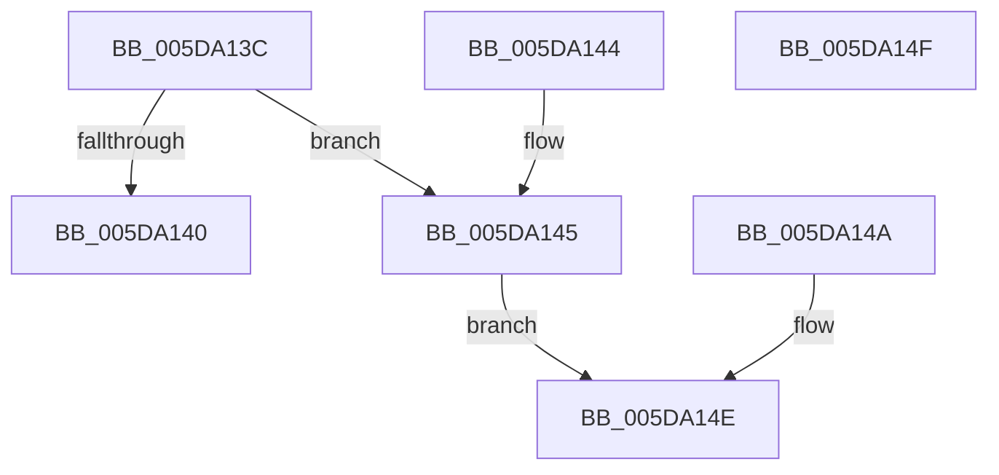

# PopResolveWatchdogParam

- RVA: `0x005DA13C`–`0x005DA150` (길이 `20` bytes)
- VA: `0x00000001405DA13C`
- 실행 섹션: `.text`
- PDB 이름 있음: `예`; PDB Function 태그: `아니요`
- unwind 정보 RVA: `0x000CD1A4`
- 디코드: `10`개 명령, `20/20` bytes 표시
- 미해석 바이트: `0` (있으면 어셈블리에 `.byte`로 보존)

> 이 문서는 커널 이미지의 기계어와 PDB 기호를 분석해 생성했습니다. 4번과 5번은 함수 원형과 자료형을 바이너리 사용 방식에서 추정한 C 해석이며 원본 소스 복구 결과는 아닙니다.

## 1. Dependencies

- 직접 호출 지점: **0**; 고유 호출 대상: **0**
- 직접 호출자로 확인된 함수: **1**
- RIP 상대 이미지 참조: **0**

### Outgoing calls
- 직접 디코드된 call 명령이 없습니다.

### Direct callers
- [PopWatchdogWorker](PopWatchdogWorker_function_005DA200.md) at `0x005DA2B8`
- [PopWatchdogWorker](PopWatchdogWorker_function_005DA200.md) at `0x005DA2DD`
- [PopWatchdogWorker](PopWatchdogWorker_function_005DA200.md) at `0x005DA2F8`
- [PopWatchdogWorker](PopWatchdogWorker_function_005DA200.md) at `0x005DA31D`

### Static image references
- 디코드된 RIP-relative 메모리 참조가 없습니다.

## 2. Other-region calls and transfers

- 다른 실행 섹션으로 향하는 call: **0**
- 별도 외부 분기/꼬리 이동을 확인하지 못했습니다.

## 3. Assembly (complete function range)

```asm
005DA13C  84 D2                           test dl, dl
005DA13E  75 05                           jne 0x1405da145
005DA140  48 8B C1                        mov rax, rcx
005DA143  C3                              ret
005DA144  CC                              int3
005DA145  48 8B 01                        mov rax, qword ptr [rcx]
005DA148  EB 04                           jmp 0x1405da14e
005DA14A  48 83 C8 FF                     or rax, 0xffffffffffffffff
005DA14E  C3                              ret
005DA14F  CC                              int3
```

## 4. C-style interpretation (structured pseudocode)

```c
__int64 __fastcall PopResolveWatchdogParam(__int64 a1, unsigned __int8 a2)
{
    if (a2 != 0) goto loc_005DA145;
    return a1;
loc_005DA145:
    goto loc_005DA14E;
loc_005DA14E:
    return *(unsigned __int64 *)(a1);
}
```

## 5. (Beta) C Style

```c
void *PopResolveWatchdogParam(void *Arg1, uint8_t Arg2)
{
    uint8_t *arg1 = (uint8_t *)Arg1;

    if (Arg2 != 0) goto loc_005DA145;
    return Arg1;
loc_005DA145:
    goto loc_005DA14E;
loc_005DA14E:
    return *(uint64_t *)(arg1);
}
```

### 관측된 메모리 오프셋

구조체 형식이 확인되지 않은 접근은 인자 기준의 오프셋으로만 기록했습니다.

| 기준 인자 | 오프셋 표현 | 폭 (bit) | 접근 |
|---|---:|---:|---|
| `Arg1` | `+ 0x0` | `64` | `R` |

## 6. Execution-region graph

[열기: 2D/3D 그래프와 함수 탐색 컨트롤 패널](../../../control-panel.html?section=text&rva=0x005DA13C&view=graph)

- 2D 그래프는 위에서 아래로 흐르고, 3D 그래프는 빈 공간을 드래그해 회전합니다. Shift+드래그는 이동, 휠은 확대·축소, 함수 노드 선택은 대상 보고서 이동입니다.

### Static fallback


