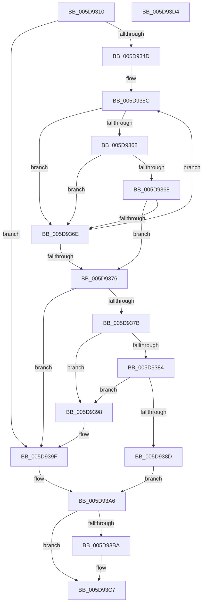

# PopShutdownListenerRemoveCallback

- RVA: `0x005D9310`–`0x005D93D5` (길이 `197` bytes)
- VA: `0x00000001405D9310`
- 실행 섹션: `.text`
- PDB 이름 있음: `예`; PDB Function 태그: `아니요`
- unwind 정보 RVA: `0x00065960`
- 디코드: `56`개 명령, `197/197` bytes 표시
- 미해석 바이트: `0` (있으면 어셈블리에 `.byte`로 보존)

> 이 문서는 커널 이미지의 기계어와 PDB 기호를 분석해 생성했습니다. 4번과 5번은 함수 원형과 자료형을 바이너리 사용 방식에서 추정한 C 해석이며 원본 소스 복구 결과는 아닙니다.

## 1. Dependencies

- 직접 호출 지점: **3**; 고유 호출 대상: **3**
- 직접 호출자로 확인된 함수: **1**
- RIP 상대 이미지 참조: **2**

### Outgoing calls
- `0x005D9332` → [KeAcquireSpinLockRaiseToDpc](../20/KeAcquireSpinLockRaiseToDpc_function_00208470.md) (function, `0x00208470`)
- `0x005D93B0` → [KeReleaseSpinLock](../39/KeReleaseSpinLock_function_00392BA0.md) (function, `0x00392BA0`)
- `0x005D93C2` → [ExFreePoolWithTag](../../poolcode/B8/ExFreePoolWithTag_function_00B82870.md) (function, `0x00B82870`)

### Direct callers
- [PopPowerInformationInternal](../../page/A8/PopPowerInformationInternal_function_00A8B7C0.md) at `0x00A8D037`

### Static image references
- `0x005D9321` → RVA `0x00F092E0` (`.data`; read)
- `0x005D9337` → RVA `0x00F092D0` (`.data`; read)

## 2. Other-region calls and transfers

- 다른 실행 섹션으로 향하는 call: **1**
  - `0x005D93C2` → [ExFreePoolWithTag](../../poolcode/B8/ExFreePoolWithTag_function_00B82870.md) (`.text` → `POOLCODE`)
- 별도 외부 분기/꼬리 이동을 확인하지 못했습니다.

## 3. Assembly (complete function range)

```asm
005D9310  48 89 5C 24 08                  mov qword ptr [rsp + 8], rbx
005D9315  57                              push rdi
005D9316  48 83 EC 40                     sub rsp, 0x40
005D931A  0F 10 01                        movups xmm0, xmmword ptr [rcx]
005D931D  0F 10 49 10                     movups xmm1, xmmword ptr [rcx + 0x10]
005D9321  48 8D 0D B8 FF 92 00            lea rcx, [rip + 0x92ffb8]
005D9328  0F 11 44 24 20                  movups xmmword ptr [rsp + 0x20], xmm0
005D932D  0F 11 4C 24 30                  movups xmmword ptr [rsp + 0x30], xmm1
005D9332  E8 39 F1 C2 FF                  call 0x140208470
005D9337  48 8B 1D 92 FF 92 00            mov rbx, qword ptr [rip + 0x92ff92]
005D933E  44 8A C8                        mov r9b, al
005D9341  48 8D 05 88 FF 92 00            lea rax, [rip + 0x92ff88]
005D9348  48 3B D8                        cmp rbx, rax
005D934B  74 52                           je 0x1405d939f
005D934D  48 8B 4C 24 38                  mov rcx, qword ptr [rsp + 0x38]
005D9352  48 8B 54 24 30                  mov rdx, qword ptr [rsp + 0x30]
005D9357  4C 8B 44 24 28                  mov r8, qword ptr [rsp + 0x28]
005D935C  48 39 53 18                     cmp qword ptr [rbx + 0x18], rdx
005D9360  75 0C                           jne 0x1405d936e
005D9362  4C 39 43 10                     cmp qword ptr [rbx + 0x10], r8
005D9366  75 06                           jne 0x1405d936e
005D9368  48 39 4B 20                     cmp qword ptr [rbx + 0x20], rcx
005D936C  74 08                           je 0x1405d9376
005D936E  48 8B 1B                        mov rbx, qword ptr [rbx]
005D9371  48 3B D8                        cmp rbx, rax
005D9374  75 E6                           jne 0x1405d935c
005D9376  48 3B D8                        cmp rbx, rax
005D9379  74 24                           je 0x1405d939f
005D937B  48 8B 0B                        mov rcx, qword ptr [rbx]
005D937E  48 39 59 08                     cmp qword ptr [rcx + 8], rbx
005D9382  75 14                           jne 0x1405d9398
005D9384  48 8B 43 08                     mov rax, qword ptr [rbx + 8]
005D9388  48 39 18                        cmp qword ptr [rax], rbx
005D938B  75 0B                           jne 0x1405d9398
005D938D  48 89 08                        mov qword ptr [rax], rcx
005D9390  33 FF                           xor edi, edi
005D9392  48 89 41 08                     mov qword ptr [rcx + 8], rax
005D9396  EB 0E                           jmp 0x1405d93a6
005D9398  B9 03 00 00 00                  mov ecx, 3
005D939D  CD 29                           int 0x29
005D939F  33 DB                           xor ebx, ebx
005D93A1  BF 25 02 00 C0                  mov edi, 0xc0000225
005D93A6  41 8A D1                        mov dl, r9b
005D93A9  48 8D 0D 30 FF 92 00            lea rcx, [rip + 0x92ff30]
005D93B0  E8 EB 97 DB FF                  call 0x140392ba0
005D93B5  48 85 DB                        test rbx, rbx
005D93B8  74 0D                           je 0x1405d93c7
005D93BA  BA 4D 65 6D 20                  mov edx, 0x206d654d
005D93BF  48 8B CB                        mov rcx, rbx
005D93C2  E8 A9 94 5A 00                  call 0x140b82870
005D93C7  48 8B 5C 24 50                  mov rbx, qword ptr [rsp + 0x50]
005D93CC  8B C7                           mov eax, edi
005D93CE  48 83 C4 40                     add rsp, 0x40
005D93D2  5F                              pop rdi
005D93D3  C3                              ret
005D93D4  CC                              int3
```

## 4. C-style interpretation (structured pseudocode)

```c
__int64 __fastcall PopShutdownListenerRemoveCallback(__int64 a1)
{
    __int64 result;
    __int64 v_rbx;
    __int64 v_rdi;
    __int64 v_rsp;
    unsigned __int64 v_stack_m10;
    unsigned __int64 v_stack_m18;
    unsigned __int64 v_stack_m20;
    unsigned __int64 v_stack_m28;
    unsigned __int64 v_stack_p8;

    v_stack_p8 = v_rbx;
    v_rsp = (v_rsp) - (64);
    v_stack_m28 = v_xmm0;
    v_stack_m18 = v_xmm1;
    result = KeAcquireSpinLockRaiseToDpc(v_rip + 9633720, a2, a3, a4);
    if ((*(unsigned __int64 *)(v_rip + 9633682)) == (v_rip + 9633672)) goto loc_005D939F;
loc_005D935C:
    if ((*(unsigned __int64 *)(*(unsigned __int64 *)(v_rip + 9633682) + 24)) != v_stack_m18) goto loc_005D936E;
    if ((*(unsigned __int64 *)(*(unsigned __int64 *)(v_rip + 9633682) + 16)) != v_stack_m20) goto loc_005D936E;
    if ((*(unsigned __int64 *)(*(unsigned __int64 *)(v_rip + 9633682) + 32)) == v_stack_m10) goto loc_005D9376;
loc_005D936E:
    if ((*(unsigned __int64 *)(*(unsigned __int64 *)(v_rip + 9633682))) != (v_rip + 9633672)) goto loc_005D935C;
loc_005D9376:
    if ((*(unsigned __int64 *)(*(unsigned __int64 *)(v_rip + 9633682))) == (v_rip + 9633672)) goto loc_005D939F;
    if ((*(unsigned __int64 *)(*(unsigned __int64 *)(*(unsigned __int64 *)(*(unsigned __int64 *)(v_rip + 9633682))) + 8)) != (*(unsigned __int64 *)(*(unsigned __int64 *)(v_rip + 9633682)))) goto loc_005D9398;
    if ((*(unsigned __int64 *)(*(unsigned __int64 *)(*(unsigned __int64 *)(*(unsigned __int64 *)(v_rip + 9633682)) + 8))) != (*(unsigned __int64 *)(*(unsigned __int64 *)(v_rip + 9633682)))) goto loc_005D9398;
    *(unsigned __int64 *)(*(unsigned __int64 *)(*(unsigned __int64 *)(*(unsigned __int64 *)(v_rip + 9633682)) + 8)) = *(unsigned __int64 *)(*(unsigned __int64 *)(*(unsigned __int64 *)(v_rip + 9633682)));
    v_rdi = 0;
    *(unsigned __int64 *)(*(unsigned __int64 *)(*(unsigned __int64 *)(*(unsigned __int64 *)(v_rip + 9633682))) + 8) = *(unsigned __int64 *)(*(unsigned __int64 *)(*(unsigned __int64 *)(v_rip + 9633682)) + 8);
    goto loc_005D93A6;
loc_005D9398:
loc_005D939F:
    v_rbx = 0;
loc_005D93A6:
    result = KeReleaseSpinLock(v_rip + 9633584, (unsigned __int8)((unsigned __int8)(result)), v_stack_m20, (unsigned __int8)(result));
    if (0 != 0) {
        a2 = 0x206D654DULL;
        a1 = 0;
        result = ExFreePoolWithTag(a1, a2, v_stack_m20, (unsigned __int8)(result));
    }
    v_rsp = (v_rsp) + (64);
    return (unsigned int)((unsigned int)((unsigned int)(0xC0000225ULL)));
}
```

## 5. (Beta) C Style

```c
int64_t PopShutdownListenerRemoveCallback(void *Arg1)
{
    uint8_t *arg1 = (uint8_t *)Arg1;

    int64_t result;
    int64_t local_rbx;
    int64_t local_rdi;
    int64_t local_rsp;
    uint64_t v_stack_m10;
    uint64_t v_stack_m18;
    uint64_t v_stack_m20;
    uint64_t v_stack_m28;
    uint64_t v_stack_p8;

    v_stack_p8 = local_rbx;
    local_rsp = (local_rsp) - (64);
    v_stack_m28 = v_xmm0;
    v_stack_m18 = v_xmm1;
    result = KeAcquireSpinLockRaiseToDpc(v_rip + 9633720, a2, a3, a4);
    if ((*(uint64_t *)(v_rip + 0x92FF92)) == (v_rip + 9633672)) goto loc_005D939F;
loc_005D935C:
    if ((*(uint64_t *)(*(uint64_t *)(v_rip + 0x92FF92) + 0x18)) != v_stack_m18) goto loc_005D936E;
    if ((*(uint64_t *)(*(uint64_t *)(v_rip + 0x92FF92) + 0x10)) != v_stack_m20) goto loc_005D936E;
    if ((*(uint64_t *)(*(uint64_t *)(v_rip + 0x92FF92) + 0x20)) == v_stack_m10) goto loc_005D9376;
loc_005D936E:
    if ((*(uint64_t *)(*(uint64_t *)(v_rip + 0x92FF92))) != (v_rip + 9633672)) goto loc_005D935C;
loc_005D9376:
    if ((*(uint64_t *)(*(uint64_t *)(v_rip + 0x92FF92))) == (v_rip + 9633672)) goto loc_005D939F;
    if ((*(uint64_t *)(*(uint64_t *)(*(uint64_t *)(*(uint64_t *)(v_rip + 0x92FF92))) + 0x8)) != (*(uint64_t *)(*(uint64_t *)(v_rip + 0x92FF92)))) goto loc_005D9398;
    if ((*(uint64_t *)(*(uint64_t *)(*(uint64_t *)(*(uint64_t *)(v_rip + 0x92FF92)) + 0x8))) != (*(uint64_t *)(*(uint64_t *)(v_rip + 0x92FF92)))) goto loc_005D9398;
    *(uint64_t *)(*(uint64_t *)(*(uint64_t *)(*(uint64_t *)(v_rip + 0x92FF92)) + 0x8)) = *(uint64_t *)(*(uint64_t *)(*(uint64_t *)(v_rip + 0x92FF92)));
    local_rdi = 0;
    *(uint64_t *)(*(uint64_t *)(*(uint64_t *)(*(uint64_t *)(v_rip + 0x92FF92))) + 0x8) = *(uint64_t *)(*(uint64_t *)(*(uint64_t *)(v_rip + 0x92FF92)) + 0x8);
    goto loc_005D93A6;
loc_005D9398:
loc_005D939F:
    local_rbx = 0;
loc_005D93A6:
    result = KeReleaseSpinLock(v_rip + 9633584, (uint8_t)((uint8_t)(result)), v_stack_m20, (uint8_t)(result));
    if (0 != 0) {
        a2 = 0x206D654DULL;
        Arg1 = 0;
        result = ExFreePoolWithTag(Arg1, a2, v_stack_m20, (uint8_t)(result));
    }
    local_rsp = (local_rsp) + (64);
    return (uint32_t)((uint32_t)((uint32_t)(0xC0000225ULL)));
}
```

### 관측된 메모리 오프셋

구조체 형식이 확인되지 않은 접근은 인자 기준의 오프셋으로만 기록했습니다.

| 기준 인자 | 오프셋 표현 | 폭 (bit) | 접근 |
|---|---:|---:|---|
| `Arg1` | `+ 0x0` | `128` | `R` |
| `Arg1` | `+ 0x10` | `128` | `R` |

## 6. Execution-region graph

[열기: 2D/3D 그래프와 함수 탐색 컨트롤 패널](../../../control-panel.html?section=text&rva=0x005D9310&view=graph)

- 2D 그래프는 위에서 아래로 흐르고, 3D 그래프는 빈 공간을 드래그해 회전합니다. Shift+드래그는 이동, 휠은 확대·축소, 함수 노드 선택은 대상 보고서 이동입니다.

### Static fallback


