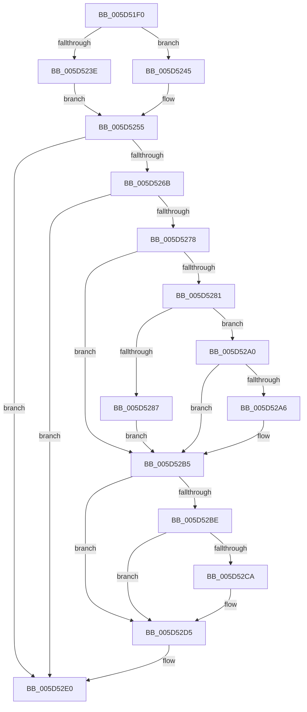

# PopStateTransitionTimeoutDispatch

- RVA: `0x005D51F0`–`0x005D5301` (길이 `273` bytes)
- VA: `0x00000001405D51F0`
- 실행 섹션: `.text`
- PDB 이름 있음: `예`; PDB Function 태그: `아니요`
- unwind 정보 RVA: `0x000CC57C`
- 디코드: `68`개 명령, `273/273` bytes 표시
- 미해석 바이트: `0` (있으면 어셈블리에 `.byte`로 보존)

> 이 문서는 커널 이미지의 기계어와 PDB 기호를 분석해 생성했습니다. 4번과 5번은 함수 원형과 자료형을 바이너리 사용 방식에서 추정한 C 해석이며 원본 소스 복구 결과는 아닙니다.

## 1. Dependencies

- 직접 호출 지점: **5**; 고유 호출 대상: **4**
- 직접 호출자로 확인된 함수: **0**
- RIP 상대 이미지 참조: **5**

### Outgoing calls
- `0x005D526F` → [PopQueryLastStateTransitionInfo](../../pagelk/B7/PopQueryLastStateTransitionInfo_function_00B707A8.md) (function, `0x00B707A8`)
- `0x005D5299` → [guard_dispatch_icall](../6B/guard_dispatch_icall_function_006BAAD0.md) (function, `0x006BAAD0`)
- `0x005D52B0` → [guard_dispatch_icall](../6B/guard_dispatch_icall_function_006BAAD0.md) (function, `0x006BAAD0`)
- `0x005D52D0` → [KiStackAttachProcess](../21/KiStackAttachProcess_function_00216820.md) (function, `0x00216820`)
- `0x005D52FB` → [KeBugCheckEx](../4F/KeBugCheckEx_function_004FD660.md) (function, `0x004FD660`)

### Direct callers
- 이 함수 시작 RVA로 연결되는 직접 call은 확인되지 않았습니다. 간접 호출은 완전히 역산할 수 없습니다.

### Static image references
- `0x005D5207` → RVA `0x00E0A740` (`.data`; read)
- `0x005D5215` → RVA `0x00F0BEF4` (`.data`; read)
- `0x005D528F` → RVA `0x00F0BF00` (`.data`; read)
- `0x005D52E0` → RVA `0x00F0C9DC` (`.data`; read)
- `0x005D52EA` → RVA `0x00F0BD6C` (`.data`; read)

## 2. Other-region calls and transfers

- 다른 실행 섹션으로 향하는 call: **1**
  - `0x005D526F` → [PopQueryLastStateTransitionInfo](../../pagelk/B7/PopQueryLastStateTransitionInfo_function_00B707A8.md) (`.text` → `PAGELK`)
- 별도 외부 분기/꼬리 이동을 확인하지 못했습니다.

## 3. Assembly (complete function range)

```asm
005D51F0  48 89 5C 24 08                  mov qword ptr [rsp + 8], rbx
005D51F5  48 89 7C 24 10                  mov qword ptr [rsp + 0x10], rdi
005D51FA  55                              push rbp
005D51FB  48 8D 6C 24 A9                  lea rbp, [rsp - 0x57]
005D5200  48 81 EC A0 00 00 00            sub rsp, 0xa0
005D5207  48 8B 05 32 55 83 00            mov rax, qword ptr [rip + 0x835532]
005D520E  48 33 C4                        xor rax, rsp
005D5211  48 89 45 47                     mov qword ptr [rbp + 0x47], rax
005D5215  8B 05 D9 6C 93 00               mov eax, dword ptr [rip + 0x936cd9]
005D521B  0F 57 C0                        xorps xmm0, xmm0
005D521E  0F 57 C9                        xorps xmm1, xmm1
005D5221  0F 11 45 17                     movups xmmword ptr [rbp + 0x17], xmm0
005D5225  0F 11 45 27                     movups xmmword ptr [rbp + 0x27], xmm0
005D5229  0F 11 45 37                     movups xmmword ptr [rbp + 0x37], xmm0
005D522D  0F 11 4D E7                     movups xmmword ptr [rbp - 0x19], xmm1
005D5231  0F 11 4D F7                     movups xmmword ptr [rbp - 9], xmm1
005D5235  0F 11 4D 07                     movups xmmword ptr [rbp + 7], xmm1
005D5239  83 F8 01                        cmp eax, 1
005D523C  75 07                           jne 0x1405d5245
005D523E  BF F0 00 00 00                  mov edi, 0xf0
005D5243  EB 10                           jmp 0x1405d5255
005D5245  83 F8 02                        cmp eax, 2
005D5248  BF 0F 00 00 00                  mov edi, 0xf
005D524D  B9 F1 00 00 00                  mov ecx, 0xf1
005D5252  0F 44 F9                        cmove edi, ecx
005D5255  65 48 8B 1C 25 88 01 00 00      mov rbx, qword ptr gs:[0x188]
005D525E  8B 05 90 6C 93 00               mov eax, dword ptr [rip + 0x936c90]
005D5264  FF C8                           dec eax
005D5266  83 F8 01                        cmp eax, 1
005D5269  77 75                           ja 0x1405d52e0
005D526B  48 8D 4D E7                     lea rcx, [rbp - 0x19]
005D526F  E8 34 B5 59 00                  call 0x140b707a8
005D5274  85 C0                           test eax, eax
005D5276  78 68                           js 0x1405d52e0
005D5278  48 8B 45 0F                     mov rax, qword ptr [rbp + 0xf]
005D527C  48 85 C0                        test rax, rax
005D527F  74 34                           je 0x1405d52b5
005D5281  83 7D 07 01                     cmp dword ptr [rbp + 7], 1
005D5285  75 19                           jne 0x1405d52a0
005D5287  4C 8B 4D FF                     mov r9, qword ptr [rbp - 1]
005D528B  4C 8D 45 E7                     lea r8, [rbp - 0x19]
005D528F  8B 0D 6B 6C 93 00               mov ecx, dword ptr [rip + 0x936c6b]
005D5295  48 8D 55 EF                     lea rdx, [rbp - 0x11]
005D5299  E8 32 58 0E 00                  call 0x1406baad0
005D529E  EB 15                           jmp 0x1405d52b5
005D52A0  83 7D 07 02                     cmp dword ptr [rbp + 7], 2
005D52A4  75 0F                           jne 0x1405d52b5
005D52A6  48 8B 55 FF                     mov rdx, qword ptr [rbp - 1]
005D52AA  8B 0D 50 6C 93 00               mov ecx, dword ptr [rip + 0x936c50]
005D52B0  E8 1B 58 0E 00                  call 0x1406baad0
005D52B5  48 8B 4D EF                     mov rcx, qword ptr [rbp - 0x11]
005D52B9  48 85 C9                        test rcx, rcx
005D52BC  74 17                           je 0x1405d52d5
005D52BE  F7 81 FC 05 00 00 00 10 00 00   test dword ptr [rcx + 0x5fc], 0x1000
005D52C8  75 0B                           jne 0x1405d52d5
005D52CA  4C 8D 45 17                     lea r8, [rbp + 0x17]
005D52CE  33 D2                           xor edx, edx
005D52D0  E8 4B 15 C4 FF                  call 0x140216820
005D52D5  48 8B 45 E7                     mov rax, qword ptr [rbp - 0x19]
005D52D9  48 85 C0                        test rax, rax
005D52DC  48 0F 45 D8                     cmovne rbx, rax
005D52E0  4C 63 0D F5 76 93 00            movsxd r9, dword ptr [rip + 0x9376f5]
005D52E7  48 8B D7                        mov rdx, rdi
005D52EA  4C 63 05 7B 6A 93 00            movsxd r8, dword ptr [rip + 0x936a7b]
005D52F1  B9 A0 00 00 00                  mov ecx, 0xa0
005D52F6  48 89 5C 24 20                  mov qword ptr [rsp + 0x20], rbx
005D52FB  E8 60 83 F2 FF                  call 0x1404fd660
005D5300  CC                              int3
```

## 4. C-style interpretation (structured pseudocode)

```c
__int64 __fastcall PopStateTransitionTimeoutDispatch(void)
{
    __int64 result;
    __int64 v_rbx;
    __int64 v_rdi;
    __int64 v_rsp;
    unsigned __int64 v_stack_m18;
    unsigned __int64 v_stack_m28;
    unsigned __int64 v_stack_m38;
    unsigned __int64 v_stack_m48;
    unsigned __int64 v_stack_m50;
    unsigned __int64 v_stack_m58;
    unsigned __int64 v_stack_m5F;
    unsigned __int64 v_stack_m60;
    unsigned __int64 v_stack_m68;
    unsigned __int64 v_stack_m70;
    unsigned __int64 v_stack_m78;
    unsigned __int64 v_stack_m88;
    unsigned __int64 v_stack_p10;
    unsigned __int64 v_stack_p8;

    v_stack_p8 = v_rbx;
    v_stack_p10 = v_rdi;
    v_rsp = (v_rsp) - (160);
    result = (*(unsigned __int64 *)(v_rip + 8607026)) ^ (v_rsp);
    v_stack_m18 = result;
    v_stack_m48 = v_xmm0;
    v_stack_m38 = v_xmm0;
    v_stack_m28 = v_xmm0;
    v_stack_m78 = v_xmm1;
    v_stack_m68 = v_xmm1;
    v_stack_m58 = v_xmm1;
    if (((unsigned int)((unsigned int)(*(unsigned int *)(v_rip + 9661657)))) != 1) goto loc_005D5245;
    goto loc_005D5255;
loc_005D5245:
    v_rdi = 15;
    if (((unsigned int)((unsigned int)(*(unsigned int *)(v_rip + 9661657)))) == 2) { v_rdi = 241; }
loc_005D5255:
    result = (unsigned int)(((unsigned int)(*(unsigned int *)(v_rip + 9661584))) - 1);
    if (((unsigned int)(result)) > 1) goto loc_005D52E0;
    result = PopQueryLastStateTransitionInfo(v_stack_m78, a2, a3, a4);
    if (sign_flag) goto loc_005D52E0;
    if (v_stack_m50 == 0) goto loc_005D52B5;
    if (v_stack_m58 != 1) goto loc_005D52A0;
    result = guard_dispatch_icall((unsigned int)(*(unsigned int *)(v_rip + 9661547)), v_stack_m70, v_stack_m78, v_stack_m60);
    goto loc_005D52B5;
loc_005D52A0:
    if (v_stack_m58 == 2) {
        a2 = v_stack_m60;
        a1 = *(unsigned int *)(v_rip + 9661520);
        result = guard_dispatch_icall(a1, a2, v_stack_m78, v_stack_m60);
    }
    if (v_stack_m70 == 0) goto loc_005D52D5;
    if (((*(unsigned int *)(v_stack_m70 + 1532)) & (0x1000ULL)) == 0) {
        a3 = v_stack_m48;
        a2 = 0;
        result = KiStackAttachProcess(v_stack_m70, a2, a3, v_stack_m60);
    }
    v_rbx = *(unsigned __int64 *)(gs_base + (0 + 392));
    if (v_stack_m78 != 0) { v_rbx = v_stack_m78; }
loc_005D52E0:
    v_stack_m88 = v_rbx;
    result = KeBugCheckEx(160, v_rdi, (int)(*(unsigned int *)(v_rip + 9661051)), (int)(*(unsigned int *)(v_rip + 9664245)));
    return result;
}
```

## 5. (Beta) C Style

```c
void PopStateTransitionTimeoutDispatch(void)
{
    int64_t result;
    int64_t local_rbx;
    int64_t local_rdi;
    int64_t local_rsp;
    uint64_t v_stack_m18;
    uint64_t v_stack_m28;
    uint64_t v_stack_m38;
    uint64_t v_stack_m48;
    uint64_t v_stack_m50;
    uint64_t v_stack_m58;
    uint64_t v_stack_m5F;
    uint64_t v_stack_m60;
    uint64_t v_stack_m68;
    uint64_t v_stack_m70;
    uint64_t v_stack_m78;
    uint64_t v_stack_m88;
    uint64_t v_stack_p10;
    uint64_t v_stack_p8;

    v_stack_p8 = local_rbx;
    v_stack_p10 = local_rdi;
    local_rsp = (local_rsp) - (160);
    result = (*(uint64_t *)(v_rip + 0x835532)) ^ (local_rsp);
    v_stack_m18 = result;
    v_stack_m48 = v_xmm0;
    v_stack_m38 = v_xmm0;
    v_stack_m28 = v_xmm0;
    v_stack_m78 = v_xmm1;
    v_stack_m68 = v_xmm1;
    v_stack_m58 = v_xmm1;
    if (((uint32_t)((uint32_t)(*(uint32_t *)(v_rip + 0x936CD9)))) != 1) goto loc_005D5245;
    goto loc_005D5255;
loc_005D5245:
    local_rdi = 15;
    if (((uint32_t)((uint32_t)(*(uint32_t *)(v_rip + 0x936CD9)))) == 2) { local_rdi = 241; }
loc_005D5255:
    result = (uint32_t)(((uint32_t)(*(uint32_t *)(v_rip + 0x936C90))) - 1);
    if (((uint32_t)(result)) > 1) goto loc_005D52E0;
    result = PopQueryLastStateTransitionInfo(v_stack_m78, a2, a3, a4);
    if (sign_flag) goto loc_005D52E0;
    if (v_stack_m50 == 0) goto loc_005D52B5;
    if (v_stack_m58 != 1) goto loc_005D52A0;
    result = guard_dispatch_icall((uint32_t)(*(uint32_t *)(v_rip + 0x936C6B)), v_stack_m70, v_stack_m78, v_stack_m60);
    goto loc_005D52B5;
loc_005D52A0:
    if (v_stack_m58 == 2) {
        a2 = v_stack_m60;
        a1 = *(uint32_t *)(v_rip + 0x936C50);
        result = guard_dispatch_icall(a1, a2, v_stack_m78, v_stack_m60);
    }
    if (v_stack_m70 == 0) goto loc_005D52D5;
    if (((*(uint32_t *)(v_stack_m70 + 0x5FC)) & (0x1000ULL)) == 0) {
        a3 = v_stack_m48;
        a2 = 0;
        result = KiStackAttachProcess(v_stack_m70, a2, a3, v_stack_m60);
    }
    local_rbx = *(uint64_t *)(gs_base + (0 + 0x188));
    if (v_stack_m78 != 0) { local_rbx = v_stack_m78; }
loc_005D52E0:
    v_stack_m88 = local_rbx;
    result = KeBugCheckEx(160, local_rdi, (int32_t)(*(uint32_t *)(v_rip + 0x936A7B)), (int32_t)(*(uint32_t *)(v_rip + 0x9376F5)));
    return result;
}
```

## 6. Execution-region graph

[열기: 2D/3D 그래프와 함수 탐색 컨트롤 패널](../../../control-panel.html?section=text&rva=0x005D51F0&view=graph)

- 2D 그래프는 위에서 아래로 흐르고, 3D 그래프는 빈 공간을 드래그해 회전합니다. Shift+드래그는 이동, 휠은 확대·축소, 함수 노드 선택은 대상 보고서 이동입니다.

### Static fallback


