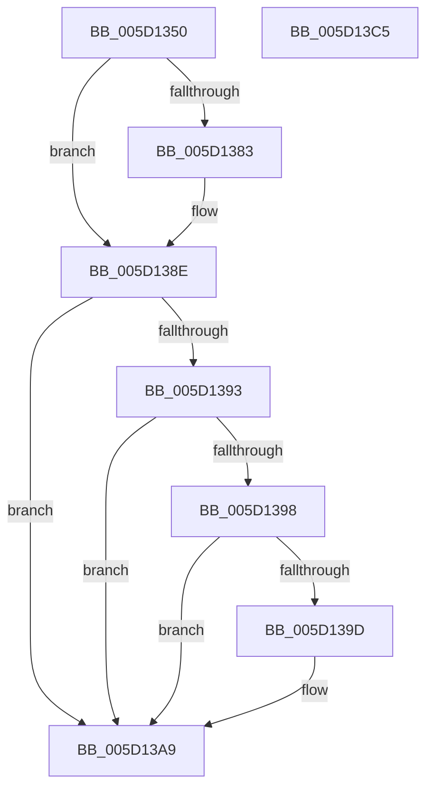

# PopSwitchForcedShutdownSettingCallback

- RVA: `0x005D1350`–`0x005D13C6` (길이 `118` bytes)
- VA: `0x00000001405D1350`
- 실행 섹션: `.text`
- PDB 이름 있음: `예`; PDB Function 태그: `아니요`
- unwind 정보 RVA: `0x0005C954`
- 디코드: `33`개 명령, `118/118` bytes 표시
- 미해석 바이트: `0` (있으면 어셈블리에 `.byte`로 보존)

> 이 문서는 커널 이미지의 기계어와 PDB 기호를 분석해 생성했습니다. 4번과 5번은 함수 원형과 자료형을 바이너리 사용 방식에서 추정한 C 해석이며 원본 소스 복구 결과는 아닙니다.

## 1. Dependencies

- 직접 호출 지점: **2**; 고유 호출 대상: **2**
- 직접 호출자로 확인된 함수: **0**
- RIP 상대 이미지 참조: **3**

### Outgoing calls
- `0x005D1372` → [PopAcquirePolicyLock](../../pagelk/B7/PopAcquirePolicyLock_function_00B783C0.md) (function, `0x00B783C0`)
- `0x005D13A9` → [PopReleasePolicyLock](../../pagelk/B7/PopReleasePolicyLock_function_00B78410.md) (function, `0x00B78410`)

### Direct callers
- 이 함수 시작 RVA로 연결되는 직접 call은 확인되지 않았습니다. 간접 호출은 완전히 역산할 수 없습니다.

### Static image references
- `0x005D1377` → RVA `0x00024938` (`.rdata`; read)
- `0x005D1383` → RVA `0x00024940` (`.rdata`; read)
- `0x005D13A0` → RVA `0x00F0CE44` (`.data`; write)

## 2. Other-region calls and transfers

- 다른 실행 섹션으로 향하는 call: **2**
  - `0x005D1372` → [PopAcquirePolicyLock](../../pagelk/B7/PopAcquirePolicyLock_function_00B783C0.md) (`.text` → `PAGELK`)
  - `0x005D13A9` → [PopReleasePolicyLock](../../pagelk/B7/PopReleasePolicyLock_function_00B78410.md) (`.text` → `PAGELK`)
- 별도 외부 분기/꼬리 이동을 확인하지 못했습니다.

## 3. Assembly (complete function range)

```asm
005D1350  48 89 5C 24 08                  mov qword ptr [rsp + 8], rbx
005D1355  48 89 6C 24 10                  mov qword ptr [rsp + 0x10], rbp
005D135A  48 89 74 24 18                  mov qword ptr [rsp + 0x18], rsi
005D135F  57                              push rdi
005D1360  48 83 EC 20                     sub rsp, 0x20
005D1364  41 8B E8                        mov ebp, r8d
005D1367  48 8B FA                        mov rdi, rdx
005D136A  48 8B F1                        mov rsi, rcx
005D136D  BB 0D 00 00 C0                  mov ebx, 0xc000000d
005D1372  E8 49 70 5A 00                  call 0x140b783c0
005D1377  4C 8B 0D BA 35 A5 FF            mov r9, qword ptr [rip - 0x5aca46]
005D137E  4C 2B 0E                        sub r9, qword ptr [rsi]
005D1381  75 0B                           jne 0x1405d138e
005D1383  4C 8B 0D B6 35 A5 FF            mov r9, qword ptr [rip - 0x5aca4a]
005D138A  4C 2B 4E 08                     sub r9, qword ptr [rsi + 8]
005D138E  4D 85 C9                        test r9, r9
005D1391  75 16                           jne 0x1405d13a9
005D1393  83 FD 04                        cmp ebp, 4
005D1396  75 11                           jne 0x1405d13a9
005D1398  48 85 FF                        test rdi, rdi
005D139B  74 0C                           je 0x1405d13a9
005D139D  44 39 0F                        cmp dword ptr [rdi], r9d
005D13A0  0F 95 05 9D BA 93 00            setne byte ptr [rip + 0x93ba9d]
005D13A7  33 DB                           xor ebx, ebx
005D13A9  E8 62 70 5A 00                  call 0x140b78410
005D13AE  48 8B 6C 24 38                  mov rbp, qword ptr [rsp + 0x38]
005D13B3  8B C3                           mov eax, ebx
005D13B5  48 8B 5C 24 30                  mov rbx, qword ptr [rsp + 0x30]
005D13BA  48 8B 74 24 40                  mov rsi, qword ptr [rsp + 0x40]
005D13BF  48 83 C4 20                     add rsp, 0x20
005D13C3  5F                              pop rdi
005D13C4  C3                              ret
005D13C5  CC                              int3
```

## 4. C-style interpretation (structured pseudocode)

```c
__int64 __fastcall PopSwitchForcedShutdownSettingCallback(__int64 a1, __int64 a2, int a3)
{
    __int64 result;
    __int64 v_rbx;
    __int64 v_rsp;
    unsigned __int64 v_stack_p10;
    unsigned __int64 v_stack_p18;
    unsigned __int64 v_stack_p8;

    v_stack_p8 = v_rbx;
    v_stack_p10 = v_rbp;
    v_stack_p18 = v_rsi;
    v_rsp = (v_rsp) - (32);
    result = PopAcquirePolicyLock(a1, a2, a3, a4);
    a4 = (*(unsigned __int64 *)(v_rip - 5950022)) - (*(unsigned __int64 *)(a1));
    if (!(condition_is_not_equal)) {
        a4 = *(unsigned __int64 *)(v_rip - 5950026);
        a4 = (a4) - (*(unsigned __int64 *)(a1 + 8));
    }
    if (a4 != 0) goto loc_005D13A9;
    if (((unsigned int)((unsigned int)(a3))) != 4) goto loc_005D13A9;
    v_rbx = (unsigned int)(0xC000000DULL);
    if (a2 != 0) {
        v_rbx = 0;
    }
    result = PopReleasePolicyLock(a1, a2, a3, a4);
    v_rsp = (v_rsp) + (32);
    return 0;
}
```

## 5. (Beta) C Style

```c
int64_t PopSwitchForcedShutdownSettingCallback(void *Arg1, int64_t Arg2, int32_t Arg3)
{
    uint8_t *arg1 = (uint8_t *)Arg1;

    int64_t result;
    int64_t local_rbx;
    int64_t local_rsp;
    uint64_t v_stack_p10;
    uint64_t v_stack_p18;
    uint64_t v_stack_p8;

    v_stack_p8 = local_rbx;
    v_stack_p10 = local_rbp;
    v_stack_p18 = local_rsi;
    local_rsp = (local_rsp) - (32);
    result = PopAcquirePolicyLock(Arg1, Arg2, Arg3, a4);
    a4 = (*(uint64_t *)(v_rip - 0x5ACA46)) - (*(uint64_t *)(arg1));
    if (!(condition_is_not_equal)) {
        a4 = *(uint64_t *)(v_rip - 0x5ACA4A);
        a4 = (a4) - (*(uint64_t *)(arg1 + 0x8));
    }
    if (a4 != 0) goto loc_005D13A9;
    if (((uint32_t)((uint32_t)(Arg3))) != 4) goto loc_005D13A9;
    local_rbx = (uint32_t)(0xC000000DULL);
    if (Arg2 != 0) {
        local_rbx = 0;
    }
    result = PopReleasePolicyLock(Arg1, Arg2, Arg3, a4);
    local_rsp = (local_rsp) + (32);
    return 0;
}
```

### 관측된 메모리 오프셋

구조체 형식이 확인되지 않은 접근은 인자 기준의 오프셋으로만 기록했습니다.

| 기준 인자 | 오프셋 표현 | 폭 (bit) | 접근 |
|---|---:|---:|---|
| `Arg1` | `+ 0x0` | `64` | `R` |
| `Arg1` | `+ 0x8` | `64` | `R` |

## 6. Execution-region graph

[열기: 2D/3D 그래프와 함수 탐색 컨트롤 패널](../../../control-panel.html?section=text&rva=0x005D1350&view=graph)

- 2D 그래프는 위에서 아래로 흐르고, 3D 그래프는 빈 공간을 드래그해 회전합니다. Shift+드래그는 이동, 휠은 확대·축소, 함수 노드 선택은 대상 보고서 이동입니다.

### Static fallback


