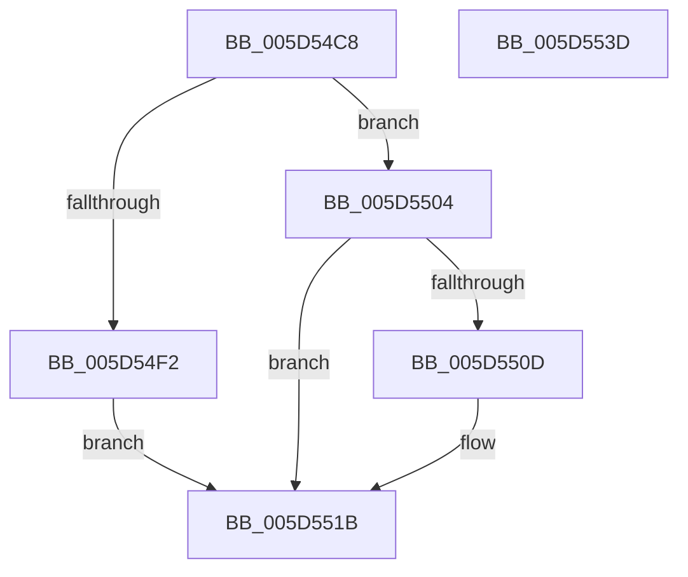

# PopThermalCsExit

- RVA: `0x005D54C8`–`0x005D553E` (길이 `118` bytes)
- VA: `0x00000001405D54C8`
- 실행 섹션: `.text`
- PDB 이름 있음: `예`; PDB Function 태그: `아니요`
- unwind 정보 RVA: `0x0005C788`
- 디코드: `25`개 명령, `118/118` bytes 표시
- 미해석 바이트: `0` (있으면 어셈블리에 `.byte`로 보존)

> 이 문서는 커널 이미지의 기계어와 PDB 기호를 분석해 생성했습니다. 4번과 5번은 함수 원형과 자료형을 바이너리 사용 방식에서 추정한 C 해석이며 원본 소스 복구 결과는 아닙니다.

## 1. Dependencies

- 직접 호출 지점: **6**; 고유 호출 대상: **5**
- 직접 호출자로 확인된 함수: **1**
- RIP 상대 이미지 참조: **6**

### Outgoing calls
- `0x005D54D3` → [PopAcquireRwLockExclusive](../43/PopAcquireRwLockExclusive_function_00430B44.md) (function, `0x00430B44`)
- `0x005D54DD` → [PopThermalStandbyEndTracking](../4D/PopThermalStandbyEndTracking_function_004D1B2C.md) (function, `0x004D1B2C`)
- `0x005D54F4` → [PopThermalStandbyNotify](PopThermalStandbyNotify_function_005D55A0.md) (function, `0x005D55A0`)
- `0x005D550F` → [PopThermalStandbyNotify](PopThermalStandbyNotify_function_005D55A0.md) (function, `0x005D55A0`)
- `0x005D5522` → [PopReleaseRwLock](../2D/PopReleaseRwLock_function_002DFBBC.md) (function, `0x002DFBBC`)
- `0x005D5533` → [PopQueueWorkItem](../4A/PopQueueWorkItem_function_004A20F8.md) (function, `0x004A20F8`)

### Direct callers
- [PopSleepstudyStartNextSession](../../page/AC/PopSleepstudyStartNextSession_function_00AC4720.md) at `0x00AC49CA`

### Static image references
- `0x005D54CC` → RVA `0x00F0BB00` (`.data`; read)
- `0x005D54E2` → RVA `0x00F0BB14` (`.data`; read)
- `0x005D54E9` → RVA `0x00F0BB10` (`.data`; write)
- `0x005D5504` → RVA `0x00F0BB11` (`.data`; read)
- `0x005D5514` → RVA `0x00F0BB11` (`.data`; write)
- `0x005D552C` → RVA `0x00F0BAC8` (`.data`; read)

## 2. Other-region calls and transfers

- 다른 실행 섹션으로 향하는 call: **0**
- 별도 외부 분기/꼬리 이동을 확인하지 못했습니다.

## 3. Assembly (complete function range)

```asm
005D54C8  48 83 EC 28                     sub rsp, 0x28
005D54CC  48 8D 0D 2D 66 93 00            lea rcx, [rip + 0x93662d]
005D54D3  E8 6C B6 E5 FF                  call 0x140430b44
005D54D8  B9 01 00 00 00                  mov ecx, 1
005D54DD  E8 4A C6 EF FF                  call 0x1404d1b2c
005D54E2  83 3D 2B 66 93 00 00            cmp dword ptr [rip + 0x93662b], 0
005D54E9  C6 05 20 66 93 00 01            mov byte ptr [rip + 0x936620], 1
005D54F0  76 12                           jbe 0x1405d5504
005D54F2  B1 01                           mov cl, 1
005D54F4  E8 A7 00 00 00                  call 0x1405d55a0
005D54F9  66 C7 05 0E 66 93 00 00 01      mov word ptr [rip + 0x93660e], 0x100
005D5502  EB 17                           jmp 0x1405d551b
005D5504  80 3D 06 66 93 00 00            cmp byte ptr [rip + 0x936606], 0
005D550B  74 0E                           je 0x1405d551b
005D550D  33 C9                           xor ecx, ecx
005D550F  E8 8C 00 00 00                  call 0x1405d55a0
005D5514  C6 05 F6 65 93 00 00            mov byte ptr [rip + 0x9365f6], 0
005D551B  48 8D 0D DE 65 93 00            lea rcx, [rip + 0x9365de]
005D5522  E8 95 A6 D0 FF                  call 0x1402dfbbc
005D5527  BA 01 00 00 00                  mov edx, 1
005D552C  48 8D 0D 95 65 93 00            lea rcx, [rip + 0x936595]
005D5533  E8 C0 CB EC FF                  call 0x1404a20f8
005D5538  48 83 C4 28                     add rsp, 0x28
005D553C  C3                              ret
005D553D  CC                              int3
```

## 4. C-style interpretation (structured pseudocode)

```c
__int64 __fastcall PopThermalCsExit(void)
{
    __int64 result;
    __int64 v_rsp;

    v_rsp = (v_rsp) - (40);
    result = PopAcquireRwLockExclusive(v_rip + 9659949, a2, a3, a4);
    result = PopThermalStandbyEndTracking(1, a2, a3, a4);
    *(unsigned __int8 *)(v_rip + 9659936) = 1;
    if ((*(unsigned int *)(v_rip + 9659947)) <= 0) goto loc_005D5504;
    result = PopThermalStandbyNotify(1, a2, a3, a4);
    *(unsigned __int16 *)(v_rip + 9659918) = 256;
    goto loc_005D551B;
loc_005D5504:
    if ((*(unsigned __int8 *)(v_rip + 9659910)) != 0) {
        a1 = 0;
        result = PopThermalStandbyNotify(a1, a2, a3, a4);
        *(unsigned __int8 *)(v_rip + 9659894) = 0;
    }
    result = PopReleaseRwLock(v_rip + 9659870, a2, a3, a4);
    result = PopQueueWorkItem(v_rip + 9659797, 1, a3, a4);
    v_rsp = (v_rsp) + (40);
    return result;
}
```

## 5. (Beta) C Style

```c
void PopThermalCsExit(void)
{
    int64_t result;
    int64_t local_rsp;

    local_rsp = (local_rsp) - (40);
    result = PopAcquireRwLockExclusive(v_rip + 9659949, a2, a3, a4);
    result = PopThermalStandbyEndTracking(1, a2, a3, a4);
    *(uint8_t *)(v_rip + 0x936620) = 1;
    if ((*(uint32_t *)(v_rip + 0x93662B)) <= 0) goto loc_005D5504;
    result = PopThermalStandbyNotify(1, a2, a3, a4);
    *(uint16_t *)(v_rip + 0x93660E) = 256;
    goto loc_005D551B;
loc_005D5504:
    if ((*(uint8_t *)(v_rip + 0x936606)) != 0) {
        a1 = 0;
        result = PopThermalStandbyNotify(a1, a2, a3, a4);
        *(uint8_t *)(v_rip + 0x9365F6) = 0;
    }
    result = PopReleaseRwLock(v_rip + 9659870, a2, a3, a4);
    result = PopQueueWorkItem(v_rip + 9659797, 1, a3, a4);
    local_rsp = (local_rsp) + (40);
    return result;
}
```

## 6. Execution-region graph

[열기: 2D/3D 그래프와 함수 탐색 컨트롤 패널](../../../control-panel.html?section=text&rva=0x005D54C8&view=graph)

- 2D 그래프는 위에서 아래로 흐르고, 3D 그래프는 빈 공간을 드래그해 회전합니다. Shift+드래그는 이동, 휠은 확대·축소, 함수 노드 선택은 대상 보고서 이동입니다.

### Static fallback


