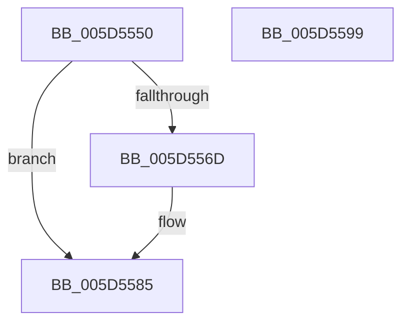

# PopThermalEventTransitionTimerCallback

- RVA: `0x005D5550`–`0x005D559A` (길이 `74` bytes)
- VA: `0x00000001405D5550`
- 실행 섹션: `.text`
- PDB 이름 있음: `예`; PDB Function 태그: `아니요`
- unwind 정보 RVA: `0x0005CF00`
- 디코드: `18`개 명령, `74/74` bytes 표시
- 미해석 바이트: `0` (있으면 어셈블리에 `.byte`로 보존)

> 이 문서는 커널 이미지의 기계어와 PDB 기호를 분석해 생성했습니다. 4번과 5번은 함수 원형과 자료형을 바이너리 사용 방식에서 추정한 C 해석이며 원본 소스 복구 결과는 아닙니다.

## 1. Dependencies

- 직접 호출 지점: **3**; 고유 호출 대상: **3**
- 직접 호출자로 확인된 함수: **0**
- RIP 상대 이미지 참조: **4**

### Outgoing calls
- `0x005D555D` → [KeAcquireSpinLockRaiseToDpc](../20/KeAcquireSpinLockRaiseToDpc_function_00208470.md) (function, `0x00208470`)
- `0x005D5572` → [PopDeepSleepClearDisengageReason](../39/PopDeepSleepClearDisengageReason_function_0039010C.md) (function, `0x0039010C`)
- `0x005D558E` → [KeReleaseSpinLock](../39/KeReleaseSpinLock_function_00392BA0.md) (function, `0x00392BA0`)

### Direct callers
- 이 함수 시작 RVA로 연결되는 직접 call은 확인되지 않았습니다. 간접 호출은 완전히 역산할 수 없습니다.

### Static image references
- `0x005D5556` → RVA `0x00F0B9A0` (`.data`; read)
- `0x005D5562` → RVA `0x00F0BA38` (`.data`; read)
- `0x005D5577` → RVA `0x00F0B9AC` (`.data`; read/write)
- `0x005D557E` → RVA `0x00F0BA38` (`.data`; write)

## 2. Other-region calls and transfers

- 다른 실행 섹션으로 향하는 call: **0**
- 별도 외부 분기/꼬리 이동을 확인하지 못했습니다.

## 3. Assembly (complete function range)

```asm
005D5550  40 53                           push rbx
005D5552  48 83 EC 20                     sub rsp, 0x20
005D5556  48 8D 0D 43 64 93 00            lea rcx, [rip + 0x936443]
005D555D  E8 0E 2F C3 FF                  call 0x140208470
005D5562  80 3D CF 64 93 00 00            cmp byte ptr [rip + 0x9364cf], 0
005D5569  8A D8                           mov bl, al
005D556B  74 18                           je 0x1405d5585
005D556D  B9 0A 00 00 00                  mov ecx, 0xa
005D5572  E8 95 AB DB FF                  call 0x14039010c
005D5577  83 0D 2E 64 93 00 FF            or dword ptr [rip + 0x93642e], 0xffffffff
005D557E  C6 05 B3 64 93 00 00            mov byte ptr [rip + 0x9364b3], 0
005D5585  8A D3                           mov dl, bl
005D5587  48 8D 0D 12 64 93 00            lea rcx, [rip + 0x936412]
005D558E  E8 0D D6 DB FF                  call 0x140392ba0
005D5593  48 83 C4 20                     add rsp, 0x20
005D5597  5B                              pop rbx
005D5598  C3                              ret
005D5599  CC                              int3
```

## 4. C-style interpretation (structured pseudocode)

```c
__int64 __fastcall PopThermalEventTransitionTimerCallback(void)
{
    __int64 result;
    __int64 v_rsp;

    v_rsp = (v_rsp) - (32);
    result = KeAcquireSpinLockRaiseToDpc(v_rip + 9659459, a2, a3, a4);
    if ((*(unsigned __int8 *)(v_rip + 9659599)) != 0) {
        a1 = 10;
        result = PopDeepSleepClearDisengageReason(a1, a2, a3, a4);
        *(unsigned __int8 *)(v_rip + 9659571) = 0;
    }
    result = KeReleaseSpinLock(v_rip + 9659410, (unsigned __int8)((unsigned __int8)(result)), a3, a4);
    v_rsp = (v_rsp) + (32);
    return result;
}
```

## 5. (Beta) C Style

```c
void PopThermalEventTransitionTimerCallback(void)
{
    int64_t result;
    int64_t local_rsp;

    local_rsp = (local_rsp) - (32);
    result = KeAcquireSpinLockRaiseToDpc(v_rip + 9659459, a2, a3, a4);
    if ((*(uint8_t *)(v_rip + 0x9364CF)) != 0) {
        a1 = 10;
        result = PopDeepSleepClearDisengageReason(a1, a2, a3, a4);
        *(uint8_t *)(v_rip + 0x9364B3) = 0;
    }
    result = KeReleaseSpinLock(v_rip + 9659410, (uint8_t)((uint8_t)(result)), a3, a4);
    local_rsp = (local_rsp) + (32);
    return result;
}
```

## 6. Execution-region graph

[열기: 2D/3D 그래프와 함수 탐색 컨트롤 패널](../../../control-panel.html?section=text&rva=0x005D5550&view=graph)

- 2D 그래프는 위에서 아래로 흐르고, 3D 그래프는 빈 공간을 드래그해 회전합니다. Shift+드래그는 이동, 휠은 확대·축소, 함수 노드 선택은 대상 보고서 이동입니다.

### Static fallback


