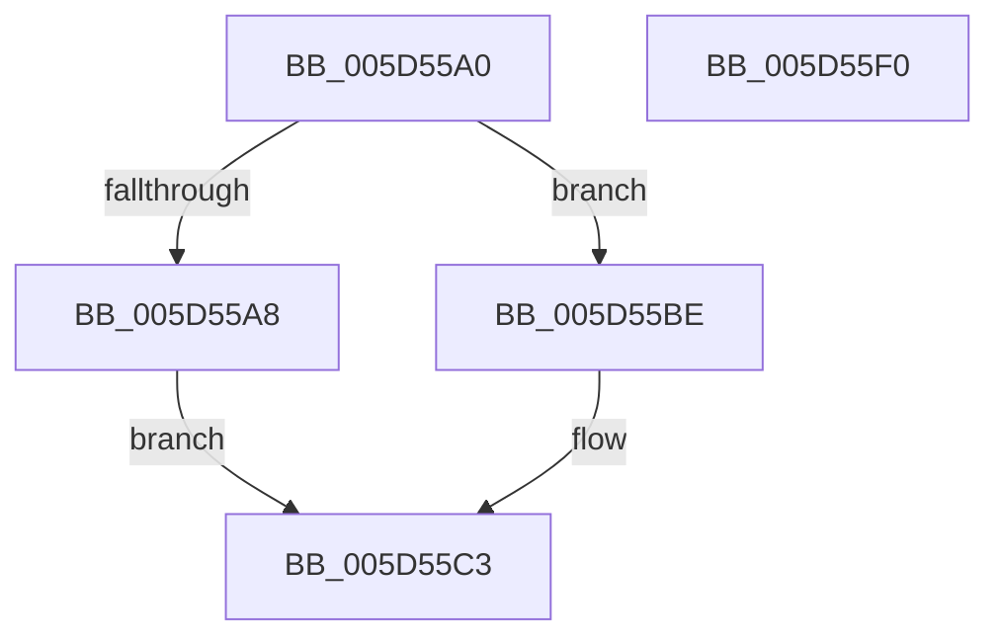

# PopThermalStandbyNotify

- RVA: `0x005D55A0`–`0x005D55F1` (길이 `81` bytes)
- VA: `0x00000001405D55A0`
- 실행 섹션: `.text`
- PDB 이름 있음: `예`; PDB Function 태그: `아니요`
- unwind 정보 RVA: `0x00063458`
- 디코드: `19`개 명령, `81/81` bytes 표시
- 미해석 바이트: `0` (있으면 어셈블리에 `.byte`로 보존)

> 이 문서는 커널 이미지의 기계어와 PDB 기호를 분석해 생성했습니다. 4번과 5번은 함수 원형과 자료형을 바이너리 사용 방식에서 추정한 C 해석이며 원본 소스 복구 결과는 아닙니다.

## 1. Dependencies

- 직접 호출 지점: **2**; 고유 호출 대상: **2**
- 직접 호출자로 확인된 함수: **3**
- RIP 상대 이미지 참조: **2**

### Outgoing calls
- `0x005D55B7` → [PopDiagTraceEventNoPayload](../49/PopDiagTraceEventNoPayload_function_004982F8.md) (function, `0x004982F8`)
- `0x005D55E6` → [ZwUpdateWnfStateData](../6B/ZwUpdateWnfStateData_function_006B0D10.md) (function, `0x006B0D10`)

### Direct callers
- [PopThermalCsExit](PopThermalCsExit_function_005D54C8.md) at `0x005D54F4`
- [PopThermalCsExit](PopThermalCsExit_function_005D54C8.md) at `0x005D550F`
- [sub_006F9E40](../6F/Unknown_function_006F9E40.md) at `0x006F9F68`
- [sub_006F9E40](../6F/Unknown_function_006F9E40.md) at `0x006F9FA8`
- [PopThermalZoneRemove](../../page/75/PopThermalZoneRemove_function_0075FAD0.md) at `0x0075FB96`

### Static image references
- `0x005D55A8` → RVA `0x00022390` (`.rdata`; read)
- `0x005D55D2` → RVA `0x00020AF8` (`.rdata`; read)

## 2. Other-region calls and transfers

- 다른 실행 섹션으로 향하는 call: **0**
- 별도 외부 분기/꼬리 이동을 확인하지 못했습니다.

## 3. Assembly (complete function range)

```asm
005D55A0  48 83 EC 48                     sub rsp, 0x48
005D55A4  84 C9                           test cl, cl
005D55A6  74 16                           je 0x1405d55be
005D55A8  48 8D 0D E1 CD A4 FF            lea rcx, [rip - 0x5b321f]
005D55AF  C7 44 24 50 01 00 00 00         mov dword ptr [rsp + 0x50], 1
005D55B7  E8 3C 2D EC FF                  call 0x1404982f8
005D55BC  EB 05                           jmp 0x1405d55c3
005D55BE  83 64 24 50 00                  and dword ptr [rsp + 0x50], 0
005D55C3  83 64 24 30 00                  and dword ptr [rsp + 0x30], 0
005D55C8  48 8D 54 24 50                  lea rdx, [rsp + 0x50]
005D55CD  83 64 24 28 00                  and dword ptr [rsp + 0x28], 0
005D55D2  48 8D 0D 1F B5 A4 FF            lea rcx, [rip - 0x5b4ae1]
005D55D9  48 83 64 24 20 00               and qword ptr [rsp + 0x20], 0
005D55DF  45 33 C9                        xor r9d, r9d
005D55E2  45 8D 41 04                     lea r8d, [r9 + 4]
005D55E6  E8 25 B7 0D 00                  call 0x1406b0d10
005D55EB  48 83 C4 48                     add rsp, 0x48
005D55EF  C3                              ret
005D55F0  CC                              int3
```

## 4. C-style interpretation (structured pseudocode)

```c
__int64 __fastcall PopThermalStandbyNotify(unsigned __int8 a1, __int64 a2, __int64 a3, int a4)
{
    __int64 result;
    __int64 v_rsp;
    unsigned int v_stack_m18;
    unsigned int v_stack_m20;
    unsigned __int64 v_stack_m28;
    unsigned int v_stack_p8;

    v_rsp = (v_rsp) - (72);
    if (a1 == 0) goto loc_005D55BE;
    v_stack_p8 = 1;
    result = PopDiagTraceEventNoPayload(v_rip - 5976607, a2, a3, a4);
    goto loc_005D55C3;
loc_005D55BE:
loc_005D55C3:
    a4 = 0;
    result = ZwUpdateWnfStateData(v_rip - 5982945, v_stack_p8, a4 + 4, a4);
    v_rsp = (v_rsp) + (72);
    return result;
}
```

## 5. (Beta) C Style

```c
int64_t PopThermalStandbyNotify(uint8_t Arg1, int64_t Arg2, int64_t Arg3, int32_t Arg4)
{
    int64_t result;
    int64_t local_rsp;
    uint32_t v_stack_m18;
    uint32_t v_stack_m20;
    uint64_t v_stack_m28;
    uint32_t v_stack_p8;

    local_rsp = (local_rsp) - (72);
    if (Arg1 == 0) goto loc_005D55BE;
    v_stack_p8 = 1;
    result = PopDiagTraceEventNoPayload(v_rip - 5976607, Arg2, Arg3, Arg4);
    goto loc_005D55C3;
loc_005D55BE:
loc_005D55C3:
    Arg4 = 0;
    result = ZwUpdateWnfStateData(v_rip - 5982945, v_stack_p8, Arg4 + 4, Arg4);
    local_rsp = (local_rsp) + (72);
    return result;
}
```

## 6. Execution-region graph

[열기: 2D/3D 그래프와 함수 탐색 컨트롤 패널](../../../control-panel.html?section=text&rva=0x005D55A0&view=graph)

- 2D 그래프는 위에서 아래로 흐르고, 3D 그래프는 빈 공간을 드래그해 회전합니다. Shift+드래그는 이동, 휠은 확대·축소, 함수 노드 선택은 대상 보고서 이동입니다.

### Static fallback


