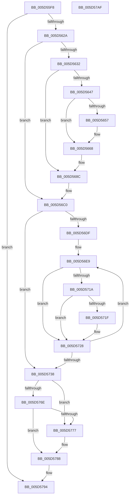

# PopThermalSxExit

- RVA: `0x005D55F8`–`0x005D57B0` (길이 `440` bytes)
- VA: `0x00000001405D55F8`
- 실행 섹션: `.text`
- PDB 이름 있음: `예`; PDB Function 태그: `아니요`
- unwind 정보 RVA: `0x000CC640`
- 디코드: `95`개 명령, `440/440` bytes 표시
- 미해석 바이트: `0` (있으면 어셈블리에 `.byte`로 보존)

> 이 문서는 커널 이미지의 기계어와 PDB 기호를 분석해 생성했습니다. 4번과 5번은 함수 원형과 자료형을 바이너리 사용 방식에서 추정한 C 해석이며 원본 소스 복구 결과는 아닙니다.

## 1. Dependencies

- 직접 호출 지점: **17**; 고유 호출 대상: **11**
- 직접 호출자로 확인된 함수: **1**
- RIP 상대 이미지 참조: **17**

### Outgoing calls
- `0x005D5639` → [PopAcquireRwLockExclusive](../43/PopAcquireRwLockExclusive_function_00430B44.md) (function, `0x00430B44`)
- `0x005D564E` → [Feature_Servicing_ThermalSxExitRereadZones__private_IsEnabledDeviceUsageNoInline](Feature_Servicing_ThermalSxExitRereadZones__private_IsEnabledDeviceUsageNoInline_function_005D53F4.md) (function, `0x005D53F4`)
- `0x005D5687` → [ZwUpdateWnfStateData](../6B/ZwUpdateWnfStateData_function_006B0D10.md) (function, `0x006B0D10`)
- `0x005D5693` → [PopReleaseRwLock](../2D/PopReleaseRwLock_function_002DFBBC.md) (function, `0x002DFBBC`)
- `0x005D569F` → [KeAcquireSpinLockRaiseToDpc](../20/KeAcquireSpinLockRaiseToDpc_function_00208470.md) (function, `0x00208470`)
- `0x005D56BB` → [KeReleaseSpinLock](../39/KeReleaseSpinLock_function_00392BA0.md) (function, `0x00392BA0`)
- `0x005D56C7` → [PopAcquireRwLockShared](../2D/PopAcquireRwLockShared_function_002D9A40.md) (function, `0x002D9A40`)
- `0x005D56F3` → [PopAcquireRwLockExclusive](../43/PopAcquireRwLockExclusive_function_00430B44.md) (function, `0x00430B44`)
- `0x005D5711` → [Feature_Servicing_ThermalSxExitRereadZones__private_IsEnabledDeviceUsageNoInline](Feature_Servicing_ThermalSxExitRereadZones__private_IsEnabledDeviceUsageNoInline_function_005D53F4.md) (function, `0x005D53F4`)
- `0x005D5723` → [IoCancelIrp](../27/IoCancelIrp_function_002720E0.md) (function, `0x002720E0`)
- `0x005D572B` → [PopReleaseRwLock](../2D/PopReleaseRwLock_function_002DFBBC.md) (function, `0x002DFBBC`)
- `0x005D573F` → [PopReleaseRwLock](../2D/PopReleaseRwLock_function_002DFBBC.md) (function, `0x002DFBBC`)
- `0x005D5746` → [PopCoolingSxTransition](../42/PopCoolingSxTransition_function_0042FEA8.md) (function, `0x0042FEA8`)
- `0x005D574D` → [PopPowerLimitSxTransition](PopPowerLimitSxTransition_function_005D0E64.md) (function, `0x005D0E64`)
- `0x005D5759` → [PopAcquireRwLockExclusive](../43/PopAcquireRwLockExclusive_function_00430B44.md) (function, `0x00430B44`)
- `0x005D5783` → [PopQueueWorkItem](../4A/PopQueueWorkItem_function_004A20F8.md) (function, `0x004A20F8`)
- `0x005D578F` → [PopReleaseRwLock](../2D/PopReleaseRwLock_function_002DFBBC.md) (function, `0x002DFBBC`)

### Direct callers
- [PopPolicyWorkerAction](../../page/A9/PopPolicyWorkerAction_function_00A9CC40.md) at `0x00A9CE22`

### Static image references
- `0x005D5611` → RVA `0x00F0C680` (`.data`; read)
- `0x005D5619` → RVA `0x00F0BAF4` (`.data`; read/write)
- `0x005D5632` → RVA `0x00F0B980` (`.data`; read)
- `0x005D563E` → RVA `0x00F0B992` (`.data`; read)
- `0x005D5647` → RVA `0x00F0B992` (`.data`; write)
- `0x005D565A` → RVA `0x00F0B991` (`.data`; write)
- `0x005D5661` → RVA `0x00F0B993` (`.data`; write)
- `0x005D566D` → RVA `0x000208F0` (`.rdata`; read)
- `0x005D5698` → RVA `0x00F0B9A0` (`.data`; read)
- `0x005D56A4` → RVA `0x00F0B9AC` (`.data`; read/write)
- `0x005D56B4` → RVA `0x00F0B9A8` (`.data`; write)
- `0x005D56C0` → RVA `0x00F0C900` (`.data`; read)
- `0x005D56CC` → RVA `0x00F0CE80` (`.data`; read)
- `0x005D575E` → RVA `0x00F0B991` (`.data`; read)
- `0x005D5765` → RVA `0x00F0B990` (`.data`; write)
- `0x005D576E` → RVA `0x00F0B993` (`.data`; read)
- `0x005D577C` → RVA `0x00F0B940` (`.data`; read)

## 2. Other-region calls and transfers

- 다른 실행 섹션으로 향하는 call: **0**
- 별도 외부 분기/꼬리 이동을 확인하지 못했습니다.

## 3. Assembly (complete function range)

```asm
005D55F8  48 8B C4                        mov rax, rsp
005D55FB  48 89 58 08                     mov qword ptr [rax + 8], rbx
005D55FF  48 89 70 10                     mov qword ptr [rax + 0x10], rsi
005D5603  48 89 78 18                     mov qword ptr [rax + 0x18], rdi
005D5607  4C 89 60 20                     mov qword ptr [rax + 0x20], r12
005D560B  41 57                           push r15
005D560D  48 83 EC 40                     sub rsp, 0x40
005D5611  8A 0D 69 70 93 00               mov cl, byte ptr [rip + 0x937069]
005D5617  33 C0                           xor eax, eax
005D5619  87 05 D5 64 93 00               xchg dword ptr [rip + 0x9364d5], eax
005D561F  40 32 FF                        xor dil, dil
005D5622  85 C0                           test eax, eax
005D5624  0F 84 6A 01 00 00               je 0x1405d5794
005D562A  84 C9                           test cl, cl
005D562C  0F 84 8E 00 00 00               je 0x1405d56c0
005D5632  48 8D 0D 47 63 93 00            lea rcx, [rip + 0x936347]
005D5639  E8 06 B5 E5 FF                  call 0x140430b44
005D563E  40 38 3D 4D 63 93 00            cmp byte ptr [rip + 0x93634d], dil
005D5645  74 45                           je 0x1405d568c
005D5647  40 88 3D 44 63 93 00            mov byte ptr [rip + 0x936344], dil
005D564E  E8 A1 FD FF FF                  call 0x1405d53f4
005D5653  85 C0                           test eax, eax
005D5655  74 11                           je 0x1405d5668
005D5657  40 B7 01                        mov dil, 1
005D565A  C6 05 30 63 93 00 00            mov byte ptr [rip + 0x936330], 0
005D5661  C6 05 2B 63 93 00 00            mov byte ptr [rip + 0x93632b], 0
005D5668  83 64 24 30 00                  and dword ptr [rsp + 0x30], 0
005D566D  48 8D 0D 7C B2 A4 FF            lea rcx, [rip - 0x5b4d84]
005D5674  83 64 24 28 00                  and dword ptr [rsp + 0x28], 0
005D5679  45 33 C9                        xor r9d, r9d
005D567C  48 83 64 24 20 00               and qword ptr [rsp + 0x20], 0
005D5682  45 33 C0                        xor r8d, r8d
005D5685  33 D2                           xor edx, edx
005D5687  E8 84 B6 0D 00                  call 0x1406b0d10
005D568C  48 8D 0D ED 62 93 00            lea rcx, [rip + 0x9362ed]
005D5693  E8 24 A5 D0 FF                  call 0x1402dfbbc
005D5698  48 8D 0D 01 63 93 00            lea rcx, [rip + 0x936301]
005D569F  E8 CC 2D C3 FF                  call 0x140208470
005D56A4  83 0D 01 63 93 00 FF            or dword ptr [rip + 0x936301], 0xffffffff
005D56AB  48 8D 0D EE 62 93 00            lea rcx, [rip + 0x9362ee]
005D56B2  8A D0                           mov dl, al
005D56B4  C6 05 ED 62 93 00 01            mov byte ptr [rip + 0x9362ed], 1
005D56BB  E8 E0 D4 DB FF                  call 0x140392ba0
005D56C0  48 8D 0D 39 72 93 00            lea rcx, [rip + 0x937239]
005D56C7  E8 74 43 D0 FF                  call 0x1402d9a40
005D56CC  48 8B 1D AD 77 93 00            mov rbx, qword ptr [rip + 0x9377ad]
005D56D3  4C 8D 3D A6 77 93 00            lea r15, [rip + 0x9377a6]
005D56DA  49 3B DF                        cmp rbx, r15
005D56DD  74 59                           je 0x1405d5738
005D56DF  49 BC 08 00 00 00 80 F7 FF FF   movabs r12, 0xfffff78000000008
005D56E9  48 8D B3 B0 01 00 00            lea rsi, [rbx + 0x1b0]
005D56F0  48 8B CE                        mov rcx, rsi
005D56F3  E8 4C B4 E5 FF                  call 0x140430b44
005D56F8  49 8B 04 24                     mov rax, qword ptr [r12]
005D56FC  48 89 83 00 02 00 00            mov qword ptr [rbx + 0x200], rax
005D5703  48 89 83 08 02 00 00            mov qword ptr [rbx + 0x208], rax
005D570A  C6 83 F8 01 00 00 00            mov byte ptr [rbx + 0x1f8], 0
005D5711  E8 DE FC FF FF                  call 0x1405d53f4
005D5716  85 C0                           test eax, eax
005D5718  74 0E                           je 0x1405d5728
005D571A  40 84 FF                        test dil, dil
005D571D  74 09                           je 0x1405d5728
005D571F  48 8B 4B 38                     mov rcx, qword ptr [rbx + 0x38]
005D5723  E8 B8 C9 C9 FF                  call 0x1402720e0
005D5728  48 8B CE                        mov rcx, rsi
005D572B  E8 8C A4 D0 FF                  call 0x1402dfbbc
005D5730  48 8B 1B                        mov rbx, qword ptr [rbx]
005D5733  49 3B DF                        cmp rbx, r15
005D5736  75 B1                           jne 0x1405d56e9
005D5738  48 8D 0D C1 71 93 00            lea rcx, [rip + 0x9371c1]
005D573F  E8 78 A4 D0 FF                  call 0x1402dfbbc
005D5744  33 C9                           xor ecx, ecx
005D5746  E8 5D A7 E5 FF                  call 0x14042fea8
005D574B  33 C9                           xor ecx, ecx
005D574D  E8 12 B7 FF FF                  call 0x1405d0e64
005D5752  48 8D 0D 27 62 93 00            lea rcx, [rip + 0x936227]
005D5759  E8 E6 B3 E5 FF                  call 0x140430b44
005D575E  80 3D 2C 62 93 00 00            cmp byte ptr [rip + 0x93622c], 0
005D5765  C6 05 24 62 93 00 01            mov byte ptr [rip + 0x936224], 1
005D576C  75 09                           jne 0x1405d5777
005D576E  80 3D 1E 62 93 00 00            cmp byte ptr [rip + 0x93621e], 0
005D5775  74 11                           je 0x1405d5788
005D5777  BA 01 00 00 00                  mov edx, 1
005D577C  48 8D 0D BD 61 93 00            lea rcx, [rip + 0x9361bd]
005D5783  E8 70 C9 EC FF                  call 0x1404a20f8
005D5788  48 8D 0D F1 61 93 00            lea rcx, [rip + 0x9361f1]
005D578F  E8 28 A4 D0 FF                  call 0x1402dfbbc
005D5794  48 8B 5C 24 50                  mov rbx, qword ptr [rsp + 0x50]
005D5799  48 8B 74 24 58                  mov rsi, qword ptr [rsp + 0x58]
005D579E  48 8B 7C 24 60                  mov rdi, qword ptr [rsp + 0x60]
005D57A3  4C 8B 64 24 68                  mov r12, qword ptr [rsp + 0x68]
005D57A8  48 83 C4 40                     add rsp, 0x40
005D57AC  41 5F                           pop r15
005D57AE  C3                              ret
005D57AF  CC                              int3
```

## 4. C-style interpretation (structured pseudocode)

```c
__int64 __fastcall PopThermalSxExit(__int64 a1, int a2, int a3, int a4)
{
    __int64 result;
    __int64 v_rdi;
    __int64 v_rsp;
    unsigned int v_stack_m18;
    unsigned int v_stack_m20;
    unsigned __int64 v_stack_m28;
    unsigned __int64 v_stack_p10;
    unsigned __int64 v_stack_p18;
    unsigned __int64 v_stack_p20;
    unsigned __int64 v_stack_p8;

    *(unsigned __int64 *)(v_rsp + 8) = v_rbx;
    *(unsigned __int64 *)(v_rsp + 16) = v_rsi;
    *(unsigned __int64 *)(v_rsp + 24) = v_rdi;
    *(unsigned __int64 *)(v_rsp + 32) = v_r12;
    v_rsp = (v_rsp) - (64);
    result = 0;
    v_rdi = 0;
    if (0 == 0) goto loc_005D5794;
    if ((unsigned __int8)(*(unsigned __int8 *)(v_rip + 9662569)) == 0) goto loc_005D56C0;
    result = PopAcquireRwLockExclusive(v_rip + 9659207, a2, a3, a4);
    if ((*(unsigned __int8 *)(v_rip + 9659213)) == 0) goto loc_005D568C;
    *(unsigned __int8 *)(v_rip + 9659204) = 0;
    result = Feature_Servicing_ThermalSxExitRereadZones__private_IsEnabledDeviceUsageNoInline(v_rip + 9659207, a2, a3, a4);
    if ((unsigned int)(result) != 0) {
        v_rdi = 1;
        *(unsigned __int8 *)(v_rip + 9659184) = 0;
        *(unsigned __int8 *)(v_rip + 9659179) = 0;
    }
    a4 = 0;
    a3 = 0;
    a2 = 0;
    result = ZwUpdateWnfStateData(v_rip - 5983620, a2, a3, a4);
loc_005D568C:
    result = PopReleaseRwLock(v_rip + 9659117, a2, a3, a4);
    result = KeAcquireSpinLockRaiseToDpc(v_rip + 9659137, a2, a3, a4);
    *(unsigned __int8 *)(v_rip + 9659117) = 1;
    result = KeReleaseSpinLock(v_rip + 9659118, (unsigned __int8)(result), a3, a4);
loc_005D56C0:
    result = PopAcquireRwLockShared(v_rip + 9663033, (unsigned __int8)(result), a3, a4);
    if ((*(unsigned __int64 *)(v_rip + 9664429)) == (v_rip + 9664422)) goto loc_005D5738;
loc_005D56E9:
    result = PopAcquireRwLockExclusive(*(unsigned __int64 *)(v_rip + 9664429) + 432, (unsigned __int8)(result), a3, a4);
    *(unsigned __int64 *)(*(unsigned __int64 *)(v_rip + 9664429) + 512) = *(unsigned __int64 *)(v_r12);
    *(unsigned __int64 *)(*(unsigned __int64 *)(v_rip + 9664429) + 520) = *(unsigned __int64 *)(v_r12);
    *(unsigned __int8 *)(*(unsigned __int64 *)(v_rip + 9664429) + 504) = 0;
    result = Feature_Servicing_ThermalSxExitRereadZones__private_IsEnabledDeviceUsageNoInline(*(unsigned __int64 *)(v_rip + 9664429) + 432, (unsigned __int8)(result), a3, a4);
    if ((unsigned int)(result) == 0) goto loc_005D5728;
    if ((unsigned __int8)(v_rdi) != 0) {
        a1 = *(unsigned __int64 *)(*(unsigned __int64 *)(v_rip + 9664429) + 56);
        result = IoCancelIrp(a1, (unsigned __int8)(result), a3, a4);
    }
    result = PopReleaseRwLock(*(unsigned __int64 *)(v_rip + 9664429) + 432, (unsigned __int8)(result), a3, a4);
    if ((*(unsigned __int64 *)(*(unsigned __int64 *)(v_rip + 9664429))) != (v_rip + 9664422)) goto loc_005D56E9;
loc_005D5738:
    result = PopReleaseRwLock(v_rip + 9662913, (unsigned __int8)(result), a3, a4);
    a1 = 0;
    result = PopCoolingSxTransition(a1, (unsigned __int8)(result), a3, a4);
    a1 = 0;
    result = PopPowerLimitSxTransition(a1, (unsigned __int8)(result), a3, a4);
    result = PopAcquireRwLockExclusive(v_rip + 9658919, (unsigned __int8)(result), a3, a4);
    *(unsigned __int8 *)(v_rip + 9658916) = 1;
    if ((*(unsigned __int8 *)(v_rip + 9658924)) != 0) goto loc_005D5777;
    if ((*(unsigned __int8 *)(v_rip + 9658910)) != 0) {
        a2 = 1;
        a1 = v_rip + 9658813;
        result = PopQueueWorkItem(a1, a2, a3, a4);
    }
    result = PopReleaseRwLock(v_rip + 9658865, a2, a3, a4);
loc_005D5794:
    v_rsp = (v_rsp) + (64);
    return result;
}
```

## 5. (Beta) C Style

```c
int64_t PopThermalSxExit(int64_t Arg1, int32_t Arg2, int32_t Arg3, int32_t Arg4)
{
    int64_t result;
    int64_t local_rdi;
    int64_t local_rsp;
    uint32_t v_stack_m18;
    uint32_t v_stack_m20;
    uint64_t v_stack_m28;
    uint64_t v_stack_p10;
    uint64_t v_stack_p18;
    uint64_t v_stack_p20;
    uint64_t v_stack_p8;

    *(uint64_t *)(local_rsp + 0x8) = local_rbx;
    *(uint64_t *)(local_rsp + 0x10) = local_rsi;
    *(uint64_t *)(local_rsp + 0x18) = local_rdi;
    *(uint64_t *)(local_rsp + 0x20) = local_r12;
    local_rsp = (local_rsp) - (64);
    result = 0;
    local_rdi = 0;
    if (0 == 0) goto loc_005D5794;
    if ((uint8_t)(*(uint8_t *)(v_rip + 0x937069)) == 0) goto loc_005D56C0;
    result = PopAcquireRwLockExclusive(v_rip + 9659207, Arg2, Arg3, Arg4);
    if ((*(uint8_t *)(v_rip + 0x93634D)) == 0) goto loc_005D568C;
    *(uint8_t *)(v_rip + 0x936344) = 0;
    result = Feature_Servicing_ThermalSxExitRereadZones__private_IsEnabledDeviceUsageNoInline(v_rip + 9659207, Arg2, Arg3, Arg4);
    if ((uint32_t)(result) != 0) {
        local_rdi = 1;
        *(uint8_t *)(v_rip + 0x936330) = 0;
        *(uint8_t *)(v_rip + 0x93632B) = 0;
    }
    Arg4 = 0;
    Arg3 = 0;
    Arg2 = 0;
    result = ZwUpdateWnfStateData(v_rip - 5983620, Arg2, Arg3, Arg4);
loc_005D568C:
    result = PopReleaseRwLock(v_rip + 9659117, Arg2, Arg3, Arg4);
    result = KeAcquireSpinLockRaiseToDpc(v_rip + 9659137, Arg2, Arg3, Arg4);
    *(uint8_t *)(v_rip + 0x9362ED) = 1;
    result = KeReleaseSpinLock(v_rip + 9659118, (uint8_t)(result), Arg3, Arg4);
loc_005D56C0:
    result = PopAcquireRwLockShared(v_rip + 9663033, (uint8_t)(result), Arg3, Arg4);
    if ((*(uint64_t *)(v_rip + 0x9377AD)) == (v_rip + 9664422)) goto loc_005D5738;
loc_005D56E9:
    result = PopAcquireRwLockExclusive(*(uint64_t *)(v_rip + 0x9377AD) + 432, (uint8_t)(result), Arg3, Arg4);
    *(uint64_t *)(*(uint64_t *)(v_rip + 0x9377AD) + 0x200) = *(uint64_t *)(local_r12);
    *(uint64_t *)(*(uint64_t *)(v_rip + 0x9377AD) + 0x208) = *(uint64_t *)(local_r12);
    *(uint8_t *)(*(uint64_t *)(v_rip + 0x9377AD) + 0x1F8) = 0;
    result = Feature_Servicing_ThermalSxExitRereadZones__private_IsEnabledDeviceUsageNoInline(*(uint64_t *)(v_rip + 0x9377AD) + 432, (uint8_t)(result), Arg3, Arg4);
    if ((uint32_t)(result) == 0) goto loc_005D5728;
    if ((uint8_t)(local_rdi) != 0) {
        Arg1 = *(uint64_t *)(*(uint64_t *)(v_rip + 0x9377AD) + 0x38);
        result = IoCancelIrp(Arg1, (uint8_t)(result), Arg3, Arg4);
    }
    result = PopReleaseRwLock(*(uint64_t *)(v_rip + 0x9377AD) + 432, (uint8_t)(result), Arg3, Arg4);
    if ((*(uint64_t *)(*(uint64_t *)(v_rip + 0x9377AD))) != (v_rip + 9664422)) goto loc_005D56E9;
loc_005D5738:
    result = PopReleaseRwLock(v_rip + 9662913, (uint8_t)(result), Arg3, Arg4);
    Arg1 = 0;
    result = PopCoolingSxTransition(Arg1, (uint8_t)(result), Arg3, Arg4);
    Arg1 = 0;
    result = PopPowerLimitSxTransition(Arg1, (uint8_t)(result), Arg3, Arg4);
    result = PopAcquireRwLockExclusive(v_rip + 9658919, (uint8_t)(result), Arg3, Arg4);
    *(uint8_t *)(v_rip + 0x936224) = 1;
    if ((*(uint8_t *)(v_rip + 0x93622C)) != 0) goto loc_005D5777;
    if ((*(uint8_t *)(v_rip + 0x93621E)) != 0) {
        Arg2 = 1;
        Arg1 = v_rip + 9658813;
        result = PopQueueWorkItem(Arg1, Arg2, Arg3, Arg4);
    }
    result = PopReleaseRwLock(v_rip + 9658865, Arg2, Arg3, Arg4);
loc_005D5794:
    local_rsp = (local_rsp) + (64);
    return result;
}
```

## 6. Execution-region graph

[열기: 2D/3D 그래프와 함수 탐색 컨트롤 패널](../../../control-panel.html?section=text&rva=0x005D55F8&view=graph)

- 2D 그래프는 위에서 아래로 흐르고, 3D 그래프는 빈 공간을 드래그해 회전합니다. Shift+드래그는 이동, 휠은 확대·축소, 함수 노드 선택은 대상 보고서 이동입니다.

### Static fallback


