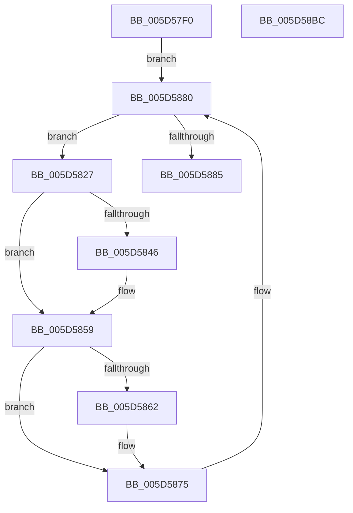

# PopThermalTelemetryWorker

- RVA: `0x005D57F0`–`0x005D58BD` (길이 `205` bytes)
- VA: `0x00000001405D57F0`
- 실행 섹션: `.text`
- PDB 이름 있음: `예`; PDB Function 태그: `아니요`
- unwind 정보 RVA: `0x0005E6B4`
- 디코드: `49`개 명령, `205/205` bytes 표시
- 미해석 바이트: `0` (있으면 어셈블리에 `.byte`로 보존)

> 이 문서는 커널 이미지의 기계어와 PDB 기호를 분석해 생성했습니다. 4번과 5번은 함수 원형과 자료형을 바이너리 사용 방식에서 추정한 C 해석이며 원본 소스 복구 결과는 아닙니다.

## 1. Dependencies

- 직접 호출 지점: **10**; 고유 호출 대상: **9**
- 직접 호출자로 확인된 함수: **0**
- RIP 상대 이미지 참조: **3**

### Outgoing calls
- `0x005D5810` → [PopAcquireRwLockShared](../2D/PopAcquireRwLockShared_function_002D9A40.md) (function, `0x002D9A40`)
- `0x005D5831` → [PopAcquireRwLockExclusive](../43/PopAcquireRwLockExclusive_function_00430B44.md) (function, `0x00430B44`)
- `0x005D584C` → [PopThermalUpdatePassiveTimeTracking](../../page/AA/PopThermalUpdatePassiveTimeTracking_function_00AA15EC.md) (function, `0x00AA15EC`)
- `0x005D5854` → [PopTraceThermalZonePassiveHistogram](../4D/PopTraceThermalZonePassiveHistogram_function_004DDD10.md) (function, `0x004DDD10`)
- `0x005D5868` → [PopThermalUpdateActiveTimeTracking](../../page/AB/PopThermalUpdateActiveTimeTracking_function_00ABA79C.md) (function, `0x00ABA79C`)
- `0x005D5870` → [PopTraceThermalZoneActiveActivity](PopTraceThermalZoneActiveActivity_function_005D7FE0.md) (function, `0x005D7FE0`)
- `0x005D5878` → [PopReleaseRwLock](../2D/PopReleaseRwLock_function_002DFBBC.md) (function, `0x002DFBBC`)
- `0x005D588C` → [PopReleaseRwLock](../2D/PopReleaseRwLock_function_002DFBBC.md) (function, `0x002DFBBC`)
- `0x005D5891` → [PopCoolingTelemetryWorker](../42/PopCoolingTelemetryWorker_function_0042FC3C.md) (function, `0x0042FC3C`)
- `0x005D5896` → [PopPowerLimitTelemetryWorker](../42/PopPowerLimitTelemetryWorker_function_0042FD20.md) (function, `0x0042FD20`)

### Direct callers
- 이 함수 시작 RVA로 연결되는 직접 call은 확인되지 않았습니다. 간접 호출은 완전히 역산할 수 없습니다.

### Static image references
- `0x005D5809` → RVA `0x00F0C900` (`.data`; read)
- `0x005D5815` → RVA `0x00F0CE80` (`.data`; read)
- `0x005D589B` → RVA `0x00F0BAE8` (`.data`; read/write)

## 2. Other-region calls and transfers

- 다른 실행 섹션으로 향하는 call: **2**
  - `0x005D584C` → [PopThermalUpdatePassiveTimeTracking](../../page/AA/PopThermalUpdatePassiveTimeTracking_function_00AA15EC.md) (`.text` → `PAGE`)
  - `0x005D5868` → [PopThermalUpdateActiveTimeTracking](../../page/AB/PopThermalUpdateActiveTimeTracking_function_00ABA79C.md) (`.text` → `PAGE`)
- 별도 외부 분기/꼬리 이동을 확인하지 못했습니다.

## 3. Assembly (complete function range)

```asm
005D57F0  48 8B C4                        mov rax, rsp
005D57F3  48 89 58 08                     mov qword ptr [rax + 8], rbx
005D57F7  48 89 68 10                     mov qword ptr [rax + 0x10], rbp
005D57FB  48 89 70 18                     mov qword ptr [rax + 0x18], rsi
005D57FF  48 89 78 20                     mov qword ptr [rax + 0x20], rdi
005D5803  41 56                           push r14
005D5805  48 83 EC 20                     sub rsp, 0x20
005D5809  48 8D 0D F0 70 93 00            lea rcx, [rip + 0x9370f0]
005D5810  E8 2B 42 D0 FF                  call 0x1402d9a40
005D5815  48 8B 1D 64 76 93 00            mov rbx, qword ptr [rip + 0x937664]
005D581C  4C 8D 35 5D 76 93 00            lea r14, [rip + 0x93765d]
005D5823  33 FF                           xor edi, edi
005D5825  EB 59                           jmp 0x1405d5880
005D5827  48 8D AB B0 01 00 00            lea rbp, [rbx + 0x1b0]
005D582E  48 8B CD                        mov rcx, rbp
005D5831  E8 0E B3 E5 FF                  call 0x140430b44
005D5836  48 8D B3 F8 01 00 00            lea rsi, [rbx + 0x1f8]
005D583D  40 38 BB 91 00 00 00            cmp byte ptr [rbx + 0x91], dil
005D5844  74 13                           je 0x1405d5859
005D5846  8A 53 50                        mov dl, byte ptr [rbx + 0x50]
005D5849  48 8B CE                        mov rcx, rsi
005D584C  E8 9B BD 4C 00                  call 0x140aa15ec
005D5851  48 8B CB                        mov rcx, rbx
005D5854  E8 B7 84 F0 FF                  call 0x1404ddd10
005D5859  40 38 BB F9 01 00 00            cmp byte ptr [rbx + 0x1f9], dil
005D5860  76 13                           jbe 0x1405d5875
005D5862  8A 53 45                        mov dl, byte ptr [rbx + 0x45]
005D5865  48 8B CE                        mov rcx, rsi
005D5868  E8 2F 4F 4E 00                  call 0x140aba79c
005D586D  48 8B CB                        mov rcx, rbx
005D5870  E8 6B 27 00 00                  call 0x1405d7fe0
005D5875  48 8B CD                        mov rcx, rbp
005D5878  E8 3F A3 D0 FF                  call 0x1402dfbbc
005D587D  48 8B 1B                        mov rbx, qword ptr [rbx]
005D5880  49 3B DE                        cmp rbx, r14
005D5883  75 A2                           jne 0x1405d5827
005D5885  48 8D 0D 74 70 93 00            lea rcx, [rip + 0x937074]
005D588C  E8 2B A3 D0 FF                  call 0x1402dfbbc
005D5891  E8 A6 A3 E5 FF                  call 0x14042fc3c
005D5896  E8 85 A4 E5 FF                  call 0x14042fd20
005D589B  87 3D 47 62 93 00               xchg dword ptr [rip + 0x936247], edi
005D58A1  48 8B 7C 24 48                  mov rdi, qword ptr [rsp + 0x48]
005D58A6  48 8B 5C 24 30                  mov rbx, qword ptr [rsp + 0x30]
005D58AB  48 8B 6C 24 38                  mov rbp, qword ptr [rsp + 0x38]
005D58B0  48 8B 74 24 40                  mov rsi, qword ptr [rsp + 0x40]
005D58B5  48 83 C4 20                     add rsp, 0x20
005D58B9  41 5E                           pop r14
005D58BB  C3                              ret
005D58BC  CC                              int3
```

## 4. C-style interpretation (structured pseudocode)

```c
__int64 __fastcall PopThermalTelemetryWorker(void)
{
    __int64 result;
    __int64 v_rdi;
    __int64 v_rsp;
    unsigned __int64 v_stack_p10;
    unsigned __int64 v_stack_p18;
    unsigned __int64 v_stack_p20;
    unsigned __int64 v_stack_p8;

    *(unsigned __int64 *)(v_rsp + 8) = v_rbx;
    *(unsigned __int64 *)(v_rsp + 16) = v_rbp;
    *(unsigned __int64 *)(v_rsp + 24) = v_rsi;
    *(unsigned __int64 *)(v_rsp + 32) = v_rdi;
    v_rsp = (v_rsp) - (32);
    result = PopAcquireRwLockShared(v_rip + 9662704, a2, a3, a4);
    v_rdi = 0;
    goto loc_005D5880;
loc_005D5827:
    result = PopAcquireRwLockExclusive(*(unsigned __int64 *)(v_rip + 9664100) + 432, a2, a3, a4);
    if ((*(unsigned __int8 *)(*(unsigned __int64 *)(v_rip + 9664100) + 145)) != 0) {
        a2 = *(unsigned __int8 *)(*(unsigned __int64 *)(v_rip + 9664100) + 80);
        a1 = *(unsigned __int64 *)(v_rip + 9664100) + 504;
        result = PopThermalUpdatePassiveTimeTracking(a1, a2, a3, a4);
        a1 = *(unsigned __int64 *)(v_rip + 9664100);
        result = PopTraceThermalZonePassiveHistogram(a1, a2, a3, a4);
    }
    if ((*(unsigned __int8 *)(*(unsigned __int64 *)(v_rip + 9664100) + 505)) >= = 0) {
        a2 = *(unsigned __int8 *)(*(unsigned __int64 *)(v_rip + 9664100) + 69);
        a1 = *(unsigned __int64 *)(v_rip + 9664100) + 504;
        result = PopThermalUpdateActiveTimeTracking(a1, a2, a3, a4);
        a1 = *(unsigned __int64 *)(v_rip + 9664100);
        result = PopTraceThermalZoneActiveActivity(a1, a2, a3, a4);
    }
    result = PopReleaseRwLock(*(unsigned __int64 *)(v_rip + 9664100) + 432, a2, a3, a4);
loc_005D5880:
    if ((*(unsigned __int64 *)(*(unsigned __int64 *)(v_rip + 9664100))) != (v_rip + 9664093)) goto loc_005D5827;
    result = PopReleaseRwLock(v_rip + 9662580, a2, a3, a4);
    result = PopCoolingTelemetryWorker(v_rip + 9662580, a2, a3, a4);
    result = PopPowerLimitTelemetryWorker(v_rip + 9662580, a2, a3, a4);
    v_rsp = (v_rsp) + (32);
    return result;
}
```

## 5. (Beta) C Style

```c
void PopThermalTelemetryWorker(void)
{
    int64_t result;
    int64_t local_rdi;
    int64_t local_rsp;
    uint64_t v_stack_p10;
    uint64_t v_stack_p18;
    uint64_t v_stack_p20;
    uint64_t v_stack_p8;

    *(uint64_t *)(local_rsp + 0x8) = local_rbx;
    *(uint64_t *)(local_rsp + 0x10) = local_rbp;
    *(uint64_t *)(local_rsp + 0x18) = local_rsi;
    *(uint64_t *)(local_rsp + 0x20) = local_rdi;
    local_rsp = (local_rsp) - (32);
    result = PopAcquireRwLockShared(v_rip + 9662704, a2, a3, a4);
    local_rdi = 0;
    goto loc_005D5880;
loc_005D5827:
    result = PopAcquireRwLockExclusive(*(uint64_t *)(v_rip + 0x937664) + 432, a2, a3, a4);
    if ((*(uint8_t *)(*(uint64_t *)(v_rip + 0x937664) + 0x91)) != 0) {
        a2 = *(uint8_t *)(*(uint64_t *)(v_rip + 0x937664) + 0x50);
        a1 = *(uint64_t *)(v_rip + 0x937664) + 504;
        result = PopThermalUpdatePassiveTimeTracking(a1, a2, a3, a4);
        a1 = *(uint64_t *)(v_rip + 0x937664);
        result = PopTraceThermalZonePassiveHistogram(a1, a2, a3, a4);
    }
    if ((*(uint8_t *)(*(uint64_t *)(v_rip + 0x937664) + 0x1F9)) >= = 0) {
        a2 = *(uint8_t *)(*(uint64_t *)(v_rip + 0x937664) + 0x45);
        a1 = *(uint64_t *)(v_rip + 0x937664) + 504;
        result = PopThermalUpdateActiveTimeTracking(a1, a2, a3, a4);
        a1 = *(uint64_t *)(v_rip + 0x937664);
        result = PopTraceThermalZoneActiveActivity(a1, a2, a3, a4);
    }
    result = PopReleaseRwLock(*(uint64_t *)(v_rip + 0x937664) + 432, a2, a3, a4);
loc_005D5880:
    if ((*(uint64_t *)(*(uint64_t *)(v_rip + 0x937664))) != (v_rip + 9664093)) goto loc_005D5827;
    result = PopReleaseRwLock(v_rip + 9662580, a2, a3, a4);
    result = PopCoolingTelemetryWorker(v_rip + 9662580, a2, a3, a4);
    result = PopPowerLimitTelemetryWorker(v_rip + 9662580, a2, a3, a4);
    local_rsp = (local_rsp) + (32);
    return result;
}
```

## 6. Execution-region graph

[열기: 2D/3D 그래프와 함수 탐색 컨트롤 패널](../../../control-panel.html?section=text&rva=0x005D57F0&view=graph)

- 2D 그래프는 위에서 아래로 흐르고, 3D 그래프는 빈 공간을 드래그해 회전합니다. Shift+드래그는 이동, 휠은 확대·축소, 함수 노드 선택은 대상 보고서 이동입니다.

### Static fallback


