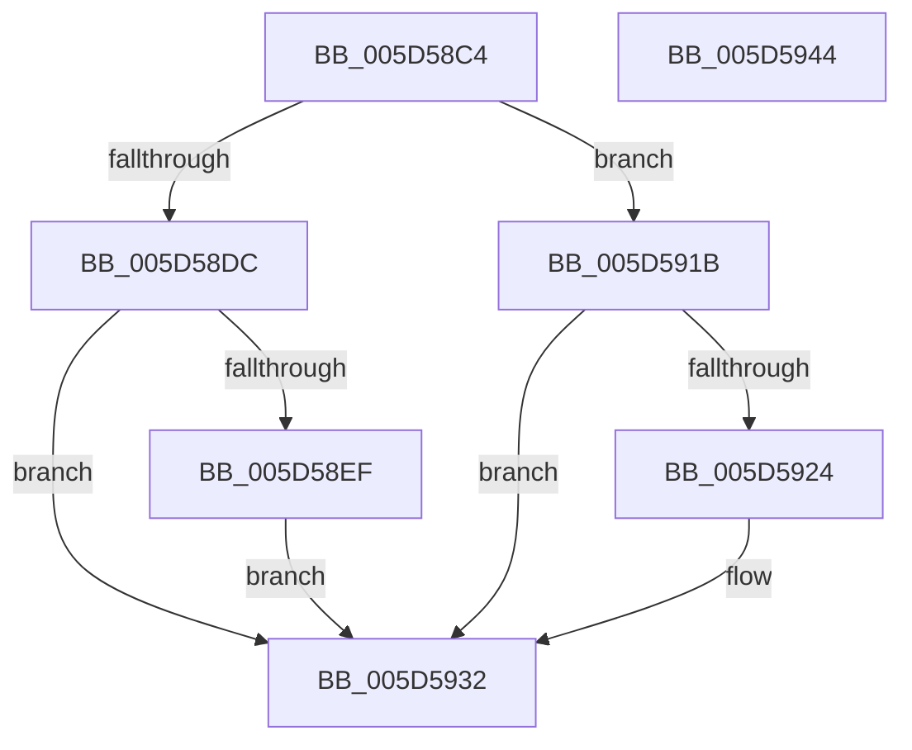

# PopThermalUpdateTelemetryClientCount

- RVA: `0x005D58C4`–`0x005D5945` (길이 `129` bytes)
- VA: `0x00000001405D58C4`
- 실행 섹션: `.text`
- PDB 이름 있음: `예`; PDB Function 태그: `아니요`
- unwind 정보 RVA: `0x00064C80`
- 디코드: `31`개 명령, `129/129` bytes 표시
- 미해석 바이트: `0` (있으면 어셈블리에 `.byte`로 보존)

> 이 문서는 커널 이미지의 기계어와 PDB 기호를 분석해 생성했습니다. 4번과 5번은 함수 원형과 자료형을 바이너리 사용 방식에서 추정한 C 해석이며 원본 소스 복구 결과는 아닙니다.

## 1. Dependencies

- 직접 호출 지점: **4**; 고유 호출 대상: **4**
- 직접 호출자로 확인된 함수: **8**
- RIP 상대 이미지 참조: **5**

### Outgoing calls
- `0x005D58D3` → [PopAcquireRwLockExclusive](../43/PopAcquireRwLockExclusive_function_00430B44.md) (function, `0x00430B44`)
- `0x005D5914` → [KeSetTimer2](../3A/KeSetTimer2_function_003A08E0.md) (function, `0x003A08E0`)
- `0x005D592D` → [KeCancelTimer2](../3A/KeCancelTimer2_function_003A01E0.md) (function, `0x003A01E0`)
- `0x005D5939` → [PopReleaseRwLock](../2D/PopReleaseRwLock_function_002DFBBC.md) (function, `0x002DFBBC`)

### Direct callers
- [PopAssociatePowerLimitRequest](../../page/75/PopAssociatePowerLimitRequest_function_00755EC8.md) at `0x007560EC`
- [PopFreePowerLimitRequest](../../page/75/PopFreePowerLimitRequest_function_00756494.md) at `0x00756533`
- [PopOrphanPowerLimitExtension](../../page/75/PopOrphanPowerLimitExtension_function_007566D8.md) at `0x0075672F`
- [PopAssociateThermalRequest](../../page/75/PopAssociateThermalRequest_function_00756E78.md) at `0x00757085`
- [PopOrphanCoolingExtension](../../page/75/PopOrphanCoolingExtension_function_00757474.md) at `0x007574F4`
- [PopThermalZoneAdd](../../page/75/PopThermalZoneAdd_function_0075F980.md) at `0x0075FAA4`
- [PopThermalZoneRemove](../../page/75/PopThermalZoneRemove_function_0075FAD0.md) at `0x0075FBF9`
- [PopDeactiveThermalRequest](../../page/AD/PopDeactiveThermalRequest_function_00ADF634.md) at `0x00ADF697`

### Static image references
- `0x005D58CC` → RVA `0x00F0C8E0` (`.data`; read)
- `0x005D58DC` → RVA `0x00F0BAF0` (`.data`; read)
- `0x005D58E4` → RVA `0x00F0BAF0` (`.data`; write)
- `0x005D5900` → RVA `0x00F0BA40` (`.data`; read)
- `0x005D591B` → RVA `0x00F0BAF0` (`.data`; read/write)

## 2. Other-region calls and transfers

- 다른 실행 섹션으로 향하는 call: **0**
- 별도 외부 분기/꼬리 이동을 확인하지 못했습니다.

## 3. Assembly (complete function range)

```asm
005D58C4  40 53                           push rbx
005D58C6  48 83 EC 30                     sub rsp, 0x30
005D58CA  8A D9                           mov bl, cl
005D58CC  48 8D 0D 0D 70 93 00            lea rcx, [rip + 0x93700d]
005D58D3  E8 6C B2 E5 FF                  call 0x140430b44
005D58D8  84 DB                           test bl, bl
005D58DA  74 3F                           je 0x1405d591b
005D58DC  8B 05 0E 62 93 00               mov eax, dword ptr [rip + 0x93620e]
005D58E2  FF C0                           inc eax
005D58E4  89 05 06 62 93 00               mov dword ptr [rip + 0x936206], eax
005D58EA  83 F8 01                        cmp eax, 1
005D58ED  75 43                           jne 0x1405d5932
005D58EF  48 83 64 24 20 00               and qword ptr [rsp + 0x20], 0
005D58F5  4C 8D 4C 24 20                  lea r9, [rsp + 0x20]
005D58FA  48 83 4C 24 28 FF               or qword ptr [rsp + 0x28], 0xffffffffffffffff
005D5900  48 8D 0D 39 61 93 00            lea rcx, [rip + 0x936139]
005D5907  45 33 C0                        xor r8d, r8d
005D590A  48 BA 00 40 96 D5 36 FF FF FF   movabs rdx, 0xffffff36d5964000
005D5914  E8 C7 AF DC FF                  call 0x1403a08e0
005D5919  EB 17                           jmp 0x1405d5932
005D591B  83 05 CE 61 93 00 FF            add dword ptr [rip + 0x9361ce], -1
005D5922  75 0E                           jne 0x1405d5932
005D5924  33 D2                           xor edx, edx
005D5926  48 8D 0D 13 61 93 00            lea rcx, [rip + 0x936113]
005D592D  E8 AE A8 DC FF                  call 0x1403a01e0
005D5932  48 8D 0D A7 6F 93 00            lea rcx, [rip + 0x936fa7]
005D5939  E8 7E A2 D0 FF                  call 0x1402dfbbc
005D593E  48 83 C4 30                     add rsp, 0x30
005D5942  5B                              pop rbx
005D5943  C3                              ret
005D5944  CC                              int3
```

## 4. C-style interpretation (structured pseudocode)

```c
__int64 __fastcall PopThermalUpdateTelemetryClientCount(unsigned __int8 a1, __int64 a2, int a3)
{
    __int64 result;
    __int64 v_rsp;
    unsigned __int64 v_stack_m10;
    unsigned __int64 v_stack_m18;

    v_rsp = (v_rsp) - (48);
    result = PopAcquireRwLockExclusive(v_rip + 9662477, a2, a3, a4);
    if (a1 == 0) goto loc_005D591B;
    result = (unsigned int)(((unsigned int)(*(unsigned int *)(v_rip + 9658894))) + 1);
    *(unsigned int *)(v_rip + 9658886) = (unsigned int)(result);
    if (((unsigned int)(result)) != 1) goto loc_005D5932;
    a3 = 0;
    result = KeSetTimer2(v_rip + 9658681, a2, a3, v_stack_m18);
    goto loc_005D5932;
loc_005D591B:
    if (!(condition_is_not_equal)) {
        a2 = 0;
        a1 = v_rip + 9658643;
        result = KeCancelTimer2(a1, a2, a3, v_stack_m18);
    }
    result = PopReleaseRwLock(v_rip + 9662375, a2, a3, v_stack_m18);
    v_rsp = (v_rsp) + (48);
    return result;
}
```

## 5. (Beta) C Style

```c
int64_t PopThermalUpdateTelemetryClientCount(uint8_t Arg1, int64_t Arg2, int32_t Arg3)
{
    int64_t result;
    int64_t local_rsp;
    uint64_t v_stack_m10;
    uint64_t v_stack_m18;

    local_rsp = (local_rsp) - (48);
    result = PopAcquireRwLockExclusive(v_rip + 9662477, Arg2, Arg3, a4);
    if (Arg1 == 0) goto loc_005D591B;
    result = (uint32_t)(((uint32_t)(*(uint32_t *)(v_rip + 0x93620E))) + 1);
    *(uint32_t *)(v_rip + 0x936206) = (uint32_t)(result);
    if (((uint32_t)(result)) != 1) goto loc_005D5932;
    Arg3 = 0;
    result = KeSetTimer2(v_rip + 9658681, Arg2, Arg3, v_stack_m18);
    goto loc_005D5932;
loc_005D591B:
    if (!(condition_is_not_equal)) {
        Arg2 = 0;
        Arg1 = v_rip + 9658643;
        result = KeCancelTimer2(Arg1, Arg2, Arg3, v_stack_m18);
    }
    result = PopReleaseRwLock(v_rip + 9662375, Arg2, Arg3, v_stack_m18);
    local_rsp = (local_rsp) + (48);
    return result;
}
```

## 6. Execution-region graph

[열기: 2D/3D 그래프와 함수 탐색 컨트롤 패널](../../../control-panel.html?section=text&rva=0x005D58C4&view=graph)

- 2D 그래프는 위에서 아래로 흐르고, 3D 그래프는 빈 공간을 드래그해 회전합니다. Shift+드래그는 이동, 휠은 확대·축소, 함수 노드 선택은 대상 보고서 이동입니다.

### Static fallback


