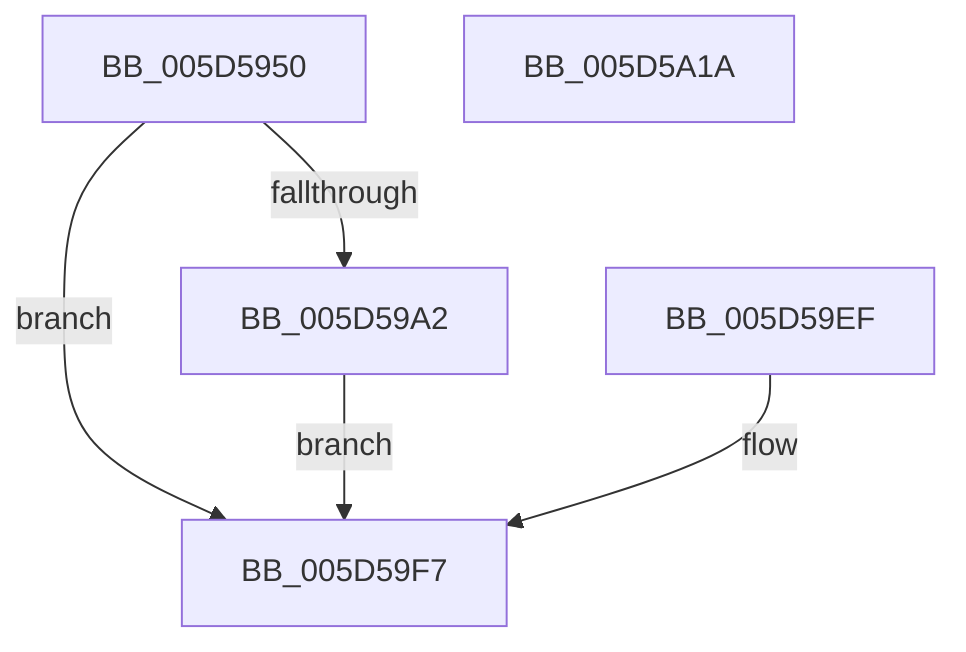

# PopThermalZoneDpc

- RVA: `0x005D5950`–`0x005D5A1B` (길이 `203` bytes)
- VA: `0x00000001405D5950`
- 실행 섹션: `.text`
- PDB 이름 있음: `예`; PDB Function 태그: `아니요`
- unwind 정보 RVA: `0x000CC5EC`
- 디코드: `52`개 명령, `203/203` bytes 표시
- 미해석 바이트: `0` (있으면 어셈블리에 `.byte`로 보존)

> 이 문서는 커널 이미지의 기계어와 PDB 기호를 분석해 생성했습니다. 4번과 5번은 함수 원형과 자료형을 바이너리 사용 방식에서 추정한 C 해석이며 원본 소스 복구 결과는 아닙니다.

## 1. Dependencies

- 직접 호출 지점: **3**; 고유 호출 대상: **3**
- 직접 호출자로 확인된 함수: **0**
- RIP 상대 이미지 참조: **0**

### Outgoing calls
- `0x005D598D` → [memset](../6C/memset_function_006C6C40.md) (function, `0x006C6C40`)
- `0x005D59E6` → [KiCustomAccessRoutine3](../6B/KiCustomAccessRoutine3_function_006BC280.md) (function, `0x006BC280`)
- `0x005D59FB` → [IoCancelIrp](../27/IoCancelIrp_function_002720E0.md) (function, `0x002720E0`)

### Direct callers
- 이 함수 시작 RVA로 연결되는 직접 call은 확인되지 않았습니다. 간접 호출은 완전히 역산할 수 없습니다.

### Static image references
- 디코드된 RIP-relative 메모리 참조가 없습니다.

## 2. Other-region calls and transfers

- 다른 실행 섹션으로 향하는 call: **0**
- 별도 외부 분기/꼬리 이동을 확인하지 못했습니다.

## 3. Assembly (complete function range)

```asm
005D5950  48 8B C4                        mov rax, rsp
005D5953  48 89 58 08                     mov qword ptr [rax + 8], rbx
005D5957  48 89 70 18                     mov qword ptr [rax + 0x18], rsi
005D595B  48 89 78 20                     mov qword ptr [rax + 0x20], rdi
005D595F  48 89 50 10                     mov qword ptr [rax + 0x10], rdx
005D5963  41 56                           push r14
005D5965  48 81 EC B0 01 00 00            sub rsp, 0x1b0
005D596C  48 89 A4 24 A0 01 00 00         mov qword ptr [rsp + 0x1a0], rsp
005D5974  4D 8B F1                        mov r14, r9
005D5977  49 8B F0                        mov rsi, r8
005D597A  48 8B FA                        mov rdi, rdx
005D597D  48 8B D9                        mov rbx, rcx
005D5980  33 D2                           xor edx, edx
005D5982  44 8D 42 5C                     lea r8d, [rdx + 0x5c]
005D5986  48 8D 88 78 FF FF FF            lea rcx, [rax - 0x88]
005D598D  E8 AE 12 0F 00                  call 0x1406c6c40
005D5992  48 8B C7                        mov rax, rdi
005D5995  48 C1 F8 2F                     sar rax, 0x2f
005D5999  48 FF C0                        inc rax
005D599C  48 83 F8 01                     cmp rax, 1
005D59A0  76 55                           jbe 0x1405d59f7
005D59A2  83 64 24 30 00                  and dword ptr [rsp + 0x30], 0
005D59A7  C6 03 00                        mov byte ptr [rbx], 0
005D59AA  49 8B C6                        mov rax, r14
005D59AD  48 C1 E8 08                     shr rax, 8
005D59B1  48 89 43 20                     mov qword ptr [rbx + 0x20], rax
005D59B5  48 89 B4 24 84 01 00 00         mov qword ptr [rsp + 0x184], rsi
005D59BD  8B CE                           mov ecx, esi
005D59BF  48 8B C7                        mov rax, rdi
005D59C2  48 D3 C0                        rol rax, cl
005D59C5  48 89 84 24 4C 01 00 00         mov qword ptr [rsp + 0x14c], rax
005D59CD  48 8B C3                        mov rax, rbx
005D59D0  48 D3 C8                        ror rax, cl
005D59D3  48 89 84 24 64 01 00 00         mov qword ptr [rsp + 0x164], rax
005D59DB  4C 31 73 28                     xor qword ptr [rbx + 0x28], r14
005D59DF  48 31 73 30                     xor qword ptr [rbx + 0x30], rsi
005D59E3  48 8B CF                        mov rcx, rdi
005D59E6  E8 95 68 0E 00                  call 0x1406bc280
005D59EB  90                              nop
005D59EC  90                              nop
005D59ED  EB 08                           jmp 0x1405d59f7
005D59EF  48 8B BC 24 C8 01 00 00         mov rdi, qword ptr [rsp + 0x1c8]
005D59F7  48 8B 4F 38                     mov rcx, qword ptr [rdi + 0x38]
005D59FB  E8 E0 C6 C9 FF                  call 0x1402720e0
005D5A00  4C 8D 9C 24 B0 01 00 00         lea r11, [rsp + 0x1b0]
005D5A08  49 8B 5B 10                     mov rbx, qword ptr [r11 + 0x10]
005D5A0C  49 8B 73 20                     mov rsi, qword ptr [r11 + 0x20]
005D5A10  49 8B 7B 28                     mov rdi, qword ptr [r11 + 0x28]
005D5A14  49 8B E3                        mov rsp, r11
005D5A17  41 5E                           pop r14
005D5A19  C3                              ret
005D5A1A  CC                              int3
```

## 4. C-style interpretation (structured pseudocode)

```c
__int64 __fastcall PopThermalZoneDpc(__int64 a1, __int64 a2, __int64 a3, __int64 a4)
{
    __int64 result;
    __int64 v_rsp;
    unsigned __int64 v_stack_m18;
    unsigned int v_stack_m188;
    unsigned __int64 v_stack_m34;
    unsigned __int64 v_stack_m54;
    unsigned __int64 v_stack_m6C;
    unsigned __int64 v_stack_m8;
    unsigned __int64 v_stack_p10;

    *(unsigned __int64 *)(v_rsp + 8) = v_rbx;
    *(unsigned __int64 *)(v_rsp + 24) = v_rsi;
    *(unsigned __int64 *)(v_rsp + 32) = v_rdi;
    *(unsigned __int64 *)(v_rsp + 16) = a2;
    v_rsp = (v_rsp) - (432);
    v_stack_m18 = v_rsp;
    a2 = 0;
    result = memset(v_rsp - 136, a2, a2 + 92, a4);
    result = (0) >> (47);
    result = (result) + 1;
    if (result <= 1) goto loc_005D59F7;
    *(unsigned __int8 *)(a1) = 0;
    result = (a4) >> (8);
    *(unsigned __int64 *)(a1 + 32) = result;
    v_stack_m34 = a3;
    v_stack_m6C = 0;
    v_stack_m54 = a1;
    result = KiCustomAccessRoutine3(0, a2, a2 + 92, a4);
    goto loc_005D59F7;
loc_005D59F7:
    result = IoCancelIrp(*(unsigned __int64 *)(a2 + 56), a2, a2 + 92, a4);
    return result;
}
```

## 5. (Beta) C Style

```c
int64_t PopThermalZoneDpc(void *Arg1, void *Arg2, int64_t Arg3, int64_t Arg4)
{
    uint8_t *arg1 = (uint8_t *)Arg1;
    uint8_t *arg2 = (uint8_t *)Arg2;

    int64_t result;
    int64_t local_rsp;
    uint64_t v_stack_m18;
    uint32_t v_stack_m188;
    uint64_t v_stack_m34;
    uint64_t v_stack_m54;
    uint64_t v_stack_m6C;
    uint64_t v_stack_m8;
    uint64_t v_stack_p10;

    *(uint64_t *)(local_rsp + 0x8) = local_rbx;
    *(uint64_t *)(local_rsp + 0x18) = local_rsi;
    *(uint64_t *)(local_rsp + 0x20) = local_rdi;
    *(void **)(local_rsp + 0x10) = Arg2;
    local_rsp = (local_rsp) - (432);
    v_stack_m18 = local_rsp;
    Arg2 = 0;
    result = memset(local_rsp - 136, Arg2, Arg2 + 92, Arg4);
    result = (0) >> (47);
    result = (result) + 1;
    if (result <= 1) goto loc_005D59F7;
    *(uint8_t *)(arg1) = 0;
    result = (Arg4) >> (8);
    *(uint64_t *)(arg1 + 0x20) = result;
    v_stack_m34 = Arg3;
    v_stack_m6C = 0;
    v_stack_m54 = Arg1;
    result = KiCustomAccessRoutine3(0, Arg2, Arg2 + 92, Arg4);
    goto loc_005D59F7;
loc_005D59F7:
    result = IoCancelIrp(*(uint64_t *)(arg2 + 0x38), Arg2, Arg2 + 92, Arg4);
    return result;
}
```

### 관측된 메모리 오프셋

구조체 형식이 확인되지 않은 접근은 인자 기준의 오프셋으로만 기록했습니다.

| 기준 인자 | 오프셋 표현 | 폭 (bit) | 접근 |
|---|---:|---:|---|
| `Arg1` | `+ 0x0` | `8` | `W` |
| `Arg1` | `+ 0x20` | `64` | `W` |
| `Arg1` | `+ 0x28` | `64` | `R/W` |
| `Arg1` | `+ 0x30` | `64` | `R/W` |
| `Arg2` | `+ 0x38` | `64` | `R` |

## 6. Execution-region graph

[열기: 2D/3D 그래프와 함수 탐색 컨트롤 패널](../../../control-panel.html?section=text&rva=0x005D5950&view=graph)

- 2D 그래프는 위에서 아래로 흐르고, 3D 그래프는 빈 공간을 드래그해 회전합니다. Shift+드래그는 이동, 휠은 확대·축소, 함수 노드 선택은 대상 보고서 이동입니다.

### Static fallback


