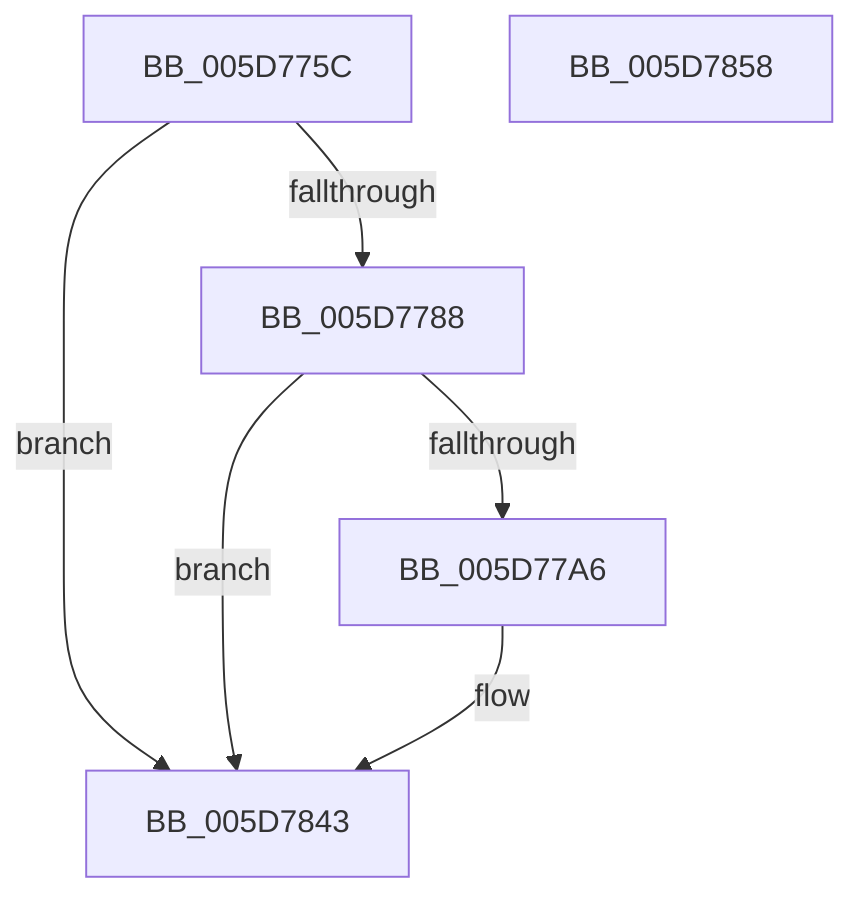

# PopTraceBootError

- RVA: `0x005D775C`–`0x005D7859` (길이 `253` bytes)
- VA: `0x00000001405D775C`
- 실행 섹션: `.text`
- PDB 이름 있음: `예`; PDB Function 태그: `아니요`
- unwind 정보 RVA: `0x000BAEE4`
- 디코드: `54`개 명령, `253/253` bytes 표시
- 미해석 바이트: `0` (있으면 어셈블리에 `.byte`로 보존)

> 이 문서는 커널 이미지의 기계어와 PDB 기호를 분석해 생성했습니다. 4번과 5번은 함수 원형과 자료형을 바이너리 사용 방식에서 추정한 C 해석이며 원본 소스 복구 결과는 아닙니다.

## 1. Dependencies

- 직접 호출 지점: **3**; 고유 호출 대상: **3**
- 직접 호출자로 확인된 함수: **1**
- RIP 상대 이미지 참조: **3**

### Outgoing calls
- `0x005D7799` → [tlgKeywordOn](../42/tlgKeywordOn_function_0042EAA0.md) (function, `0x0042EAA0`)
- `0x005D783E` → [tlgWriteTransfer_EtwWriteTransfer](../42/tlgWriteTransfer_EtwWriteTransfer_function_004260E0.md) (function, `0x004260E0`)
- `0x005D784A` → [_security_check_cookie](../6A/_security_check_cookie_function_006AC640.md) (function, `0x006AC640`)

### Direct callers
- [PopCheckAndClearBootError](../../init/C3/PopCheckAndClearBootError_function_00C3DA4C.md) at `0x00C3DA91`

### Static image references
- `0x005D776A` → RVA `0x00E0A740` (`.data`; read)
- `0x005D7778` → RVA `0x00E07748` (`.data`; read)
- `0x005D77A9` → RVA `0x000494D9` (`.rdata`; read)

## 2. Other-region calls and transfers

- 다른 실행 섹션으로 향하는 call: **0**
- 별도 외부 분기/꼬리 이동을 확인하지 못했습니다.

## 3. Assembly (complete function range)

```asm
005D775C  40 55                           push rbp
005D775E  48 8D 6C 24 A9                  lea rbp, [rsp - 0x57]
005D7763  48 81 EC D0 00 00 00            sub rsp, 0xd0
005D776A  48 8B 05 CF 2F 83 00            mov rax, qword ptr [rip + 0x832fcf]
005D7771  48 33 C4                        xor rax, rsp
005D7774  48 89 45 47                     mov qword ptr [rbp + 0x47], rax
005D7778  83 3D C9 FF 82 00 05            cmp dword ptr [rip + 0x82ffc9], 5
005D777F  4C 8B C1                        mov r8, rcx
005D7782  0F 86 BB 00 00 00               jbe 0x1405d7843
005D7788  48 BA 00 00 00 00 00 80 00 00   movabs rdx, 0x800000000000
005D7792  48 8D 0D AF FF 82 00            lea rcx, [rip + 0x82ffaf]
005D7799  E8 02 73 E5 FF                  call 0x14042eaa0
005D779E  84 C0                           test al, al
005D77A0  0F 84 9D 00 00 00               je 0x1405d7843
005D77A6  41 8B 00                        mov eax, dword ptr [r8]
005D77A9  48 8D 15 29 1D A7 FF            lea rdx, [rip - 0x58e2d7]
005D77B0  89 45 B7                        mov dword ptr [rbp - 0x49], eax
005D77B3  48 8D 0D 8E FF 82 00            lea rcx, [rip + 0x82ff8e]
005D77BA  48 8D 45 B7                     lea rax, [rbp - 0x49]
005D77BE  48 C7 45 FF 04 00 00 00         mov qword ptr [rbp - 1], 4
005D77C6  48 89 45 F7                     mov qword ptr [rbp - 9], rax
005D77CA  45 33 C9                        xor r9d, r9d
005D77CD  41 8B 40 04                     mov eax, dword ptr [r8 + 4]
005D77D1  89 45 BB                        mov dword ptr [rbp - 0x45], eax
005D77D4  48 8D 45 BB                     lea rax, [rbp - 0x45]
005D77D8  48 89 45 07                     mov qword ptr [rbp + 7], rax
005D77DC  41 8B 40 08                     mov eax, dword ptr [r8 + 8]
005D77E0  89 45 BF                        mov dword ptr [rbp - 0x41], eax
005D77E3  48 8D 45 BF                     lea rax, [rbp - 0x41]
005D77E7  48 89 45 17                     mov qword ptr [rbp + 0x17], rax
005D77EB  41 8B 40 0C                     mov eax, dword ptr [r8 + 0xc]
005D77EF  89 45 C3                        mov dword ptr [rbp - 0x3d], eax
005D77F2  48 8D 45 C3                     lea rax, [rbp - 0x3d]
005D77F6  48 89 45 27                     mov qword ptr [rbp + 0x27], rax
005D77FA  49 63 40 10                     movsxd rax, dword ptr [r8 + 0x10]
005D77FE  45 33 C0                        xor r8d, r8d
005D7801  48 89 45 C7                     mov qword ptr [rbp - 0x39], rax
005D7805  48 8D 45 C7                     lea rax, [rbp - 0x39]
005D7809  48 89 45 37                     mov qword ptr [rbp + 0x37], rax
005D780D  48 8D 45 D7                     lea rax, [rbp - 0x29]
005D7811  48 89 44 24 28                  mov qword ptr [rsp + 0x28], rax
005D7816  C7 44 24 20 07 00 00 00         mov dword ptr [rsp + 0x20], 7
005D781E  48 C7 45 0F 04 00 00 00         mov qword ptr [rbp + 0xf], 4
005D7826  48 C7 45 1F 04 00 00 00         mov qword ptr [rbp + 0x1f], 4
005D782E  48 C7 45 2F 04 00 00 00         mov qword ptr [rbp + 0x2f], 4
005D7836  48 C7 45 3F 08 00 00 00         mov qword ptr [rbp + 0x3f], 8
005D783E  E8 9D E8 E4 FF                  call 0x1404260e0
005D7843  48 8B 4D 47                     mov rcx, qword ptr [rbp + 0x47]
005D7847  48 33 CC                        xor rcx, rsp
005D784A  E8 F1 4D 0D 00                  call 0x1406ac640
005D784F  48 81 C4 D0 00 00 00            add rsp, 0xd0
005D7856  5D                              pop rbp
005D7857  C3                              ret
005D7858  CC                              int3
```

## 4. C-style interpretation (structured pseudocode)

```c
__int64 __fastcall PopTraceBootError(__int64 a1, __int64 a2, __int64 a3, int a4)
{
    __int64 result;
    __int64 v_rsp;
    unsigned __int64 v_stack_m18;
    unsigned __int64 v_stack_m20;
    unsigned __int64 v_stack_m28;
    unsigned __int64 v_stack_m30;
    unsigned __int64 v_stack_m38;
    unsigned __int64 v_stack_m40;
    unsigned __int64 v_stack_m48;
    unsigned __int64 v_stack_m50;
    unsigned __int64 v_stack_m58;
    unsigned __int64 v_stack_m5F;
    unsigned __int64 v_stack_m60;
    unsigned __int64 v_stack_m68;
    unsigned __int64 v_stack_m88;
    unsigned __int64 v_stack_m98;
    unsigned int v_stack_m9C;
    unsigned int v_stack_mA0;
    unsigned int v_stack_mA4;
    unsigned int v_stack_mA8;
    unsigned __int64 v_stack_mB0;
    unsigned int v_stack_mB8;

    v_rsp = (v_rsp) - (208);
    result = (*(unsigned __int64 *)(v_rip + 8597455)) ^ (v_rsp);
    v_stack_m18 = result;
    if ((*(unsigned int *)(v_rip + 8585161)) <= 5) goto loc_005D7843;
    result = tlgKeywordOn(v_rip + 8585135, a2, a1, a4);
    if ((unsigned __int8)(result) != 0) {
        result = *(unsigned int *)(a1);
        a2 = v_rip - 5825239;
        v_stack_mA8 = (unsigned int)(result);
        a1 = v_rip + 8585102;
        result = v_stack_mA8;
        v_stack_m60 = 4;
        v_stack_m68 = result;
        a4 = 0;
        result = *(unsigned int *)(a1 + 4);
        v_stack_mA4 = (unsigned int)(result);
        result = v_stack_mA4;
        v_stack_m58 = result;
        result = *(unsigned int *)(a1 + 8);
        v_stack_mA0 = (unsigned int)(result);
        result = v_stack_mA0;
        v_stack_m48 = result;
        result = *(unsigned int *)(a1 + 12);
        v_stack_m9C = (unsigned int)(result);
        result = v_stack_m9C;
        v_stack_m38 = result;
        result = (int)(*(unsigned int *)(a1 + 16));
        a3 = 0;
        v_stack_m98 = result;
        result = v_stack_m98;
        v_stack_m28 = result;
        result = v_stack_m88;
        v_stack_mB0 = result;
        v_stack_mB8 = 7;
        v_stack_m50 = 4;
        v_stack_m40 = 4;
        v_stack_m30 = 4;
        v_stack_m20 = 8;
        result = tlgWriteTransfer_EtwWriteTransfer(a1, a2, a3, a4);
    }
    a1 = (v_stack_m18) ^ (v_rsp);
    result = _security_check_cookie(a1, a2, a3, a4);
    v_rsp = (v_rsp) + (208);
    return result;
}
```

## 5. (Beta) C Style

```c
int64_t PopTraceBootError(int64_t Arg1, int64_t Arg2, int64_t Arg3, int32_t Arg4)
{
    int64_t result;
    int64_t local_rsp;
    uint64_t v_stack_m18;
    uint64_t v_stack_m20;
    uint64_t v_stack_m28;
    uint64_t v_stack_m30;
    uint64_t v_stack_m38;
    uint64_t v_stack_m40;
    uint64_t v_stack_m48;
    uint64_t v_stack_m50;
    uint64_t v_stack_m58;
    uint64_t v_stack_m5F;
    uint64_t v_stack_m60;
    uint64_t v_stack_m68;
    uint64_t v_stack_m88;
    uint64_t v_stack_m98;
    uint32_t v_stack_m9C;
    uint32_t v_stack_mA0;
    uint32_t v_stack_mA4;
    uint32_t v_stack_mA8;
    uint64_t v_stack_mB0;
    uint32_t v_stack_mB8;

    local_rsp = (local_rsp) - (208);
    result = (*(uint64_t *)(v_rip + 0x832FCF)) ^ (local_rsp);
    v_stack_m18 = result;
    if ((*(uint32_t *)(v_rip + 0x82FFC9)) <= 5) goto loc_005D7843;
    result = tlgKeywordOn(v_rip + 8585135, Arg2, Arg1, Arg4);
    if ((uint8_t)(result) != 0) {
        result = *(uint32_t *)(Arg1);
        Arg2 = v_rip - 5825239;
        v_stack_mA8 = (uint32_t)(result);
        Arg1 = v_rip + 8585102;
        result = v_stack_mA8;
        v_stack_m60 = 4;
        v_stack_m68 = result;
        Arg4 = 0;
        result = *(uint32_t *)(Arg1 + 0x4);
        v_stack_mA4 = (uint32_t)(result);
        result = v_stack_mA4;
        v_stack_m58 = result;
        result = *(uint32_t *)(Arg1 + 0x8);
        v_stack_mA0 = (uint32_t)(result);
        result = v_stack_mA0;
        v_stack_m48 = result;
        result = *(uint32_t *)(Arg1 + 0xC);
        v_stack_m9C = (uint32_t)(result);
        result = v_stack_m9C;
        v_stack_m38 = result;
        result = (int32_t)(*(uint32_t *)(Arg1 + 0x10));
        Arg3 = 0;
        v_stack_m98 = result;
        result = v_stack_m98;
        v_stack_m28 = result;
        result = v_stack_m88;
        v_stack_mB0 = result;
        v_stack_mB8 = 7;
        v_stack_m50 = 4;
        v_stack_m40 = 4;
        v_stack_m30 = 4;
        v_stack_m20 = 8;
        result = tlgWriteTransfer_EtwWriteTransfer(Arg1, Arg2, Arg3, Arg4);
    }
    Arg1 = (v_stack_m18) ^ (local_rsp);
    result = _security_check_cookie(Arg1, Arg2, Arg3, Arg4);
    local_rsp = (local_rsp) + (208);
    return result;
}
```

## 6. Execution-region graph

[열기: 2D/3D 그래프와 함수 탐색 컨트롤 패널](../../../control-panel.html?section=text&rva=0x005D775C&view=graph)

- 2D 그래프는 위에서 아래로 흐르고, 3D 그래프는 빈 공간을 드래그해 회전합니다. Shift+드래그는 이동, 휠은 확대·축소, 함수 노드 선택은 대상 보고서 이동입니다.

### Static fallback


