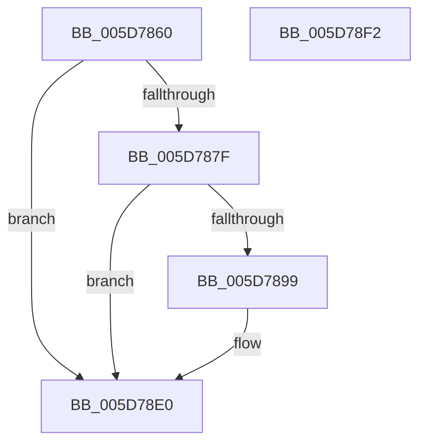

# PopTraceCr3Mitigated

- RVA: `0x005D7860`–`0x005D78F3` (길이 `147` bytes)
- VA: `0x00000001405D7860`
- 실행 섹션: `.text`
- PDB 이름 있음: `예`; PDB Function 태그: `아니요`
- unwind 정보 RVA: `0x000986E4`
- 디코드: `31`개 명령, `147/147` bytes 표시
- 미해석 바이트: `0` (있으면 어셈블리에 `.byte`로 보존)

> 이 문서는 커널 이미지의 기계어와 PDB 기호를 분석해 생성했습니다. 4번과 5번은 함수 원형과 자료형을 바이너리 사용 방식에서 추정한 C 해석이며 원본 소스 복구 결과는 아닙니다.

## 1. Dependencies

- 직접 호출 지점: **3**; 고유 호출 대상: **3**
- 직접 호출자로 확인된 함수: **2**
- RIP 상대 이미지 참조: **3**

### Outgoing calls
- `0x005D7890` → [tlgKeywordOn](../42/tlgKeywordOn_function_0042EAA0.md) (function, `0x0042EAA0`)
- `0x005D78DB` → [tlgWriteTransfer_EtwWriteTransfer](../42/tlgWriteTransfer_EtwWriteTransfer_function_004260E0.md) (function, `0x004260E0`)
- `0x005D78E8` → [_security_check_cookie](../6A/_security_check_cookie_function_006AC640.md) (function, `0x006AC640`)

### Direct callers
- [sub_006F9E40](../6F/Unknown_function_006F9E40.md) at `0x006F9F98`
- [PopThermalZoneRemove](../../page/75/PopThermalZoneRemove_function_0075FAD0.md) at `0x0075FB86`

### Static image references
- `0x005D7864` → RVA `0x00E0A740` (`.data`; read)
- `0x005D7873` → RVA `0x00E07748` (`.data`; read)
- `0x005D78A8` → RVA `0x0004B15F` (`.rdata`; read)

## 2. Other-region calls and transfers

- 다른 실행 섹션으로 향하는 call: **0**
- 별도 외부 분기/꼬리 이동을 확인하지 못했습니다.

## 3. Assembly (complete function range)

```asm
005D7860  48 83 EC 78                     sub rsp, 0x78
005D7864  48 8B 05 D5 2E 83 00            mov rax, qword ptr [rip + 0x832ed5]
005D786B  48 33 C4                        xor rax, rsp
005D786E  48 89 44 24 68                  mov qword ptr [rsp + 0x68], rax
005D7873  83 3D CE FE 82 00 05            cmp dword ptr [rip + 0x82fece], 5
005D787A  44 8B C1                        mov r8d, ecx
005D787D  76 61                           jbe 0x1405d78e0
005D787F  48 BA 00 00 00 00 00 40 00 00   movabs rdx, 0x400000000000
005D7889  48 8D 0D B8 FE 82 00            lea rcx, [rip + 0x82feb8]
005D7890  E8 0B 72 E5 FF                  call 0x14042eaa0
005D7895  84 C0                           test al, al
005D7897  74 47                           je 0x1405d78e0
005D7899  83 64 24 64 00                  and dword ptr [rsp + 0x64], 0
005D789E  48 8D 44 24 30                  lea rax, [rsp + 0x30]
005D78A3  48 89 44 24 58                  mov qword ptr [rsp + 0x58], rax
005D78A8  48 8D 15 B0 38 A7 FF            lea rdx, [rip - 0x58c750]
005D78AF  48 8D 44 24 38                  lea rax, [rsp + 0x38]
005D78B4  44 89 44 24 30                  mov dword ptr [rsp + 0x30], r8d
005D78B9  48 89 44 24 28                  mov qword ptr [rsp + 0x28], rax
005D78BE  48 8D 0D 83 FE 82 00            lea rcx, [rip + 0x82fe83]
005D78C5  45 33 C9                        xor r9d, r9d
005D78C8  C7 44 24 20 03 00 00 00         mov dword ptr [rsp + 0x20], 3
005D78D0  45 33 C0                        xor r8d, r8d
005D78D3  C7 44 24 60 04 00 00 00         mov dword ptr [rsp + 0x60], 4
005D78DB  E8 00 E8 E4 FF                  call 0x1404260e0
005D78E0  48 8B 4C 24 68                  mov rcx, qword ptr [rsp + 0x68]
005D78E5  48 33 CC                        xor rcx, rsp
005D78E8  E8 53 4D 0D 00                  call 0x1406ac640
005D78ED  48 83 C4 78                     add rsp, 0x78
005D78F1  C3                              ret
005D78F2  CC                              int3
```

## 4. C-style interpretation (structured pseudocode)

```c
__int64 __fastcall PopTraceCr3Mitigated(int a1, __int64 a2, __int64 a3, int a4)
{
    __int64 result;
    __int64 v_rsp;
    unsigned __int64 v_stack_m10;
    unsigned int v_stack_m14;
    unsigned int v_stack_m18;
    unsigned __int64 v_stack_m20;
    unsigned __int64 v_stack_m40;
    unsigned __int64 v_stack_m48;
    unsigned __int64 v_stack_m50;
    unsigned int v_stack_m58;

    v_rsp = (v_rsp) - (120);
    result = (*(unsigned __int64 *)(v_rip + 8597205)) ^ (v_rsp);
    v_stack_m10 = result;
    if ((*(unsigned int *)(v_rip + 8584910)) <= 5) goto loc_005D78E0;
    result = tlgKeywordOn(v_rip + 8584888, a2, (unsigned int)(a1), a4);
    if ((unsigned __int8)(result) != 0) {
        result = v_stack_m48;
        v_stack_m20 = result;
        a2 = v_rip - 5818192;
        result = v_stack_m40;
        v_stack_m48 = (unsigned int)((unsigned int)(a1));
        v_stack_m50 = result;
        a1 = v_rip + 8584835;
        a4 = 0;
        v_stack_m58 = 3;
        a3 = 0;
        v_stack_m18 = 4;
        result = tlgWriteTransfer_EtwWriteTransfer(a1, a2, a3, a4);
    }
    a1 = (v_stack_m10) ^ (v_rsp);
    result = _security_check_cookie(a1, a2, a3, a4);
    v_rsp = (v_rsp) + (120);
    return result;
}
```

## 5. (Beta) C Style

```c
int64_t PopTraceCr3Mitigated(int32_t Arg1, int64_t Arg2, int64_t Arg3, int32_t Arg4)
{
    int64_t result;
    int64_t local_rsp;
    uint64_t v_stack_m10;
    uint32_t v_stack_m14;
    uint32_t v_stack_m18;
    uint64_t v_stack_m20;
    uint64_t v_stack_m40;
    uint64_t v_stack_m48;
    uint64_t v_stack_m50;
    uint32_t v_stack_m58;

    local_rsp = (local_rsp) - (120);
    result = (*(uint64_t *)(v_rip + 0x832ED5)) ^ (local_rsp);
    v_stack_m10 = result;
    if ((*(uint32_t *)(v_rip + 0x82FECE)) <= 5) goto loc_005D78E0;
    result = tlgKeywordOn(v_rip + 8584888, Arg2, (uint32_t)(Arg1), Arg4);
    if ((uint8_t)(result) != 0) {
        result = v_stack_m48;
        v_stack_m20 = result;
        Arg2 = v_rip - 5818192;
        result = v_stack_m40;
        v_stack_m48 = (uint32_t)((uint32_t)(Arg1));
        v_stack_m50 = result;
        Arg1 = v_rip + 8584835;
        Arg4 = 0;
        v_stack_m58 = 3;
        Arg3 = 0;
        v_stack_m18 = 4;
        result = tlgWriteTransfer_EtwWriteTransfer(Arg1, Arg2, Arg3, Arg4);
    }
    Arg1 = (v_stack_m10) ^ (local_rsp);
    result = _security_check_cookie(Arg1, Arg2, Arg3, Arg4);
    local_rsp = (local_rsp) + (120);
    return result;
}
```

## 6. Execution-region graph

[열기: 2D/3D 그래프와 함수 탐색 컨트롤 패널](../../../control-panel.html?section=text&rva=0x005D7860&view=graph)

- 2D 그래프는 위에서 아래로 흐르고, 3D 그래프는 빈 공간을 드래그해 회전합니다. Shift+드래그는 이동, 휠은 확대·축소, 함수 노드 선택은 대상 보고서 이동입니다.

### Static fallback


