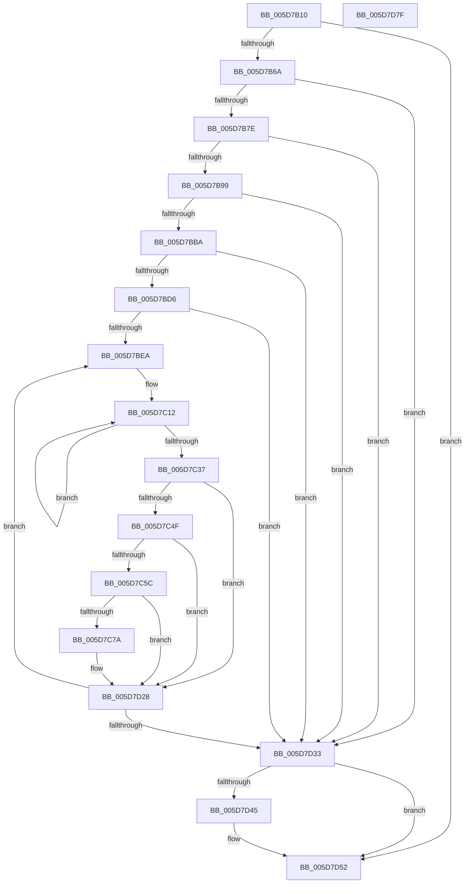

# PopTracePowerLimitHistogram

- RVA: `0x005D7B10`–`0x005D7D80` (길이 `624` bytes)
- VA: `0x00000001405D7B10`
- 실행 섹션: `.text`
- PDB 이름 있음: `예`; PDB Function 태그: `아니요`
- unwind 정보 RVA: `0x000CCBEC`
- 디코드: `146`개 명령, `624/624` bytes 표시
- 미해석 바이트: `0` (있으면 어셈블리에 `.byte`로 보존)

> 이 문서는 커널 이미지의 기계어와 PDB 기호를 분석해 생성했습니다. 4번과 5번은 함수 원형과 자료형을 바이너리 사용 방식에서 추정한 C 해석이며 원본 소스 복구 결과는 아닙니다.

## 1. Dependencies

- 직접 호출 지점: **11**; 고유 호출 대상: **10**
- 직접 호출자로 확인된 함수: **3**
- RIP 상대 이미지 참조: **3**

### Outgoing calls
- `0x005D7B59` → [IoGetDeviceAttachmentBaseRefWithTag](../27/IoGetDeviceAttachmentBaseRefWithTag_function_00272788.md) (function, `0x00272788`)
- `0x005D7B89` → [PoStoreDiagnosticContext](../23/PoStoreDiagnosticContext_function_0023009C.md) (function, `0x0023009C`)
- `0x005D7BA9` → [ExAllocatePool2](../../poolcode/B8/ExAllocatePool2_function_00B820F0.md) (function, `0x00B820F0`)
- `0x005D7BC6` → [PoStoreDiagnosticContext](../23/PoStoreDiagnosticContext_function_0023009C.md) (function, `0x0023009C`)
- `0x005D7C3F` → [RtlIsZeroMemory](../4B/RtlIsZeroMemory_function_004B7A10.md) (function, `0x004B7A10`)
- `0x005D7C6D` → [tlgKeywordOn](../42/tlgKeywordOn_function_0042EAA0.md) (function, `0x0042EAA0`)
- `0x005D7CAB` → [tlgCreate1Sz_wchar_t](../42/tlgCreate1Sz_wchar_t_function_00426198.md) (function, `0x00426198`)
- `0x005D7D20` → [tlgWriteTransfer_EtwWriteTransfer](../42/tlgWriteTransfer_EtwWriteTransfer_function_004260E0.md) (function, `0x004260E0`)
- `0x005D7D3B` → [ObfDereferenceObjectWithTag](../2F/ObfDereferenceObjectWithTag_function_002F78E0.md) (function, `0x002F78E0`)
- `0x005D7D4D` → [ExFreePoolWithTag](../../poolcode/B8/ExFreePoolWithTag_function_00B82870.md) (function, `0x00B82870`)
- `0x005D7D59` → [_security_check_cookie](../6A/_security_check_cookie_function_006AC640.md) (function, `0x006AC640`)

### Direct callers
- [PopPowerLimitTelemetryWorker](../42/PopPowerLimitTelemetryWorker_function_0042FD20.md) at `0x0042FD93`
- [PopPowerLimitSxTransition](PopPowerLimitSxTransition_function_005D0E64.md) at `0x005D0EE5`
- [PopFreePowerLimitRequest](../../page/75/PopFreePowerLimitRequest_function_00756494.md) at `0x0075652C`

### Static image references
- `0x005D7B33` → RVA `0x00E0A740` (`.data`; read)
- `0x005D7C4F` → RVA `0x00E07748` (`.data`; read)
- `0x005D7CB4` → RVA `0x0004ACC5` (`.rdata`; read)

## 2. Other-region calls and transfers

- 다른 실행 섹션으로 향하는 call: **2**
  - `0x005D7BA9` → [ExAllocatePool2](../../poolcode/B8/ExAllocatePool2_function_00B820F0.md) (`.text` → `POOLCODE`)
  - `0x005D7D4D` → [ExFreePoolWithTag](../../poolcode/B8/ExFreePoolWithTag_function_00B82870.md) (`.text` → `POOLCODE`)
- 별도 외부 분기/꼬리 이동을 확인하지 못했습니다.

## 3. Assembly (complete function range)

```asm
005D7B10  48 8B C4                        mov rax, rsp
005D7B13  48 89 58 10                     mov qword ptr [rax + 0x10], rbx
005D7B17  48 89 70 18                     mov qword ptr [rax + 0x18], rsi
005D7B1B  48 89 78 20                     mov qword ptr [rax + 0x20], rdi
005D7B1F  55                              push rbp
005D7B20  41 54                           push r12
005D7B22  41 55                           push r13
005D7B24  41 56                           push r14
005D7B26  41 57                           push r15
005D7B28  48 8D 68 A1                     lea rbp, [rax - 0x5f]
005D7B2C  48 81 EC 00 01 00 00            sub rsp, 0x100
005D7B33  48 8B 05 06 2C 83 00            mov rax, qword ptr [rip + 0x832c06]
005D7B3A  48 33 C4                        xor rax, rsp
005D7B3D  48 89 45 27                     mov qword ptr [rbp + 0x27], rax
005D7B41  48 83 64 24 38 00               and qword ptr [rsp + 0x38], 0
005D7B47  48 8B F9                        mov rdi, rcx
005D7B4A  48 8B 49 40                     mov rcx, qword ptr [rcx + 0x40]
005D7B4E  BA 50 6F 44 67                  mov edx, 0x67446f50
005D7B53  33 DB                           xor ebx, ebx
005D7B55  48 8B 49 38                     mov rcx, qword ptr [rcx + 0x38]
005D7B59  E8 2A AC C9 FF                  call 0x140272788
005D7B5E  4C 8B F0                        mov r14, rax
005D7B61  48 85 C0                        test rax, rax
005D7B64  0F 84 E8 01 00 00               je 0x1405d7d52
005D7B6A  48 8B 80 38 01 00 00            mov rax, qword ptr [rax + 0x138]
005D7B71  4C 8B 78 28                     mov r15, qword ptr [rax + 0x28]
005D7B75  4D 85 FF                        test r15, r15
005D7B78  0F 84 B5 01 00 00               je 0x1405d7d33
005D7B7E  48 8B 4F 18                     mov rcx, qword ptr [rdi + 0x18]
005D7B82  4C 8D 44 24 38                  lea r8, [rsp + 0x38]
005D7B87  33 D2                           xor edx, edx
005D7B89  E8 0E 85 C5 FF                  call 0x14023009c
005D7B8E  3D 23 00 00 C0                  cmp eax, 0xc0000023
005D7B93  0F 85 9A 01 00 00               jne 0x1405d7d33
005D7B99  48 8B 54 24 38                  mov rdx, qword ptr [rsp + 0x38]
005D7B9E  41 B8 54 56 45 50               mov r8d, 0x50455654
005D7BA4  B9 00 01 00 00                  mov ecx, 0x100
005D7BA9  E8 42 A5 5A 00                  call 0x140b820f0
005D7BAE  48 8B D8                        mov rbx, rax
005D7BB1  48 85 C0                        test rax, rax
005D7BB4  0F 84 79 01 00 00               je 0x1405d7d33
005D7BBA  48 8B 4F 18                     mov rcx, qword ptr [rdi + 0x18]
005D7BBE  4C 8D 44 24 38                  lea r8, [rsp + 0x38]
005D7BC3  48 8B D0                        mov rdx, rax
005D7BC6  E8 D1 84 C5 FF                  call 0x14023009c
005D7BCB  45 33 D2                        xor r10d, r10d
005D7BCE  85 C0                           test eax, eax
005D7BD0  0F 88 5D 01 00 00               js 0x1405d7d33
005D7BD6  4C 8B 6B 10                     mov r13, qword ptr [rbx + 0x10]
005D7BDA  41 8B F2                        mov esi, r10d
005D7BDD  4C 03 EB                        add r13, rbx
005D7BE0  44 39 57 20                     cmp dword ptr [rdi + 0x20], r10d
005D7BE4  0F 86 49 01 00 00               jbe 0x1405d7d33
005D7BEA  0F 57 C0                        xorps xmm0, xmm0
005D7BED  44 8B E6                        mov r12d, esi
005D7BF0  49 6B CC 68                     imul rcx, r12, 0x68
005D7BF4  0F 11 45 F7                     movups xmmword ptr [rbp - 9], xmm0
005D7BF8  0F 11 45 07                     movups xmmword ptr [rbp + 7], xmm0
005D7BFC  0F 11 45 17                     movups xmmword ptr [rbp + 0x17], xmm0
005D7C00  48 83 C1 08                     add rcx, 8
005D7C04  4C 8D 45 F7                     lea r8, [rbp - 9]
005D7C08  48 03 4F 38                     add rcx, qword ptr [rdi + 0x38]
005D7C0C  41 B9 0C 00 00 00               mov r9d, 0xc
005D7C12  48 B8 BD 42 7A E5 D5 94 BF D6   movabs rax, 0xd6bf94d5e57a42bd
005D7C1C  48 F7 21                        mul qword ptr [rcx]
005D7C1F  48 C1 EA 17                     shr rdx, 0x17
005D7C23  41 89 10                        mov dword ptr [r8], edx
005D7C26  4D 8D 40 04                     lea r8, [r8 + 4]
005D7C2A  4C 89 11                        mov qword ptr [rcx], r10
005D7C2D  48 8D 49 08                     lea rcx, [rcx + 8]
005D7C31  49 83 E9 01                     sub r9, 1
005D7C35  75 DB                           jne 0x1405d7c12
005D7C37  41 8D 51 30                     lea edx, [r9 + 0x30]
005D7C3B  48 8D 4D F7                     lea rcx, [rbp - 9]
005D7C3F  E8 CC FD ED FF                  call 0x1404b7a10
005D7C44  45 33 D2                        xor r10d, r10d
005D7C47  84 C0                           test al, al
005D7C49  0F 85 D9 00 00 00               jne 0x1405d7d28
005D7C4F  83 3D F2 FA 82 00 05            cmp dword ptr [rip + 0x82faf2], 5
005D7C56  0F 86 CC 00 00 00               jbe 0x1405d7d28
005D7C5C  48 BA 00 00 00 00 00 40 00 00   movabs rdx, 0x400000000000
005D7C66  48 8D 0D DB FA 82 00            lea rcx, [rip + 0x82fadb]
005D7C6D  E8 2E 6E E5 FF                  call 0x14042eaa0
005D7C72  84 C0                           test al, al
005D7C74  0F 84 AE 00 00 00               je 0x1405d7d28
005D7C7A  48 8D 45 AF                     lea rax, [rbp - 0x51]
005D7C7E  48 C7 45 9F 02 00 00 00         mov qword ptr [rbp - 0x61], 2
005D7C86  48 89 45 97                     mov qword ptr [rbp - 0x69], rax
005D7C8A  48 8D 4D B7                     lea rcx, [rbp - 0x49]
005D7C8E  49 8B 87 88 00 00 00            mov rax, qword ptr [r15 + 0x88]
005D7C95  49 8B D5                        mov rdx, r13
005D7C98  48 89 45 A7                     mov qword ptr [rbp - 0x59], rax
005D7C9C  41 0F B7 87 80 00 00 00         movzx eax, word ptr [r15 + 0x80]
005D7CA4  89 45 AF                        mov dword ptr [rbp - 0x51], eax
005D7CA7  44 89 55 B3                     mov dword ptr [rbp - 0x4d], r10d
005D7CAB  E8 E8 E4 E4 FF                  call 0x140426198
005D7CB0  48 8B 4F 28                     mov rcx, qword ptr [rdi + 0x28]
005D7CB4  48 8D 15 0A 30 A7 FF            lea rdx, [rip - 0x58cff6]
005D7CBB  4D 03 E4                        add r12, r12
005D7CBE  45 33 C9                        xor r9d, r9d
005D7CC1  45 33 C0                        xor r8d, r8d
005D7CC4  42 8A 04 E1                     mov al, byte ptr [rcx + r12*8]
005D7CC8  88 44 24 30                     mov byte ptr [rsp + 0x30], al
005D7CCC  48 8D 44 24 30                  lea rax, [rsp + 0x30]
005D7CD1  48 89 45 C7                     mov qword ptr [rbp - 0x39], rax
005D7CD5  48 C7 45 CF 01 00 00 00         mov qword ptr [rbp - 0x31], 1
005D7CDD  42 8B 44 E1 04                  mov eax, dword ptr [rcx + r12*8 + 4]
005D7CE2  48 8D 0D 5F FA 82 00            lea rcx, [rip + 0x82fa5f]
005D7CE9  89 44 24 38                     mov dword ptr [rsp + 0x38], eax
005D7CED  48 8D 44 24 38                  lea rax, [rsp + 0x38]
005D7CF2  48 89 45 D7                     mov qword ptr [rbp - 0x29], rax
005D7CF6  48 8D 45 F7                     lea rax, [rbp - 9]
005D7CFA  48 89 45 E7                     mov qword ptr [rbp - 0x19], rax
005D7CFE  48 8D 44 24 40                  lea rax, [rsp + 0x40]
005D7D03  48 89 44 24 28                  mov qword ptr [rsp + 0x28], rax
005D7D08  C7 44 24 20 08 00 00 00         mov dword ptr [rsp + 0x20], 8
005D7D10  48 C7 45 DF 04 00 00 00         mov qword ptr [rbp - 0x21], 4
005D7D18  48 C7 45 EF 30 00 00 00         mov qword ptr [rbp - 0x11], 0x30
005D7D20  E8 BB E3 E4 FF                  call 0x1404260e0
005D7D25  45 33 D2                        xor r10d, r10d
005D7D28  FF C6                           inc esi
005D7D2A  3B 77 20                        cmp esi, dword ptr [rdi + 0x20]
005D7D2D  0F 82 B7 FE FF FF               jb 0x1405d7bea
005D7D33  BA 50 6F 44 67                  mov edx, 0x67446f50
005D7D38  49 8B CE                        mov rcx, r14
005D7D3B  E8 A0 FB D1 FF                  call 0x1402f78e0
005D7D40  48 85 DB                        test rbx, rbx
005D7D43  74 0D                           je 0x1405d7d52
005D7D45  BA 54 56 45 50                  mov edx, 0x50455654
005D7D4A  48 8B CB                        mov rcx, rbx
005D7D4D  E8 1E AB 5A 00                  call 0x140b82870
005D7D52  48 8B 4D 27                     mov rcx, qword ptr [rbp + 0x27]
005D7D56  48 33 CC                        xor rcx, rsp
005D7D59  E8 E2 48 0D 00                  call 0x1406ac640
005D7D5E  4C 8D 9C 24 00 01 00 00         lea r11, [rsp + 0x100]
005D7D66  49 8B 5B 38                     mov rbx, qword ptr [r11 + 0x38]
005D7D6A  49 8B 73 40                     mov rsi, qword ptr [r11 + 0x40]
005D7D6E  49 8B 7B 48                     mov rdi, qword ptr [r11 + 0x48]
005D7D72  49 8B E3                        mov rsp, r11
005D7D75  41 5F                           pop r15
005D7D77  41 5E                           pop r14
005D7D79  41 5D                           pop r13
005D7D7B  41 5C                           pop r12
005D7D7D  5D                              pop rbp
005D7D7E  C3                              ret
005D7D7F  CC                              int3
```

## 4. C-style interpretation (structured pseudocode)

```c
__int64 __fastcall PopTracePowerLimitHistogram(__int64 a1)
{
    __int64 result;
    __int64 v_r10;
    __int64 v_r12;
    __int64 v_r13;
    __int64 v_rbx;
    __int64 v_rsi;
    __int64 v_rsp;
    unsigned __int64 v_stack_m100;
    unsigned int v_stack_m108;
    unsigned __int64 v_stack_m28;
    unsigned __int64 v_stack_mE8;
    unsigned __int64 v_stack_mF0;
    unsigned __int8 v_stack_mF8;

    *(unsigned __int64 *)(v_rsp + 16) = v_rbx;
    *(unsigned __int64 *)(v_rsp + 24) = v_rsi;
    *(unsigned __int64 *)(v_rsp + 32) = v_rdi;
    v_rsp = (v_rsp) - (256);
    result = (*(unsigned __int64 *)(v_rip + 8596486)) ^ (v_rsp);
    *(unsigned __int64 *)(v_rsp - 95 + 39) = result;
    v_rbx = 0;
    result = IoGetDeviceAttachmentBaseRefWithTag(*(unsigned __int64 *)(*(unsigned __int64 *)(a1 + 64) + 56), (unsigned int)(0x67446F50ULL), a3, a4);
    if (result == 0) goto loc_005D7D52;
    if (*(unsigned __int64 *)(*(unsigned __int64 *)(result + 312) + 40) == 0) goto loc_005D7D33;
    a2 = 0;
    result = PoStoreDiagnosticContext(*(unsigned __int64 *)(a1 + 24), a2, v_stack_mF0, a4);
    if (((unsigned int)(result)) != 0xC0000023ULL) goto loc_005D7D33;
    result = ExAllocatePool2(256, v_stack_mF0, (unsigned int)(0x50455654ULL), a4);
    if (result == 0) goto loc_005D7D33;
    result = PoStoreDiagnosticContext(*(unsigned __int64 *)(a1 + 24), result, v_stack_mF0, a4);
    v_r10 = 0;
    if (sign_flag) goto loc_005D7D33;
    v_r13 = (*(unsigned __int64 *)(result + 16)) + (result);
    if ((*(unsigned int *)(a1 + 32)) <= 0) goto loc_005D7D33;
loc_005D7BEA:
    a1 = (*(unsigned __int64 *)(a1 + 24)) * (0);
    *(unsigned __int64 *)(v_rsp - 95 - 9) = v_xmm0;
    *(unsigned __int64 *)(v_rsp - 95 + 7) = v_xmm0;
    *(unsigned __int64 *)(v_rsp - 95 + 23) = v_xmm0;
    a1 = (a1) + (8);
    a1 = (a1) + (*(unsigned __int64 *)(a1 + 56));
loc_005D7C12:
    a2 = (result) >> (23);
    *(unsigned int *)(v_rsp - 95 - 9) = (unsigned int)(a2);
    *(unsigned __int64 *)(a1) = 0;
    a4 = (12) - (1);
    if (condition_is_not_equal) goto loc_005D7C12;
    result = RtlIsZeroMemory(v_rsp - 95 - 9, a4 + 48, v_rsp - 95 - 9 + 4, a4);
    v_r10 = 0;
    if ((unsigned __int8)(result) != 0) goto loc_005D7D28;
    if ((*(unsigned int *)(v_rip + 8583922)) <= 5) goto loc_005D7D28;
    result = tlgKeywordOn(v_rip + 8583899, a4 + 48, v_rsp - 95 - 9 + 4, a4);
    v_r12 = 0;
    if ((unsigned __int8)(result) != 0) {
        result = v_rsp - 95 - 81;
        *(unsigned __int64 *)(v_rsp - 95 - 97) = 2;
        *(unsigned __int64 *)(v_rsp - 95 - 105) = result;
        a1 = v_rsp - 95 - 73;
        result = *(unsigned __int64 *)(*(unsigned __int64 *)(*(unsigned __int64 *)(result + 312) + 40) + 136);
        a2 = v_r13;
        *(unsigned __int64 *)(v_rsp - 95 - 89) = result;
        result = *(unsigned __int16 *)(*(unsigned __int64 *)(*(unsigned __int64 *)(result + 312) + 40) + 128);
        *(unsigned int *)(v_rsp - 95 - 81) = (unsigned int)(result);
        *(unsigned int *)(v_rsp - 95 - 77) = 0;
        result = tlgCreate1Sz_wchar_t(a1, a2, v_rsp - 95 - 9 + 4, a4);
        a1 = *(unsigned __int64 *)(a1 + 40);
        a2 = v_rip - 5820406;
        v_r12 = (0) + (0);
        a4 = 0;
        a3 = 0;
        result = *(unsigned __int8 *)(a1 + v_r12 * 8);
        v_stack_mF8 = (unsigned __int8)(result);
        result = v_stack_mF8;
        *(unsigned __int64 *)(v_rsp - 95 - 57) = result;
        *(unsigned __int64 *)(v_rsp - 95 - 49) = 1;
        result = *(unsigned int *)(a1 + v_r12 * 8 + 4);
        a1 = v_rip + 8583775;
        v_stack_mF0 = (unsigned int)(result);
        result = v_stack_mF0;
        *(unsigned __int64 *)(v_rsp - 95 - 41) = result;
        result = v_rsp - 95 - 9;
        *(unsigned __int64 *)(v_rsp - 95 - 25) = result;
        result = v_stack_mE8;
        v_stack_m100 = result;
        v_stack_m108 = 8;
        *(unsigned __int64 *)(v_rsp - 95 - 33) = 4;
        *(unsigned __int64 *)(v_rsp - 95 - 17) = 48;
        result = tlgWriteTransfer_EtwWriteTransfer(a1, a2, a3, a4);
        v_r10 = 0;
    }
    v_rsi = (unsigned int)((0) + 1);
    if (((unsigned int)(v_rsi)) < (*(unsigned int *)(a1 + 32))) goto loc_005D7BEA;
loc_005D7D33:
    result = ObfDereferenceObjectWithTag(result, (unsigned int)(0x67446F50ULL), a3, a4);
    if (result != 0) {
        a2 = 0x50455654ULL;
        a1 = result;
        result = ExFreePoolWithTag(a1, a2, a3, a4);
    }
    a1 = (*(unsigned __int64 *)(v_rsp - 95 + 39)) ^ (v_rsp);
    result = _security_check_cookie(a1, a2, a3, a4);
    return result;
}
```

## 5. (Beta) C Style

```c
int64_t PopTracePowerLimitHistogram(void *Arg1)
{
    uint8_t *arg1 = (uint8_t *)Arg1;

    int64_t result;
    int64_t local_r10;
    int64_t local_r12;
    int64_t local_r13;
    int64_t local_rbx;
    int64_t local_rsi;
    int64_t local_rsp;
    uint64_t v_stack_m100;
    uint32_t v_stack_m108;
    uint64_t v_stack_m28;
    uint64_t v_stack_mE8;
    uint64_t v_stack_mF0;
    uint8_t v_stack_mF8;

    *(uint64_t *)(local_rsp + 0x10) = local_rbx;
    *(uint64_t *)(local_rsp + 0x18) = local_rsi;
    *(uint64_t *)(local_rsp + 0x20) = local_rdi;
    local_rsp = (local_rsp) - (256);
    result = (*(uint64_t *)(v_rip + 0x832C06)) ^ (local_rsp);
    *(uint64_t *)(local_rsp - 0x5F + 0x27) = result;
    local_rbx = 0;
    result = IoGetDeviceAttachmentBaseRefWithTag(*(uint64_t *)(*(uint64_t *)(arg1 + 0x40) + 0x38), (uint32_t)(0x67446F50ULL), a3, a4);
    if (result == 0) goto loc_005D7D52;
    if (*(uint64_t *)(*(uint64_t *)(result + 0x138) + 0x28) == 0) goto loc_005D7D33;
    a2 = 0;
    result = PoStoreDiagnosticContext(*(uint64_t *)(arg1 + 0x18), a2, v_stack_mF0, a4);
    if (((uint32_t)(result)) != 0xC0000023ULL) goto loc_005D7D33;
    result = ExAllocatePool2(256, v_stack_mF0, (uint32_t)(0x50455654ULL), a4);
    if (result == 0) goto loc_005D7D33;
    result = PoStoreDiagnosticContext(*(uint64_t *)(arg1 + 0x18), result, v_stack_mF0, a4);
    local_r10 = 0;
    if (sign_flag) goto loc_005D7D33;
    local_r13 = (*(uint64_t *)(result + 0x10)) + (result);
    if ((*(uint32_t *)(arg1 + 0x20)) <= 0) goto loc_005D7D33;
loc_005D7BEA:
    Arg1 = (*(uint64_t *)(arg1 + 0x18)) * (0);
    *(uint64_t *)(local_rsp - 0x5F - 0x9) = v_xmm0;
    *(uint64_t *)(local_rsp - 0x5F + 0x7) = v_xmm0;
    *(uint64_t *)(local_rsp - 0x5F + 0x17) = v_xmm0;
    Arg1 = (Arg1) + (8);
    Arg1 = (Arg1) + (*(uint64_t *)(arg1 + 0x38));
loc_005D7C12:
    a2 = (result) >> (23);
    *(uint32_t *)(local_rsp - 0x5F - 0x9) = (uint32_t)(a2);
    *(uint64_t *)(arg1) = 0;
    a4 = (12) - (1);
    if (condition_is_not_equal) goto loc_005D7C12;
    result = RtlIsZeroMemory(local_rsp - 95 - 9, a4 + 48, local_rsp - 95 - 9 + 4, a4);
    local_r10 = 0;
    if ((uint8_t)(result) != 0) goto loc_005D7D28;
    if ((*(uint32_t *)(v_rip + 0x82FAF2)) <= 5) goto loc_005D7D28;
    result = tlgKeywordOn(v_rip + 8583899, a4 + 48, local_rsp - 95 - 9 + 4, a4);
    local_r12 = 0;
    if ((uint8_t)(result) != 0) {
        result = local_rsp - 95 - 81;
        *(uint64_t *)(local_rsp - 0x5F - 0x61) = 2;
        *(uint64_t *)(local_rsp - 0x5F - 0x69) = result;
        Arg1 = local_rsp - 95 - 73;
        result = *(uint64_t *)(*(uint64_t *)(*(uint64_t *)(result + 0x138) + 0x28) + 0x88);
        a2 = local_r13;
        *(uint64_t *)(local_rsp - 0x5F - 0x59) = result;
        result = *(uint16_t *)(*(uint64_t *)(*(uint64_t *)(result + 0x138) + 0x28) + 0x80);
        *(uint32_t *)(local_rsp - 0x5F - 0x51) = (uint32_t)(result);
        *(uint32_t *)(local_rsp - 0x5F - 0x4D) = 0;
        result = tlgCreate1Sz_wchar_t(Arg1, a2, local_rsp - 95 - 9 + 4, a4);
        Arg1 = *(uint64_t *)(arg1 + 0x28);
        a2 = v_rip - 5820406;
        local_r12 = (0) + (0);
        a4 = 0;
        a3 = 0;
        result = *(uint8_t *)(arg1 + local_r12 * 8);
        v_stack_mF8 = (uint8_t)(result);
        result = v_stack_mF8;
        *(uint64_t *)(local_rsp - 0x5F - 0x39) = result;
        *(uint64_t *)(local_rsp - 0x5F - 0x31) = 1;
        result = *(uint32_t *)(arg1 + local_r12 * 8 + 0x4);
        Arg1 = v_rip + 8583775;
        v_stack_mF0 = (uint32_t)(result);
        result = v_stack_mF0;
        *(uint64_t *)(local_rsp - 0x5F - 0x29) = result;
        result = local_rsp - 95 - 9;
        *(uint64_t *)(local_rsp - 0x5F - 0x19) = result;
        result = v_stack_mE8;
        v_stack_m100 = result;
        v_stack_m108 = 8;
        *(uint64_t *)(local_rsp - 0x5F - 0x21) = 4;
        *(uint64_t *)(local_rsp - 0x5F - 0x11) = 48;
        result = tlgWriteTransfer_EtwWriteTransfer(Arg1, a2, a3, a4);
        local_r10 = 0;
    }
    local_rsi = (uint32_t)((0) + 1);
    if (((uint32_t)(local_rsi)) < (*(uint32_t *)(arg1 + 0x20))) goto loc_005D7BEA;
loc_005D7D33:
    result = ObfDereferenceObjectWithTag(result, (uint32_t)(0x67446F50ULL), a3, a4);
    if (result != 0) {
        a2 = 0x50455654ULL;
        Arg1 = result;
        result = ExFreePoolWithTag(Arg1, a2, a3, a4);
    }
    Arg1 = (*(uint64_t *)(local_rsp - 0x5F + 0x27)) ^ (local_rsp);
    result = _security_check_cookie(Arg1, a2, a3, a4);
    return result;
}
```

### 관측된 메모리 오프셋

구조체 형식이 확인되지 않은 접근은 인자 기준의 오프셋으로만 기록했습니다.

| 기준 인자 | 오프셋 표현 | 폭 (bit) | 접근 |
|---|---:|---:|---|
| `Arg1` | `+ 0x18` | `64` | `R` |
| `Arg1` | `+ 0x20` | `32` | `R` |
| `Arg1` | `+ 0x28` | `64` | `R` |
| `Arg1` | `+ 0x38` | `64` | `R` |
| `Arg1` | `+ 0x40` | `64` | `R` |

## 6. Execution-region graph

[열기: 2D/3D 그래프와 함수 탐색 컨트롤 패널](../../../control-panel.html?section=text&rva=0x005D7B10&view=graph)

- 2D 그래프는 위에서 아래로 흐르고, 3D 그래프는 빈 공간을 드래그해 회전합니다. Shift+드래그는 이동, 휠은 확대·축소, 함수 노드 선택은 대상 보고서 이동입니다.

### Static fallback


