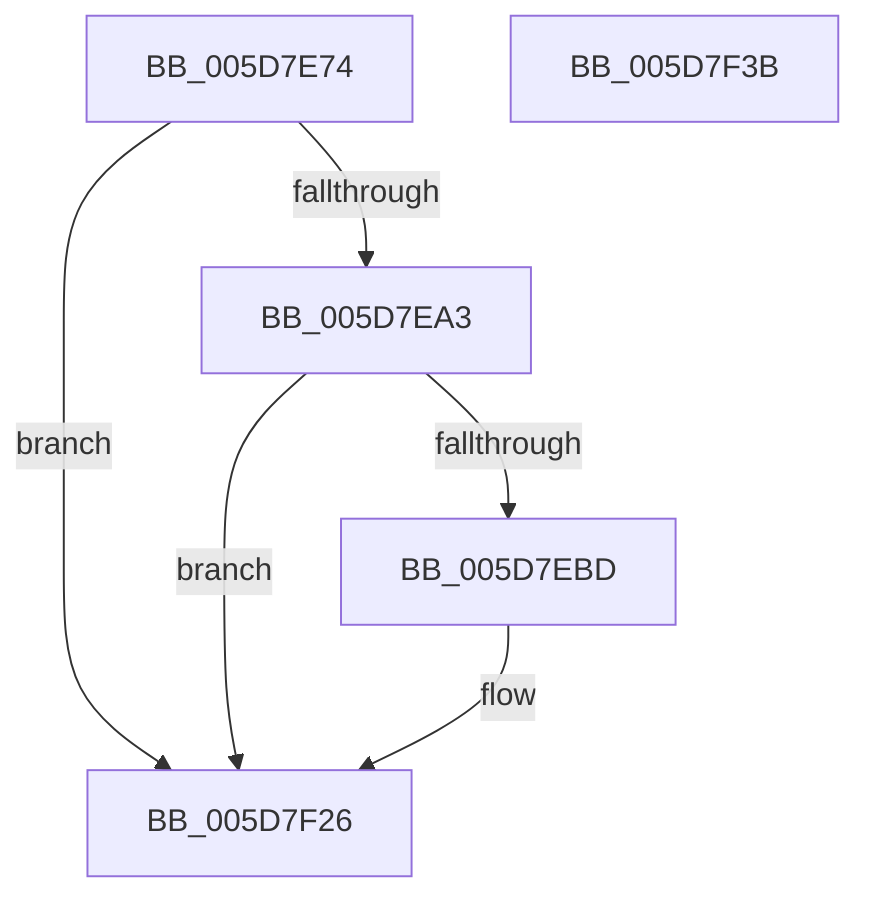

# PopTraceThermalStandbyComplete

- RVA: `0x005D7E74`–`0x005D7F3C` (길이 `200` bytes)
- VA: `0x00000001405D7E74`
- 실행 섹션: `.text`
- PDB 이름 있음: `예`; PDB Function 태그: `아니요`
- unwind 정보 RVA: `0x0009EA9C`
- 디코드: `43`개 명령, `200/200` bytes 표시
- 미해석 바이트: `0` (있으면 어셈블리에 `.byte`로 보존)

> 이 문서는 커널 이미지의 기계어와 PDB 기호를 분석해 생성했습니다. 4번과 5번은 함수 원형과 자료형을 바이너리 사용 방식에서 추정한 C 해석이며 원본 소스 복구 결과는 아닙니다.

## 1. Dependencies

- 직접 호출 지점: **3**; 고유 호출 대상: **3**
- 직접 호출자로 확인된 함수: **1**
- RIP 상대 이미지 참조: **3**

### Outgoing calls
- `0x005D7EB4` → [tlgKeywordOn](../42/tlgKeywordOn_function_0042EAA0.md) (function, `0x0042EAA0`)
- `0x005D7F21` → [tlgWriteTransfer_EtwWriteTransfer](../42/tlgWriteTransfer_EtwWriteTransfer_function_004260E0.md) (function, `0x004260E0`)
- `0x005D7F2D` → [_security_check_cookie](../6A/_security_check_cookie_function_006AC640.md) (function, `0x006AC640`)

### Direct callers
- [PopThermalStandbyEndTracking](../4D/PopThermalStandbyEndTracking_function_004D1B2C.md) at `0x004D1B72`

### Static image references
- `0x005D7E82` → RVA `0x00E0A740` (`.data`; read)
- `0x005D7E90` → RVA `0x00E07748` (`.data`; read)
- `0x005D7EC9` → RVA `0x0004B03C` (`.rdata`; read)

## 2. Other-region calls and transfers

- 다른 실행 섹션으로 향하는 call: **0**
- 별도 외부 분기/꼬리 이동을 확인하지 못했습니다.

## 3. Assembly (complete function range)

```asm
005D7E74  40 55                           push rbp
005D7E76  48 8D 6C 24 A9                  lea rbp, [rsp - 0x57]
005D7E7B  48 81 EC A0 00 00 00            sub rsp, 0xa0
005D7E82  48 8B 05 B7 28 83 00            mov rax, qword ptr [rip + 0x8328b7]
005D7E89  48 33 C4                        xor rax, rsp
005D7E8C  48 89 45 47                     mov qword ptr [rbp + 0x47], rax
005D7E90  83 3D B1 F8 82 00 05            cmp dword ptr [rip + 0x82f8b1], 5
005D7E97  44 8B CA                        mov r9d, edx
005D7E9A  44 8B D1                        mov r10d, ecx
005D7E9D  0F 86 83 00 00 00               jbe 0x1405d7f26
005D7EA3  48 BA 00 00 00 00 00 40 00 00   movabs rdx, 0x400000000000
005D7EAD  48 8D 0D 94 F8 82 00            lea rcx, [rip + 0x82f894]
005D7EB4  E8 E7 6B E5 FF                  call 0x14042eaa0
005D7EB9  84 C0                           test al, al
005D7EBB  74 69                           je 0x1405d7f26
005D7EBD  48 8D 45 E7                     lea rax, [rbp - 0x19]
005D7EC1  44 89 4D EB                     mov dword ptr [rbp - 0x15], r9d
005D7EC5  48 89 45 17                     mov qword ptr [rbp + 0x17], rax
005D7EC9  48 8D 15 6C 31 A7 FF            lea rdx, [rip - 0x58ce94]
005D7ED0  48 8D 45 EB                     lea rax, [rbp - 0x15]
005D7ED4  44 89 55 E7                     mov dword ptr [rbp - 0x19], r10d
005D7ED8  48 89 45 27                     mov qword ptr [rbp + 0x27], rax
005D7EDC  48 8D 0D 65 F8 82 00            lea rcx, [rip + 0x82f865]
005D7EE3  41 0F B6 C0                     movzx eax, r8b
005D7EE7  45 33 C9                        xor r9d, r9d
005D7EEA  89 45 EF                        mov dword ptr [rbp - 0x11], eax
005D7EED  45 33 C0                        xor r8d, r8d
005D7EF0  48 8D 45 EF                     lea rax, [rbp - 0x11]
005D7EF4  48 C7 45 1F 04 00 00 00         mov qword ptr [rbp + 0x1f], 4
005D7EFC  48 89 45 37                     mov qword ptr [rbp + 0x37], rax
005D7F00  48 8D 45 F7                     lea rax, [rbp - 9]
005D7F04  48 89 44 24 28                  mov qword ptr [rsp + 0x28], rax
005D7F09  C7 44 24 20 05 00 00 00         mov dword ptr [rsp + 0x20], 5
005D7F11  48 C7 45 2F 04 00 00 00         mov qword ptr [rbp + 0x2f], 4
005D7F19  48 C7 45 3F 04 00 00 00         mov qword ptr [rbp + 0x3f], 4
005D7F21  E8 BA E1 E4 FF                  call 0x1404260e0
005D7F26  48 8B 4D 47                     mov rcx, qword ptr [rbp + 0x47]
005D7F2A  48 33 CC                        xor rcx, rsp
005D7F2D  E8 0E 47 0D 00                  call 0x1406ac640
005D7F32  48 81 C4 A0 00 00 00            add rsp, 0xa0
005D7F39  5D                              pop rbp
005D7F3A  C3                              ret
005D7F3B  CC                              int3
```

## 4. C-style interpretation (structured pseudocode)

```c
__int64 __fastcall PopTraceThermalStandbyComplete(int a1, int a2, int a3)
{
    __int64 result;
    __int64 v_rsp;
    unsigned __int64 v_stack_m18;
    unsigned __int64 v_stack_m20;
    unsigned __int64 v_stack_m28;
    unsigned __int64 v_stack_m30;
    unsigned __int64 v_stack_m38;
    unsigned __int64 v_stack_m40;
    unsigned __int64 v_stack_m48;
    unsigned __int64 v_stack_m5F;
    unsigned __int64 v_stack_m68;
    unsigned int v_stack_m70;
    unsigned int v_stack_m74;
    unsigned __int64 v_stack_m78;
    unsigned __int64 v_stack_m80;
    unsigned int v_stack_m88;

    v_rsp = (v_rsp) - (160);
    result = (*(unsigned __int64 *)(v_rip + 8595639)) ^ (v_rsp);
    v_stack_m18 = result;
    if ((*(unsigned int *)(v_rip + 8583345)) <= 5) goto loc_005D7F26;
    result = tlgKeywordOn(v_rip + 8583316, a2, a3, (unsigned int)(a2));
    if ((unsigned __int8)(result) != 0) {
        result = v_stack_m78;
        v_stack_m74 = (unsigned int)((unsigned int)(a2));
        v_stack_m48 = result;
        a2 = v_rip - 5820052;
        result = v_stack_m74;
        v_stack_m78 = (unsigned int)((unsigned int)(a1));
        v_stack_m38 = result;
        a1 = v_rip + 8583269;
        result = (unsigned __int8)(a3);
        a4 = 0;
        v_stack_m70 = (unsigned int)(result);
        a3 = 0;
        result = v_stack_m70;
        v_stack_m40 = 4;
        v_stack_m28 = result;
        result = v_stack_m68;
        v_stack_m80 = result;
        v_stack_m88 = 5;
        v_stack_m30 = 4;
        v_stack_m20 = 4;
        result = tlgWriteTransfer_EtwWriteTransfer(a1, a2, a3, a4);
    }
    a1 = (v_stack_m18) ^ (v_rsp);
    result = _security_check_cookie(a1, a2, a3, a4);
    v_rsp = (v_rsp) + (160);
    return result;
}
```

## 5. (Beta) C Style

```c
int64_t PopTraceThermalStandbyComplete(int32_t Arg1, int32_t Arg2, int32_t Arg3)
{
    int64_t result;
    int64_t local_rsp;
    uint64_t v_stack_m18;
    uint64_t v_stack_m20;
    uint64_t v_stack_m28;
    uint64_t v_stack_m30;
    uint64_t v_stack_m38;
    uint64_t v_stack_m40;
    uint64_t v_stack_m48;
    uint64_t v_stack_m5F;
    uint64_t v_stack_m68;
    uint32_t v_stack_m70;
    uint32_t v_stack_m74;
    uint64_t v_stack_m78;
    uint64_t v_stack_m80;
    uint32_t v_stack_m88;

    local_rsp = (local_rsp) - (160);
    result = (*(uint64_t *)(v_rip + 0x8328B7)) ^ (local_rsp);
    v_stack_m18 = result;
    if ((*(uint32_t *)(v_rip + 0x82F8B1)) <= 5) goto loc_005D7F26;
    result = tlgKeywordOn(v_rip + 8583316, Arg2, Arg3, (uint32_t)(Arg2));
    if ((uint8_t)(result) != 0) {
        result = v_stack_m78;
        v_stack_m74 = (uint32_t)((uint32_t)(Arg2));
        v_stack_m48 = result;
        Arg2 = v_rip - 5820052;
        result = v_stack_m74;
        v_stack_m78 = (uint32_t)((uint32_t)(Arg1));
        v_stack_m38 = result;
        Arg1 = v_rip + 8583269;
        result = (uint8_t)(Arg3);
        a4 = 0;
        v_stack_m70 = (uint32_t)(result);
        Arg3 = 0;
        result = v_stack_m70;
        v_stack_m40 = 4;
        v_stack_m28 = result;
        result = v_stack_m68;
        v_stack_m80 = result;
        v_stack_m88 = 5;
        v_stack_m30 = 4;
        v_stack_m20 = 4;
        result = tlgWriteTransfer_EtwWriteTransfer(Arg1, Arg2, Arg3, a4);
    }
    Arg1 = (v_stack_m18) ^ (local_rsp);
    result = _security_check_cookie(Arg1, Arg2, Arg3, a4);
    local_rsp = (local_rsp) + (160);
    return result;
}
```

## 6. Execution-region graph

[열기: 2D/3D 그래프와 함수 탐색 컨트롤 패널](../../../control-panel.html?section=text&rva=0x005D7E74&view=graph)

- 2D 그래프는 위에서 아래로 흐르고, 3D 그래프는 빈 공간을 드래그해 회전합니다. Shift+드래그는 이동, 휠은 확대·축소, 함수 노드 선택은 대상 보고서 이동입니다.

### Static fallback


