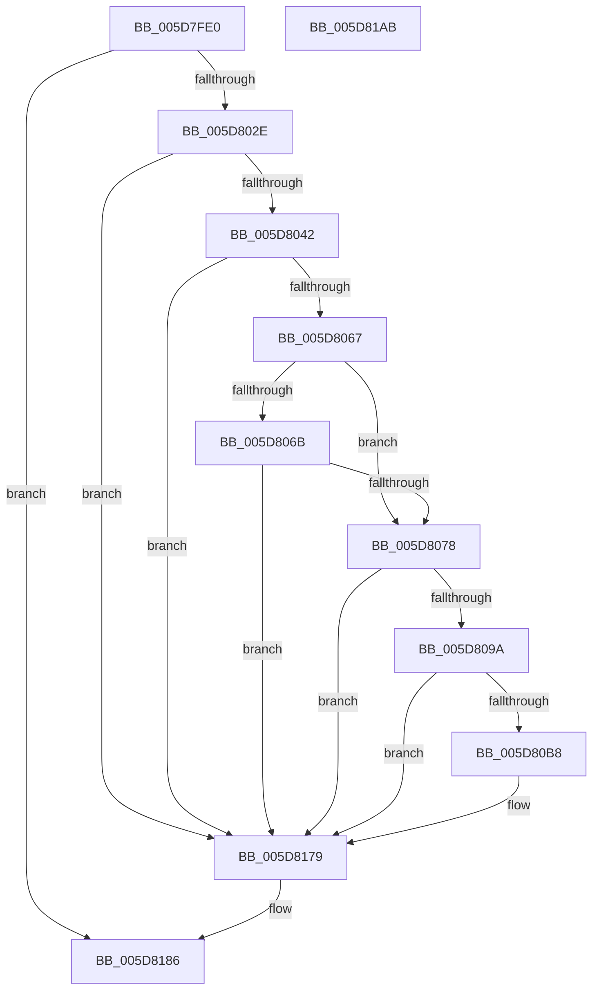

# PopTraceThermalZoneActiveActivity

- RVA: `0x005D7FE0`–`0x005D81AC` (길이 `460` bytes)
- VA: `0x00000001405D7FE0`
- 실행 섹션: `.text`
- PDB 이름 있음: `예`; PDB Function 태그: `아니요`
- unwind 정보 RVA: `0x000CCA50`
- 디코드: `102`개 명령, `460/460` bytes 표시
- 미해석 바이트: `0` (있으면 어셈블리에 `.byte`로 보존)

> 이 문서는 커널 이미지의 기계어와 PDB 기호를 분석해 생성했습니다. 4번과 5번은 함수 원형과 자료형을 바이너리 사용 방식에서 추정한 C 해석이며 원본 소스 복구 결과는 아닙니다.

## 1. Dependencies

- 직접 호출 지점: **7**; 고유 호출 대상: **7**
- 직접 호출자로 확인된 함수: **3**
- RIP 상대 이미지 참조: **5**

### Outgoing calls
- `0x005D801D` → [IoGetDeviceAttachmentBaseRefWithTag](../27/IoGetDeviceAttachmentBaseRefWithTag_function_00272788.md) (function, `0x00272788`)
- `0x005D8055` → [PopDiagSnapActiveActivity](../4D/PopDiagSnapActiveActivity_function_004DB0F4.md) (function, `0x004DB0F4`)
- `0x005D80AB` → [tlgKeywordOn](../42/tlgKeywordOn_function_0042EAA0.md) (function, `0x0042EAA0`)
- `0x005D80EE` → [tlgCreate1Sz_wchar_t](../42/tlgCreate1Sz_wchar_t_function_00426198.md) (function, `0x00426198`)
- `0x005D8174` → [tlgWriteTransfer_EtwWriteTransfer](../42/tlgWriteTransfer_EtwWriteTransfer_function_004260E0.md) (function, `0x004260E0`)
- `0x005D8181` → [ObfDereferenceObjectWithTag](../2F/ObfDereferenceObjectWithTag_function_002F78E0.md) (function, `0x002F78E0`)
- `0x005D818D` → [_security_check_cookie](../6A/_security_check_cookie_function_006AC640.md) (function, `0x006AC640`)

### Direct callers
- [PopThermalSxEntry](../4E/PopThermalSxEntry_function_004E3D20.md) at `0x004E3DCF`
- [PopThermalTelemetryWorker](PopThermalTelemetryWorker_function_005D57F0.md) at `0x005D5870`
- [PopThermalZoneRemove](../../page/75/PopThermalZoneRemove_function_0075FAD0.md) at `0x0075FB3E`

### Static image references
- `0x005D7FFB` → RVA `0x00E0A740` (`.data`; read)
- `0x005D806B` → RVA `0x00E0B564` (`.data`; read)
- `0x005D807F` → RVA `0x006C8EC0` (` ?? ::FNODOBFM::`string'`; read)
- `0x005D808D` → RVA `0x00E07748` (`.data`; read)
- `0x005D8107` → RVA `0x0004ADAC` (`.rdata`; read)

## 2. Other-region calls and transfers

- 다른 실행 섹션으로 향하는 call: **0**
- 별도 외부 분기/꼬리 이동을 확인하지 못했습니다.

## 3. Assembly (complete function range)

```asm
005D7FE0  48 8B C4                        mov rax, rsp
005D7FE3  48 89 58 10                     mov qword ptr [rax + 0x10], rbx
005D7FE7  48 89 70 18                     mov qword ptr [rax + 0x18], rsi
005D7FEB  48 89 78 20                     mov qword ptr [rax + 0x20], rdi
005D7FEF  55                              push rbp
005D7FF0  48 8D 68 A1                     lea rbp, [rax - 0x5f]
005D7FF4  48 81 EC 00 01 00 00            sub rsp, 0x100
005D7FFB  48 8B 05 3E 27 83 00            mov rax, qword ptr [rip + 0x83273e]
005D8002  48 33 C4                        xor rax, rsp
005D8005  48 89 45 4F                     mov qword ptr [rbp + 0x4f], rax
005D8009  83 65 8B 00                     and dword ptr [rbp - 0x75], 0
005D800D  48 8B F9                        mov rdi, rcx
005D8010  48 8B 49 30                     mov rcx, qword ptr [rcx + 0x30]
005D8014  BA 50 6F 44 67                  mov edx, 0x67446f50
005D8019  C6 45 87 00                     mov byte ptr [rbp - 0x79], 0
005D801D  E8 66 A7 C9 FF                  call 0x140272788
005D8022  48 8B D8                        mov rbx, rax
005D8025  48 85 C0                        test rax, rax
005D8028  0F 84 58 01 00 00               je 0x1405d8186
005D802E  48 8B 88 38 01 00 00            mov rcx, qword ptr [rax + 0x138]
005D8035  48 8B 71 28                     mov rsi, qword ptr [rcx + 0x28]
005D8039  48 85 F6                        test rsi, rsi
005D803C  0F 84 37 01 00 00               je 0x1405d8179
005D8042  48 8D 8F F8 01 00 00            lea rcx, [rdi + 0x1f8]
005D8049  4C 8D 4D 27                     lea r9, [rbp + 0x27]
005D804D  4C 8D 45 87                     lea r8, [rbp - 0x79]
005D8051  48 8D 55 8B                     lea rdx, [rbp - 0x75]
005D8055  E8 9A 30 F0 FF                  call 0x1404db0f4
005D805A  44 8B 4D 8B                     mov r9d, dword ptr [rbp - 0x75]
005D805E  45 85 C9                        test r9d, r9d
005D8061  0F 84 12 01 00 00               je 0x1405d8179
005D8067  84 C0                           test al, al
005D8069  75 0D                           jne 0x1405d8078
005D806B  83 3D F2 34 83 00 00            cmp dword ptr [rip + 0x8334f2], 0
005D8072  0F 84 01 01 00 00               je 0x1405d8179
005D8078  48 8B 87 18 04 00 00            mov rax, qword ptr [rdi + 0x418]
005D807F  4C 8D 05 3A 0E 0F 00            lea r8, [rip + 0xf0e3a]
005D8086  48 85 C0                        test rax, rax
005D8089  4C 0F 45 C0                     cmovne r8, rax
005D808D  83 3D B4 F6 82 00 05            cmp dword ptr [rip + 0x82f6b4], 5
005D8094  0F 86 DF 00 00 00               jbe 0x1405d8179
005D809A  48 BA 00 00 00 00 00 40 00 00   movabs rdx, 0x400000000000
005D80A4  48 8D 0D 9D F6 82 00            lea rcx, [rip + 0x82f69d]
005D80AB  E8 F0 69 E5 FF                  call 0x14042eaa0
005D80B0  84 C0                           test al, al
005D80B2  0F 84 C1 00 00 00               je 0x1405d8179
005D80B8  83 65 C3 00                     and dword ptr [rbp - 0x3d], 0
005D80BC  48 8D 45 CF                     lea rax, [rbp - 0x31]
005D80C0  83 65 D3 00                     and dword ptr [rbp - 0x2d], 0
005D80C4  48 8D 4D D7                     lea rcx, [rbp - 0x29]
005D80C8  48 89 45 B7                     mov qword ptr [rbp - 0x49], rax
005D80CC  41 BA 02 00 00 00               mov r10d, 2
005D80D2  48 8B 86 88 00 00 00            mov rax, qword ptr [rsi + 0x88]
005D80D9  49 8B D0                        mov rdx, r8
005D80DC  48 89 45 C7                     mov qword ptr [rbp - 0x39], rax
005D80E0  0F B7 86 80 00 00 00            movzx eax, word ptr [rsi + 0x80]
005D80E7  89 45 CF                        mov dword ptr [rbp - 0x31], eax
005D80EA  44 89 55 BF                     mov dword ptr [rbp - 0x41], r10d
005D80EE  E8 A5 E0 E4 FF                  call 0x140426198
005D80F3  83 65 F3 00                     and dword ptr [rbp - 0xd], 0
005D80F7  48 8D 45 8B                     lea rax, [rbp - 0x75]
005D80FB  83 65 03 00                     and dword ptr [rbp + 3], 0
005D80FF  48 8D 4D 87                     lea rcx, [rbp - 0x79]
005D8103  83 65 13 00                     and dword ptr [rbp + 0x13], 0
005D8107  48 8D 15 9E 2C A7 FF            lea rdx, [rip - 0x58d362]
005D810E  83 65 23 00                     and dword ptr [rbp + 0x23], 0
005D8112  45 33 C0                        xor r8d, r8d
005D8115  48 89 45 E7                     mov qword ptr [rbp - 0x19], rax
005D8119  0F B6 45 87                     movzx eax, byte ptr [rbp - 0x79]
005D811D  66 89 45 87                     mov word ptr [rbp - 0x79], ax
005D8121  C1 E0 02                        shl eax, 2
005D8124  89 45 0F                        mov dword ptr [rbp + 0xf], eax
005D8127  48 8D 45 8F                     lea rax, [rbp - 0x71]
005D812B  48 89 4D F7                     mov qword ptr [rbp - 9], rcx
005D812F  48 8D 4D 27                     lea rcx, [rbp + 0x27]
005D8133  48 89 45 17                     mov qword ptr [rbp + 0x17], rax
005D8137  48 8D 45 97                     lea rax, [rbp - 0x69]
005D813B  44 89 4D 8B                     mov dword ptr [rbp - 0x75], r9d
005D813F  45 33 C9                        xor r9d, r9d
005D8142  48 89 4D 07                     mov qword ptr [rbp + 7], rcx
005D8146  48 8D 0D FB F5 82 00            lea rcx, [rip + 0x82f5fb]
005D814D  48 89 44 24 28                  mov qword ptr [rsp + 0x28], rax
005D8152  C7 44 24 20 09 00 00 00         mov dword ptr [rsp + 0x20], 9
005D815A  C7 45 EF 04 00 00 00            mov dword ptr [rbp - 0x11], 4
005D8161  44 89 55 FF                     mov dword ptr [rbp - 1], r10d
005D8165  48 C7 45 8F 00 00 00 01         mov qword ptr [rbp - 0x71], 0x1000000
005D816D  C7 45 1F 08 00 00 00            mov dword ptr [rbp + 0x1f], 8
005D8174  E8 67 DF E4 FF                  call 0x1404260e0
005D8179  BA 50 6F 44 67                  mov edx, 0x67446f50
005D817E  48 8B CB                        mov rcx, rbx
005D8181  E8 5A F7 D1 FF                  call 0x1402f78e0
005D8186  48 8B 4D 4F                     mov rcx, qword ptr [rbp + 0x4f]
005D818A  48 33 CC                        xor rcx, rsp
005D818D  E8 AE 44 0D 00                  call 0x1406ac640
005D8192  4C 8D 9C 24 00 01 00 00         lea r11, [rsp + 0x100]
005D819A  49 8B 5B 18                     mov rbx, qword ptr [r11 + 0x18]
005D819E  49 8B 73 20                     mov rsi, qword ptr [r11 + 0x20]
005D81A2  49 8B 7B 28                     mov rdi, qword ptr [r11 + 0x28]
005D81A6  49 8B E3                        mov rsp, r11
005D81A9  5D                              pop rbp
005D81AA  C3                              ret
005D81AB  CC                              int3
```

## 4. C-style interpretation (structured pseudocode)

```c
__int64 __fastcall PopTraceThermalZoneActiveActivity(__int64 a1)
{
    __int64 result;
    __int64 v_r10;
    __int64 v_rsp;
    unsigned __int64 v_stack_m8;
    unsigned __int64 v_stack_mE0;
    unsigned int v_stack_mE8;

    *(unsigned __int64 *)(v_rsp + 16) = v_rbx;
    *(unsigned __int64 *)(v_rsp + 24) = v_rsi;
    *(unsigned __int64 *)(v_rsp + 32) = v_rdi;
    v_rsp = (v_rsp) - (256);
    result = (*(unsigned __int64 *)(v_rip + 8595262)) ^ (v_rsp);
    *(unsigned __int64 *)(v_rsp - 95 + 79) = result;
    *(unsigned __int8 *)(v_rsp - 95 - 121) = 0;
    result = IoGetDeviceAttachmentBaseRefWithTag(*(unsigned __int64 *)(a1 + 48), (unsigned int)(0x67446F50ULL), a3, a4);
    if (result == 0) goto loc_005D8186;
    if (*(unsigned __int64 *)(*(unsigned __int64 *)(result + 312) + 40) == 0) goto loc_005D8179;
    result = PopDiagSnapActiveActivity(a1 + 504, v_rsp - 95 - 117, v_rsp - 95 - 121, v_rsp - 95 + 39);
    if ((unsigned int)((unsigned int)(*(unsigned int *)(v_rsp - 95 - 117))) == 0) goto loc_005D8179;
    if ((unsigned __int8)(result) != 0) goto loc_005D8078;
    if ((*(unsigned int *)(v_rip + 8598770)) == 0) goto loc_005D8179;
loc_005D8078:
    a3 = v_rip + 986682;
    if (*(unsigned __int64 *)(a1 + 1048) != 0) { a3 = *(unsigned __int64 *)(a1 + 1048); }
    if ((*(unsigned int *)(v_rip + 8582836)) <= 5) goto loc_005D8179;
    result = tlgKeywordOn(v_rip + 8582813, v_rsp - 95 - 117, a3, (unsigned int)(*(unsigned int *)(v_rsp - 95 - 117)));
    if ((unsigned __int8)(result) != 0) {
        result = v_rsp - 95 - 49;
        a1 = v_rsp - 95 - 41;
        *(unsigned __int64 *)(v_rsp - 95 - 73) = result;
        v_r10 = 2;
        result = *(unsigned __int64 *)(*(unsigned __int64 *)(*(unsigned __int64 *)(result + 312) + 40) + 136);
        a2 = a3;
        *(unsigned __int64 *)(v_rsp - 95 - 57) = result;
        result = *(unsigned __int16 *)(*(unsigned __int64 *)(*(unsigned __int64 *)(result + 312) + 40) + 128);
        *(unsigned int *)(v_rsp - 95 - 49) = (unsigned int)(result);
        *(unsigned int *)(v_rsp - 95 - 65) = (unsigned int)(v_r10);
        result = tlgCreate1Sz_wchar_t(a1, a2, a3, (unsigned int)(*(unsigned int *)(v_rsp - 95 - 117)));
        result = v_rsp - 95 - 117;
        a1 = v_rsp - 95 - 121;
        a2 = v_rip - 5821282;
        a3 = 0;
        *(unsigned __int64 *)(v_rsp - 95 - 25) = result;
        result = *(unsigned __int8 *)(v_rsp - 95 - 121);
        *(unsigned __int16 *)(v_rsp - 95 - 121) = (unsigned __int16)(result);
        result = (unsigned int)((result) << (2));
        *(unsigned int *)(v_rsp - 95 + 15) = (unsigned int)(result);
        result = v_rsp - 95 - 113;
        *(unsigned __int64 *)(v_rsp - 95 - 9) = a1;
        a1 = v_rsp - 95 + 39;
        *(unsigned __int64 *)(v_rsp - 95 + 23) = result;
        result = v_rsp - 95 - 105;
        *(unsigned int *)(v_rsp - 95 - 117) = (unsigned int)((unsigned int)(*(unsigned int *)(v_rsp - 95 - 117)));
        a4 = 0;
        *(unsigned __int64 *)(v_rsp - 95 + 7) = a1;
        a1 = v_rip + 8582651;
        v_stack_mE0 = result;
        v_stack_mE8 = 9;
        *(unsigned int *)(v_rsp - 95 - 17) = 4;
        *(unsigned int *)(v_rsp - 95 - 1) = (unsigned int)(v_r10);
        *(unsigned __int64 *)(v_rsp - 95 - 113) = 0x1000000ULL;
        *(unsigned int *)(v_rsp - 95 + 31) = 8;
        result = tlgWriteTransfer_EtwWriteTransfer(a1, a2, a3, a4);
    }
    result = ObfDereferenceObjectWithTag(result, (unsigned int)(0x67446F50ULL), a3, a4);
loc_005D8186:
    a1 = (*(unsigned __int64 *)(v_rsp - 95 + 79)) ^ (v_rsp);
    result = _security_check_cookie(a1, (unsigned int)(0x67446F50ULL), a3, a4);
    return result;
}
```

## 5. (Beta) C Style

```c
int64_t PopTraceThermalZoneActiveActivity(void *Arg1)
{
    uint8_t *arg1 = (uint8_t *)Arg1;

    int64_t result;
    int64_t local_r10;
    int64_t local_rsp;
    uint64_t v_stack_m8;
    uint64_t v_stack_mE0;
    uint32_t v_stack_mE8;

    *(uint64_t *)(local_rsp + 0x10) = local_rbx;
    *(uint64_t *)(local_rsp + 0x18) = local_rsi;
    *(uint64_t *)(local_rsp + 0x20) = local_rdi;
    local_rsp = (local_rsp) - (256);
    result = (*(uint64_t *)(v_rip + 0x83273E)) ^ (local_rsp);
    *(uint64_t *)(local_rsp - 0x5F + 0x4F) = result;
    *(uint8_t *)(local_rsp - 0x5F - 0x79) = 0;
    result = IoGetDeviceAttachmentBaseRefWithTag(*(uint64_t *)(arg1 + 0x30), (uint32_t)(0x67446F50ULL), a3, a4);
    if (result == 0) goto loc_005D8186;
    if (*(uint64_t *)(*(uint64_t *)(result + 0x138) + 0x28) == 0) goto loc_005D8179;
    result = PopDiagSnapActiveActivity(Arg1 + 504, local_rsp - 95 - 117, local_rsp - 95 - 121, local_rsp - 95 + 39);
    if ((uint32_t)((uint32_t)(*(uint32_t *)(local_rsp - 0x5F - 0x75))) == 0) goto loc_005D8179;
    if ((uint8_t)(result) != 0) goto loc_005D8078;
    if ((*(uint32_t *)(v_rip + 0x8334F2)) == 0) goto loc_005D8179;
loc_005D8078:
    a3 = v_rip + 986682;
    if (*(uint64_t *)(arg1 + 0x418) != 0) { a3 = *(uint64_t *)(arg1 + 0x418); }
    if ((*(uint32_t *)(v_rip + 0x82F6B4)) <= 5) goto loc_005D8179;
    result = tlgKeywordOn(v_rip + 8582813, local_rsp - 95 - 117, a3, (uint32_t)(*(uint32_t *)(local_rsp - 0x5F - 0x75)));
    if ((uint8_t)(result) != 0) {
        result = local_rsp - 95 - 49;
        Arg1 = local_rsp - 95 - 41;
        *(uint64_t *)(local_rsp - 0x5F - 0x49) = result;
        local_r10 = 2;
        result = *(uint64_t *)(*(uint64_t *)(*(uint64_t *)(result + 0x138) + 0x28) + 0x88);
        a2 = a3;
        *(uint64_t *)(local_rsp - 0x5F - 0x39) = result;
        result = *(uint16_t *)(*(uint64_t *)(*(uint64_t *)(result + 0x138) + 0x28) + 0x80);
        *(uint32_t *)(local_rsp - 0x5F - 0x31) = (uint32_t)(result);
        *(uint32_t *)(local_rsp - 0x5F - 0x41) = (uint32_t)(local_r10);
        result = tlgCreate1Sz_wchar_t(Arg1, a2, a3, (uint32_t)(*(uint32_t *)(local_rsp - 0x5F - 0x75)));
        result = local_rsp - 95 - 117;
        Arg1 = local_rsp - 95 - 121;
        a2 = v_rip - 5821282;
        a3 = 0;
        *(uint64_t *)(local_rsp - 0x5F - 0x19) = result;
        result = *(uint8_t *)(local_rsp - 0x5F - 0x79);
        *(uint16_t *)(local_rsp - 0x5F - 0x79) = (uint16_t)(result);
        result = (uint32_t)((result) << (2));
        *(uint32_t *)(local_rsp - 0x5F + 0xF) = (uint32_t)(result);
        result = local_rsp - 95 - 113;
        *(void **)(local_rsp - 0x5F - 0x9) = Arg1;
        Arg1 = local_rsp - 95 + 39;
        *(uint64_t *)(local_rsp - 0x5F + 0x17) = result;
        result = local_rsp - 95 - 105;
        *(uint32_t *)(local_rsp - 0x5F - 0x75) = (uint32_t)((uint32_t)(*(uint32_t *)(local_rsp - 0x5F - 0x75)));
        a4 = 0;
        *(void **)(local_rsp - 0x5F + 0x7) = Arg1;
        Arg1 = v_rip + 8582651;
        v_stack_mE0 = result;
        v_stack_mE8 = 9;
        *(uint32_t *)(local_rsp - 0x5F - 0x11) = 4;
        *(uint32_t *)(local_rsp - 0x5F - 0x1) = (uint32_t)(local_r10);
        *(uint64_t *)(local_rsp - 0x5F - 0x71) = 0x1000000ULL;
        *(uint32_t *)(local_rsp - 0x5F + 0x1F) = 8;
        result = tlgWriteTransfer_EtwWriteTransfer(Arg1, a2, a3, a4);
    }
    result = ObfDereferenceObjectWithTag(result, (uint32_t)(0x67446F50ULL), a3, a4);
loc_005D8186:
    Arg1 = (*(uint64_t *)(local_rsp - 0x5F + 0x4F)) ^ (local_rsp);
    result = _security_check_cookie(Arg1, (uint32_t)(0x67446F50ULL), a3, a4);
    return result;
}
```

### 관측된 메모리 오프셋

구조체 형식이 확인되지 않은 접근은 인자 기준의 오프셋으로만 기록했습니다.

| 기준 인자 | 오프셋 표현 | 폭 (bit) | 접근 |
|---|---:|---:|---|
| `Arg1` | `+ 0x30` | `64` | `R` |
| `Arg1` | `+ 0x1F8` | `64` | `R` |
| `Arg1` | `+ 0x418` | `64` | `R` |

## 6. Execution-region graph

[열기: 2D/3D 그래프와 함수 탐색 컨트롤 패널](../../../control-panel.html?section=text&rva=0x005D7FE0&view=graph)

- 2D 그래프는 위에서 아래로 흐르고, 3D 그래프는 빈 공간을 드래그해 회전합니다. Shift+드래그는 이동, 휠은 확대·축소, 함수 노드 선택은 대상 보고서 이동입니다.

### Static fallback


