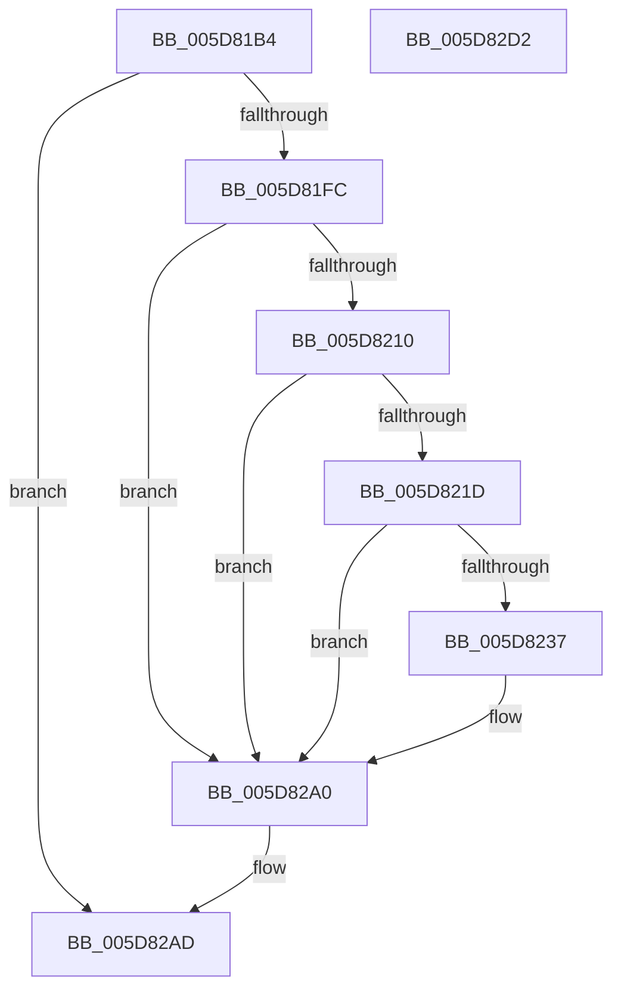

# PopTraceZoneCr3Mitigated

- RVA: `0x005D81B4`–`0x005D82D3` (길이 `287` bytes)
- VA: `0x00000001405D81B4`
- 실행 섹션: `.text`
- PDB 이름 있음: `예`; PDB Function 태그: `아니요`
- unwind 정보 RVA: `0x000CCA2C`
- 디코드: `66`개 명령, `287/287` bytes 표시
- 미해석 바이트: `0` (있으면 어셈블리에 `.byte`로 보존)

> 이 문서는 커널 이미지의 기계어와 PDB 기호를 분석해 생성했습니다. 4번과 5번은 함수 원형과 자료형을 바이너리 사용 방식에서 추정한 C 해석이며 원본 소스 복구 결과는 아닙니다.

## 1. Dependencies

- 직접 호출 지점: **6**; 고유 호출 대상: **6**
- 직접 호출자로 확인된 함수: **2**
- RIP 상대 이미지 참조: **3**

### Outgoing calls
- `0x005D81EB` → [IoGetDeviceAttachmentBaseRefWithTag](../27/IoGetDeviceAttachmentBaseRefWithTag_function_00272788.md) (function, `0x00272788`)
- `0x005D822E` → [tlgKeywordOn](../42/tlgKeywordOn_function_0042EAA0.md) (function, `0x0042EAA0`)
- `0x005D8271` → [tlgCreate1Sz_wchar_t](../42/tlgCreate1Sz_wchar_t_function_00426198.md) (function, `0x00426198`)
- `0x005D829B` → [tlgWriteTransfer_EtwWriteTransfer](../42/tlgWriteTransfer_EtwWriteTransfer_function_004260E0.md) (function, `0x004260E0`)
- `0x005D82A8` → [ObfDereferenceObjectWithTag](../2F/ObfDereferenceObjectWithTag_function_002F78E0.md) (function, `0x002F78E0`)
- `0x005D82B4` → [_security_check_cookie](../6A/_security_check_cookie_function_006AC640.md) (function, `0x006AC640`)

### Direct callers
- [sub_006F9E40](../6F/Unknown_function_006F9E40.md) at `0x006F9F33`
- [PopThermalZoneRemove](../../page/75/PopThermalZoneRemove_function_0075FAD0.md) at `0x0075FB72`

### Static image references
- `0x005D81CF` → RVA `0x00E0A740` (`.data`; read)
- `0x005D8210` → RVA `0x00E07748` (`.data`; read)
- `0x005D8282` → RVA `0x0004AFF6` (`.rdata`; read)

## 2. Other-region calls and transfers

- 다른 실행 섹션으로 향하는 call: **0**
- 별도 외부 분기/꼬리 이동을 확인하지 못했습니다.

## 3. Assembly (complete function range)

```asm
005D81B4  48 8B C4                        mov rax, rsp
005D81B7  48 89 58 08                     mov qword ptr [rax + 8], rbx
005D81BB  48 89 70 18                     mov qword ptr [rax + 0x18], rsi
005D81BF  48 89 78 20                     mov qword ptr [rax + 0x20], rdi
005D81C3  55                              push rbp
005D81C4  48 8D 68 A1                     lea rbp, [rax - 0x5f]
005D81C8  48 81 EC A0 00 00 00            sub rsp, 0xa0
005D81CF  48 8B 05 6A 25 83 00            mov rax, qword ptr [rip + 0x83256a]
005D81D6  48 33 C4                        xor rax, rsp
005D81D9  48 89 45 47                     mov qword ptr [rbp + 0x47], rax
005D81DD  48 8B FA                        mov rdi, rdx
005D81E0  8B F1                           mov esi, ecx
005D81E2  BA 50 6F 44 67                  mov edx, 0x67446f50
005D81E7  48 8B 4F 30                     mov rcx, qword ptr [rdi + 0x30]
005D81EB  E8 98 A5 C9 FF                  call 0x140272788
005D81F0  48 8B D8                        mov rbx, rax
005D81F3  48 85 C0                        test rax, rax
005D81F6  0F 84 B1 00 00 00               je 0x1405d82ad
005D81FC  48 8B 90 38 01 00 00            mov rdx, qword ptr [rax + 0x138]
005D8203  4C 8B 42 28                     mov r8, qword ptr [rdx + 0x28]
005D8207  4D 85 C0                        test r8, r8
005D820A  0F 84 90 00 00 00               je 0x1405d82a0
005D8210  83 3D 31 F5 82 00 05            cmp dword ptr [rip + 0x82f531], 5
005D8217  0F 86 83 00 00 00               jbe 0x1405d82a0
005D821D  48 BA 00 00 00 00 00 40 00 00   movabs rdx, 0x400000000000
005D8227  48 8D 0D 1A F5 82 00            lea rcx, [rip + 0x82f51a]
005D822E  E8 6D 68 E5 FF                  call 0x14042eaa0
005D8233  84 C0                           test al, al
005D8235  74 69                           je 0x1405d82a0
005D8237  83 65 23 00                     and dword ptr [rbp + 0x23], 0
005D823B  48 8D 45 E7                     lea rax, [rbp - 0x19]
005D823F  83 65 33 00                     and dword ptr [rbp + 0x33], 0
005D8243  48 8D 4D 37                     lea rcx, [rbp + 0x37]
005D8247  48 89 45 17                     mov qword ptr [rbp + 0x17], rax
005D824B  BA 04 00 00 00                  mov edx, 4
005D8250  8B 87 80 00 00 00               mov eax, dword ptr [rdi + 0x80]
005D8256  89 45 EB                        mov dword ptr [rbp - 0x15], eax
005D8259  48 8D 45 EB                     lea rax, [rbp - 0x15]
005D825D  89 55 1F                        mov dword ptr [rbp + 0x1f], edx
005D8260  89 55 2F                        mov dword ptr [rbp + 0x2f], edx
005D8263  49 8B 90 88 00 00 00            mov rdx, qword ptr [r8 + 0x88]
005D826A  48 89 45 27                     mov qword ptr [rbp + 0x27], rax
005D826E  89 75 E7                        mov dword ptr [rbp - 0x19], esi
005D8271  E8 22 DF E4 FF                  call 0x140426198
005D8276  4C 8D 4D F7                     lea r9, [rbp - 9]
005D827A  45 33 C0                        xor r8d, r8d
005D827D  4C 89 4C 24 28                  mov qword ptr [rsp + 0x28], r9
005D8282  48 8D 15 6D 2D A7 FF            lea rdx, [rip - 0x58d293]
005D8289  45 33 C9                        xor r9d, r9d
005D828C  C7 44 24 20 05 00 00 00         mov dword ptr [rsp + 0x20], 5
005D8294  48 8D 0D AD F4 82 00            lea rcx, [rip + 0x82f4ad]
005D829B  E8 40 DE E4 FF                  call 0x1404260e0
005D82A0  BA 50 6F 44 67                  mov edx, 0x67446f50
005D82A5  48 8B CB                        mov rcx, rbx
005D82A8  E8 33 F6 D1 FF                  call 0x1402f78e0
005D82AD  48 8B 4D 47                     mov rcx, qword ptr [rbp + 0x47]
005D82B1  48 33 CC                        xor rcx, rsp
005D82B4  E8 87 43 0D 00                  call 0x1406ac640
005D82B9  4C 8D 9C 24 A0 00 00 00         lea r11, [rsp + 0xa0]
005D82C1  49 8B 5B 10                     mov rbx, qword ptr [r11 + 0x10]
005D82C5  49 8B 73 20                     mov rsi, qword ptr [r11 + 0x20]
005D82C9  49 8B 7B 28                     mov rdi, qword ptr [r11 + 0x28]
005D82CD  49 8B E3                        mov rsp, r11
005D82D0  5D                              pop rbp
005D82D1  C3                              ret
005D82D2  CC                              int3
```

## 4. C-style interpretation (structured pseudocode)

```c
__int64 __fastcall PopTraceZoneCr3Mitigated(int a1, __int64 a2)
{
    __int64 result;
    __int64 v_rsp;
    unsigned __int64 v_stack_m8;
    unsigned __int64 v_stack_m80;
    unsigned int v_stack_m88;

    *(unsigned __int64 *)(v_rsp + 8) = v_rbx;
    *(unsigned __int64 *)(v_rsp + 24) = v_rsi;
    *(unsigned __int64 *)(v_rsp + 32) = v_rdi;
    v_rsp = (v_rsp) - (160);
    result = (*(unsigned __int64 *)(v_rip + 8594794)) ^ (v_rsp);
    *(unsigned __int64 *)(v_rsp - 95 + 71) = result;
    result = IoGetDeviceAttachmentBaseRefWithTag(*(unsigned __int64 *)(a2 + 48), (unsigned int)(0x67446F50ULL), a3, a4);
    if (result == 0) goto loc_005D82AD;
    if (*(unsigned __int64 *)(*(unsigned __int64 *)(result + 312) + 40) == 0) goto loc_005D82A0;
    if ((*(unsigned int *)(v_rip + 8582449)) <= 5) goto loc_005D82A0;
    result = tlgKeywordOn(v_rip + 8582426, *(unsigned __int64 *)(result + 312), *(unsigned __int64 *)(*(unsigned __int64 *)(result + 312) + 40), a4);
    if ((unsigned __int8)(result) != 0) {
        result = v_rsp - 95 - 25;
        a1 = v_rsp - 95 + 55;
        *(unsigned __int64 *)(v_rsp - 95 + 23) = result;
        a2 = 4;
        result = *(unsigned int *)(a2 + 128);
        *(unsigned int *)(v_rsp - 95 - 21) = (unsigned int)(result);
        result = v_rsp - 95 - 21;
        *(unsigned int *)(v_rsp - 95 + 31) = (unsigned int)(a2);
        *(unsigned int *)(v_rsp - 95 + 47) = (unsigned int)(a2);
        a2 = *(unsigned __int64 *)(*(unsigned __int64 *)(*(unsigned __int64 *)(result + 312) + 40) + 136);
        *(unsigned __int64 *)(v_rsp - 95 + 39) = result;
        *(unsigned int *)(v_rsp - 95 - 25) = (unsigned int)((unsigned int)(a1));
        result = tlgCreate1Sz_wchar_t(a1, a2, *(unsigned __int64 *)(*(unsigned __int64 *)(result + 312) + 40), a4);
        a4 = v_rsp - 95 - 9;
        a3 = 0;
        v_stack_m80 = a4;
        a2 = v_rip - 5821075;
        a4 = 0;
        v_stack_m88 = 5;
        a1 = v_rip + 8582317;
        result = tlgWriteTransfer_EtwWriteTransfer(a1, a2, a3, a4);
    }
    result = ObfDereferenceObjectWithTag(result, (unsigned int)(0x67446F50ULL), a3, a4);
loc_005D82AD:
    a1 = (*(unsigned __int64 *)(v_rsp - 95 + 71)) ^ (v_rsp);
    result = _security_check_cookie(a1, (unsigned int)(0x67446F50ULL), a3, a4);
    return result;
}
```

## 5. (Beta) C Style

```c
int64_t PopTraceZoneCr3Mitigated(int32_t Arg1, void *Arg2)
{
    uint8_t *arg2 = (uint8_t *)Arg2;

    int64_t result;
    int64_t local_rsp;
    uint64_t v_stack_m8;
    uint64_t v_stack_m80;
    uint32_t v_stack_m88;

    *(uint64_t *)(local_rsp + 0x8) = local_rbx;
    *(uint64_t *)(local_rsp + 0x18) = local_rsi;
    *(uint64_t *)(local_rsp + 0x20) = local_rdi;
    local_rsp = (local_rsp) - (160);
    result = (*(uint64_t *)(v_rip + 0x83256A)) ^ (local_rsp);
    *(uint64_t *)(local_rsp - 0x5F + 0x47) = result;
    result = IoGetDeviceAttachmentBaseRefWithTag(*(uint64_t *)(arg2 + 0x30), (uint32_t)(0x67446F50ULL), a3, a4);
    if (result == 0) goto loc_005D82AD;
    if (*(uint64_t *)(*(uint64_t *)(result + 0x138) + 0x28) == 0) goto loc_005D82A0;
    if ((*(uint32_t *)(v_rip + 0x82F531)) <= 5) goto loc_005D82A0;
    result = tlgKeywordOn(v_rip + 8582426, *(uint64_t *)(result + 0x138), *(uint64_t *)(*(uint64_t *)(result + 0x138) + 0x28), a4);
    if ((uint8_t)(result) != 0) {
        result = local_rsp - 95 - 25;
        Arg1 = local_rsp - 95 + 55;
        *(uint64_t *)(local_rsp - 0x5F + 0x17) = result;
        Arg2 = 4;
        result = *(uint32_t *)(arg2 + 0x80);
        *(uint32_t *)(local_rsp - 0x5F - 0x15) = (uint32_t)(result);
        result = local_rsp - 95 - 21;
        *(uint32_t *)(local_rsp - 0x5F + 0x1F) = (uint32_t)(Arg2);
        *(uint32_t *)(local_rsp - 0x5F + 0x2F) = (uint32_t)(Arg2);
        Arg2 = *(uint64_t *)(*(uint64_t *)(*(uint64_t *)(result + 0x138) + 0x28) + 0x88);
        *(uint64_t *)(local_rsp - 0x5F + 0x27) = result;
        *(uint32_t *)(local_rsp - 0x5F - 0x19) = (uint32_t)((uint32_t)(Arg1));
        result = tlgCreate1Sz_wchar_t(Arg1, Arg2, *(uint64_t *)(*(uint64_t *)(result + 0x138) + 0x28), a4);
        a4 = local_rsp - 95 - 9;
        a3 = 0;
        v_stack_m80 = a4;
        Arg2 = v_rip - 5821075;
        a4 = 0;
        v_stack_m88 = 5;
        Arg1 = v_rip + 8582317;
        result = tlgWriteTransfer_EtwWriteTransfer(Arg1, Arg2, a3, a4);
    }
    result = ObfDereferenceObjectWithTag(result, (uint32_t)(0x67446F50ULL), a3, a4);
loc_005D82AD:
    Arg1 = (*(uint64_t *)(local_rsp - 0x5F + 0x47)) ^ (local_rsp);
    result = _security_check_cookie(Arg1, (uint32_t)(0x67446F50ULL), a3, a4);
    return result;
}
```

### 관측된 메모리 오프셋

구조체 형식이 확인되지 않은 접근은 인자 기준의 오프셋으로만 기록했습니다.

| 기준 인자 | 오프셋 표현 | 폭 (bit) | 접근 |
|---|---:|---:|---|
| `Arg2` | `+ 0x30` | `64` | `R` |
| `Arg2` | `+ 0x80` | `32` | `R` |

## 6. Execution-region graph

[열기: 2D/3D 그래프와 함수 탐색 컨트롤 패널](../../../control-panel.html?section=text&rva=0x005D81B4&view=graph)

- 2D 그래프는 위에서 아래로 흐르고, 3D 그래프는 빈 공간을 드래그해 회전합니다. Shift+드래그는 이동, 휠은 확대·축소, 함수 노드 선택은 대상 보고서 이동입니다.

### Static fallback


