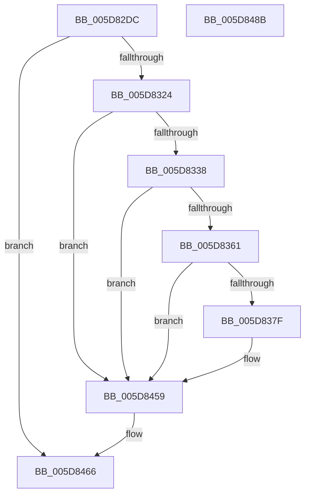

# PopTraceZoneCr3Tripped

- RVA: `0x005D82DC`–`0x005D848C` (길이 `432` bytes)
- VA: `0x00000001405D82DC`
- 실행 섹션: `.text`
- PDB 이름 있음: `예`; PDB Function 태그: `아니요`
- unwind 정보 RVA: `0x000CCA08`
- 디코드: `101`개 명령, `432/432` bytes 표시
- 미해석 바이트: `0` (있으면 어셈블리에 `.byte`로 보존)

> 이 문서는 커널 이미지의 기계어와 PDB 기호를 분석해 생성했습니다. 4번과 5번은 함수 원형과 자료형을 바이너리 사용 방식에서 추정한 C 해석이며 원본 소스 복구 결과는 아닙니다.

## 1. Dependencies

- 직접 호출 지점: **7**; 고유 호출 대상: **6**
- 직접 호출자로 확인된 함수: **1**
- RIP 상대 이미지 참조: **4**

### Outgoing calls
- `0x005D8313` → [IoGetDeviceAttachmentBaseRefWithTag](../27/IoGetDeviceAttachmentBaseRefWithTag_function_00272788.md) (function, `0x00272788`)
- `0x005D8372` → [tlgKeywordOn](../42/tlgKeywordOn_function_0042EAA0.md) (function, `0x0042EAA0`)
- `0x005D841E` → [tlgCreate1Sz_wchar_t](../42/tlgCreate1Sz_wchar_t_function_00426198.md) (function, `0x00426198`)
- `0x005D842A` → [tlgCreate1Sz_wchar_t](../42/tlgCreate1Sz_wchar_t_function_00426198.md) (function, `0x00426198`)
- `0x005D8454` → [tlgWriteTransfer_EtwWriteTransfer](../42/tlgWriteTransfer_EtwWriteTransfer_function_004260E0.md) (function, `0x004260E0`)
- `0x005D8461` → [ObfDereferenceObjectWithTag](../2F/ObfDereferenceObjectWithTag_function_002F78E0.md) (function, `0x002F78E0`)
- `0x005D846D` → [_security_check_cookie](../6A/_security_check_cookie_function_006AC640.md) (function, `0x006AC640`)

### Direct callers
- [sub_006F9E40](../6F/Unknown_function_006F9E40.md) at `0x006F9F23`

### Static image references
- `0x005D82F7` → RVA `0x00E0A740` (`.data`; read)
- `0x005D833F` → RVA `0x006C8EC0` (` ?? ::FNODOBFM::`string'`; read)
- `0x005D8354` → RVA `0x00E07748` (`.data`; read)
- `0x005D843B` → RVA `0x0004AF5B` (`.rdata`; read)

## 2. Other-region calls and transfers

- 다른 실행 섹션으로 향하는 call: **0**
- 별도 외부 분기/꼬리 이동을 확인하지 못했습니다.

## 3. Assembly (complete function range)

```asm
005D82DC  48 8B C4                        mov rax, rsp
005D82DF  48 89 58 08                     mov qword ptr [rax + 8], rbx
005D82E3  48 89 70 18                     mov qword ptr [rax + 0x18], rsi
005D82E7  48 89 78 20                     mov qword ptr [rax + 0x20], rdi
005D82EB  55                              push rbp
005D82EC  48 8D 68 A1                     lea rbp, [rax - 0x5f]
005D82F0  48 81 EC F0 00 00 00            sub rsp, 0xf0
005D82F7  48 8B 05 42 24 83 00            mov rax, qword ptr [rip + 0x832442]
005D82FE  48 33 C4                        xor rax, rsp
005D8301  48 89 45 47                     mov qword ptr [rbp + 0x47], rax
005D8305  48 8B DA                        mov rbx, rdx
005D8308  8B F1                           mov esi, ecx
005D830A  BA 50 6F 44 67                  mov edx, 0x67446f50
005D830F  48 8B 4B 30                     mov rcx, qword ptr [rbx + 0x30]
005D8313  E8 70 A4 C9 FF                  call 0x140272788
005D8318  48 8B F8                        mov rdi, rax
005D831B  48 85 C0                        test rax, rax
005D831E  0F 84 42 01 00 00               je 0x1405d8466
005D8324  48 8B 90 38 01 00 00            mov rdx, qword ptr [rax + 0x138]
005D832B  4C 8B 42 28                     mov r8, qword ptr [rdx + 0x28]
005D832F  4D 85 C0                        test r8, r8
005D8332  0F 84 21 01 00 00               je 0x1405d8459
005D8338  48 8B 8B 18 04 00 00            mov rcx, qword ptr [rbx + 0x418]
005D833F  4C 8D 0D 7A 0B 0F 00            lea r9, [rip + 0xf0b7a]
005D8346  44 8B 93 80 00 00 00            mov r10d, dword ptr [rbx + 0x80]
005D834D  48 85 C9                        test rcx, rcx
005D8350  4C 0F 45 C9                     cmovne r9, rcx
005D8354  83 3D ED F3 82 00 05            cmp dword ptr [rip + 0x82f3ed], 5
005D835B  0F 86 F8 00 00 00               jbe 0x1405d8459
005D8361  48 BA 00 00 00 00 00 40 00 00   movabs rdx, 0x400000000000
005D836B  48 8D 0D D6 F3 82 00            lea rcx, [rip + 0x82f3d6]
005D8372  E8 29 67 E5 FF                  call 0x14042eaa0
005D8377  84 C0                           test al, al
005D8379  0F 84 DA 00 00 00               je 0x1405d8459
005D837F  8A 4B 41                        mov cl, byte ptr [rbx + 0x41]
005D8382  48 8D 45 9B                     lea rax, [rbp - 0x65]
005D8386  83 65 D3 00                     and dword ptr [rbp - 0x2d], 0
005D838A  41 BB 04 00 00 00               mov r11d, 4
005D8390  80 BB E4 00 00 00 00            cmp byte ptr [rbx + 0xe4], 0
005D8397  48 89 45 C7                     mov qword ptr [rbp - 0x39], rax
005D839B  48 8D 45 97                     lea rax, [rbp - 0x69]
005D839F  0F 95 45 97                     setne byte ptr [rbp - 0x69]
005D83A3  48 89 45 D7                     mov qword ptr [rbp - 0x29], rax
005D83A7  83 65 E3 00                     and dword ptr [rbp - 0x1d], 0
005D83AB  41 8D 53 FD                     lea edx, [r11 - 3]
005D83AF  83 65 F3 00                     and dword ptr [rbp - 0xd], 0
005D83B3  8A C1                           mov al, cl
005D83B5  83 65 03 00                     and dword ptr [rbp + 3], 0
005D83B9  22 C2                           and al, dl
005D83BB  83 65 13 00                     and dword ptr [rbp + 0x13], 0
005D83BF  83 65 23 00                     and dword ptr [rbp + 0x23], 0
005D83C3  88 45 98                        mov byte ptr [rbp - 0x68], al
005D83C6  48 8D 45 98                     lea rax, [rbp - 0x68]
005D83CA  48 89 45 E7                     mov qword ptr [rbp - 0x19], rax
005D83CE  48 8D 45 99                     lea rax, [rbp - 0x67]
005D83D2  48 89 45 F7                     mov qword ptr [rbp - 9], rax
005D83D6  48 8D 45 9F                     lea rax, [rbp - 0x61]
005D83DA  48 89 45 07                     mov qword ptr [rbp + 7], rax
005D83DE  8B 83 88 00 00 00               mov eax, dword ptr [rbx + 0x88]
005D83E4  C0 E9 02                        shr cl, 2
005D83E7  22 CA                           and cl, dl
005D83E9  89 45 A3                        mov dword ptr [rbp - 0x5d], eax
005D83EC  48 8D 45 A3                     lea rax, [rbp - 0x5d]
005D83F0  89 55 DF                        mov dword ptr [rbp - 0x21], edx
005D83F3  89 55 EF                        mov dword ptr [rbp - 0x11], edx
005D83F6  88 4D 99                        mov byte ptr [rbp - 0x67], cl
005D83F9  48 8D 4D 27                     lea rcx, [rbp + 0x27]
005D83FD  89 55 FF                        mov dword ptr [rbp - 1], edx
005D8400  49 8B 90 88 00 00 00            mov rdx, qword ptr [r8 + 0x88]
005D8407  48 89 45 17                     mov qword ptr [rbp + 0x17], rax
005D840B  89 75 9B                        mov dword ptr [rbp - 0x65], esi
005D840E  44 89 5D CF                     mov dword ptr [rbp - 0x31], r11d
005D8412  44 89 55 9F                     mov dword ptr [rbp - 0x61], r10d
005D8416  44 89 5D 0F                     mov dword ptr [rbp + 0xf], r11d
005D841A  44 89 5D 1F                     mov dword ptr [rbp + 0x1f], r11d
005D841E  E8 75 DD E4 FF                  call 0x140426198
005D8423  49 8B D1                        mov rdx, r9
005D8426  48 8D 4D 37                     lea rcx, [rbp + 0x37]
005D842A  E8 69 DD E4 FF                  call 0x140426198
005D842F  4C 8D 4D A7                     lea r9, [rbp - 0x59]
005D8433  45 33 C0                        xor r8d, r8d
005D8436  4C 89 4C 24 28                  mov qword ptr [rsp + 0x28], r9
005D843B  48 8D 15 19 2B A7 FF            lea rdx, [rip - 0x58d4e7]
005D8442  45 33 C9                        xor r9d, r9d
005D8445  C7 44 24 20 0A 00 00 00         mov dword ptr [rsp + 0x20], 0xa
005D844D  48 8D 0D F4 F2 82 00            lea rcx, [rip + 0x82f2f4]
005D8454  E8 87 DC E4 FF                  call 0x1404260e0
005D8459  BA 50 6F 44 67                  mov edx, 0x67446f50
005D845E  48 8B CF                        mov rcx, rdi
005D8461  E8 7A F4 D1 FF                  call 0x1402f78e0
005D8466  48 8B 4D 47                     mov rcx, qword ptr [rbp + 0x47]
005D846A  48 33 CC                        xor rcx, rsp
005D846D  E8 CE 41 0D 00                  call 0x1406ac640
005D8472  4C 8D 9C 24 F0 00 00 00         lea r11, [rsp + 0xf0]
005D847A  49 8B 5B 10                     mov rbx, qword ptr [r11 + 0x10]
005D847E  49 8B 73 20                     mov rsi, qword ptr [r11 + 0x20]
005D8482  49 8B 7B 28                     mov rdi, qword ptr [r11 + 0x28]
005D8486  49 8B E3                        mov rsp, r11
005D8489  5D                              pop rbp
005D848A  C3                              ret
005D848B  CC                              int3
```

## 4. C-style interpretation (structured pseudocode)

```c
__int64 __fastcall PopTraceZoneCr3Tripped(int a1, __int64 a2)
{
    __int64 result;
    __int64 v_r11;
    __int64 v_rsp;
    unsigned __int64 v_stack_m8;
    unsigned __int64 v_stack_mD0;
    unsigned int v_stack_mD8;

    *(unsigned __int64 *)(v_rsp + 8) = v_rbx;
    *(unsigned __int64 *)(v_rsp + 24) = v_rsi;
    *(unsigned __int64 *)(v_rsp + 32) = v_rdi;
    v_rsp = (v_rsp) - (240);
    result = (*(unsigned __int64 *)(v_rip + 8594498)) ^ (v_rsp);
    *(unsigned __int64 *)(v_rsp - 95 + 71) = result;
    result = IoGetDeviceAttachmentBaseRefWithTag(*(unsigned __int64 *)(a2 + 48), (unsigned int)(0x67446F50ULL), a3, a4);
    if (result == 0) goto loc_005D8466;
    if (*(unsigned __int64 *)(*(unsigned __int64 *)(result + 312) + 40) == 0) goto loc_005D8459;
    a4 = v_rip + 985978;
    if (*(unsigned __int64 *)(a2 + 1048) != 0) { a4 = *(unsigned __int64 *)(a2 + 1048); }
    if ((*(unsigned int *)(v_rip + 8582125)) <= 5) goto loc_005D8459;
    result = tlgKeywordOn(v_rip + 8582102, *(unsigned __int64 *)(result + 312), *(unsigned __int64 *)(*(unsigned __int64 *)(result + 312) + 40), a4);
    if ((unsigned __int8)(result) != 0) {
        a1 = *(unsigned __int8 *)(a2 + 65);
        result = v_rsp - 95 - 101;
        v_r11 = 4;
        *(unsigned __int64 *)(v_rsp - 95 - 57) = result;
        result = v_rsp - 95 - 105;
        *(unsigned __int64 *)(v_rsp - 95 - 41) = result;
        a2 = v_r11 - 3;
        result = (unsigned __int8)(a1);
        result = (unsigned __int8)((result) & ((unsigned __int8)(a2)));
        *(unsigned __int8 *)(v_rsp - 95 - 104) = (unsigned __int8)(result);
        result = v_rsp - 95 - 104;
        *(unsigned __int64 *)(v_rsp - 95 - 25) = result;
        result = v_rsp - 95 - 103;
        *(unsigned __int64 *)(v_rsp - 95 - 9) = result;
        result = v_rsp - 95 - 97;
        *(unsigned __int64 *)(v_rsp - 95 + 7) = result;
        result = *(unsigned int *)(a2 + 136);
        a1 = (unsigned __int8)((a1) >> (2));
        a1 = (unsigned __int8)((a1) & ((unsigned __int8)(a2)));
        *(unsigned int *)(v_rsp - 95 - 93) = (unsigned int)(result);
        result = v_rsp - 95 - 93;
        *(unsigned int *)(v_rsp - 95 - 33) = (unsigned int)(a2);
        *(unsigned int *)(v_rsp - 95 - 17) = (unsigned int)(a2);
        *(unsigned __int8 *)(v_rsp - 95 - 103) = (unsigned __int8)(a1);
        a1 = v_rsp - 95 + 39;
        *(unsigned int *)(v_rsp - 95 - 1) = (unsigned int)(a2);
        a2 = *(unsigned __int64 *)(*(unsigned __int64 *)(*(unsigned __int64 *)(result + 312) + 40) + 136);
        *(unsigned __int64 *)(v_rsp - 95 + 23) = result;
        *(unsigned int *)(v_rsp - 95 - 101) = (unsigned int)((unsigned int)(a1));
        *(unsigned int *)(v_rsp - 95 - 49) = (unsigned int)(v_r11);
        *(unsigned int *)(v_rsp - 95 - 97) = (unsigned int)((unsigned int)(*(unsigned int *)(a2 + 128)));
        *(unsigned int *)(v_rsp - 95 + 15) = (unsigned int)(v_r11);
        *(unsigned int *)(v_rsp - 95 + 31) = (unsigned int)(v_r11);
        result = tlgCreate1Sz_wchar_t(a1, a2, *(unsigned __int64 *)(*(unsigned __int64 *)(result + 312) + 40), a4);
        a2 = a4;
        a1 = v_rsp - 95 + 55;
        result = tlgCreate1Sz_wchar_t(a1, a2, *(unsigned __int64 *)(*(unsigned __int64 *)(result + 312) + 40), a4);
        a4 = v_rsp - 95 - 89;
        a3 = 0;
        v_stack_mD0 = a4;
        a2 = v_rip - 5821671;
        a4 = 0;
        v_stack_mD8 = 10;
        a1 = v_rip + 8581876;
        result = tlgWriteTransfer_EtwWriteTransfer(a1, a2, a3, a4);
    }
    result = ObfDereferenceObjectWithTag(result, (unsigned int)(0x67446F50ULL), a3, a4);
loc_005D8466:
    a1 = (*(unsigned __int64 *)(v_rsp - 95 + 71)) ^ (v_rsp);
    result = _security_check_cookie(a1, (unsigned int)(0x67446F50ULL), a3, a4);
    return result;
}
```

## 5. (Beta) C Style

```c
int64_t PopTraceZoneCr3Tripped(int32_t Arg1, void *Arg2)
{
    uint8_t *arg2 = (uint8_t *)Arg2;

    int64_t result;
    int64_t local_r11;
    int64_t local_rsp;
    uint64_t v_stack_m8;
    uint64_t v_stack_mD0;
    uint32_t v_stack_mD8;

    *(uint64_t *)(local_rsp + 0x8) = local_rbx;
    *(uint64_t *)(local_rsp + 0x18) = local_rsi;
    *(uint64_t *)(local_rsp + 0x20) = local_rdi;
    local_rsp = (local_rsp) - (240);
    result = (*(uint64_t *)(v_rip + 0x832442)) ^ (local_rsp);
    *(uint64_t *)(local_rsp - 0x5F + 0x47) = result;
    result = IoGetDeviceAttachmentBaseRefWithTag(*(uint64_t *)(arg2 + 0x30), (uint32_t)(0x67446F50ULL), a3, a4);
    if (result == 0) goto loc_005D8466;
    if (*(uint64_t *)(*(uint64_t *)(result + 0x138) + 0x28) == 0) goto loc_005D8459;
    a4 = v_rip + 985978;
    if (*(uint64_t *)(arg2 + 0x418) != 0) { a4 = *(uint64_t *)(arg2 + 0x418); }
    if ((*(uint32_t *)(v_rip + 0x82F3ED)) <= 5) goto loc_005D8459;
    result = tlgKeywordOn(v_rip + 8582102, *(uint64_t *)(result + 0x138), *(uint64_t *)(*(uint64_t *)(result + 0x138) + 0x28), a4);
    if ((uint8_t)(result) != 0) {
        Arg1 = *(uint8_t *)(arg2 + 0x41);
        result = local_rsp - 95 - 101;
        local_r11 = 4;
        *(uint64_t *)(local_rsp - 0x5F - 0x39) = result;
        result = local_rsp - 95 - 105;
        *(uint64_t *)(local_rsp - 0x5F - 0x29) = result;
        Arg2 = local_r11 - 3;
        result = (uint8_t)(Arg1);
        result = (uint8_t)((result) & ((uint8_t)(Arg2)));
        *(uint8_t *)(local_rsp - 0x5F - 0x68) = (uint8_t)(result);
        result = local_rsp - 95 - 104;
        *(uint64_t *)(local_rsp - 0x5F - 0x19) = result;
        result = local_rsp - 95 - 103;
        *(uint64_t *)(local_rsp - 0x5F - 0x9) = result;
        result = local_rsp - 95 - 97;
        *(uint64_t *)(local_rsp - 0x5F + 0x7) = result;
        result = *(uint32_t *)(arg2 + 0x88);
        Arg1 = (uint8_t)((Arg1) >> (2));
        Arg1 = (uint8_t)((Arg1) & ((uint8_t)(Arg2)));
        *(uint32_t *)(local_rsp - 0x5F - 0x5D) = (uint32_t)(result);
        result = local_rsp - 95 - 93;
        *(uint32_t *)(local_rsp - 0x5F - 0x21) = (uint32_t)(Arg2);
        *(uint32_t *)(local_rsp - 0x5F - 0x11) = (uint32_t)(Arg2);
        *(uint8_t *)(local_rsp - 0x5F - 0x67) = (uint8_t)(Arg1);
        Arg1 = local_rsp - 95 + 39;
        *(uint32_t *)(local_rsp - 0x5F - 0x1) = (uint32_t)(Arg2);
        Arg2 = *(uint64_t *)(*(uint64_t *)(*(uint64_t *)(result + 0x138) + 0x28) + 0x88);
        *(uint64_t *)(local_rsp - 0x5F + 0x17) = result;
        *(uint32_t *)(local_rsp - 0x5F - 0x65) = (uint32_t)((uint32_t)(Arg1));
        *(uint32_t *)(local_rsp - 0x5F - 0x31) = (uint32_t)(local_r11);
        *(uint32_t *)(local_rsp - 0x5F - 0x61) = (uint32_t)((uint32_t)(*(uint32_t *)(arg2 + 0x80)));
        *(uint32_t *)(local_rsp - 0x5F + 0xF) = (uint32_t)(local_r11);
        *(uint32_t *)(local_rsp - 0x5F + 0x1F) = (uint32_t)(local_r11);
        result = tlgCreate1Sz_wchar_t(Arg1, Arg2, *(uint64_t *)(*(uint64_t *)(result + 0x138) + 0x28), a4);
        Arg2 = a4;
        Arg1 = local_rsp - 95 + 55;
        result = tlgCreate1Sz_wchar_t(Arg1, Arg2, *(uint64_t *)(*(uint64_t *)(result + 0x138) + 0x28), a4);
        a4 = local_rsp - 95 - 89;
        a3 = 0;
        v_stack_mD0 = a4;
        Arg2 = v_rip - 5821671;
        a4 = 0;
        v_stack_mD8 = 10;
        Arg1 = v_rip + 8581876;
        result = tlgWriteTransfer_EtwWriteTransfer(Arg1, Arg2, a3, a4);
    }
    result = ObfDereferenceObjectWithTag(result, (uint32_t)(0x67446F50ULL), a3, a4);
loc_005D8466:
    Arg1 = (*(uint64_t *)(local_rsp - 0x5F + 0x47)) ^ (local_rsp);
    result = _security_check_cookie(Arg1, (uint32_t)(0x67446F50ULL), a3, a4);
    return result;
}
```

### 관측된 메모리 오프셋

구조체 형식이 확인되지 않은 접근은 인자 기준의 오프셋으로만 기록했습니다.

| 기준 인자 | 오프셋 표현 | 폭 (bit) | 접근 |
|---|---:|---:|---|
| `Arg2` | `+ 0x30` | `64` | `R` |
| `Arg2` | `+ 0x41` | `8` | `R` |
| `Arg2` | `+ 0x80` | `32` | `R` |
| `Arg2` | `+ 0x88` | `32` | `R` |
| `Arg2` | `+ 0xE4` | `8` | `R` |
| `Arg2` | `+ 0x418` | `64` | `R` |

## 6. Execution-region graph

[열기: 2D/3D 그래프와 함수 탐색 컨트롤 패널](../../../control-panel.html?section=text&rva=0x005D82DC&view=graph)

- 2D 그래프는 위에서 아래로 흐르고, 3D 그래프는 빈 공간을 드래그해 회전합니다. Shift+드래그는 이동, 휠은 확대·축소, 함수 노드 선택은 대상 보고서 이동입니다.

### Static fallback


