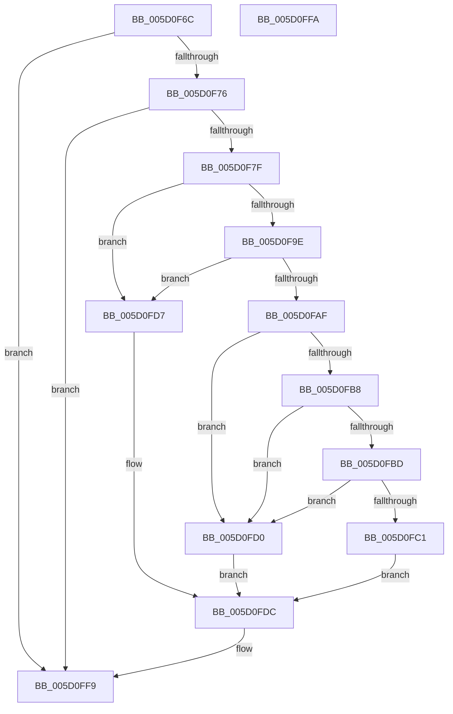

# PopUpdatePowerLimitTimeTracking

- RVA: `0x005D0F6C`–`0x005D0FFB` (길이 `143` bytes)
- VA: `0x00000001405D0F6C`
- 실행 섹션: `.text`
- PDB 이름 있음: `예`; PDB Function 태그: `아니요`
- unwind 정보 RVA: `0x000DB714`
- 디코드: `44`개 명령, `143/143` bytes 표시
- 미해석 바이트: `0` (있으면 어셈블리에 `.byte`로 보존)

> 이 문서는 커널 이미지의 기계어와 PDB 기호를 분석해 생성했습니다. 4번과 5번은 함수 원형과 자료형을 바이너리 사용 방식에서 추정한 C 해석이며 원본 소스 복구 결과는 아닙니다.

## 1. Dependencies

- 직접 호출 지점: **0**; 고유 호출 대상: **0**
- 직접 호출자로 확인된 함수: **4**
- RIP 상대 이미지 참조: **0**

### Outgoing calls
- 직접 디코드된 call 명령이 없습니다.

### Direct callers
- [PopPowerLimitTelemetryWorker](../42/PopPowerLimitTelemetryWorker_function_0042FD20.md) at `0x0042FD84`
- [PopPowerLimitSxTransition](PopPowerLimitSxTransition_function_005D0E64.md) at `0x005D0ED6`
- [PoSetPowerLimitValue](../../page/75/PoSetPowerLimitValue_function_00755C30.md) at `0x00755D6A`
- [PopFreePowerLimitRequest](../../page/75/PopFreePowerLimitRequest_function_00756494.md) at `0x0075651D`

### Static image references
- 디코드된 RIP-relative 메모리 참조가 없습니다.

## 2. Other-region calls and transfers

- 다른 실행 섹션으로 향하는 call: **0**
- 별도 외부 분기/꼬리 이동을 확인하지 못했습니다.

## 3. Assembly (complete function range)

```asm
005D0F6C  80 79 30 00                     cmp byte ptr [rcx + 0x30], 0
005D0F70  0F 84 83 00 00 00               je 0x1405d0ff9
005D0F76  4C 8B 59 40                     mov r11, qword ptr [rcx + 0x40]
005D0F7A  4D 85 DB                        test r11, r11
005D0F7D  74 7A                           je 0x1405d0ff9
005D0F7F  48 8B 41 28                     mov rax, qword ptr [rcx + 0x28]
005D0F83  44 8B D2                        mov r10d, edx
005D0F86  4D 6B CA 68                     imul r9, r10, 0x68
005D0F8A  8B D2                           mov edx, edx
005D0F8C  4C 03 49 38                     add r9, qword ptr [rcx + 0x38]
005D0F90  48 03 D2                        add rdx, rdx
005D0F93  44 8B 44 D0 08                  mov r8d, dword ptr [rax + rdx*8 + 8]
005D0F98  41 83 F8 FF                     cmp r8d, -1
005D0F9C  74 39                           je 0x1405d0fd7
005D0F9E  49 8B 53 50                     mov rdx, qword ptr [r11 + 0x50]
005D0FA2  4B 8D 04 D2                     lea rax, [r10 + r10*8]
005D0FA6  8B 4C 82 08                     mov ecx, dword ptr [rdx + rax*4 + 8]
005D0FAA  44 3B C1                        cmp r8d, ecx
005D0FAD  74 28                           je 0x1405d0fd7
005D0FAF  8B 44 82 0C                     mov eax, dword ptr [rdx + rax*4 + 0xc]
005D0FB3  44 3B C0                        cmp r8d, eax
005D0FB6  72 18                           jb 0x1405d0fd0
005D0FB8  44 3B C1                        cmp r8d, ecx
005D0FBB  77 13                           ja 0x1405d0fd0
005D0FBD  2B C8                           sub ecx, eax
005D0FBF  74 0F                           je 0x1405d0fd0
005D0FC1  44 2B C0                        sub r8d, eax
005D0FC4  33 D2                           xor edx, edx
005D0FC6  43 8D 04 80                     lea eax, [r8 + r8*4]
005D0FCA  03 C0                           add eax, eax
005D0FCC  F7 F1                           div ecx
005D0FCE  EB 0C                           jmp 0x1405d0fdc
005D0FD0  B8 0B 00 00 00                  mov eax, 0xb
005D0FD5  EB 05                           jmp 0x1405d0fdc
005D0FD7  B8 0A 00 00 00                  mov eax, 0xa
005D0FDC  8B C8                           mov ecx, eax
005D0FDE  48 BA 08 00 00 00 80 F7 FF FF   movabs rdx, 0xfffff78000000008
005D0FE8  48 8B 12                        mov rdx, qword ptr [rdx]
005D0FEB  48 8B C2                        mov rax, rdx
005D0FEE  49 2B 01                        sub rax, qword ptr [r9]
005D0FF1  49 01 44 C9 08                  add qword ptr [r9 + rcx*8 + 8], rax
005D0FF6  49 89 11                        mov qword ptr [r9], rdx
005D0FF9  C3                              ret
005D0FFA  CC                              int3
```

## 4. C-style interpretation (structured pseudocode)

```c
__int64 __fastcall PopUpdatePowerLimitTimeTracking(__int64 a1, int a2)
{
    __int64 result;

    if ((*(unsigned __int8 *)(a1 + 48)) == 0) goto loc_005D0FF9;
    if (*(unsigned __int64 *)(a1 + 64) == 0) goto loc_005D0FF9;
    a4 = (a4) * ((unsigned int)(a2));
    a4 = (a4) + (*(unsigned __int64 *)(a1 + 56));
    a2 = ((unsigned int)(a2)) + ((unsigned int)(a2));
    if (((unsigned int)((unsigned int)(*(unsigned int *)(*(unsigned __int64 *)(a1 + 40) + a2 * 8 + 8)))) == -1) goto loc_005D0FD7;
    if (((unsigned int)((unsigned int)(*(unsigned int *)(*(unsigned __int64 *)(a1 + 40) + a2 * 8 + 8)))) == ((unsigned int)((unsigned int)(*(unsigned int *)(*(unsigned __int64 *)(*(unsigned __int64 *)(a1 + 64) + 80) + (unsigned int)(a2) + (unsigned int)(a2) * 8 * 4 + 8))))) goto loc_005D0FD7;
    if (((unsigned int)((unsigned int)(*(unsigned int *)(*(unsigned __int64 *)(a1 + 40) + a2 * 8 + 8)))) < ((unsigned int)((unsigned int)(*(unsigned int *)(*(unsigned __int64 *)(*(unsigned __int64 *)(a1 + 64) + 80) + (unsigned int)(a2) + (unsigned int)(a2) * 8 * 4 + 12))))) goto loc_005D0FD0;
    if (((unsigned int)((unsigned int)(*(unsigned int *)(*(unsigned __int64 *)(a1 + 40) + a2 * 8 + 8)))) > ((unsigned int)((unsigned int)(*(unsigned int *)(*(unsigned __int64 *)(*(unsigned __int64 *)(a1 + 64) + 80) + (unsigned int)(a2) + (unsigned int)(a2) * 8 * 4 + 8))))) goto loc_005D0FD0;
    a1 = (unsigned int)(((unsigned int)(*(unsigned int *)(*(unsigned __int64 *)(*(unsigned __int64 *)(a1 + 64) + 80) + (unsigned int)(a2) + (unsigned int)(a2) * 8 * 4 + 8))) - ((unsigned int)((unsigned int)(*(unsigned int *)(*(unsigned __int64 *)(*(unsigned __int64 *)(a1 + 64) + 80) + (unsigned int)(a2) + (unsigned int)(a2) * 8 * 4 + 12)))));
    if (condition_is_equal) goto loc_005D0FD0;
    a3 = (unsigned int)(((unsigned int)(*(unsigned int *)(*(unsigned __int64 *)(a1 + 40) + a2 * 8 + 8))) - ((unsigned int)((unsigned int)(*(unsigned int *)(*(unsigned __int64 *)(*(unsigned __int64 *)(a1 + 64) + 80) + (unsigned int)(a2) + (unsigned int)(a2) * 8 * 4 + 12)))));
    a2 = 0;
    result = (unsigned int)((a3 + a3 * 4) + ((unsigned int)(a3 + a3 * 4)));
    goto loc_005D0FDC;
loc_005D0FD0:
    goto loc_005D0FDC;
loc_005D0FD7:
loc_005D0FDC:
    result = (*(unsigned __int64 *)(a2)) - (*(unsigned __int64 *)(a4));
    *(unsigned __int64 *)(a4) = *(unsigned __int64 *)(a2);
loc_005D0FF9:
    return result;
}
```

## 5. (Beta) C Style

```c
int64_t PopUpdatePowerLimitTimeTracking(void *Arg1, void *Arg2)
{
    uint8_t *arg1 = (uint8_t *)Arg1;
    uint8_t *arg2 = (uint8_t *)Arg2;

    int64_t result;

    if ((*(uint8_t *)(arg1 + 0x30)) == 0) goto loc_005D0FF9;
    if (*(uint64_t *)(arg1 + 0x40) == 0) goto loc_005D0FF9;
    a4 = (a4) * ((uint32_t)(Arg2));
    a4 = (a4) + (*(uint64_t *)(arg1 + 0x38));
    Arg2 = ((uint32_t)(Arg2)) + ((uint32_t)(Arg2));
    if (((uint32_t)((uint32_t)(*(uint32_t *)(*(uint64_t *)(arg1 + 0x28) + arg2 * 8 + 0x8)))) == -1) goto loc_005D0FD7;
    if (((uint32_t)((uint32_t)(*(uint32_t *)(*(uint64_t *)(arg1 + 0x28) + arg2 * 8 + 0x8)))) == ((uint32_t)((uint32_t)(*(uint32_t *)(*(uint64_t *)(*(uint64_t *)(arg1 + 0x40) + 0x50) + (uint32_t)(arg2) + (uint32_t)(arg2) * 8 * 4 + 0x8))))) goto loc_005D0FD7;
    if (((uint32_t)((uint32_t)(*(uint32_t *)(*(uint64_t *)(arg1 + 0x28) + arg2 * 8 + 0x8)))) < ((uint32_t)((uint32_t)(*(uint32_t *)(*(uint64_t *)(*(uint64_t *)(arg1 + 0x40) + 0x50) + (uint32_t)(arg2) + (uint32_t)(arg2) * 8 * 4 + 0xC))))) goto loc_005D0FD0;
    if (((uint32_t)((uint32_t)(*(uint32_t *)(*(uint64_t *)(arg1 + 0x28) + arg2 * 8 + 0x8)))) > ((uint32_t)((uint32_t)(*(uint32_t *)(*(uint64_t *)(*(uint64_t *)(arg1 + 0x40) + 0x50) + (uint32_t)(arg2) + (uint32_t)(arg2) * 8 * 4 + 0x8))))) goto loc_005D0FD0;
    Arg1 = (uint32_t)(((uint32_t)(*(uint32_t *)(*(uint64_t *)(*(uint64_t *)(arg1 + 0x40) + 0x50) + (uint32_t)(arg2) + (uint32_t)(arg2) * 8 * 4 + 0x8))) - ((uint32_t)((uint32_t)(*(uint32_t *)(*(uint64_t *)(*(uint64_t *)(arg1 + 0x40) + 0x50) + (uint32_t)(arg2) + (uint32_t)(arg2) * 8 * 4 + 0xC)))));
    if (condition_is_equal) goto loc_005D0FD0;
    a3 = (uint32_t)(((uint32_t)(*(uint32_t *)(*(uint64_t *)(arg1 + 0x28) + arg2 * 8 + 0x8))) - ((uint32_t)((uint32_t)(*(uint32_t *)(*(uint64_t *)(*(uint64_t *)(arg1 + 0x40) + 0x50) + (uint32_t)(arg2) + (uint32_t)(arg2) * 8 * 4 + 0xC)))));
    Arg2 = 0;
    result = (uint32_t)((a3 + a3 * 4) + ((uint32_t)(a3 + a3 * 4)));
    goto loc_005D0FDC;
loc_005D0FD0:
    goto loc_005D0FDC;
loc_005D0FD7:
loc_005D0FDC:
    result = (*(uint64_t *)(arg2)) - (*(uint64_t *)(a4));
    *(uint64_t *)(a4) = *(uint64_t *)(arg2);
loc_005D0FF9:
    return result;
}
```

### 관측된 메모리 오프셋

구조체 형식이 확인되지 않은 접근은 인자 기준의 오프셋으로만 기록했습니다.

| 기준 인자 | 오프셋 표현 | 폭 (bit) | 접근 |
|---|---:|---:|---|
| `Arg1` | `+ 0x28` | `64` | `R` |
| `Arg1` | `+ 0x30` | `8` | `R` |
| `Arg1` | `+ 0x38` | `64` | `R` |
| `Arg1` | `+ 0x40` | `64` | `R` |
| `Arg2` | `+ 0x0 + r10*8` | `64` | `R` |

## 6. Execution-region graph

[열기: 2D/3D 그래프와 함수 탐색 컨트롤 패널](../../../control-panel.html?section=text&rva=0x005D0F6C&view=graph)

- 2D 그래프는 위에서 아래로 흐르고, 3D 그래프는 빈 공간을 드래그해 회전합니다. Shift+드래그는 이동, 휠은 확대·축소, 함수 노드 선택은 대상 보고서 이동입니다.

### Static fallback


