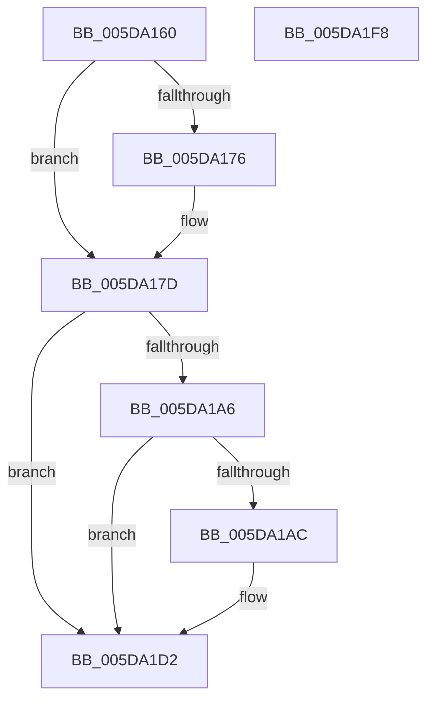

# PopWatchdogDpc

- RVA: `0x005DA160`–`0x005DA1F9` (길이 `153` bytes)
- VA: `0x00000001405DA160`
- 실행 섹션: `.text`
- PDB 이름 있음: `예`; PDB Function 태그: `아니요`
- unwind 정보 RVA: `0x0005CAAC`
- 디코드: `36`개 명령, `153/153` bytes 표시
- 미해석 바이트: `0` (있으면 어셈블리에 `.byte`로 보존)

> 이 문서는 커널 이미지의 기계어와 PDB 기호를 분석해 생성했습니다. 4번과 5번은 함수 원형과 자료형을 바이너리 사용 방식에서 추정한 C 해석이며 원본 소스 복구 결과는 아닙니다.

## 1. Dependencies

- 직접 호출 지점: **6**; 고유 호출 대상: **5**
- 직접 호출자로 확인된 함수: **0**
- RIP 상대 이미지 참조: **1**

### Outgoing calls
- `0x005DA182` → [RtlGetInterruptTimePrecise](../20/RtlGetInterruptTimePrecise_function_0020A4C0.md) (function, `0x0020A4C0`)
- `0x005DA195` → [KeAcquireSpinLockRaiseToDpc](../20/KeAcquireSpinLockRaiseToDpc_function_00208470.md) (function, `0x00208470`)
- `0x005DA1B5` → [RtlGetInterruptTimePrecise](../20/RtlGetInterruptTimePrecise_function_0020A4C0.md) (function, `0x0020A4C0`)
- `0x005DA1CD` → [ExQueueWorkItem](../2F/ExQueueWorkItem_function_002F9520.md) (function, `0x002F9520`)
- `0x005DA1D9` → [PopUpdateWatchdogNoWorkersEvent](../46/PopUpdateWatchdogNoWorkersEvent_function_00461078.md) (function, `0x00461078`)
- `0x005DA1E8` → [KeReleaseSpinLock](../39/KeReleaseSpinLock_function_00392BA0.md) (function, `0x00392BA0`)

### Direct callers
- 이 함수 시작 RVA로 연결되는 직접 call은 확인되지 않았습니다. 간접 호출은 완전히 역산할 수 없습니다.

### Static image references
- `0x005DA187` → RVA `0x00F083F8` (`.data`; read)

## 2. Other-region calls and transfers

- 다른 실행 섹션으로 향하는 call: **0**
- 별도 외부 분기/꼬리 이동을 확인하지 못했습니다.

## 3. Assembly (complete function range)

```asm
005DA160  48 89 5C 24 08                  mov qword ptr [rsp + 8], rbx
005DA165  57                              push rdi
005DA166  48 83 EC 20                     sub rsp, 0x20
005DA16A  81 7A 10 50 4F 57 44            cmp dword ptr [rdx + 0x10], 0x44574f50
005DA171  48 8B DA                        mov rbx, rdx
005DA174  74 07                           je 0x1405da17d
005DA176  B9 05 00 00 00                  mov ecx, 5
005DA17B  CD 29                           int 0x29
005DA17D  48 8D 4C 24 38                  lea rcx, [rsp + 0x38]
005DA182  E8 39 03 C3 FF                  call 0x14020a4c0
005DA187  48 8D 0D 6A E2 92 00            lea rcx, [rip + 0x92e26a]
005DA18E  48 89 83 68 01 00 00            mov qword ptr [rbx + 0x168], rax
005DA195  E8 D6 E2 C2 FF                  call 0x140208470
005DA19A  80 BB D0 00 00 00 00            cmp byte ptr [rbx + 0xd0], 0
005DA1A1  40 8A F8                        mov dil, al
005DA1A4  74 2C                           je 0x1405da1d2
005DA1A6  80 7B 15 00                     cmp byte ptr [rbx + 0x15], 0
005DA1AA  75 26                           jne 0x1405da1d2
005DA1AC  48 8D 4C 24 38                  lea rcx, [rsp + 0x38]
005DA1B1  C6 43 15 01                     mov byte ptr [rbx + 0x15], 1
005DA1B5  E8 06 03 C3 FF                  call 0x14020a4c0
005DA1BA  48 8D 8B B0 00 00 00            lea rcx, [rbx + 0xb0]
005DA1C1  48 89 83 70 01 00 00            mov qword ptr [rbx + 0x170], rax
005DA1C8  BA 05 00 00 00                  mov edx, 5
005DA1CD  E8 4E F3 D1 FF                  call 0x1402f9520
005DA1D2  48 8B CB                        mov rcx, rbx
005DA1D5  C6 43 14 00                     mov byte ptr [rbx + 0x14], 0
005DA1D9  E8 9A 6E E8 FF                  call 0x140461078
005DA1DE  40 8A D7                        mov dl, dil
005DA1E1  48 8D 0D 10 E2 92 00            lea rcx, [rip + 0x92e210]
005DA1E8  E8 B3 89 DB FF                  call 0x140392ba0
005DA1ED  48 8B 5C 24 30                  mov rbx, qword ptr [rsp + 0x30]
005DA1F2  48 83 C4 20                     add rsp, 0x20
005DA1F6  5F                              pop rdi
005DA1F7  C3                              ret
005DA1F8  CC                              int3
```

## 4. C-style interpretation (structured pseudocode)

```c
__int64 __fastcall PopWatchdogDpc(__int64 a1, __int64 a2)
{
    __int64 result;
    __int64 v_rsp;
    unsigned __int64 v_stack_p10;
    unsigned __int64 v_stack_p8;

    v_stack_p8 = v_rbx;
    v_rsp = (v_rsp) - (32);
    if ((*(unsigned int *)(a2 + 16)) != 0x44574F50ULL) {
        a1 = 5;
    }
    result = RtlGetInterruptTimePrecise(v_stack_p10, a2, a3, a4);
    *(unsigned __int64 *)(a2 + 360) = result;
    result = KeAcquireSpinLockRaiseToDpc(v_rip + 9626218, a2, a3, a4);
    if ((*(unsigned __int8 *)(a2 + 208)) == 0) goto loc_005DA1D2;
    if ((*(unsigned __int8 *)(a2 + 21)) == 0) {
        a1 = v_stack_p10;
        *(unsigned __int8 *)(a2 + 21) = 1;
        result = RtlGetInterruptTimePrecise(a1, a2, a3, a4);
        a1 = a2 + 176;
        *(unsigned __int64 *)(a2 + 368) = result;
        a2 = 5;
        result = ExQueueWorkItem(a1, a2, a3, a4);
    }
    *(unsigned __int8 *)(a2 + 20) = 0;
    result = PopUpdateWatchdogNoWorkersEvent(a2, a2, a3, a4);
    result = KeReleaseSpinLock(v_rip + 9626128, (unsigned __int8)((unsigned __int8)(result)), a3, a4);
    v_rsp = (v_rsp) + (32);
    return result;
}
```

## 5. (Beta) C Style

```c
int64_t PopWatchdogDpc(int64_t Arg1, void *Arg2)
{
    uint8_t *arg2 = (uint8_t *)Arg2;

    int64_t result;
    int64_t local_rsp;
    uint64_t v_stack_p10;
    uint64_t v_stack_p8;

    v_stack_p8 = local_rbx;
    local_rsp = (local_rsp) - (32);
    if ((*(uint32_t *)(arg2 + 0x10)) != 0x44574F50ULL) {
        Arg1 = 5;
    }
    result = RtlGetInterruptTimePrecise(v_stack_p10, Arg2, a3, a4);
    *(uint64_t *)(arg2 + 0x168) = result;
    result = KeAcquireSpinLockRaiseToDpc(v_rip + 9626218, Arg2, a3, a4);
    if ((*(uint8_t *)(arg2 + 0xD0)) == 0) goto loc_005DA1D2;
    if ((*(uint8_t *)(arg2 + 0x15)) == 0) {
        Arg1 = v_stack_p10;
        *(uint8_t *)(arg2 + 0x15) = 1;
        result = RtlGetInterruptTimePrecise(Arg1, Arg2, a3, a4);
        Arg1 = Arg2 + 176;
        *(uint64_t *)(arg2 + 0x170) = result;
        Arg2 = 5;
        result = ExQueueWorkItem(Arg1, Arg2, a3, a4);
    }
    *(uint8_t *)(arg2 + 0x14) = 0;
    result = PopUpdateWatchdogNoWorkersEvent(Arg2, Arg2, a3, a4);
    result = KeReleaseSpinLock(v_rip + 9626128, (uint8_t)((uint8_t)(result)), a3, a4);
    local_rsp = (local_rsp) + (32);
    return result;
}
```

### 관측된 메모리 오프셋

구조체 형식이 확인되지 않은 접근은 인자 기준의 오프셋으로만 기록했습니다.

| 기준 인자 | 오프셋 표현 | 폭 (bit) | 접근 |
|---|---:|---:|---|
| `Arg2` | `+ 0x10` | `32` | `R` |
| `Arg2` | `+ 0x14` | `8` | `W` |
| `Arg2` | `+ 0x15` | `8` | `R` |
| `Arg2` | `+ 0x15` | `8` | `W` |
| `Arg2` | `+ 0xB0` | `64` | `R` |
| `Arg2` | `+ 0xD0` | `8` | `R` |
| `Arg2` | `+ 0x168` | `64` | `W` |
| `Arg2` | `+ 0x170` | `64` | `W` |

## 6. Execution-region graph

[열기: 2D/3D 그래프와 함수 탐색 컨트롤 패널](../../../control-panel.html?section=text&rva=0x005DA160&view=graph)

- 2D 그래프는 위에서 아래로 흐르고, 3D 그래프는 빈 공간을 드래그해 회전합니다. Shift+드래그는 이동, 휠은 확대·축소, 함수 노드 선택은 대상 보고서 이동입니다.

### Static fallback


