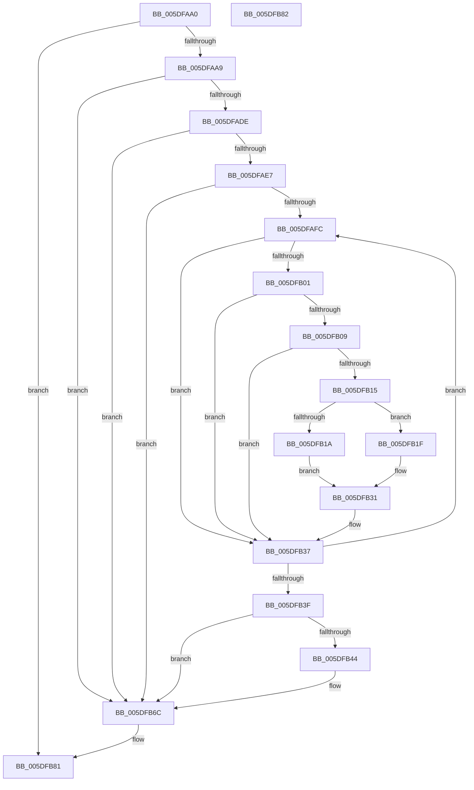

# PopWatchdogDumpControlRoutine

- RVA: `0x005DFAA0`–`0x005DFB83` (길이 `227` bytes)
- VA: `0x00000001405DFAA0`
- 실행 섹션: `.text`
- PDB 이름 있음: `예`; PDB Function 태그: `아니요`
- unwind 정보 RVA: `0x000CD998`
- 디코드: `59`개 명령, `227/227` bytes 표시
- 미해석 바이트: `0` (있으면 어셈블리에 `.byte`로 보존)

> 이 문서는 커널 이미지의 기계어와 PDB 기호를 분석해 생성했습니다. 4번과 5번은 함수 원형과 자료형을 바이너리 사용 방식에서 추정한 C 해석이며 원본 소스 복구 결과는 아닙니다.

## 1. Dependencies

- 직접 호출 지점: **3**; 고유 호출 대상: **3**
- 직접 호출자로 확인된 함수: **0**
- RIP 상대 이미지 참조: **2**

### Outgoing calls
- `0x005DFAD1` → [strcmp](../6C/strcmp_function_006C7000.md) (function, `0x006C7000`)
- `0x005DFB50` → [KeInitializeTriageDumpDataArray](../4B/KeInitializeTriageDumpDataArray_function_004BA020.md) (function, `0x004BA020`)
- `0x005DFB61` → [KeAddTriageDumpDataBlock](../5B/KeAddTriageDumpDataBlock_function_005B26B0.md) (function, `0x005B26B0`)

### Direct callers
- 이 함수 시작 RVA로 연결되는 직접 call은 확인되지 않았습니다. 간접 호출은 완전히 역산할 수 없습니다.

### Static image references
- `0x005DFAC4` → RVA `0x006CC520` (` ?? ::FNODOBFM::`string'`; read)
- `0x005DFAE7` → RVA `0x00F08400` (`.data`; read)

## 2. Other-region calls and transfers

- 다른 실행 섹션으로 향하는 call: **0**
- 별도 외부 분기/꼬리 이동을 확인하지 못했습니다.

## 3. Assembly (complete function range)

```asm
005DFAA0  48 85 D2                        test rdx, rdx
005DFAA3  0F 84 D8 00 00 00               je 0x1405dfb81
005DFAA9  48 89 5C 24 08                  mov qword ptr [rsp + 8], rbx
005DFAAE  48 89 74 24 10                  mov qword ptr [rsp + 0x10], rsi
005DFAB3  48 89 7C 24 18                  mov qword ptr [rsp + 0x18], rdi
005DFAB8  41 56                           push r14
005DFABA  48 83 EC 20                     sub rsp, 0x20
005DFABE  48 8B F2                        mov rsi, rdx
005DFAC1  4D 8B F0                        mov r14, r8
005DFAC4  48 8D 15 55 CA 0E 00            lea rdx, [rip + 0xeca55]
005DFACB  33 DB                           xor ebx, ebx
005DFACD  48 8B 4E 18                     mov rcx, qword ptr [rsi + 0x18]
005DFAD1  E8 2A 75 0E 00                  call 0x1406c7000
005DFAD6  85 C0                           test eax, eax
005DFAD8  0F 85 8E 00 00 00               jne 0x1405dfb6c
005DFADE  38 5E E8                        cmp byte ptr [rsi - 0x18], bl
005DFAE1  0F 84 85 00 00 00               je 0x1405dfb6c
005DFAE7  48 8B 0D 12 89 92 00            mov rcx, qword ptr [rip + 0x928912]
005DFAEE  48 8D 15 0B 89 92 00            lea rdx, [rip + 0x92890b]
005DFAF5  8B FB                           mov edi, ebx
005DFAF7  48 3B CA                        cmp rcx, rdx
005DFAFA  74 70                           je 0x1405dfb6c
005DFAFC  48 85 C9                        test rcx, rcx
005DFAFF  74 36                           je 0x1405dfb37
005DFB01  38 99 D1 00 00 00               cmp byte ptr [rcx + 0xd1], bl
005DFB07  74 2E                           je 0x1405dfb37
005DFB09  41 8B 46 10                     mov eax, dword ptr [r14 + 0x10]
005DFB0D  39 81 E0 00 00 00               cmp dword ptr [rcx + 0xe0], eax
005DFB13  75 22                           jne 0x1405dfb37
005DFB15  48 85 FF                        test rdi, rdi
005DFB18  75 05                           jne 0x1405dfb1f
005DFB1A  48 8B F9                        mov rdi, rcx
005DFB1D  EB 12                           jmp 0x1405dfb31
005DFB1F  48 8B 87 30 01 00 00            mov rax, qword ptr [rdi + 0x130]
005DFB26  48 39 81 30 01 00 00            cmp qword ptr [rcx + 0x130], rax
005DFB2D  48 0F 42 F9                     cmovb rdi, rcx
005DFB31  88 99 D1 00 00 00               mov byte ptr [rcx + 0xd1], bl
005DFB37  48 8B 09                        mov rcx, qword ptr [rcx]
005DFB3A  48 3B CA                        cmp rcx, rdx
005DFB3D  75 BD                           jne 0x1405dfafc
005DFB3F  48 85 FF                        test rdi, rdi
005DFB42  74 28                           je 0x1405dfb6c
005DFB44  48 8D 5E 30                     lea rbx, [rsi + 0x30]
005DFB48  BA 40 00 00 00                  mov edx, 0x40
005DFB4D  48 8B CB                        mov rcx, rbx
005DFB50  E8 CB A4 ED FF                  call 0x1404ba020
005DFB55  41 B8 90 01 00 00               mov r8d, 0x190
005DFB5B  48 8B D7                        mov rdx, rdi
005DFB5E  48 8B CB                        mov rcx, rbx
005DFB61  E8 4A 2B FD FF                  call 0x1405b26b0
005DFB66  FF 46 EC                        inc dword ptr [rsi - 0x14]
005DFB69  49 89 1E                        mov qword ptr [r14], rbx
005DFB6C  48 8B 5C 24 30                  mov rbx, qword ptr [rsp + 0x30]
005DFB71  48 8B 74 24 38                  mov rsi, qword ptr [rsp + 0x38]
005DFB76  48 8B 7C 24 40                  mov rdi, qword ptr [rsp + 0x40]
005DFB7B  48 83 C4 20                     add rsp, 0x20
005DFB7F  41 5E                           pop r14
005DFB81  C3                              ret
005DFB82  CC                              int3
```

## 4. C-style interpretation (structured pseudocode)

```c
__int64 __fastcall PopWatchdogDumpControlRoutine(__int64 a1, __int64 a2, __int64 a3)
{
    __int64 result;
    __int64 v_rbx;
    __int64 v_rdi;
    __int64 v_rsp;
    unsigned __int64 v_stack_p10;
    unsigned __int64 v_stack_p18;
    unsigned __int64 v_stack_p8;

    if (a2 == 0) goto loc_005DFB81;
    v_stack_p8 = v_rbx;
    v_stack_p10 = v_rsi;
    v_stack_p18 = v_rdi;
    v_rsp = (v_rsp) - (32);
    v_rbx = 0;
    result = strcmp(*(unsigned __int64 *)(a2 + 24), v_rip + 969301, a3, a4);
    if ((unsigned int)(result) != 0) goto loc_005DFB6C;
    if ((*(unsigned __int8 *)(a2 - 24)) == 0) goto loc_005DFB6C;
    if ((*(unsigned __int64 *)(v_rip + 9603346)) == (v_rip + 9603339)) goto loc_005DFB6C;
loc_005DFAFC:
    if (*(unsigned __int64 *)(v_rip + 9603346) == 0) goto loc_005DFB37;
    if ((*(unsigned __int8 *)(*(unsigned __int64 *)(v_rip + 9603346) + 209)) == 0) goto loc_005DFB37;
    if ((*(unsigned int *)(*(unsigned __int64 *)(v_rip + 9603346) + 224)) != ((unsigned int)((unsigned int)(*(unsigned int *)(a3 + 16))))) goto loc_005DFB37;
    if (0 != 0) goto loc_005DFB1F;
    goto loc_005DFB31;
loc_005DFB1F:
    v_rdi = *(unsigned __int64 *)(v_rip + 9603346);
    if ((*(unsigned __int64 *)(*(unsigned __int64 *)(v_rip + 9603346) + 304)) < (*(unsigned __int64 *)(*(unsigned __int64 *)(v_rip + 9603346) + 304))) { v_rdi = *(unsigned __int64 *)(v_rip + 9603346); }
loc_005DFB31:
    *(unsigned __int8 *)(*(unsigned __int64 *)(v_rip + 9603346) + 209) = 0;
loc_005DFB37:
    if ((*(unsigned __int64 *)(*(unsigned __int64 *)(v_rip + 9603346))) != (v_rip + 9603339)) goto loc_005DFAFC;
    result = *(unsigned __int64 *)(*(unsigned __int64 *)(v_rip + 9603346) + 304);
    if (v_rdi != 0) {
        v_rbx = a2 + 48;
        a2 = 64;
        a1 = v_rbx;
        result = KeInitializeTriageDumpDataArray(a1, a2, a3, a4);
        a3 = 400;
        a2 = v_rdi;
        a1 = v_rbx;
        result = KeAddTriageDumpDataBlock(a1, a2, a3, a4);
        *(unsigned __int64 *)(a3) = v_rbx;
    }
    v_rsp = (v_rsp) + (32);
loc_005DFB81:
    return result;
}
```

## 5. (Beta) C Style

```c
int64_t PopWatchdogDumpControlRoutine(int64_t Arg1, int64_t Arg2, void *Arg3)
{
    uint8_t *arg3 = (uint8_t *)Arg3;

    int64_t result;
    int64_t local_rbx;
    int64_t local_rdi;
    int64_t local_rsp;
    uint64_t v_stack_p10;
    uint64_t v_stack_p18;
    uint64_t v_stack_p8;

    if (Arg2 == 0) goto loc_005DFB81;
    v_stack_p8 = local_rbx;
    v_stack_p10 = local_rsi;
    v_stack_p18 = local_rdi;
    local_rsp = (local_rsp) - (32);
    local_rbx = 0;
    result = strcmp(*(uint64_t *)(Arg2 + 0x18), v_rip + 969301, Arg3, a4);
    if ((uint32_t)(result) != 0) goto loc_005DFB6C;
    if ((*(uint8_t *)(Arg2 - 0x18)) == 0) goto loc_005DFB6C;
    if ((*(uint64_t *)(v_rip + 0x928912)) == (v_rip + 9603339)) goto loc_005DFB6C;
loc_005DFAFC:
    if (*(uint64_t *)(v_rip + 0x928912) == 0) goto loc_005DFB37;
    if ((*(uint8_t *)(*(uint64_t *)(v_rip + 0x928912) + 0xD1)) == 0) goto loc_005DFB37;
    if ((*(uint32_t *)(*(uint64_t *)(v_rip + 0x928912) + 0xE0)) != ((uint32_t)((uint32_t)(*(uint32_t *)(arg3 + 0x10))))) goto loc_005DFB37;
    if (0 != 0) goto loc_005DFB1F;
    goto loc_005DFB31;
loc_005DFB1F:
    local_rdi = *(uint64_t *)(v_rip + 0x928912);
    if ((*(uint64_t *)(*(uint64_t *)(v_rip + 0x928912) + 0x130)) < (*(uint64_t *)(*(uint64_t *)(v_rip + 0x928912) + 0x130))) { local_rdi = *(uint64_t *)(v_rip + 0x928912); }
loc_005DFB31:
    *(uint8_t *)(*(uint64_t *)(v_rip + 0x928912) + 0xD1) = 0;
loc_005DFB37:
    if ((*(uint64_t *)(*(uint64_t *)(v_rip + 0x928912))) != (v_rip + 9603339)) goto loc_005DFAFC;
    result = *(uint64_t *)(*(uint64_t *)(v_rip + 0x928912) + 0x130);
    if (local_rdi != 0) {
        local_rbx = Arg2 + 48;
        Arg2 = 64;
        Arg1 = local_rbx;
        result = KeInitializeTriageDumpDataArray(Arg1, Arg2, Arg3, a4);
        Arg3 = 400;
        Arg2 = local_rdi;
        Arg1 = local_rbx;
        result = KeAddTriageDumpDataBlock(Arg1, Arg2, Arg3, a4);
        *(uint64_t *)(arg3) = local_rbx;
    }
    local_rsp = (local_rsp) + (32);
loc_005DFB81:
    return result;
}
```

### 관측된 메모리 오프셋

구조체 형식이 확인되지 않은 접근은 인자 기준의 오프셋으로만 기록했습니다.

| 기준 인자 | 오프셋 표현 | 폭 (bit) | 접근 |
|---|---:|---:|---|
| `Arg3` | `+ 0x0` | `64` | `W` |
| `Arg3` | `+ 0x10` | `32` | `R` |

## 6. Execution-region graph

[열기: 2D/3D 그래프와 함수 탐색 컨트롤 패널](../../../control-panel.html?section=text&rva=0x005DFAA0&view=graph)

- 2D 그래프는 위에서 아래로 흐르고, 3D 그래프는 빈 공간을 드래그해 회전합니다. Shift+드래그는 이동, 휠은 확대·축소, 함수 노드 선택은 대상 보고서 이동입니다.

### Static fallback


