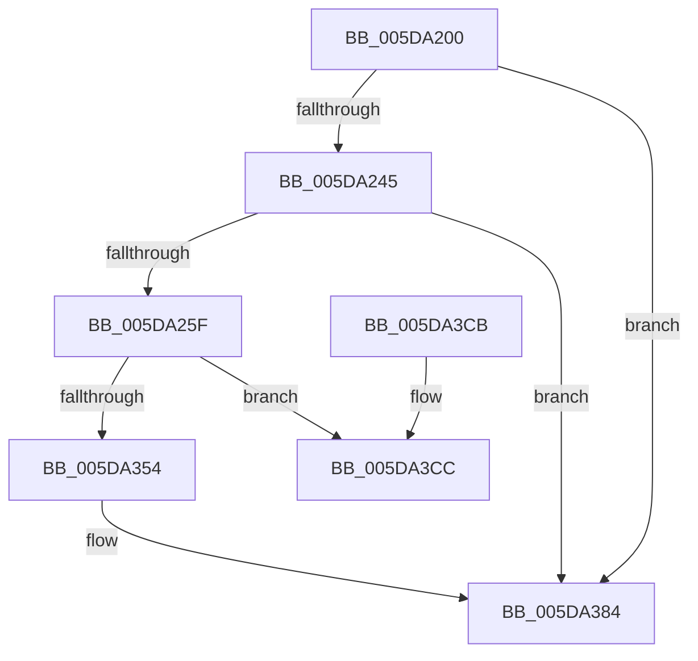

# PopWatchdogWorker

- RVA: `0x005DA200`–`0x005DA3E4` (길이 `484` bytes)
- VA: `0x00000001405DA200`
- 실행 섹션: `.text`
- PDB 이름 있음: `예`; PDB Function 태그: `아니요`
- unwind 정보 RVA: `0x000CD188`
- 디코드: `103`개 명령, `484/484` bytes 표시
- 미해석 바이트: `0` (있으면 어셈블리에 `.byte`로 보존)

> 이 문서는 커널 이미지의 기계어와 PDB 기호를 분석해 생성했습니다. 4번과 5번은 함수 원형과 자료형을 바이너리 사용 방식에서 추정한 C 해석이며 원본 소스 복구 결과는 아닙니다.

## 1. Dependencies

- 직접 호출 지점: **15**; 고유 호출 대상: **7**
- 직접 호출자로 확인된 함수: **0**
- RIP 상대 이미지 참조: **1**

### Outgoing calls
- `0x005DA21D` → [RtlGetInterruptTimePrecise](../20/RtlGetInterruptTimePrecise_function_0020A4C0.md) (function, `0x0020A4C0`)
- `0x005DA230` → [KeAcquireSpinLockRaiseToDpc](../20/KeAcquireSpinLockRaiseToDpc_function_00208470.md) (function, `0x00208470`)
- `0x005DA24D` → [RtlGetInterruptTimePrecise](../20/RtlGetInterruptTimePrecise_function_0020A4C0.md) (function, `0x0020A4C0`)
- `0x005DA2AA` → [KeReleaseSpinLock](../39/KeReleaseSpinLock_function_00392BA0.md) (function, `0x00392BA0`)
- `0x005DA2B8` → [PopResolveWatchdogParam](PopResolveWatchdogParam_function_005DA13C.md) (function, `0x005DA13C`)
- `0x005DA2DD` → [PopResolveWatchdogParam](PopResolveWatchdogParam_function_005DA13C.md) (function, `0x005DA13C`)
- `0x005DA2F8` → [PopResolveWatchdogParam](PopResolveWatchdogParam_function_005DA13C.md) (function, `0x005DA13C`)
- `0x005DA31D` → [PopResolveWatchdogParam](PopResolveWatchdogParam_function_005DA13C.md) (function, `0x005DA13C`)
- `0x005DA32D` → [RtlGetInterruptTimePrecise](../20/RtlGetInterruptTimePrecise_function_0020A4C0.md) (function, `0x0020A4C0`)
- `0x005DA370` → [guard_dispatch_icall](../6B/guard_dispatch_icall_function_006BAAD0.md) (function, `0x006BAAD0`)
- `0x005DA37C` → [KeAcquireSpinLockRaiseToDpc](../20/KeAcquireSpinLockRaiseToDpc_function_00208470.md) (function, `0x00208470`)
- `0x005DA38B` → [PopUpdateWatchdogNoWorkersEvent](../46/PopUpdateWatchdogNoWorkersEvent_function_00461078.md) (function, `0x00461078`)
- `0x005DA39A` → [KeReleaseSpinLock](../39/KeReleaseSpinLock_function_00392BA0.md) (function, `0x00392BA0`)
- `0x005DA3A7` → [RtlGetInterruptTimePrecise](../20/RtlGetInterruptTimePrecise_function_0020A4C0.md) (function, `0x0020A4C0`)
- `0x005DA3DE` → [KeBugCheckEx](../4F/KeBugCheckEx_function_004FD660.md) (function, `0x004FD660`)

### Direct callers
- 이 함수 시작 RVA로 연결되는 직접 call은 확인되지 않았습니다. 간접 호출은 완전히 역산할 수 없습니다.

### Static image references
- `0x005DA222` → RVA `0x00F083F8` (`.data`; read)

## 2. Other-region calls and transfers

- 다른 실행 섹션으로 향하는 call: **0**
- 별도 외부 분기/꼬리 이동을 확인하지 못했습니다.

## 3. Assembly (complete function range)

```asm
005DA200  48 8B C4                        mov rax, rsp
005DA203  48 89 58 10                     mov qword ptr [rax + 0x10], rbx
005DA207  48 89 68 18                     mov qword ptr [rax + 0x18], rbp
005DA20B  56                              push rsi
005DA20C  57                              push rdi
005DA20D  41 56                           push r14
005DA20F  48 81 EC C0 00 00 00            sub rsp, 0xc0
005DA216  48 8B D9                        mov rbx, rcx
005DA219  48 8D 48 08                     lea rcx, [rax + 8]
005DA21D  E8 9E 02 C3 FF                  call 0x14020a4c0
005DA222  48 8D 0D CF E1 92 00            lea rcx, [rip + 0x92e1cf]
005DA229  48 89 83 78 01 00 00            mov qword ptr [rbx + 0x178], rax
005DA230  E8 3B E2 C2 FF                  call 0x140208470
005DA235  80 BB D0 00 00 00 00            cmp byte ptr [rbx + 0xd0], 0
005DA23C  40 8A F8                        mov dil, al
005DA23F  0F 84 3F 01 00 00               je 0x1405da384
005DA245  48 8D 8C 24 E0 00 00 00         lea rcx, [rsp + 0xe0]
005DA24D  E8 6E 02 C3 FF                  call 0x14020a4c0
005DA252  48 3B 83 30 01 00 00            cmp rax, qword ptr [rbx + 0x130]
005DA259  0F 82 25 01 00 00               jb 0x1405da384
005DA25F  0F 10 83 D8 00 00 00            movups xmm0, xmmword ptr [rbx + 0xd8]
005DA266  40 8A D7                        mov dl, dil
005DA269  48 8D 0D 88 E1 92 00            lea rcx, [rip + 0x92e188]
005DA270  0F 29 44 24 70                  movaps xmmword ptr [rsp + 0x70], xmm0
005DA275  0F 10 83 E8 00 00 00            movups xmm0, xmmword ptr [rbx + 0xe8]
005DA27C  0F 11 44 24 50                  movups xmmword ptr [rsp + 0x50], xmm0
005DA281  0F 10 83 F8 00 00 00            movups xmm0, xmmword ptr [rbx + 0xf8]
005DA288  0F 11 44 24 60                  movups xmmword ptr [rsp + 0x60], xmm0
005DA28D  0F 10 83 08 01 00 00            movups xmm0, xmmword ptr [rbx + 0x108]
005DA294  0F 11 44 24 40                  movups xmmword ptr [rsp + 0x40], xmm0
005DA299  F2 0F 10 83 18 01 00 00         movsd xmm0, qword ptr [rbx + 0x118]
005DA2A1  F2 0F 11 84 24 B0 00 00 00      movsd qword ptr [rsp + 0xb0], xmm0
005DA2AA  E8 F1 88 DB FF                  call 0x140392ba0
005DA2AF  8B 54 24 40                     mov edx, dword ptr [rsp + 0x40]
005DA2B3  48 8B 4C 24 50                  mov rcx, qword ptr [rsp + 0x50]
005DA2B8  E8 7F FE FF FF                  call 0x1405da13c
005DA2BD  0F 10 44 24 40                  movups xmm0, xmmword ptr [rsp + 0x40]
005DA2C2  48 8B F8                        mov rdi, rax
005DA2C5  66 0F 73 D8 01                  psrldq xmm0, 1
005DA2CA  66 0F 7E C2                     movd edx, xmm0
005DA2CE  0F 10 44 24 50                  movups xmm0, xmmword ptr [rsp + 0x50]
005DA2D3  66 0F 73 D8 08                  psrldq xmm0, 8
005DA2D8  66 48 0F 7E C1                  movq rcx, xmm0
005DA2DD  E8 5A FE FF FF                  call 0x1405da13c
005DA2E2  0F 10 44 24 40                  movups xmm0, xmmword ptr [rsp + 0x40]
005DA2E7  48 8B 4C 24 60                  mov rcx, qword ptr [rsp + 0x60]
005DA2EC  48 8B F0                        mov rsi, rax
005DA2EF  66 0F 73 D8 02                  psrldq xmm0, 2
005DA2F4  66 0F 7E C2                     movd edx, xmm0
005DA2F8  E8 3F FE FF FF                  call 0x1405da13c
005DA2FD  0F 10 44 24 40                  movups xmm0, xmmword ptr [rsp + 0x40]
005DA302  48 8B E8                        mov rbp, rax
005DA305  66 0F 73 D8 03                  psrldq xmm0, 3
005DA30A  66 0F 7E C2                     movd edx, xmm0
005DA30E  0F 10 44 24 60                  movups xmm0, xmmword ptr [rsp + 0x60]
005DA313  66 0F 73 D8 08                  psrldq xmm0, 8
005DA318  66 48 0F 7E C1                  movq rcx, xmm0
005DA31D  E8 1A FE FF FF                  call 0x1405da13c
005DA322  48 8D 8C 24 E0 00 00 00         lea rcx, [rsp + 0xe0]
005DA32A  4C 8B F0                        mov r14, rax
005DA32D  E8 8E 01 C3 FF                  call 0x14020a4c0
005DA332  0F 10 44 24 40                  movups xmm0, xmmword ptr [rsp + 0x40]
005DA337  48 89 83 80 01 00 00            mov qword ptr [rbx + 0x180], rax
005DA33E  C6 83 D1 00 00 00 01            mov byte ptr [rbx + 0xd1], 1
005DA345  66 0F 73 D8 08                  psrldq xmm0, 8
005DA34A  66 48 0F 7E C0                  movq rax, xmm0
005DA34F  48 85 C0                        test rax, rax
005DA352  74 78                           je 0x1405da3cc
005DA354  8B 54 24 78                     mov edx, dword ptr [rsp + 0x78]
005DA358  4C 8B CE                        mov r9, rsi
005DA35B  48 8B 8C 24 B0 00 00 00         mov rcx, qword ptr [rsp + 0xb0]
005DA363  4C 8B C7                        mov r8, rdi
005DA366  4C 89 74 24 28                  mov qword ptr [rsp + 0x28], r14
005DA36B  48 89 6C 24 20                  mov qword ptr [rsp + 0x20], rbp
005DA370  E8 5B 07 0E 00                  call 0x1406baad0
005DA375  48 8D 0D 7C E0 92 00            lea rcx, [rip + 0x92e07c]
005DA37C  E8 EF E0 C2 FF                  call 0x140208470
005DA381  40 8A F8                        mov dil, al
005DA384  48 8B CB                        mov rcx, rbx
005DA387  C6 43 15 00                     mov byte ptr [rbx + 0x15], 0
005DA38B  E8 E8 6C E8 FF                  call 0x140461078
005DA390  40 8A D7                        mov dl, dil
005DA393  48 8D 0D 5E E0 92 00            lea rcx, [rip + 0x92e05e]
005DA39A  E8 01 88 DB FF                  call 0x140392ba0
005DA39F  48 8D 8C 24 E0 00 00 00         lea rcx, [rsp + 0xe0]
005DA3A7  E8 14 01 C3 FF                  call 0x14020a4c0
005DA3AC  4C 8D 9C 24 C0 00 00 00         lea r11, [rsp + 0xc0]
005DA3B4  48 89 83 88 01 00 00            mov qword ptr [rbx + 0x188], rax
005DA3BB  49 8B 5B 28                     mov rbx, qword ptr [r11 + 0x28]
005DA3BF  49 8B 6B 30                     mov rbp, qword ptr [r11 + 0x30]
005DA3C3  49 8B E3                        mov rsp, r11
005DA3C6  41 5E                           pop r14
005DA3C8  5F                              pop rdi
005DA3C9  5E                              pop rsi
005DA3CA  C3                              ret
005DA3CB  CC                              int3
005DA3CC  8B 4C 24 78                     mov ecx, dword ptr [rsp + 0x78]
005DA3D0  4C 8B CD                        mov r9, rbp
005DA3D3  4C 8B C6                        mov r8, rsi
005DA3D6  4C 89 74 24 20                  mov qword ptr [rsp + 0x20], r14
005DA3DB  48 8B D7                        mov rdx, rdi
005DA3DE  E8 7D 32 F2 FF                  call 0x1404fd660
005DA3E3  CC                              int3
```

## 4. C-style interpretation (structured pseudocode)

```c
__int64 __fastcall PopWatchdogWorker(__int64 a1)
{
    __int64 result;
    __int64 v_rsp;
    unsigned __int64 v_stack_m18;
    unsigned __int64 v_stack_m28;
    unsigned int v_stack_m48;
    unsigned int v_stack_m60;
    unsigned __int64 v_stack_m68;
    unsigned __int64 v_stack_m78;
    unsigned __int64 v_stack_m88;
    unsigned __int64 v_stack_m98;
    unsigned __int64 v_stack_mA0;
    unsigned __int64 v_stack_mB0;
    unsigned __int64 v_stack_mB8;
    unsigned __int64 v_stack_p8;

    *(unsigned __int64 *)(v_rsp + 16) = v_rbx;
    *(unsigned __int64 *)(v_rsp + 24) = v_rbp;
    v_rsp = (v_rsp) - (192);
    result = RtlGetInterruptTimePrecise(v_rsp + 8, a2, a3, a4);
    *(unsigned __int64 *)(a1 + 376) = result;
    result = KeAcquireSpinLockRaiseToDpc(v_rip + 9626063, a2, a3, a4);
    if ((*(unsigned __int8 *)(a1 + 208)) == 0) goto loc_005DA384;
    result = RtlGetInterruptTimePrecise(v_stack_p8, a2, a3, a4);
    if (result < (*(unsigned __int64 *)(a1 + 304))) goto loc_005DA384;
    v_stack_m68 = v_xmm0;
    v_stack_m88 = v_xmm0;
    v_stack_m78 = v_xmm0;
    v_stack_m98 = v_xmm0;
    v_stack_m28 = v_xmm0;
    result = KeReleaseSpinLock(v_rip + 9625992, (unsigned __int8)((unsigned __int8)(result)), a3, a4);
    result = PopResolveWatchdogParam(v_stack_m88, (unsigned int)(v_stack_m98), a3, a4);
    result = PopResolveWatchdogParam(v_stack_m88, (unsigned int)(v_stack_m98), a3, a4);
    result = PopResolveWatchdogParam(v_stack_m78, (unsigned int)(v_stack_m98), a3, a4);
    result = PopResolveWatchdogParam(v_stack_m78, (unsigned int)(v_stack_m98), a3, a4);
    result = RtlGetInterruptTimePrecise(v_stack_p8, (unsigned int)(v_stack_m98), a3, a4);
    *(unsigned __int64 *)(a1 + 384) = result;
    *(unsigned __int8 *)(a1 + 209) = 1;
    if (result == 0) goto loc_005DA3CC;
    v_stack_mB0 = result;
    v_stack_mB8 = result;
    result = guard_dispatch_icall(v_stack_m28, (unsigned int)(v_stack_m60), result, result);
    result = KeAcquireSpinLockRaiseToDpc(v_rip + 9625724, (unsigned int)(v_stack_m60), result, result);
loc_005DA384:
    *(unsigned __int8 *)(a1 + 21) = 0;
    result = PopUpdateWatchdogNoWorkersEvent(a1, (unsigned int)(v_stack_m60), result, result);
    result = KeReleaseSpinLock(v_rip + 9625694, (unsigned __int8)((unsigned __int8)(result)), result, result);
    result = RtlGetInterruptTimePrecise(v_stack_p8, (unsigned __int8)((unsigned __int8)(result)), result, result);
    *(unsigned __int64 *)(a1 + 392) = result;
    return result;
loc_005DA3CC:
    v_stack_mA0 = result;
    result = KeBugCheckEx((unsigned int)(v_stack_m48), (unsigned __int8)(result), result, *(unsigned __int64 *)(v_stack_m18 + 48));
    return result;
}
```

## 5. (Beta) C Style

```c
int64_t PopWatchdogWorker(void *Arg1)
{
    uint8_t *arg1 = (uint8_t *)Arg1;

    int64_t result;
    int64_t local_rsp;
    uint64_t v_stack_m18;
    uint64_t v_stack_m28;
    uint32_t v_stack_m48;
    uint32_t v_stack_m60;
    uint64_t v_stack_m68;
    uint64_t v_stack_m78;
    uint64_t v_stack_m88;
    uint64_t v_stack_m98;
    uint64_t v_stack_mA0;
    uint64_t v_stack_mB0;
    uint64_t v_stack_mB8;
    uint64_t v_stack_p8;

    *(uint64_t *)(local_rsp + 0x10) = local_rbx;
    *(uint64_t *)(local_rsp + 0x18) = local_rbp;
    local_rsp = (local_rsp) - (192);
    result = RtlGetInterruptTimePrecise(local_rsp + 8, a2, a3, a4);
    *(uint64_t *)(arg1 + 0x178) = result;
    result = KeAcquireSpinLockRaiseToDpc(v_rip + 9626063, a2, a3, a4);
    if ((*(uint8_t *)(arg1 + 0xD0)) == 0) goto loc_005DA384;
    result = RtlGetInterruptTimePrecise(v_stack_p8, a2, a3, a4);
    if (result < (*(uint64_t *)(arg1 + 0x130))) goto loc_005DA384;
    v_stack_m68 = v_xmm0;
    v_stack_m88 = v_xmm0;
    v_stack_m78 = v_xmm0;
    v_stack_m98 = v_xmm0;
    v_stack_m28 = v_xmm0;
    result = KeReleaseSpinLock(v_rip + 9625992, (uint8_t)((uint8_t)(result)), a3, a4);
    result = PopResolveWatchdogParam(v_stack_m88, (uint32_t)(v_stack_m98), a3, a4);
    result = PopResolveWatchdogParam(v_stack_m88, (uint32_t)(v_stack_m98), a3, a4);
    result = PopResolveWatchdogParam(v_stack_m78, (uint32_t)(v_stack_m98), a3, a4);
    result = PopResolveWatchdogParam(v_stack_m78, (uint32_t)(v_stack_m98), a3, a4);
    result = RtlGetInterruptTimePrecise(v_stack_p8, (uint32_t)(v_stack_m98), a3, a4);
    *(uint64_t *)(arg1 + 0x180) = result;
    *(uint8_t *)(arg1 + 0xD1) = 1;
    if (result == 0) goto loc_005DA3CC;
    v_stack_mB0 = result;
    v_stack_mB8 = result;
    result = guard_dispatch_icall(v_stack_m28, (uint32_t)(v_stack_m60), result, result);
    result = KeAcquireSpinLockRaiseToDpc(v_rip + 9625724, (uint32_t)(v_stack_m60), result, result);
loc_005DA384:
    *(uint8_t *)(arg1 + 0x15) = 0;
    result = PopUpdateWatchdogNoWorkersEvent(Arg1, (uint32_t)(v_stack_m60), result, result);
    result = KeReleaseSpinLock(v_rip + 9625694, (uint8_t)((uint8_t)(result)), result, result);
    result = RtlGetInterruptTimePrecise(v_stack_p8, (uint8_t)((uint8_t)(result)), result, result);
    *(uint64_t *)(arg1 + 0x188) = result;
    return result;
loc_005DA3CC:
    v_stack_mA0 = result;
    result = KeBugCheckEx((uint32_t)(v_stack_m48), (uint8_t)(result), result, *(uint64_t *)(v_stack_m18 + 0x30));
    return result;
}
```

### 관측된 메모리 오프셋

구조체 형식이 확인되지 않은 접근은 인자 기준의 오프셋으로만 기록했습니다.

| 기준 인자 | 오프셋 표현 | 폭 (bit) | 접근 |
|---|---:|---:|---|
| `Arg1` | `+ 0x15` | `8` | `W` |
| `Arg1` | `+ 0xD0` | `8` | `R` |
| `Arg1` | `+ 0xD1` | `8` | `W` |
| `Arg1` | `+ 0xD8` | `128` | `R` |
| `Arg1` | `+ 0xE8` | `128` | `R` |
| `Arg1` | `+ 0xF8` | `128` | `R` |
| `Arg1` | `+ 0x108` | `128` | `R` |
| `Arg1` | `+ 0x118` | `64` | `R` |
| `Arg1` | `+ 0x130` | `64` | `R` |
| `Arg1` | `+ 0x178` | `64` | `W` |
| `Arg1` | `+ 0x180` | `64` | `W` |
| `Arg1` | `+ 0x188` | `64` | `W` |

## 6. Execution-region graph

[열기: 2D/3D 그래프와 함수 탐색 컨트롤 패널](../../../control-panel.html?section=text&rva=0x005DA200&view=graph)

- 2D 그래프는 위에서 아래로 흐르고, 3D 그래프는 빈 공간을 드래그해 회전합니다. Shift+드래그는 이동, 휠은 확대·축소, 함수 노드 선택은 대상 보고서 이동입니다.

### Static fallback


