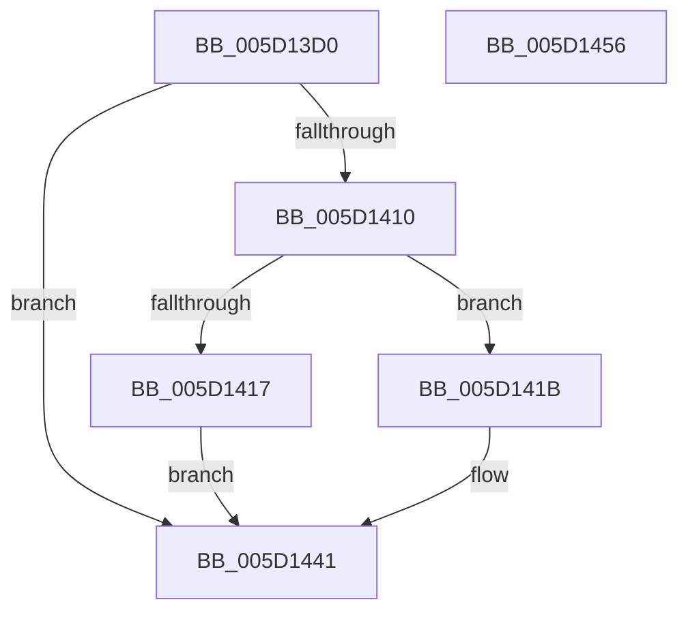

# PopWnfAirplaneModeCallback

- RVA: `0x005D13D0`–`0x005D1457` (길이 `135` bytes)
- VA: `0x00000001405D13D0`
- 실행 섹션: `.text`
- PDB 이름 있음: `예`; PDB Function 태그: `아니요`
- unwind 정보 RVA: `0x000CC0E0`
- 디코드: `36`개 명령, `135/135` bytes 표시
- 미해석 바이트: `0` (있으면 어셈블리에 `.byte`로 보존)

> 이 문서는 커널 이미지의 기계어와 PDB 기호를 분석해 생성했습니다. 4번과 5번은 함수 원형과 자료형을 바이너리 사용 방식에서 추정한 C 해석이며 원본 소스 복구 결과는 아닙니다.

## 1. Dependencies

- 직접 호출 지점: **4**; 고유 호출 대상: **4**
- 직접 호출자로 확인된 함수: **0**
- RIP 상대 이미지 참조: **3**

### Outgoing calls
- `0x005D1405` → [ExQueryWnfStateData](../../page/A4/ExQueryWnfStateData_function_00A4A480.md) (function, `0x00A4A480`)
- `0x005D1422` → [KeAcquireSpinLockRaiseToDpc](../20/KeAcquireSpinLockRaiseToDpc_function_00208470.md) (function, `0x00208470`)
- `0x005D143C` → [KeReleaseSpinLock](../39/KeReleaseSpinLock_function_00392BA0.md) (function, `0x00392BA0`)
- `0x005D144B` → [_security_check_cookie](../6A/_security_check_cookie_function_006AC640.md) (function, `0x006AC640`)

### Direct callers
- 이 함수 시작 RVA로 연결되는 직접 call은 확인되지 않았습니다. 간접 호출은 완전히 역산할 수 없습니다.

### Static image references
- `0x005D13D8` → RVA `0x00E0A740` (`.data`; read)
- `0x005D141B` → RVA `0x00F0CA58` (`.data`; read)
- `0x005D1435` → RVA `0x00F0CE64` (`.data`; write)

## 2. Other-region calls and transfers

- 다른 실행 섹션으로 향하는 call: **1**
  - `0x005D1405` → [ExQueryWnfStateData](../../page/A4/ExQueryWnfStateData_function_00A4A480.md) (`.text` → `PAGE`)
- 별도 외부 분기/꼬리 이동을 확인하지 못했습니다.

## 3. Assembly (complete function range)

```asm
005D13D0  4C 8B DC                        mov r11, rsp
005D13D3  53                              push rbx
005D13D4  48 83 EC 50                     sub rsp, 0x50
005D13D8  48 8B 05 61 93 83 00            mov rax, qword ptr [rip + 0x839361]
005D13DF  48 33 C4                        xor rax, rsp
005D13E2  48 89 44 24 40                  mov qword ptr [rsp + 0x40], rax
005D13E7  33 C0                           xor eax, eax
005D13E9  C7 44 24 20 0C 00 00 00         mov dword ptr [rsp + 0x20], 0xc
005D13F1  49 89 43 D8                     mov qword ptr [r11 - 0x28], rax
005D13F5  4D 8D 4B C8                     lea r9, [r11 - 0x38]
005D13F9  4D 8D 43 D8                     lea r8, [r11 - 0x28]
005D13FD  89 44 24 38                     mov dword ptr [rsp + 0x38], eax
005D1401  49 8D 53 D0                     lea rdx, [r11 - 0x30]
005D1405  E8 76 90 47 00                  call 0x140a4a480
005D140A  8B D8                           mov ebx, eax
005D140C  85 C0                           test eax, eax
005D140E  78 31                           js 0x1405d1441
005D1410  83 7C 24 20 0C                  cmp dword ptr [rsp + 0x20], 0xc
005D1415  73 04                           jae 0x1405d141b
005D1417  33 DB                           xor ebx, ebx
005D1419  EB 26                           jmp 0x1405d1441
005D141B  48 8D 0D 36 B6 93 00            lea rcx, [rip + 0x93b636]
005D1422  E8 49 70 C3 FF                  call 0x140208470
005D1427  83 7C 24 30 00                  cmp dword ptr [rsp + 0x30], 0
005D142C  48 8D 0D 25 B6 93 00            lea rcx, [rip + 0x93b625]
005D1433  8A D0                           mov dl, al
005D1435  0F 94 05 28 BA 93 00            sete byte ptr [rip + 0x93ba28]
005D143C  E8 5F 17 DC FF                  call 0x140392ba0
005D1441  8B C3                           mov eax, ebx
005D1443  48 8B 4C 24 40                  mov rcx, qword ptr [rsp + 0x40]
005D1448  48 33 CC                        xor rcx, rsp
005D144B  E8 F0 B1 0D 00                  call 0x1406ac640
005D1450  48 83 C4 50                     add rsp, 0x50
005D1454  5B                              pop rbx
005D1455  C3                              ret
005D1456  CC                              int3
```

## 4. C-style interpretation (structured pseudocode)

```c
__int64 __fastcall PopWnfAirplaneModeCallback(void)
{
    __int64 result;
    __int64 v_rbx;
    __int64 v_rsp;
    unsigned __int64 v_stack_m18;
    unsigned int v_stack_m20;
    unsigned int v_stack_m28;
    unsigned int v_stack_m38;

    v_rsp = (v_rsp) - (80);
    result = (*(unsigned __int64 *)(v_rip + 8622945)) ^ (v_rsp);
    v_stack_m18 = result;
    result = 0;
    v_stack_m38 = 12;
    *(unsigned __int64 *)(v_rsp - 40) = 0;
    v_stack_m20 = 0;
    result = ExQueryWnfStateData(a1, v_rsp - 48, v_rsp - 40, v_rsp - 56);
    if (sign_flag) goto loc_005D1441;
    if (v_stack_m38 >= 12) goto loc_005D141B;
    v_rbx = 0;
    goto loc_005D1441;
loc_005D141B:
    result = KeAcquireSpinLockRaiseToDpc(v_rip + 9680438, v_rsp - 48, v_rsp - 40, v_rsp - 56);
    result = KeReleaseSpinLock(v_rip + 9680421, (unsigned __int8)(result), v_rsp - 40, v_rsp - 56);
loc_005D1441:
    a1 = (v_stack_m18) ^ (v_rsp);
    result = _security_check_cookie(a1, (unsigned __int8)(result), v_rsp - 40, v_rsp - 56);
    v_rsp = (v_rsp) + (80);
    return result;
}
```

## 5. (Beta) C Style

```c
void PopWnfAirplaneModeCallback(void)
{
    int64_t result;
    int64_t local_rbx;
    int64_t local_rsp;
    uint64_t v_stack_m18;
    uint32_t v_stack_m20;
    uint32_t v_stack_m28;
    uint32_t v_stack_m38;

    local_rsp = (local_rsp) - (80);
    result = (*(uint64_t *)(v_rip + 0x839361)) ^ (local_rsp);
    v_stack_m18 = result;
    result = 0;
    v_stack_m38 = 12;
    *(uint64_t *)(local_rsp - 0x28) = 0;
    v_stack_m20 = 0;
    result = ExQueryWnfStateData(a1, local_rsp - 48, local_rsp - 40, local_rsp - 56);
    if (sign_flag) goto loc_005D1441;
    if (v_stack_m38 >= 12) goto loc_005D141B;
    local_rbx = 0;
    goto loc_005D1441;
loc_005D141B:
    result = KeAcquireSpinLockRaiseToDpc(v_rip + 9680438, local_rsp - 48, local_rsp - 40, local_rsp - 56);
    result = KeReleaseSpinLock(v_rip + 9680421, (uint8_t)(result), local_rsp - 40, local_rsp - 56);
loc_005D1441:
    a1 = (v_stack_m18) ^ (local_rsp);
    result = _security_check_cookie(a1, (uint8_t)(result), local_rsp - 40, local_rsp - 56);
    local_rsp = (local_rsp) + (80);
    return result;
}
```

## 6. Execution-region graph

[열기: 2D/3D 그래프와 함수 탐색 컨트롤 패널](../../../control-panel.html?section=text&rva=0x005D13D0&view=graph)

- 2D 그래프는 위에서 아래로 흐르고, 3D 그래프는 빈 공간을 드래그해 회전합니다. Shift+드래그는 이동, 휠은 확대·축소, 함수 노드 선택은 대상 보고서 이동입니다.

### Static fallback


