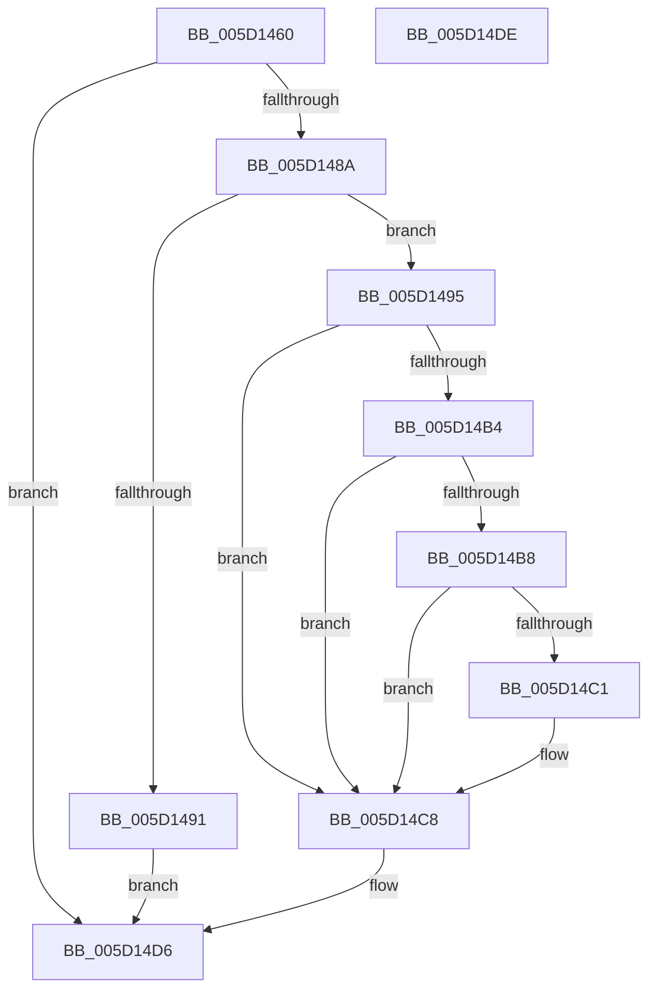

# PopWnfBluetoothChargingCallback

- RVA: `0x005D1460`–`0x005D14DF` (길이 `127` bytes)
- VA: `0x00000001405D1460`
- 실행 섹션: `.text`
- PDB 이름 있음: `예`; PDB Function 태그: `아니요`
- unwind 정보 RVA: `0x000AA39C`
- 디코드: `35`개 명령, `127/127` bytes 표시
- 미해석 바이트: `0` (있으면 어셈블리에 `.byte`로 보존)

> 이 문서는 커널 이미지의 기계어와 PDB 기호를 분석해 생성했습니다. 4번과 5번은 함수 원형과 자료형을 바이너리 사용 방식에서 추정한 C 해석이며 원본 소스 복구 결과는 아닙니다.

## 1. Dependencies

- 직접 호출 지점: **3**; 고유 호출 대상: **3**
- 직접 호출자로 확인된 함수: **0**
- RIP 상대 이미지 참조: **5**

### Outgoing calls
- `0x005D147F` → [ExQueryWnfStateData](../../page/A4/ExQueryWnfStateData_function_00A4A480.md) (function, `0x00A4A480`)
- `0x005D149C` → [KeAcquireSpinLockRaiseToDpc](../20/KeAcquireSpinLockRaiseToDpc_function_00208470.md) (function, `0x00208470`)
- `0x005D14D1` → [KeReleaseSpinLock](../39/KeReleaseSpinLock_function_00392BA0.md) (function, `0x00392BA0`)

### Direct callers
- 이 함수 시작 RVA로 연결되는 직접 call은 확인되지 않았습니다. 간접 호출은 완전히 역산할 수 없습니다.

### Static image references
- `0x005D1495` → RVA `0x00F0CA58` (`.data`; read)
- `0x005D14A1` → RVA `0x00F0C740` (`.data`; read)
- `0x005D14AC` → RVA `0x00F0CE65` (`.data`; write)
- `0x005D14B8` → RVA `0x00F0C743` (`.data`; read)
- `0x005D14C1` → RVA `0x00F0C743` (`.data`; write)

## 2. Other-region calls and transfers

- 다른 실행 섹션으로 향하는 call: **1**
  - `0x005D147F` → [ExQueryWnfStateData](../../page/A4/ExQueryWnfStateData_function_00A4A480.md) (`.text` → `PAGE`)
- 별도 외부 분기/꼬리 이동을 확인하지 못했습니다.

## 3. Assembly (complete function range)

```asm
005D1460  48 8B C4                        mov rax, rsp
005D1463  53                              push rbx
005D1464  48 83 EC 30                     sub rsp, 0x30
005D1468  4C 8D 48 EC                     lea r9, [rax - 0x14]
005D146C  C6 40 E8 00                     mov byte ptr [rax - 0x18], 0
005D1470  4C 8D 40 E8                     lea r8, [rax - 0x18]
005D1474  C7 40 EC 01 00 00 00            mov dword ptr [rax - 0x14], 1
005D147B  48 8D 50 20                     lea rdx, [rax + 0x20]
005D147F  E8 FC 8F 47 00                  call 0x140a4a480
005D1484  8B D8                           mov ebx, eax
005D1486  85 C0                           test eax, eax
005D1488  78 4C                           js 0x1405d14d6
005D148A  83 7C 24 24 01                  cmp dword ptr [rsp + 0x24], 1
005D148F  73 04                           jae 0x1405d1495
005D1491  33 DB                           xor ebx, ebx
005D1493  EB 41                           jmp 0x1405d14d6
005D1495  48 8D 0D BC B5 93 00            lea rcx, [rip + 0x93b5bc]
005D149C  E8 CF 6F C3 FF                  call 0x140208470
005D14A1  80 3D 98 B2 93 00 00            cmp byte ptr [rip + 0x93b298], 0
005D14A8  8A 54 24 20                     mov dl, byte ptr [rsp + 0x20]
005D14AC  88 15 B3 B9 93 00               mov byte ptr [rip + 0x93b9b3], dl
005D14B2  74 14                           je 0x1405d14c8
005D14B4  84 D2                           test dl, dl
005D14B6  74 10                           je 0x1405d14c8
005D14B8  80 3D 84 B2 93 00 00            cmp byte ptr [rip + 0x93b284], 0
005D14BF  75 07                           jne 0x1405d14c8
005D14C1  C6 05 7B B2 93 00 01            mov byte ptr [rip + 0x93b27b], 1
005D14C8  8A D0                           mov dl, al
005D14CA  48 8D 0D 87 B5 93 00            lea rcx, [rip + 0x93b587]
005D14D1  E8 CA 16 DC FF                  call 0x140392ba0
005D14D6  8B C3                           mov eax, ebx
005D14D8  48 83 C4 30                     add rsp, 0x30
005D14DC  5B                              pop rbx
005D14DD  C3                              ret
005D14DE  CC                              int3
```

## 4. C-style interpretation (structured pseudocode)

```c
__int64 __fastcall PopWnfBluetoothChargingCallback(void)
{
    __int64 result;
    __int64 v_rbx;
    __int64 v_rsp;
    unsigned int v_stack_m14;
    unsigned __int8 v_stack_m18;

    v_rsp = (v_rsp) - (48);
    *(unsigned __int8 *)(v_rsp - 24) = 0;
    *(unsigned int *)(v_rsp - 20) = 1;
    result = ExQueryWnfStateData(a1, v_rsp + 32, v_rsp - 24, v_rsp - 20);
    if (sign_flag) goto loc_005D14D6;
    if (v_stack_m14 >= 1) goto loc_005D1495;
    v_rbx = 0;
    goto loc_005D14D6;
loc_005D1495:
    result = KeAcquireSpinLockRaiseToDpc(v_rip + 9680316, v_rsp + 32, v_rsp - 24, v_rsp - 20);
    *(unsigned __int8 *)(v_rip + 9681331) = (unsigned __int8)(v_stack_m18);
    if ((*(unsigned __int8 *)(v_rip + 9679512)) == 0) goto loc_005D14C8;
    if ((unsigned __int8)(v_stack_m18) == 0) goto loc_005D14C8;
    if ((*(unsigned __int8 *)(v_rip + 9679492)) == 0) {
        *(unsigned __int8 *)(v_rip + 9679483) = 1;
    }
    result = KeReleaseSpinLock(v_rip + 9680263, (unsigned __int8)(result), v_rsp - 24, v_rsp - 20);
loc_005D14D6:
    v_rsp = (v_rsp) + (48);
    return 0;
}
```

## 5. (Beta) C Style

```c
void PopWnfBluetoothChargingCallback(void)
{
    int64_t result;
    int64_t local_rbx;
    int64_t local_rsp;
    uint32_t v_stack_m14;
    uint8_t v_stack_m18;

    local_rsp = (local_rsp) - (48);
    *(uint8_t *)(local_rsp - 0x18) = 0;
    *(uint32_t *)(local_rsp - 0x14) = 1;
    result = ExQueryWnfStateData(a1, local_rsp + 32, local_rsp - 24, local_rsp - 20);
    if (sign_flag) goto loc_005D14D6;
    if (v_stack_m14 >= 1) goto loc_005D1495;
    local_rbx = 0;
    goto loc_005D14D6;
loc_005D1495:
    result = KeAcquireSpinLockRaiseToDpc(v_rip + 9680316, local_rsp + 32, local_rsp - 24, local_rsp - 20);
    *(uint8_t *)(v_rip + 0x93B9B3) = (uint8_t)(v_stack_m18);
    if ((*(uint8_t *)(v_rip + 0x93B298)) == 0) goto loc_005D14C8;
    if ((uint8_t)(v_stack_m18) == 0) goto loc_005D14C8;
    if ((*(uint8_t *)(v_rip + 0x93B284)) == 0) {
        *(uint8_t *)(v_rip + 0x93B27B) = 1;
    }
    result = KeReleaseSpinLock(v_rip + 9680263, (uint8_t)(result), local_rsp - 24, local_rsp - 20);
loc_005D14D6:
    local_rsp = (local_rsp) + (48);
    return 0;
}
```

## 6. Execution-region graph

[열기: 2D/3D 그래프와 함수 탐색 컨트롤 패널](../../../control-panel.html?section=text&rva=0x005D1460&view=graph)

- 2D 그래프는 위에서 아래로 흐르고, 3D 그래프는 빈 공간을 드래그해 회전합니다. Shift+드래그는 이동, 휠은 확대·축소, 함수 노드 선택은 대상 보고서 이동입니다.

### Static fallback


