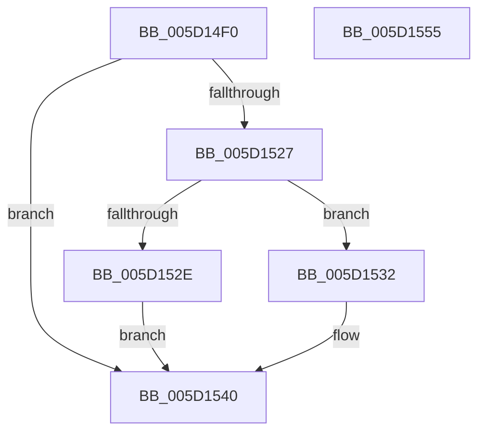

# PopWnfMobileHotspotCallback

- RVA: `0x005D14F0`–`0x005D1556` (길이 `102` bytes)
- VA: `0x00000001405D14F0`
- 실행 섹션: `.text`
- PDB 이름 있음: `예`; PDB Function 태그: `아니요`
- unwind 정보 RVA: `0x000A5A24`
- 디코드: `29`개 명령, `102/102` bytes 표시
- 미해석 바이트: `0` (있으면 어셈블리에 `.byte`로 보존)

> 이 문서는 커널 이미지의 기계어와 PDB 기호를 분석해 생성했습니다. 4번과 5번은 함수 원형과 자료형을 바이너리 사용 방식에서 추정한 C 해석이며 원본 소스 복구 결과는 아닙니다.

## 1. Dependencies

- 직접 호출 지점: **3**; 고유 호출 대상: **3**
- 직접 호출자로 확인된 함수: **0**
- RIP 상대 이미지 참조: **1**

### Outgoing calls
- `0x005D151C` → [ExQueryWnfStateData](../../page/A4/ExQueryWnfStateData_function_00A4A480.md) (function, `0x00A4A480`)
- `0x005D153B` → [PopPowerRequestNotifyMobileHotspotChanged](../../page/75/PopPowerRequestNotifyMobileHotspotChanged_function_00754BBC.md) (function, `0x00754BBC`)
- `0x005D154A` → [_security_check_cookie](../6A/_security_check_cookie_function_006AC640.md) (function, `0x006AC640`)

### Direct callers
- 이 함수 시작 RVA로 연결되는 직접 call은 확인되지 않았습니다. 간접 호출은 완전히 역산할 수 없습니다.

### Static image references
- `0x005D14F6` → RVA `0x00E0A740` (`.data`; read)

## 2. Other-region calls and transfers

- 다른 실행 섹션으로 향하는 call: **2**
  - `0x005D151C` → [ExQueryWnfStateData](../../page/A4/ExQueryWnfStateData_function_00A4A480.md) (`.text` → `PAGE`)
  - `0x005D153B` → [PopPowerRequestNotifyMobileHotspotChanged](../../page/75/PopPowerRequestNotifyMobileHotspotChanged_function_00754BBC.md) (`.text` → `PAGE`)
- 별도 외부 분기/꼬리 이동을 확인하지 못했습니다.

## 3. Assembly (complete function range)

```asm
005D14F0  40 53                           push rbx
005D14F2  48 83 EC 40                     sub rsp, 0x40
005D14F6  48 8B 05 43 92 83 00            mov rax, qword ptr [rip + 0x839243]
005D14FD  48 33 C4                        xor rax, rsp
005D1500  48 89 44 24 38                  mov qword ptr [rsp + 0x38], rax
005D1505  4C 8D 4C 24 20                  lea r9, [rsp + 0x20]
005D150A  C7 44 24 20 08 00 00 00         mov dword ptr [rsp + 0x20], 8
005D1512  4C 8D 44 24 30                  lea r8, [rsp + 0x30]
005D1517  48 8D 54 24 28                  lea rdx, [rsp + 0x28]
005D151C  E8 5F 8F 47 00                  call 0x140a4a480
005D1521  8B D8                           mov ebx, eax
005D1523  85 C0                           test eax, eax
005D1525  78 19                           js 0x1405d1540
005D1527  83 7C 24 20 08                  cmp dword ptr [rsp + 0x20], 8
005D152C  73 04                           jae 0x1405d1532
005D152E  33 DB                           xor ebx, ebx
005D1530  EB 0E                           jmp 0x1405d1540
005D1532  8B 4C 24 30                     mov ecx, dword ptr [rsp + 0x30]
005D1536  D1 E9                           shr ecx, 1
005D1538  80 E1 01                        and cl, 1
005D153B  E8 7C 36 18 00                  call 0x140754bbc
005D1540  8B C3                           mov eax, ebx
005D1542  48 8B 4C 24 38                  mov rcx, qword ptr [rsp + 0x38]
005D1547  48 33 CC                        xor rcx, rsp
005D154A  E8 F1 B0 0D 00                  call 0x1406ac640
005D154F  48 83 C4 40                     add rsp, 0x40
005D1553  5B                              pop rbx
005D1554  C3                              ret
005D1555  CC                              int3
```

## 4. C-style interpretation (structured pseudocode)

```c
__int64 __fastcall PopWnfMobileHotspotCallback(void)
{
    __int64 result;
    __int64 v_rbx;
    __int64 v_rsp;
    unsigned __int64 v_stack_m10;
    unsigned __int64 v_stack_m18;
    unsigned __int64 v_stack_m20;
    unsigned __int64 v_stack_m28;

    v_rsp = (v_rsp) - (64);
    result = (*(unsigned __int64 *)(v_rip + 8622659)) ^ (v_rsp);
    v_stack_m10 = result;
    v_stack_m28 = 8;
    result = ExQueryWnfStateData(a1, v_stack_m20, v_stack_m18, v_stack_m28);
    if (sign_flag) goto loc_005D1540;
    if (v_stack_m28 >= 8) goto loc_005D1532;
    v_rbx = 0;
    goto loc_005D1540;
loc_005D1532:
    a1 = (unsigned int)(((unsigned int)(v_stack_m18)) >> (1));
    a1 = (unsigned __int8)((a1) & (1));
    result = PopPowerRequestNotifyMobileHotspotChanged(a1, v_stack_m20, v_stack_m18, v_stack_m28);
loc_005D1540:
    a1 = (v_stack_m10) ^ (v_rsp);
    result = _security_check_cookie(a1, v_stack_m20, v_stack_m18, v_stack_m28);
    v_rsp = (v_rsp) + (64);
    return result;
}
```

## 5. (Beta) C Style

```c
void PopWnfMobileHotspotCallback(void)
{
    int64_t result;
    int64_t local_rbx;
    int64_t local_rsp;
    uint64_t v_stack_m10;
    uint64_t v_stack_m18;
    uint64_t v_stack_m20;
    uint64_t v_stack_m28;

    local_rsp = (local_rsp) - (64);
    result = (*(uint64_t *)(v_rip + 0x839243)) ^ (local_rsp);
    v_stack_m10 = result;
    v_stack_m28 = 8;
    result = ExQueryWnfStateData(a1, v_stack_m20, v_stack_m18, v_stack_m28);
    if (sign_flag) goto loc_005D1540;
    if (v_stack_m28 >= 8) goto loc_005D1532;
    local_rbx = 0;
    goto loc_005D1540;
loc_005D1532:
    a1 = (uint32_t)(((uint32_t)(v_stack_m18)) >> (1));
    a1 = (uint8_t)((a1) & (1));
    result = PopPowerRequestNotifyMobileHotspotChanged(a1, v_stack_m20, v_stack_m18, v_stack_m28);
loc_005D1540:
    a1 = (v_stack_m10) ^ (local_rsp);
    result = _security_check_cookie(a1, v_stack_m20, v_stack_m18, v_stack_m28);
    local_rsp = (local_rsp) + (64);
    return result;
}
```

## 6. Execution-region graph

[열기: 2D/3D 그래프와 함수 탐색 컨트롤 패널](../../../control-panel.html?section=text&rva=0x005D14F0&view=graph)

- 2D 그래프는 위에서 아래로 흐르고, 3D 그래프는 빈 공간을 드래그해 회전합니다. Shift+드래그는 이동, 휠은 확대·축소, 함수 노드 선택은 대상 보고서 이동입니다.

### Static fallback


