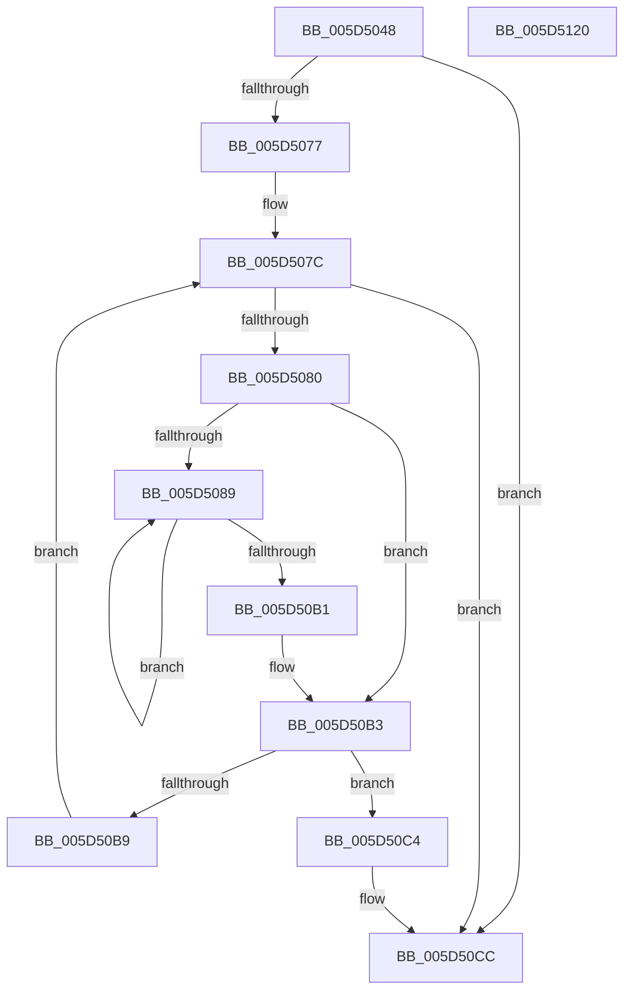

# PopWriteSecurePagesCallback

- RVA: `0x005D5048`–`0x005D5121` (길이 `217` bytes)
- VA: `0x00000001405D5048`
- 실행 섹션: `.text`
- PDB 이름 있음: `예`; PDB Function 태그: `아니요`
- unwind 정보 RVA: `0x00075C18`
- 디코드: `65`개 명령, `217/217` bytes 표시
- 미해석 바이트: `0` (있으면 어셈블리에 `.byte`로 보존)

> 이 문서는 커널 이미지의 기계어와 PDB 기호를 분석해 생성했습니다. 4번과 5번은 함수 원형과 자료형을 바이너리 사용 방식에서 추정한 C 해석이며 원본 소스 복구 결과는 아닙니다.

## 1. Dependencies

- 직접 호출 지점: **2**; 고유 호출 대상: **2**
- 직접 호출자로 확인된 함수: **1**
- RIP 상대 이미지 참조: **0**

### Outgoing calls
- `0x005D50A0` → [RtlClearBits](../3E/RtlClearBits_function_003E1A90.md) (function, `0x003E1A90`)
- `0x005D50F8` → [PopWriteHiberPages](../../pagelk/B6/PopWriteHiberPages_function_00B6FF78.md) (function, `0x00B6FF78`)

### Direct callers
- [HvlIterateSecurePagesForHibernation](../58/HvlIterateSecurePagesForHibernation_function_0058A520.md) at `0x0058A5AE`

### Static image references
- 디코드된 RIP-relative 메모리 참조가 없습니다.

## 2. Other-region calls and transfers

- 다른 실행 섹션으로 향하는 call: **1**
  - `0x005D50F8` → [PopWriteHiberPages](../../pagelk/B6/PopWriteHiberPages_function_00B6FF78.md) (`.text` → `PAGELK`)
- 별도 외부 분기/꼬리 이동을 확인하지 못했습니다.

## 3. Assembly (complete function range)

```asm
005D5048  48 89 5C 24 08                  mov qword ptr [rsp + 8], rbx
005D504D  48 89 6C 24 10                  mov qword ptr [rsp + 0x10], rbp
005D5052  48 89 74 24 18                  mov qword ptr [rsp + 0x18], rsi
005D5057  57                              push rdi
005D5058  41 54                           push r12
005D505A  41 55                           push r13
005D505C  41 56                           push r14
005D505E  41 57                           push r15
005D5060  48 83 EC 20                     sub rsp, 0x20
005D5064  48 8B 39                        mov rdi, qword ptr [rcx]
005D5067  33 C0                           xor eax, eax
005D5069  4C 8B E2                        mov r12, rdx
005D506C  41 8B E8                        mov ebp, r8d
005D506F  4C 8B F1                        mov r14, rcx
005D5072  39 41 08                        cmp dword ptr [rcx + 8], eax
005D5075  75 55                           jne 0x1405d50cc
005D5077  48 8B DA                        mov rbx, rdx
005D507A  8B F0                           mov esi, eax
005D507C  3B F5                           cmp esi, ebp
005D507E  73 4C                           jae 0x1405d50cc
005D5080  44 8B F8                        mov r15d, eax
005D5083  66 3B 43 08                     cmp ax, word ptr [rbx + 8]
005D5087  73 2A                           jae 0x1405d50b3
005D5089  41 8B D7                        mov edx, r15d
005D508C  48 8D 4F 20                     lea rcx, [rdi + 0x20]
005D5090  4C 8B 44 D3 10                  mov r8, qword ptr [rbx + rdx*8 + 0x10]
005D5095  8B 54 D3 10                     mov edx, dword ptr [rbx + rdx*8 + 0x10]
005D5099  49 C1 E8 28                     shr r8, 0x28
005D509D  41 FF C0                        inc r8d
005D50A0  E8 EB C9 E0 FF                  call 0x1403e1a90
005D50A5  0F B7 43 08                     movzx eax, word ptr [rbx + 8]
005D50A9  41 FF C7                        inc r15d
005D50AC  44 3B F8                        cmp r15d, eax
005D50AF  72 D8                           jb 0x1405d5089
005D50B1  33 C0                           xor eax, eax
005D50B3  48 83 3B FF                     cmp qword ptr [rbx], -1
005D50B7  74 0B                           je 0x1405d50c4
005D50B9  48 81 C3 00 10 00 00            add rbx, 0x1000
005D50C0  FF C6                           inc esi
005D50C2  EB B8                           jmp 0x1405d507c
005D50C4  41 C7 46 08 01 00 00 00         mov dword ptr [r14 + 8], 1
005D50CC  8B 4F 20                        mov ecx, dword ptr [rdi + 0x20]
005D50CF  4C 8B C5                        mov r8, rbp
005D50D2  44 8B 8F 1C 01 00 00            mov r9d, dword ptr [rdi + 0x11c]
005D50D9  49 8B D4                        mov rdx, r12
005D50DC  C1 E9 03                        shr ecx, 3
005D50DF  41 83 C1 02                     add r9d, 2
005D50E3  81 C1 FF 0F 00 00               add ecx, 0xfff
005D50E9  C1 E9 0C                        shr ecx, 0xc
005D50EC  03 8F 18 01 00 00               add ecx, dword ptr [rdi + 0x118]
005D50F2  44 03 C9                        add r9d, ecx
005D50F5  48 8B CF                        mov rcx, rdi
005D50F8  E8 7B AE 59 00                  call 0x140b6ff78
005D50FD  01 AF 1C 01 00 00               add dword ptr [rdi + 0x11c], ebp
005D5103  48 8B 6C 24 58                  mov rbp, qword ptr [rsp + 0x58]
005D5108  48 8B 5C 24 50                  mov rbx, qword ptr [rsp + 0x50]
005D510D  48 8B 74 24 60                  mov rsi, qword ptr [rsp + 0x60]
005D5112  48 83 C4 20                     add rsp, 0x20
005D5116  41 5F                           pop r15
005D5118  41 5E                           pop r14
005D511A  41 5D                           pop r13
005D511C  41 5C                           pop r12
005D511E  5F                              pop rdi
005D511F  C3                              ret
005D5120  CC                              int3
```

## 4. C-style interpretation (structured pseudocode)

```c
__int64 __fastcall PopWriteSecurePagesCallback(__int64 a1, __int64 a2, int a3)
{
    __int64 result;
    __int64 v_r15;
    __int64 v_rbx;
    __int64 v_rsi;
    __int64 v_rsp;
    unsigned __int64 v_stack_p10;
    unsigned __int64 v_stack_p18;
    unsigned __int64 v_stack_p8;

    v_stack_p8 = v_rbx;
    v_stack_p10 = v_rbp;
    v_stack_p18 = v_rsi;
    v_rsp = (v_rsp) - (32);
    result = 0;
    if ((*(unsigned int *)(a1 + 8)) != 0) goto loc_005D50CC;
loc_005D507C:
    if (0 >= ((unsigned int)((unsigned int)(a3)))) goto loc_005D50CC;
    if (0 >= (*(unsigned __int16 *)(a2 + 8))) goto loc_005D50B3;
loc_005D5089:
    a3 = (*(unsigned __int64 *)(a2 + 0 * 8 + 16)) >> (40);
    a3 = (unsigned int)((a3) + 1);
    result = RtlClearBits(*(unsigned __int64 *)(a1) + 32, (unsigned int)(*(unsigned int *)(a2 + 0 * 8 + 16)), a3, a4);
    v_r15 = (unsigned int)((0) + 1);
    if (((unsigned int)(v_r15)) < ((unsigned int)(*(unsigned __int16 *)(a2 + 8)))) goto loc_005D5089;
    result = 0;
loc_005D50B3:
    if ((*(unsigned __int64 *)(a2)) == -1) goto loc_005D50C4;
    v_rbx = (a2) + (0x1000ULL);
    v_rsi = (unsigned int)((0) + 1);
    goto loc_005D507C;
loc_005D50C4:
    *(unsigned int *)(a1 + 8) = 1;
loc_005D50CC:
    a1 = (unsigned int)(((unsigned int)(*(unsigned int *)(*(unsigned __int64 *)(a1) + 32))) >> (3));
    a4 = (unsigned int)(((unsigned int)(*(unsigned int *)(*(unsigned __int64 *)(a1) + 284))) + (2));
    a1 = (unsigned int)((a1) + (0xFFFULL));
    a1 = (unsigned int)((a1) >> (12));
    a1 = (unsigned int)((a1) + (*(unsigned int *)(*(unsigned __int64 *)(a1) + 280)));
    a4 = (unsigned int)((a4) + ((unsigned int)(a1)));
    result = PopWriteHiberPages(*(unsigned __int64 *)(a1), a2, (unsigned int)(a3), a4);
    v_rsp = (v_rsp) + (32);
    return result;
}
```

## 5. (Beta) C Style

```c
int64_t PopWriteSecurePagesCallback(void *Arg1, void *Arg2, int32_t Arg3)
{
    uint8_t *arg1 = (uint8_t *)Arg1;
    uint8_t *arg2 = (uint8_t *)Arg2;

    int64_t result;
    int64_t local_r15;
    int64_t local_rbx;
    int64_t local_rsi;
    int64_t local_rsp;
    uint64_t v_stack_p10;
    uint64_t v_stack_p18;
    uint64_t v_stack_p8;

    v_stack_p8 = local_rbx;
    v_stack_p10 = local_rbp;
    v_stack_p18 = local_rsi;
    local_rsp = (local_rsp) - (32);
    result = 0;
    if ((*(uint32_t *)(arg1 + 0x8)) != 0) goto loc_005D50CC;
loc_005D507C:
    if (0 >= ((uint32_t)((uint32_t)(Arg3)))) goto loc_005D50CC;
    if (0 >= (*(uint16_t *)(arg2 + 0x8))) goto loc_005D50B3;
loc_005D5089:
    Arg3 = (*(uint64_t *)(arg2 + 0x0 * 8 + 0x10)) >> (40);
    Arg3 = (uint32_t)((Arg3) + 1);
    result = RtlClearBits(*(uint64_t *)(arg1) + 32, (uint32_t)(*(uint32_t *)(arg2 + 0x0 * 8 + 0x10)), Arg3, a4);
    local_r15 = (uint32_t)((0) + 1);
    if (((uint32_t)(local_r15)) < ((uint32_t)(*(uint16_t *)(arg2 + 0x8)))) goto loc_005D5089;
    result = 0;
loc_005D50B3:
    if ((*(uint64_t *)(arg2)) == -1) goto loc_005D50C4;
    local_rbx = (Arg2) + (0x1000ULL);
    local_rsi = (uint32_t)((0) + 1);
    goto loc_005D507C;
loc_005D50C4:
    *(uint32_t *)(arg1 + 0x8) = 1;
loc_005D50CC:
    Arg1 = (uint32_t)(((uint32_t)(*(uint32_t *)(*(uint64_t *)(arg1) + 0x20))) >> (3));
    a4 = (uint32_t)(((uint32_t)(*(uint32_t *)(*(uint64_t *)(arg1) + 0x11C))) + (2));
    Arg1 = (uint32_t)((Arg1) + (0xFFFULL));
    Arg1 = (uint32_t)((Arg1) >> (12));
    Arg1 = (uint32_t)((Arg1) + (*(uint32_t *)(*(uint64_t *)(arg1) + 0x118)));
    a4 = (uint32_t)((a4) + ((uint32_t)(Arg1)));
    result = PopWriteHiberPages(*(uint64_t *)(arg1), Arg2, (uint32_t)(Arg3), a4);
    local_rsp = (local_rsp) + (32);
    return result;
}
```

### 관측된 메모리 오프셋

구조체 형식이 확인되지 않은 접근은 인자 기준의 오프셋으로만 기록했습니다.

| 기준 인자 | 오프셋 표현 | 폭 (bit) | 접근 |
|---|---:|---:|---|
| `Arg1` | `+ 0x0` | `64` | `R` |
| `Arg1` | `+ 0x8` | `32` | `R` |
| `Arg1` | `+ 0x8` | `32` | `W` |
| `Arg2` | `+ 0x0` | `64` | `R` |
| `Arg2` | `+ 0x8` | `16` | `R` |
| `Arg2` | `+ 0x10 + rdx*8` | `32` | `R` |
| `Arg2` | `+ 0x10 + rdx*8` | `64` | `R` |

## 6. Execution-region graph

[열기: 2D/3D 그래프와 함수 탐색 컨트롤 패널](../../../control-panel.html?section=text&rva=0x005D5048&view=graph)

- 2D 그래프는 위에서 아래로 흐르고, 3D 그래프는 빈 공간을 드래그해 회전합니다. Shift+드래그는 이동, 휠은 확대·축소, 함수 노드 선택은 대상 보고서 이동입니다.

### Static fallback


