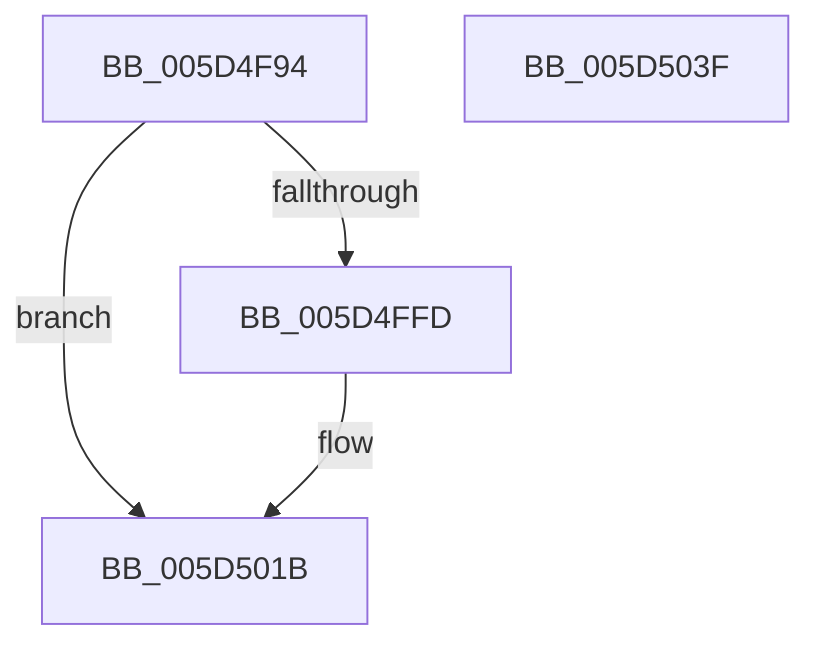

# PopWriteSecurePages

- RVA: `0x005D4F94`–`0x005D5040` (길이 `172` bytes)
- VA: `0x00000001405D4F94`
- 실행 섹션: `.text`
- PDB 이름 있음: `예`; PDB Function 태그: `아니요`
- unwind 정보 RVA: `0x000937EC`
- 디코드: `46`개 명령, `172/172` bytes 표시
- 미해석 바이트: `0` (있으면 어셈블리에 `.byte`로 보존)

> 이 문서는 커널 이미지의 기계어와 PDB 기호를 분석해 생성했습니다. 4번과 5번은 함수 원형과 자료형을 바이너리 사용 방식에서 추정한 C 해석이며 원본 소스 복구 결과는 아닙니다.

## 1. Dependencies

- 직접 호출 지점: **3**; 고유 호출 대상: **3**
- 직접 호출자로 확인된 함수: **1**
- RIP 상대 이미지 참조: **0**

### Outgoing calls
- `0x005D4FF4` → [HvlIterateSecurePagesForHibernation](../58/HvlIterateSecurePagesForHibernation_function_0058A520.md) (function, `0x0058A520`)
- `0x005D5015` → [KeBugCheckEx](../4F/KeBugCheckEx_function_004FD660.md) (function, `0x004FD660`)
- `0x005D502A` → [PopWriteHiberPages](../../pagelk/B6/PopWriteHiberPages_function_00B6FF78.md) (function, `0x00B6FF78`)

### Direct callers
- [PopSaveHiberContext](../../pagelk/B6/PopSaveHiberContext_function_00B6F050.md) at `0x00B6F6A1`

### Static image references
- 디코드된 RIP-relative 메모리 참조가 없습니다.

## 2. Other-region calls and transfers

- 다른 실행 섹션으로 향하는 call: **1**
  - `0x005D502A` → [PopWriteHiberPages](../../pagelk/B6/PopWriteHiberPages_function_00B6FF78.md) (`.text` → `PAGELK`)
- 별도 외부 분기/꼬리 이동을 확인하지 못했습니다.

## 3. Assembly (complete function range)

```asm
005D4F94  4C 8B DC                        mov r11, rsp
005D4F97  49 89 5B 10                     mov qword ptr [r11 + 0x10], rbx
005D4F9B  49 89 73 18                     mov qword ptr [r11 + 0x18], rsi
005D4F9F  57                              push rdi
005D4FA0  48 83 EC 40                     sub rsp, 0x40
005D4FA4  8B 51 20                        mov edx, dword ptr [rcx + 0x20]
005D4FA7  4D 8D 4B 08                     lea r9, [r11 + 8]
005D4FAB  8B B1 18 01 00 00               mov esi, dword ptr [rcx + 0x118]
005D4FB1  48 8B D9                        mov rbx, rcx
005D4FB4  8B 81 A8 00 00 00               mov eax, dword ptr [rcx + 0xa8]
005D4FBA  83 C6 02                        add esi, 2
005D4FBD  48 8B B9 A0 00 00 00            mov rdi, qword ptr [rcx + 0xa0]
005D4FC4  83 64 24 3C 00                  and dword ptr [rsp + 0x3c], 0
005D4FC9  4C 8B C7                        mov r8, rdi
005D4FCC  FF 81 1C 01 00 00               inc dword ptr [rcx + 0x11c]
005D4FD2  C1 EA 03                        shr edx, 3
005D4FD5  81 C2 FF 0F 00 00               add edx, 0xfff
005D4FDB  C1 E0 0C                        shl eax, 0xc
005D4FDE  C1 EA 0C                        shr edx, 0xc
005D4FE1  03 F2                           add esi, edx
005D4FE3  49 89 4B E8                     mov qword ptr [r11 - 0x18], rcx
005D4FE7  83 64 24 38 00                  and dword ptr [rsp + 0x38], 0
005D4FEC  49 8D 53 E8                     lea rdx, [r11 - 0x18]
005D4FF0  89 44 24 50                     mov dword ptr [rsp + 0x50], eax
005D4FF4  E8 27 55 FB FF                  call 0x14058a520
005D4FF9  85 C0                           test eax, eax
005D4FFB  79 1E                           jns 0x1405d501b
005D4FFD  BA 0D 01 00 00                  mov edx, 0x10d
005D5002  48 98                           cdqe
005D5004  4C 8B CB                        mov r9, rbx
005D5007  48 89 44 24 20                  mov qword ptr [rsp + 0x20], rax
005D500C  41 B8 0A 00 00 00               mov r8d, 0xa
005D5012  8D 4A 93                        lea ecx, [rdx - 0x6d]
005D5015  E8 46 86 F2 FF                  call 0x1404fd660
005D501A  CC                              int3
005D501B  4C 8B CE                        mov r9, rsi
005D501E  41 B8 01 00 00 00               mov r8d, 1
005D5024  48 8B D7                        mov rdx, rdi
005D5027  48 8B CB                        mov rcx, rbx
005D502A  E8 49 AF 59 00                  call 0x140b6ff78
005D502F  48 8B 5C 24 58                  mov rbx, qword ptr [rsp + 0x58]
005D5034  48 8B 74 24 60                  mov rsi, qword ptr [rsp + 0x60]
005D5039  48 83 C4 40                     add rsp, 0x40
005D503D  5F                              pop rdi
005D503E  C3                              ret
005D503F  CC                              int3
```

## 4. C-style interpretation (structured pseudocode)

```c
__int64 __fastcall PopWriteSecurePages(__int64 a1)
{
    __int64 result;
    __int64 v_rsi;
    __int64 v_rsp;
    unsigned int v_stack_m10;
    unsigned __int64 v_stack_m28;
    unsigned int v_stack_mC;
    unsigned __int64 v_stack_p10;
    unsigned __int64 v_stack_p18;
    unsigned int v_stack_p8;

    *(unsigned __int64 *)(v_rsp + 16) = v_rbx;
    *(unsigned __int64 *)(v_rsp + 24) = v_rsi;
    v_rsp = (v_rsp) - (64);
    v_rsi = (unsigned int)(((unsigned int)(*(unsigned int *)(a1 + 280))) + (2));
    a2 = (unsigned int)(((unsigned int)(*(unsigned int *)(a1 + 32))) >> (3));
    a2 = (unsigned int)((a2) + (0xFFFULL));
    result = (unsigned int)(((unsigned int)(*(unsigned int *)(a1 + 168))) << (12));
    a2 = (unsigned int)((a2) >> (12));
    v_rsi = (unsigned int)((v_rsi) + ((unsigned int)(a2)));
    *(unsigned __int64 *)(v_rsp - 24) = a1;
    v_stack_p8 = (unsigned int)(result);
    result = HvlIterateSecurePagesForHibernation(a1, v_rsp - 24, *(unsigned __int64 *)(a1 + 160), v_rsp + 8);
    if (sign_flag) {
        a2 = 269;
        a4 = a1;
        v_stack_m28 = result;
        a3 = 10;
        a1 = a2 - 109;
        result = KeBugCheckEx(a1, a2, a3, a4);
    }
    result = PopWriteHiberPages(a1, *(unsigned __int64 *)(a1 + 160), 1, v_rsi);
    v_rsp = (v_rsp) + (64);
    return result;
}
```

## 5. (Beta) C Style

```c
int64_t PopWriteSecurePages(void *Arg1)
{
    uint8_t *arg1 = (uint8_t *)Arg1;

    int64_t result;
    int64_t local_rsi;
    int64_t local_rsp;
    uint32_t v_stack_m10;
    uint64_t v_stack_m28;
    uint32_t v_stack_mC;
    uint64_t v_stack_p10;
    uint64_t v_stack_p18;
    uint32_t v_stack_p8;

    *(uint64_t *)(local_rsp + 0x10) = local_rbx;
    *(uint64_t *)(local_rsp + 0x18) = local_rsi;
    local_rsp = (local_rsp) - (64);
    local_rsi = (uint32_t)(((uint32_t)(*(uint32_t *)(arg1 + 0x118))) + (2));
    a2 = (uint32_t)(((uint32_t)(*(uint32_t *)(arg1 + 0x20))) >> (3));
    a2 = (uint32_t)((a2) + (0xFFFULL));
    result = (uint32_t)(((uint32_t)(*(uint32_t *)(arg1 + 0xA8))) << (12));
    a2 = (uint32_t)((a2) >> (12));
    local_rsi = (uint32_t)((local_rsi) + ((uint32_t)(a2)));
    *(void **)(local_rsp - 0x18) = Arg1;
    v_stack_p8 = (uint32_t)(result);
    result = HvlIterateSecurePagesForHibernation(Arg1, local_rsp - 24, *(uint64_t *)(arg1 + 0xA0), local_rsp + 8);
    if (sign_flag) {
        a2 = 269;
        a4 = Arg1;
        v_stack_m28 = result;
        a3 = 10;
        Arg1 = a2 - 109;
        result = KeBugCheckEx(Arg1, a2, a3, a4);
    }
    result = PopWriteHiberPages(Arg1, *(uint64_t *)(arg1 + 0xA0), 1, local_rsi);
    local_rsp = (local_rsp) + (64);
    return result;
}
```

### 관측된 메모리 오프셋

구조체 형식이 확인되지 않은 접근은 인자 기준의 오프셋으로만 기록했습니다.

| 기준 인자 | 오프셋 표현 | 폭 (bit) | 접근 |
|---|---:|---:|---|
| `Arg1` | `+ 0x20` | `32` | `R` |
| `Arg1` | `+ 0xA0` | `64` | `R` |
| `Arg1` | `+ 0xA8` | `32` | `R` |
| `Arg1` | `+ 0x118` | `32` | `R` |
| `Arg1` | `+ 0x11C` | `32` | `R/W` |

## 6. Execution-region graph

[열기: 2D/3D 그래프와 함수 탐색 컨트롤 패널](../../../control-panel.html?section=text&rva=0x005D4F94&view=graph)

- 2D 그래프는 위에서 아래로 흐르고, 3D 그래프는 빈 공간을 드래그해 회전합니다. Shift+드래그는 이동, 휠은 확대·축소, 함수 노드 선택은 대상 보고서 이동입니다.

### Static fallback


