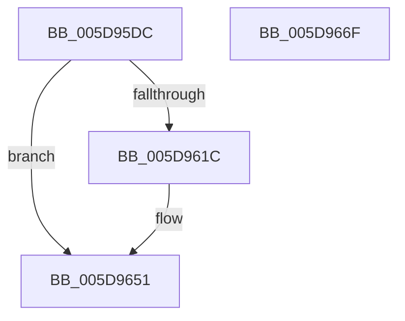

# PpmAllocWmiEvent

- RVA: `0x005D95DC`–`0x005D9670` (길이 `148` bytes)
- VA: `0x00000001405D95DC`
- 실행 섹션: `.text`
- PDB 이름 있음: `예`; PDB Function 태그: `아니요`
- unwind 정보 RVA: `0x0005E6B4`
- 디코드: `38`개 명령, `148/148` bytes 표시
- 미해석 바이트: `0` (있으면 어셈블리에 `.byte`로 보존)

> 이 문서는 커널 이미지의 기계어와 PDB 기호를 분석해 생성했습니다. 4번과 5번은 함수 원형과 자료형을 바이너리 사용 방식에서 추정한 C 해석이며 원본 소스 복구 결과는 아닙니다.

## 1. Dependencies

- 직접 호출 지점: **2**; 고유 호출 대상: **2**
- 직접 호출자로 확인된 함수: **2**
- RIP 상대 이미지 참조: **0**

### Outgoing calls
- `0x005D960F` → [ExAllocatePool2](../../poolcode/B8/ExAllocatePool2_function_00B820F0.md) (function, `0x00B820F0`)
- `0x005D962F` → [IoWMIDeviceObjectToProviderId](../46/IoWMIDeviceObjectToProviderId_function_0046C2B0.md) (function, `0x0046C2B0`)

### Direct callers
- [PpmFireWmiEvent](PpmFireWmiEvent_function_005D9678.md) at `0x005D969D`
- [PpmWmiFireIdleAccountingEvent](PpmWmiFireIdleAccountingEvent_function_005D9700.md) at `0x005D9742`

### Static image references
- 디코드된 RIP-relative 메모리 참조가 없습니다.

## 2. Other-region calls and transfers

- 다른 실행 섹션으로 향하는 call: **1**
  - `0x005D960F` → [ExAllocatePool2](../../poolcode/B8/ExAllocatePool2_function_00B820F0.md) (`.text` → `POOLCODE`)
- 별도 외부 분기/꼬리 이동을 확인하지 못했습니다.

## 3. Assembly (complete function range)

```asm
005D95DC  48 8B C4                        mov rax, rsp
005D95DF  48 89 58 08                     mov qword ptr [rax + 8], rbx
005D95E3  48 89 68 10                     mov qword ptr [rax + 0x10], rbp
005D95E7  48 89 70 18                     mov qword ptr [rax + 0x18], rsi
005D95EB  48 89 78 20                     mov qword ptr [rax + 0x20], rdi
005D95EF  41 56                           push r14
005D95F1  48 83 EC 20                     sub rsp, 0x20
005D95F5  41 8D 70 40                     lea esi, [r8 + 0x40]
005D95F9  41 8B F8                        mov edi, r8d
005D95FC  48 8B EA                        mov rbp, rdx
005D95FF  4C 8B F1                        mov r14, rcx
005D9602  8B D6                           mov edx, esi
005D9604  B9 40 00 00 00                  mov ecx, 0x40
005D9609  41 B8 50 50 4D 77               mov r8d, 0x774d5050
005D960F  E8 DC 8A 5A 00                  call 0x140b820f0
005D9614  48 8B D8                        mov rbx, rax
005D9617  48 85 C0                        test rax, rax
005D961A  74 35                           je 0x1405d9651
005D961C  48 A1 14 00 00 00 80 F7 FF FF   movabs rax, qword ptr [0xfffff78000000014]
005D9626  49 8B CE                        mov rcx, r14
005D9629  48 89 43 10                     mov qword ptr [rbx + 0x10], rax
005D962D  89 33                           mov dword ptr [rbx], esi
005D962F  E8 7C 2C E9 FF                  call 0x14046c2b0
005D9634  89 43 04                        mov dword ptr [rbx + 4], eax
005D9637  0F 10 45 00                     movups xmm0, xmmword ptr [rbp]
005D963B  C7 43 2C 8A 00 00 00            mov dword ptr [rbx + 0x2c], 0x8a
005D9642  C7 43 38 40 00 00 00            mov dword ptr [rbx + 0x38], 0x40
005D9649  F3 0F 7F 43 18                  movdqu xmmword ptr [rbx + 0x18], xmm0
005D964E  89 7B 3C                        mov dword ptr [rbx + 0x3c], edi
005D9651  48 8B 6C 24 38                  mov rbp, qword ptr [rsp + 0x38]
005D9656  48 8B C3                        mov rax, rbx
005D9659  48 8B 5C 24 30                  mov rbx, qword ptr [rsp + 0x30]
005D965E  48 8B 74 24 40                  mov rsi, qword ptr [rsp + 0x40]
005D9663  48 8B 7C 24 48                  mov rdi, qword ptr [rsp + 0x48]
005D9668  48 83 C4 20                     add rsp, 0x20
005D966C  41 5E                           pop r14
005D966E  C3                              ret
005D966F  CC                              int3
```

## 4. C-style interpretation (structured pseudocode)

```c
__int64 __fastcall PpmAllocWmiEvent(__int64 a1, __int64 a2, __int64 a3)
{
    __int64 result;
    __int64 v_rsp;
    unsigned __int64 v_stack_p10;
    unsigned __int64 v_stack_p18;
    unsigned __int64 v_stack_p20;
    unsigned __int64 v_stack_p8;

    *(unsigned __int64 *)(v_rsp + 8) = v_rbx;
    *(unsigned __int64 *)(v_rsp + 16) = v_rbp;
    *(unsigned __int64 *)(v_rsp + 24) = v_rsi;
    *(unsigned __int64 *)(v_rsp + 32) = v_rdi;
    v_rsp = (v_rsp) - (32);
    result = ExAllocatePool2(64, (unsigned int)((unsigned int)(a3 + 64)), (unsigned int)(0x774D5050ULL), a4);
    if (result != 0) {
        a1 = a1;
        *(unsigned __int64 *)(result + 16) = result;
        *(unsigned int *)(result) = (unsigned int)(a3 + 64);
        result = IoWMIDeviceObjectToProviderId(a1, (unsigned int)((unsigned int)(a3 + 64)), (unsigned int)(0x774D5050ULL), a4);
        *(unsigned int *)(result + 4) = (unsigned int)(result);
        *(unsigned int *)(result + 44) = 138;
        *(unsigned int *)(result + 56) = 64;
        *(unsigned __int64 *)(result + 24) = v_xmm0;
        *(unsigned int *)(result + 60) = (unsigned int)((unsigned int)((unsigned int)(a3)));
    }
    v_rsp = (v_rsp) + (32);
    return result;
}
```

## 5. (Beta) C Style

```c
int64_t PpmAllocWmiEvent(int64_t Arg1, void *Arg2, void *Arg3)
{
    uint8_t *arg2 = (uint8_t *)Arg2;
    uint8_t *arg3 = (uint8_t *)Arg3;

    int64_t result;
    int64_t local_rsp;
    uint64_t v_stack_p10;
    uint64_t v_stack_p18;
    uint64_t v_stack_p20;
    uint64_t v_stack_p8;

    *(uint64_t *)(local_rsp + 0x8) = local_rbx;
    *(uint64_t *)(local_rsp + 0x10) = local_rbp;
    *(uint64_t *)(local_rsp + 0x18) = local_rsi;
    *(uint64_t *)(local_rsp + 0x20) = local_rdi;
    local_rsp = (local_rsp) - (32);
    result = ExAllocatePool2(64, (uint32_t)((uint32_t)(Arg3 + 64)), (uint32_t)(0x774D5050ULL), a4);
    if (result != 0) {
        Arg1 = Arg1;
        *(uint64_t *)(result + 0x10) = result;
        *(uint32_t *)(result) = (uint32_t)(Arg3 + 64);
        result = IoWMIDeviceObjectToProviderId(Arg1, (uint32_t)((uint32_t)(Arg3 + 64)), (uint32_t)(0x774D5050ULL), a4);
        *(uint32_t *)(result + 0x4) = (uint32_t)(result);
        *(uint32_t *)(result + 0x2C) = 138;
        *(uint32_t *)(result + 0x38) = 64;
        *(uint64_t *)(result + 0x18) = v_xmm0;
        *(uint32_t *)(result + 0x3C) = (uint32_t)((uint32_t)((uint32_t)(Arg3)));
    }
    local_rsp = (local_rsp) + (32);
    return result;
}
```

### 관측된 메모리 오프셋

구조체 형식이 확인되지 않은 접근은 인자 기준의 오프셋으로만 기록했습니다.

| 기준 인자 | 오프셋 표현 | 폭 (bit) | 접근 |
|---|---:|---:|---|
| `Arg2` | `+ 0x0` | `128` | `R` |
| `Arg3` | `+ 0x40` | `32` | `R` |

## 6. Execution-region graph

[열기: 2D/3D 그래프와 함수 탐색 컨트롤 패널](../../../control-panel.html?section=text&rva=0x005D95DC&view=graph)

- 2D 그래프는 위에서 아래로 흐르고, 3D 그래프는 빈 공간을 드래그해 회전합니다. Shift+드래그는 이동, 휠은 확대·축소, 함수 노드 선택은 대상 보고서 이동입니다.

### Static fallback


