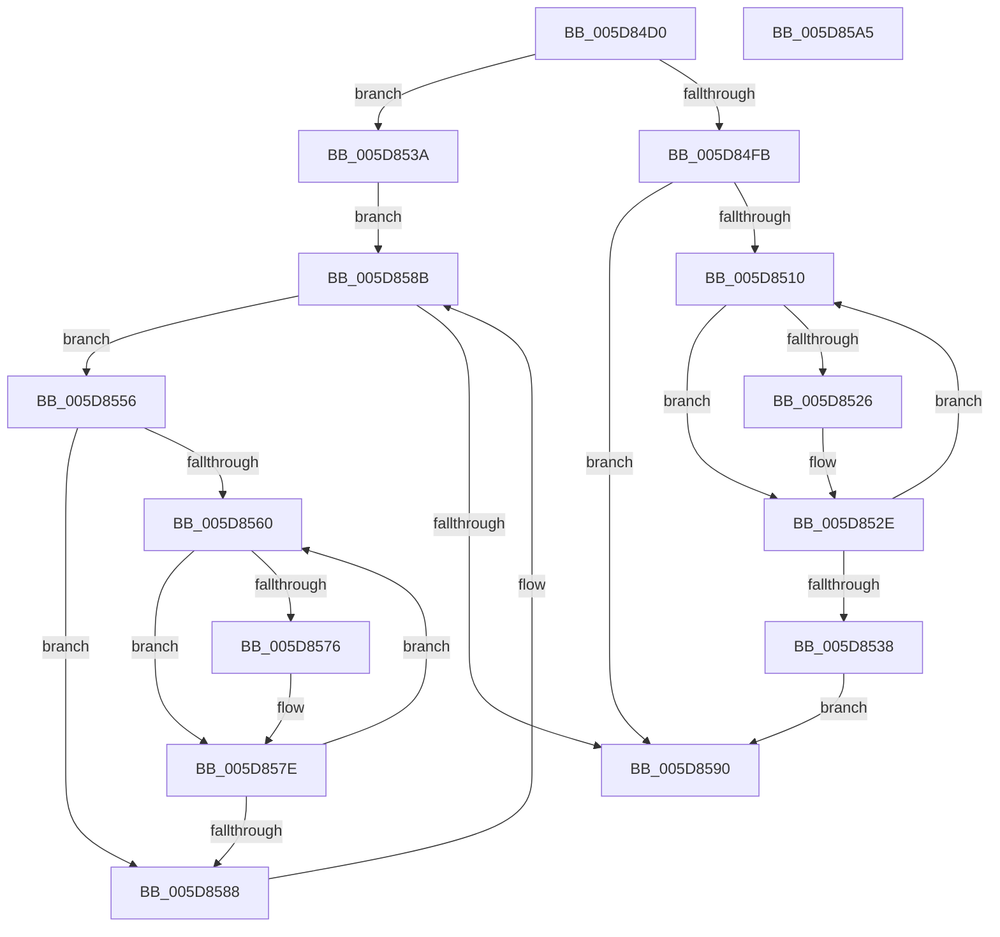

# PpmCheckResetProcessors

- RVA: `0x005D84D0`–`0x005D85A6` (길이 `214` bytes)
- VA: `0x00000001405D84D0`
- 실행 섹션: `.text`
- PDB 이름 있음: `예`; PDB Function 태그: `아니요`
- unwind 정보 RVA: `0x0005C954`
- 디코드: `55`개 명령, `214/214` bytes 표시
- 미해석 바이트: `0` (있으면 어셈블리에 `.byte`로 보존)

> 이 문서는 커널 이미지의 기계어와 PDB 기호를 분석해 생성했습니다. 4번과 5번은 함수 원형과 자료형을 바이너리 사용 방식에서 추정한 C 해석이며 원본 소스 복구 결과는 아닙니다.

## 1. Dependencies

- 직접 호출 지점: **4**; 고유 호출 대상: **2**
- 직접 호출자로 확인된 함수: **2**
- RIP 상대 이미지 참조: **3**

### Outgoing calls
- `0x005D84FF` → [PopExecuteOnTargetProcessors](../2D/PopExecuteOnTargetProcessors_function_002DD834.md) (function, `0x002DD834`)
- `0x005D8529` → [PpmResetPerfTimes](../44/PpmResetPerfTimes_function_0044F8EC.md) (function, `0x0044F8EC`)
- `0x005D8541` → [PopExecuteOnTargetProcessors](../2D/PopExecuteOnTargetProcessors_function_002DD834.md) (function, `0x002DD834`)
- `0x005D8579` → [PpmResetPerfTimes](../44/PpmResetPerfTimes_function_0044F8EC.md) (function, `0x0044F8EC`)

### Direct callers
- [PpmCheckArmPeriod](../4B/PpmCheckArmPeriod_function_004B5D1C.md) at `0x004B5D8A`
- [PpmRegisterPerfStates](../../page/75/PpmRegisterPerfStates_function_0075B084.md) at `0x0075BBF6`

### Static image references
- `0x005D84E6` → RVA `0x0044F7B0` (`PpmCheckReset`; read)
- `0x005D853A` → RVA `0x00E0B5A0` (`.data`; read)
- `0x005D8546` → RVA `0x00FC6BA8` (`ALMOSTRO`; read)

## 2. Other-region calls and transfers

- 다른 실행 섹션으로 향하는 call: **0**
- 별도 외부 분기/꼬리 이동을 확인하지 못했습니다.

## 3. Assembly (complete function range)

```asm
005D84D0  48 89 5C 24 08                  mov qword ptr [rsp + 8], rbx
005D84D5  48 89 6C 24 10                  mov qword ptr [rsp + 0x10], rbp
005D84DA  48 89 74 24 18                  mov qword ptr [rsp + 0x18], rsi
005D84DF  57                              push rdi
005D84E0  48 83 EC 20                     sub rsp, 0x20
005D84E4  33 DB                           xor ebx, ebx
005D84E6  48 8D 15 C3 72 E7 FF            lea rdx, [rip - 0x188d3d]
005D84ED  45 33 C9                        xor r9d, r9d
005D84F0  45 33 C0                        xor r8d, r8d
005D84F3  48 8B F9                        mov rdi, rcx
005D84F6  48 85 C9                        test rcx, rcx
005D84F9  74 3F                           je 0x1405d853a
005D84FB  48 83 C1 18                     add rcx, 0x18
005D84FF  E8 30 53 D0 FF                  call 0x1402dd834
005D8504  39 9F 28 01 00 00               cmp dword ptr [rdi + 0x128], ebx
005D850A  0F 86 80 00 00 00               jbe 0x1405d8590
005D8510  8B C3                           mov eax, ebx
005D8512  48 69 C8 A8 04 00 00            imul rcx, rax, 0x4a8
005D8519  48 03 8F 38 01 00 00            add rcx, qword ptr [rdi + 0x138]
005D8520  83 79 10 01                     cmp dword ptr [rcx + 0x10], 1
005D8524  75 08                           jne 0x1405d852e
005D8526  48 8B 09                        mov rcx, qword ptr [rcx]
005D8529  E8 BE 73 E7 FF                  call 0x14044f8ec
005D852E  FF C3                           inc ebx
005D8530  3B 9F 28 01 00 00               cmp ebx, dword ptr [rdi + 0x128]
005D8536  72 D8                           jb 0x1405d8510
005D8538  EB 56                           jmp 0x1405d8590
005D853A  48 8D 0D 5F 30 83 00            lea rcx, [rip + 0x83305f]
005D8541  E8 EE 52 D0 FF                  call 0x1402dd834
005D8546  48 8B 3D 5B E6 9E 00            mov rdi, qword ptr [rip + 0x9ee65b]
005D854D  48 8D 2D 54 E6 9E 00            lea rbp, [rip + 0x9ee654]
005D8554  EB 35                           jmp 0x1405d858b
005D8556  8B F3                           mov esi, ebx
005D8558  39 9F 28 01 00 00               cmp dword ptr [rdi + 0x128], ebx
005D855E  76 28                           jbe 0x1405d8588
005D8560  8B C6                           mov eax, esi
005D8562  48 69 C8 A8 04 00 00            imul rcx, rax, 0x4a8
005D8569  48 03 8F 38 01 00 00            add rcx, qword ptr [rdi + 0x138]
005D8570  83 79 10 01                     cmp dword ptr [rcx + 0x10], 1
005D8574  75 08                           jne 0x1405d857e
005D8576  48 8B 09                        mov rcx, qword ptr [rcx]
005D8579  E8 6E 73 E7 FF                  call 0x14044f8ec
005D857E  FF C6                           inc esi
005D8580  3B B7 28 01 00 00               cmp esi, dword ptr [rdi + 0x128]
005D8586  72 D8                           jb 0x1405d8560
005D8588  48 8B 3F                        mov rdi, qword ptr [rdi]
005D858B  48 3B FD                        cmp rdi, rbp
005D858E  75 C6                           jne 0x1405d8556
005D8590  48 8B 5C 24 30                  mov rbx, qword ptr [rsp + 0x30]
005D8595  48 8B 6C 24 38                  mov rbp, qword ptr [rsp + 0x38]
005D859A  48 8B 74 24 40                  mov rsi, qword ptr [rsp + 0x40]
005D859F  48 83 C4 20                     add rsp, 0x20
005D85A3  5F                              pop rdi
005D85A4  C3                              ret
005D85A5  CC                              int3
```

## 4. C-style interpretation (structured pseudocode)

```c
__int64 __fastcall PpmCheckResetProcessors(__int64 a1, __int64 a2, int a3, int a4)
{
    __int64 result;
    __int64 v_rbx;
    __int64 v_rsi;
    __int64 v_rsp;
    unsigned __int64 v_stack_p10;
    unsigned __int64 v_stack_p18;
    unsigned __int64 v_stack_p8;

    v_stack_p8 = v_rbx;
    v_stack_p10 = v_rbp;
    v_stack_p18 = v_rsi;
    v_rsp = (v_rsp) - (32);
    v_rbx = 0;
    a4 = 0;
    a3 = 0;
    if (a1 == 0) goto loc_005D853A;
    a1 = (a1) + (24);
    result = PopExecuteOnTargetProcessors(a1, v_rip - 1609021, a3, a4);
    if ((*(unsigned int *)(a1 + 296)) <= 0) goto loc_005D8590;
loc_005D8510:
    a1 = (a1) * (0);
    a1 = (a1) + (*(unsigned __int64 *)(a1 + 312));
    result = 0;
    if ((*(unsigned int *)(a1 + 16)) == 1) {
        a1 = *(unsigned __int64 *)(a1);
        result = PpmResetPerfTimes(a1, v_rip - 1609021, a3, a4);
    }
    v_rbx = (unsigned int)((v_rbx) + 1);
    if (((unsigned int)(v_rbx)) < (*(unsigned int *)(a1 + 296))) goto loc_005D8510;
    goto loc_005D8590;
loc_005D853A:
    result = PopExecuteOnTargetProcessors(v_rip + 8597599, v_rip - 1609021, a3, a4);
    goto loc_005D858B;
loc_005D8556:
    if ((*(unsigned int *)(*(unsigned __int64 *)(v_rip + 10413659) + 296)) <= ((unsigned int)(v_rbx))) goto loc_005D8588;
loc_005D8560:
    a1 = (v_rip + 8597599) * ((unsigned int)((unsigned int)((unsigned int)((unsigned int)(v_rbx)))));
    a1 = (a1) + (*(unsigned __int64 *)(*(unsigned __int64 *)(v_rip + 10413659) + 312));
    result = (unsigned int)((unsigned int)((unsigned int)((unsigned int)(v_rbx))));
    if ((*(unsigned int *)(a1 + 16)) == 1) {
        a1 = *(unsigned __int64 *)(a1);
        result = PpmResetPerfTimes(a1, v_rip - 1609021, a3, a4);
    }
    v_rsi = (unsigned int)(((unsigned int)((unsigned int)(v_rbx))) + 1);
    if (((unsigned int)(v_rsi)) < (*(unsigned int *)(*(unsigned __int64 *)(v_rip + 10413659) + 296))) goto loc_005D8560;
loc_005D8588:
loc_005D858B:
    if ((*(unsigned __int64 *)(*(unsigned __int64 *)(v_rip + 10413659))) != (v_rip + 10413652)) goto loc_005D8556;
loc_005D8590:
    v_rsp = (v_rsp) + (32);
    return result;
}
```

## 5. (Beta) C Style

```c
int64_t PpmCheckResetProcessors(void *Arg1, int64_t Arg2, int32_t Arg3, int32_t Arg4)
{
    uint8_t *arg1 = (uint8_t *)Arg1;

    int64_t result;
    int64_t local_rbx;
    int64_t local_rsi;
    int64_t local_rsp;
    uint64_t v_stack_p10;
    uint64_t v_stack_p18;
    uint64_t v_stack_p8;

    v_stack_p8 = local_rbx;
    v_stack_p10 = local_rbp;
    v_stack_p18 = local_rsi;
    local_rsp = (local_rsp) - (32);
    local_rbx = 0;
    Arg4 = 0;
    Arg3 = 0;
    if (Arg1 == NULL) goto loc_005D853A;
    Arg1 = (Arg1) + (24);
    result = PopExecuteOnTargetProcessors(Arg1, v_rip - 1609021, Arg3, Arg4);
    if ((*(uint32_t *)(arg1 + 0x128)) <= 0) goto loc_005D8590;
loc_005D8510:
    Arg1 = (Arg1) * (0);
    Arg1 = (Arg1) + (*(uint64_t *)(arg1 + 0x138));
    result = 0;
    if ((*(uint32_t *)(arg1 + 0x10)) == 1) {
        Arg1 = *(uint64_t *)(arg1);
        result = PpmResetPerfTimes(Arg1, v_rip - 1609021, Arg3, Arg4);
    }
    local_rbx = (uint32_t)((local_rbx) + 1);
    if (((uint32_t)(local_rbx)) < (*(uint32_t *)(arg1 + 0x128))) goto loc_005D8510;
    goto loc_005D8590;
loc_005D853A:
    result = PopExecuteOnTargetProcessors(v_rip + 8597599, v_rip - 1609021, Arg3, Arg4);
    goto loc_005D858B;
loc_005D8556:
    if ((*(uint32_t *)(*(uint64_t *)(v_rip + 0x9EE65B) + 0x128)) <= ((uint32_t)(local_rbx))) goto loc_005D8588;
loc_005D8560:
    Arg1 = (v_rip + 8597599) * ((uint32_t)((uint32_t)((uint32_t)((uint32_t)(local_rbx)))));
    Arg1 = (Arg1) + (*(uint64_t *)(*(uint64_t *)(v_rip + 0x9EE65B) + 0x138));
    result = (uint32_t)((uint32_t)((uint32_t)((uint32_t)(local_rbx))));
    if ((*(uint32_t *)(arg1 + 0x10)) == 1) {
        Arg1 = *(uint64_t *)(arg1);
        result = PpmResetPerfTimes(Arg1, v_rip - 1609021, Arg3, Arg4);
    }
    local_rsi = (uint32_t)(((uint32_t)((uint32_t)(local_rbx))) + 1);
    if (((uint32_t)(local_rsi)) < (*(uint32_t *)(*(uint64_t *)(v_rip + 0x9EE65B) + 0x128))) goto loc_005D8560;
loc_005D8588:
loc_005D858B:
    if ((*(uint64_t *)(*(uint64_t *)(v_rip + 0x9EE65B))) != (v_rip + 10413652)) goto loc_005D8556;
loc_005D8590:
    local_rsp = (local_rsp) + (32);
    return result;
}
```

### 관측된 메모리 오프셋

구조체 형식이 확인되지 않은 접근은 인자 기준의 오프셋으로만 기록했습니다.

| 기준 인자 | 오프셋 표현 | 폭 (bit) | 접근 |
|---|---:|---:|---|
| `Arg1` | `+ 0x128` | `32` | `R` |
| `Arg1` | `+ 0x138` | `64` | `R` |

## 6. Execution-region graph

[열기: 2D/3D 그래프와 함수 탐색 컨트롤 패널](../../../control-panel.html?section=text&rva=0x005D84D0&view=graph)

- 2D 그래프는 위에서 아래로 흐르고, 3D 그래프는 빈 공간을 드래그해 회전합니다. Shift+드래그는 이동, 휠은 확대·축소, 함수 노드 선택은 대상 보고서 이동입니다.

### Static fallback


