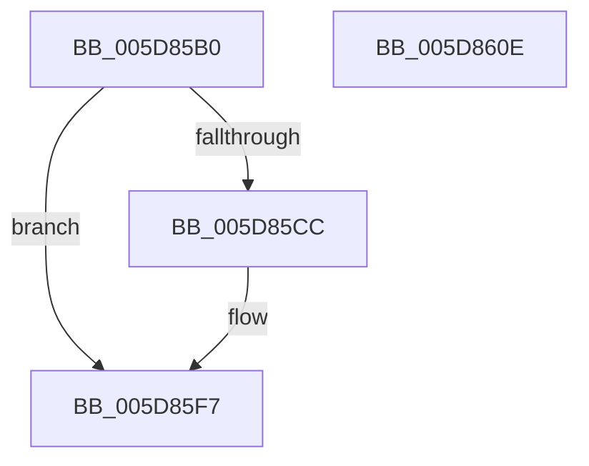

# PpmCheckTimerCallback

- RVA: `0x005D85B0`–`0x005D860F` (길이 `95` bytes)
- VA: `0x00000001405D85B0`
- 실행 섹션: `.text`
- PDB 이름 있음: `예`; PDB Function 태그: `아니요`
- unwind 정보 RVA: `0x0006F9F8`
- 디코드: `21`개 명령, `95/95` bytes 표시
- 미해석 바이트: `0` (있으면 어셈블리에 `.byte`로 보존)

> 이 문서는 커널 이미지의 기계어와 PDB 기호를 분석해 생성했습니다. 4번과 5번은 함수 원형과 자료형을 바이너리 사용 방식에서 추정한 C 해석이며 원본 소스 복구 결과는 아닙니다.

## 1. Dependencies

- 직접 호출 지점: **3**; 고유 호출 대상: **3**
- 직접 호출자로 확인된 함수: **0**
- RIP 상대 이미지 참조: **3**

### Outgoing calls
- `0x005D85F2` → [tlgWriteTransfer_EtwWriteTransfer](../42/tlgWriteTransfer_EtwWriteTransfer_function_004260E0.md) (function, `0x004260E0`)
- `0x005D85F7` → [PpmExecutePeriodicPerfCheck](../39/PpmExecutePeriodicPerfCheck_function_0039D0CC.md) (function, `0x0039D0CC`)
- `0x005D8604` → [_security_check_cookie](../6A/_security_check_cookie_function_006AC640.md) (function, `0x006AC640`)

### Direct callers
- 이 함수 시작 RVA로 연결되는 직접 call은 확인되지 않았습니다. 간접 호출은 완전히 역산할 수 없습니다.

### Static image references
- `0x005D85B4` → RVA `0x00E0A740` (`.data`; read)
- `0x005D85C3` → RVA `0x00E07748` (`.data`; read)
- `0x005D85D9` → RVA `0x0004C221` (`.rdata`; read)

## 2. Other-region calls and transfers

- 다른 실행 섹션으로 향하는 call: **0**
- 별도 외부 분기/꼬리 이동을 확인하지 못했습니다.

## 3. Assembly (complete function range)

```asm
005D85B0  48 83 EC 68                     sub rsp, 0x68
005D85B4  48 8B 05 85 21 83 00            mov rax, qword ptr [rip + 0x832185]
005D85BB  48 33 C4                        xor rax, rsp
005D85BE  48 89 44 24 50                  mov qword ptr [rsp + 0x50], rax
005D85C3  83 3D 7E F1 82 00 05            cmp dword ptr [rip + 0x82f17e], 5
005D85CA  76 2B                           jbe 0x1405d85f7
005D85CC  48 8D 44 24 30                  lea rax, [rsp + 0x30]
005D85D1  45 33 C9                        xor r9d, r9d
005D85D4  48 89 44 24 28                  mov qword ptr [rsp + 0x28], rax
005D85D9  48 8D 15 41 3C A7 FF            lea rdx, [rip - 0x58c3bf]
005D85E0  45 33 C0                        xor r8d, r8d
005D85E3  C7 44 24 20 02 00 00 00         mov dword ptr [rsp + 0x20], 2
005D85EB  48 8D 0D 56 F1 82 00            lea rcx, [rip + 0x82f156]
005D85F2  E8 E9 DA E4 FF                  call 0x1404260e0
005D85F7  E8 D0 4A DC FF                  call 0x14039d0cc
005D85FC  48 8B 4C 24 50                  mov rcx, qword ptr [rsp + 0x50]
005D8601  48 33 CC                        xor rcx, rsp
005D8604  E8 37 40 0D 00                  call 0x1406ac640
005D8609  48 83 C4 68                     add rsp, 0x68
005D860D  C3                              ret
005D860E  CC                              int3
```

## 4. C-style interpretation (structured pseudocode)

```c
__int64 __fastcall PpmCheckTimerCallback(__int64 a1, __int64 a2, int a3, int a4)
{
    __int64 result;
    __int64 v_rsp;
    unsigned __int64 v_stack_m18;
    unsigned __int64 v_stack_m38;
    unsigned __int64 v_stack_m40;
    unsigned int v_stack_m48;

    v_rsp = (v_rsp) - (104);
    result = (*(unsigned __int64 *)(v_rip + 8593797)) ^ (v_rsp);
    v_stack_m18 = result;
    if ((*(unsigned int *)(v_rip + 8581502)) >= = 5) {
        result = v_stack_m38;
        a4 = 0;
        v_stack_m40 = result;
        a2 = v_rip - 5817279;
        a3 = 0;
        v_stack_m48 = 2;
        a1 = v_rip + 8581462;
        result = tlgWriteTransfer_EtwWriteTransfer(a1, a2, a3, a4);
    }
    result = PpmExecutePeriodicPerfCheck(a1, a2, a3, a4);
    a1 = (v_stack_m18) ^ (v_rsp);
    result = _security_check_cookie(a1, a2, a3, a4);
    v_rsp = (v_rsp) + (104);
    return result;
}
```

## 5. (Beta) C Style

```c
int64_t PpmCheckTimerCallback(int64_t Arg1, int64_t Arg2, int32_t Arg3, int32_t Arg4)
{
    int64_t result;
    int64_t local_rsp;
    uint64_t v_stack_m18;
    uint64_t v_stack_m38;
    uint64_t v_stack_m40;
    uint32_t v_stack_m48;

    local_rsp = (local_rsp) - (104);
    result = (*(uint64_t *)(v_rip + 0x832185)) ^ (local_rsp);
    v_stack_m18 = result;
    if ((*(uint32_t *)(v_rip + 0x82F17E)) >= = 5) {
        result = v_stack_m38;
        Arg4 = 0;
        v_stack_m40 = result;
        Arg2 = v_rip - 5817279;
        Arg3 = 0;
        v_stack_m48 = 2;
        Arg1 = v_rip + 8581462;
        result = tlgWriteTransfer_EtwWriteTransfer(Arg1, Arg2, Arg3, Arg4);
    }
    result = PpmExecutePeriodicPerfCheck(Arg1, Arg2, Arg3, Arg4);
    Arg1 = (v_stack_m18) ^ (local_rsp);
    result = _security_check_cookie(Arg1, Arg2, Arg3, Arg4);
    local_rsp = (local_rsp) + (104);
    return result;
}
```

## 6. Execution-region graph

[열기: 2D/3D 그래프와 함수 탐색 컨트롤 패널](../../../control-panel.html?section=text&rva=0x005D85B0&view=graph)

- 2D 그래프는 위에서 아래로 흐르고, 3D 그래프는 빈 공간을 드래그해 회전합니다. Shift+드래그는 이동, 휠은 확대·축소, 함수 노드 선택은 대상 보고서 이동입니다.

### Static fallback


