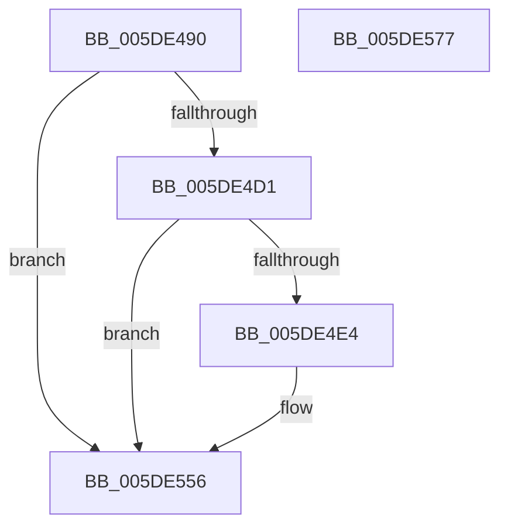

# PpmEventAffinityMaskEx

- RVA: `0x005DE490`–`0x005DE578` (길이 `232` bytes)
- VA: `0x00000001405DE490`
- 실행 섹션: `.text`
- PDB 이름 있음: `예`; PDB Function 태그: `아니요`
- unwind 정보 RVA: `0x000CD8FC`
- 디코드: `50`개 명령, `232/232` bytes 표시
- 미해석 바이트: `0` (있으면 어셈블리에 `.byte`로 보존)

> 이 문서는 커널 이미지의 기계어와 PDB 기호를 분석해 생성했습니다. 4번과 5번은 함수 원형과 자료형을 바이너리 사용 방식에서 추정한 C 해석이며 원본 소스 복구 결과는 아닙니다.

## 1. Dependencies

- 직접 호출 지점: **4**; 고유 호출 대상: **4**
- 직접 호출자로 확인된 함수: **1**
- RIP 상대 이미지 참조: **3**

### Outgoing calls
- `0x005DE4DB` → [EtwEventEnabled](../39/EtwEventEnabled_function_00392450.md) (function, `0x00392450`)
- `0x005DE51E` → [PpmEventAddAffinityMaskAsSubset](../4E/PpmEventAddAffinityMaskAsSubset_function_004EF628.md) (function, `0x004EF628`)
- `0x005DE551` → [EtwWriteEx](../25/EtwWriteEx_function_0025F0D0.md) (function, `0x0025F0D0`)
- `0x005DE561` → [_security_check_cookie](../6A/_security_check_cookie_function_006AC640.md) (function, `0x006AC640`)

### Direct callers
- [PpmEventAffinityMask](PpmEventAffinityMask_function_005DA500.md) at `0x005DA650`

### Static image references
- `0x005DE49D` → RVA `0x00E0A740` (`.data`; read)
- `0x005DE4C4` → RVA `0x00E67A39` (`.data`; read)
- `0x005DE4D4` → RVA `0x00F083E8` (`.data`; read)

## 2. Other-region calls and transfers

- 다른 실행 섹션으로 향하는 call: **0**
- 별도 외부 분기/꼬리 이동을 확인하지 못했습니다.

## 3. Assembly (complete function range)

```asm
005DE490  48 89 5C 24 18                  mov qword ptr [rsp + 0x18], rbx
005DE495  57                              push rdi
005DE496  48 81 EC B0 04 00 00            sub rsp, 0x4b0
005DE49D  48 8B 05 9C C2 82 00            mov rax, qword ptr [rip + 0x82c29c]
005DE4A4  48 33 C4                        xor rax, rsp
005DE4A7  48 89 84 24 A0 04 00 00         mov qword ptr [rsp + 0x4a0], rax
005DE4AF  83 64 24 4C 00                  and dword ptr [rsp + 0x4c], 0
005DE4B4  48 8B FA                        mov rdi, rdx
005DE4B7  83 64 24 48 00                  and dword ptr [rsp + 0x48], 0
005DE4BC  48 8B D9                        mov rbx, rcx
005DE4BF  83 64 24 40 00                  and dword ptr [rsp + 0x40], 0
005DE4C4  80 3D 6E 95 88 00 00            cmp byte ptr [rip + 0x88956e], 0
005DE4CB  0F 84 85 00 00 00               je 0x1405de556
005DE4D1  48 8B D1                        mov rdx, rcx
005DE4D4  48 8B 0D 0D 9F 92 00            mov rcx, qword ptr [rip + 0x929f0d]
005DE4DB  E8 70 3F DB FF                  call 0x140392450
005DE4E0  84 C0                           test al, al
005DE4E2  74 72                           je 0x1405de556
005DE4E4  48 8D 44 24 40                  lea rax, [rsp + 0x40]
005DE4E9  48 8B D7                        mov rdx, rdi
005DE4EC  48 89 44 24 38                  mov qword ptr [rsp + 0x38], rax
005DE4F1  4C 8D 8C 24 60 04 00 00         lea r9, [rsp + 0x460]
005DE4F9  48 8D 44 24 48                  lea rax, [rsp + 0x48]
005DE4FE  33 C9                           xor ecx, ecx
005DE500  48 89 44 24 30                  mov qword ptr [rsp + 0x30], rax
005DE505  4C 8D 44 24 44                  lea r8, [rsp + 0x44]
005DE50A  48 8D 44 24 4C                  lea rax, [rsp + 0x4c]
005DE50F  48 89 44 24 28                  mov qword ptr [rsp + 0x28], rax
005DE514  48 8D 44 24 50                  lea rax, [rsp + 0x50]
005DE519  48 89 44 24 20                  mov qword ptr [rsp + 0x20], rax
005DE51E  E8 05 11 F1 FF                  call 0x1404ef628
005DE523  48 8B 0D BE 9E 92 00            mov rcx, qword ptr [rip + 0x929ebe]
005DE52A  48 8D 44 24 50                  lea rax, [rsp + 0x50]
005DE52F  48 89 44 24 38                  mov qword ptr [rsp + 0x38], rax
005DE534  45 33 C9                        xor r9d, r9d
005DE537  8B 44 24 40                     mov eax, dword ptr [rsp + 0x40]
005DE53B  45 33 C0                        xor r8d, r8d
005DE53E  89 44 24 30                     mov dword ptr [rsp + 0x30], eax
005DE542  48 8B D3                        mov rdx, rbx
005DE545  48 83 64 24 28 00               and qword ptr [rsp + 0x28], 0
005DE54B  48 83 64 24 20 00               and qword ptr [rsp + 0x20], 0
005DE551  E8 7A 0B C8 FF                  call 0x14025f0d0
005DE556  48 8B 8C 24 A0 04 00 00         mov rcx, qword ptr [rsp + 0x4a0]
005DE55E  48 33 CC                        xor rcx, rsp
005DE561  E8 DA E0 0C 00                  call 0x1406ac640
005DE566  48 8B 9C 24 D0 04 00 00         mov rbx, qword ptr [rsp + 0x4d0]
005DE56E  48 81 C4 B0 04 00 00            add rsp, 0x4b0
005DE575  5F                              pop rdi
005DE576  C3                              ret
005DE577  CC                              int3
```

## 4. C-style interpretation (structured pseudocode)

```c
__int64 __fastcall PpmEventAffinityMaskEx(__int64 a1, __int64 a2)
{
    __int64 result;
    __int64 v_rsp;
    unsigned __int64 v_stack_m18;
    unsigned __int64 v_stack_m468;
    unsigned int v_stack_m46C;
    unsigned int v_stack_m470;
    unsigned __int64 v_stack_m474;
    unsigned int v_stack_m478;
    unsigned __int64 v_stack_m480;
    unsigned __int64 v_stack_m488;
    unsigned __int64 v_stack_m490;
    unsigned __int64 v_stack_m498;
    unsigned __int64 v_stack_m58;
    unsigned __int64 v_stack_p18;

    v_stack_p18 = v_rbx;
    v_rsp = (v_rsp) - (0x4B0ULL);
    result = (*(unsigned __int64 *)(v_rip + 8569500)) ^ (v_rsp);
    v_stack_m18 = result;
    if ((*(unsigned __int8 *)(v_rip + 8951150)) == 0) goto loc_005DE556;
    result = EtwEventEnabled(*(unsigned __int64 *)(v_rip + 9608973), a1, a3, a4);
    if ((unsigned __int8)(result) != 0) {
        result = v_stack_m478;
        a2 = a2;
        v_stack_m480 = result;
        a4 = v_stack_m58;
        result = v_stack_m470;
        a1 = 0;
        v_stack_m488 = result;
        a3 = v_stack_m474;
        result = v_stack_m46C;
        v_stack_m490 = result;
        result = v_stack_m468;
        v_stack_m498 = result;
        result = PpmEventAddAffinityMaskAsSubset(a1, a2, a3, a4);
        a1 = *(unsigned __int64 *)(v_rip + 9608894);
        result = v_stack_m468;
        v_stack_m480 = result;
        a4 = 0;
        result = v_stack_m478;
        a3 = 0;
        v_stack_m488 = (unsigned int)(result);
        a2 = a1;
        result = EtwWriteEx(a1, a2, a3, a4);
    }
    a1 = (v_stack_m18) ^ (v_rsp);
    result = _security_check_cookie(a1, a2, a3, a4);
    v_rsp = (v_rsp) + (0x4B0ULL);
    return result;
}
```

## 5. (Beta) C Style

```c
int64_t PpmEventAffinityMaskEx(int64_t Arg1, int64_t Arg2)
{
    int64_t result;
    int64_t local_rsp;
    uint64_t v_stack_m18;
    uint64_t v_stack_m468;
    uint32_t v_stack_m46C;
    uint32_t v_stack_m470;
    uint64_t v_stack_m474;
    uint32_t v_stack_m478;
    uint64_t v_stack_m480;
    uint64_t v_stack_m488;
    uint64_t v_stack_m490;
    uint64_t v_stack_m498;
    uint64_t v_stack_m58;
    uint64_t v_stack_p18;

    v_stack_p18 = local_rbx;
    local_rsp = (local_rsp) - (0x4B0ULL);
    result = (*(uint64_t *)(v_rip + 0x82C29C)) ^ (local_rsp);
    v_stack_m18 = result;
    if ((*(uint8_t *)(v_rip + 0x88956E)) == 0) goto loc_005DE556;
    result = EtwEventEnabled(*(uint64_t *)(v_rip + 0x929F0D), Arg1, a3, a4);
    if ((uint8_t)(result) != 0) {
        result = v_stack_m478;
        Arg2 = Arg2;
        v_stack_m480 = result;
        a4 = v_stack_m58;
        result = v_stack_m470;
        Arg1 = 0;
        v_stack_m488 = result;
        a3 = v_stack_m474;
        result = v_stack_m46C;
        v_stack_m490 = result;
        result = v_stack_m468;
        v_stack_m498 = result;
        result = PpmEventAddAffinityMaskAsSubset(Arg1, Arg2, a3, a4);
        Arg1 = *(uint64_t *)(v_rip + 0x929EBE);
        result = v_stack_m468;
        v_stack_m480 = result;
        a4 = 0;
        result = v_stack_m478;
        a3 = 0;
        v_stack_m488 = (uint32_t)(result);
        Arg2 = Arg1;
        result = EtwWriteEx(Arg1, Arg2, a3, a4);
    }
    Arg1 = (v_stack_m18) ^ (local_rsp);
    result = _security_check_cookie(Arg1, Arg2, a3, a4);
    local_rsp = (local_rsp) + (0x4B0ULL);
    return result;
}
```

## 6. Execution-region graph

[열기: 2D/3D 그래프와 함수 탐색 컨트롤 패널](../../../control-panel.html?section=text&rva=0x005DE490&view=graph)

- 2D 그래프는 위에서 아래로 흐르고, 3D 그래프는 빈 공간을 드래그해 회전합니다. Shift+드래그는 이동, 휠은 확대·축소, 함수 노드 선택은 대상 보고서 이동입니다.

### Static fallback


