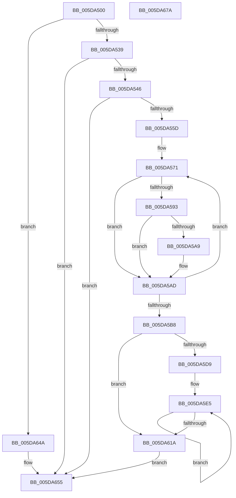

# PpmEventAffinityMask

- RVA: `0x005DA500`–`0x005DA67B` (길이 `379` bytes)
- VA: `0x00000001405DA500`
- 실행 섹션: `.text`
- PDB 이름 있음: `예`; PDB Function 태그: `아니요`
- unwind 정보 RVA: `0x000CD228`
- 디코드: `88`개 명령, `379/379` bytes 표시
- 미해석 바이트: `0` (있으면 어셈블리에 `.byte`로 보존)

> 이 문서는 커널 이미지의 기계어와 PDB 기호를 분석해 생성했습니다. 4번과 5번은 함수 원형과 자료형을 바이너리 사용 방식에서 추정한 C 해석이며 원본 소스 복구 결과는 아닙니다.

## 1. Dependencies

- 직접 호출 지점: **5**; 고유 호출 대상: **5**
- 직접 호출자로 확인된 함수: **2**
- RIP 상대 이미지 참조: **3**

### Outgoing calls
- `0x005DA52A` → [Feature_PpmParkEx__private_IsEnabledDeviceUsageNoInline](../4F/Feature_PpmParkEx__private_IsEnabledDeviceUsageNoInline_function_004F135C.md) (function, `0x004F135C`)
- `0x005DA550` → [EtwEventEnabled](../39/EtwEventEnabled_function_00392450.md) (function, `0x00392450`)
- `0x005DA643` → [EtwWriteEx](../25/EtwWriteEx_function_0025F0D0.md) (function, `0x0025F0D0`)
- `0x005DA650` → [PpmEventAffinityMaskEx](PpmEventAffinityMaskEx_function_005DE490.md) (function, `0x005DE490`)
- `0x005DA660` → [_security_check_cookie](../6A/_security_check_cookie_function_006AC640.md) (function, `0x006AC640`)

### Direct callers
- [PpmIdleUpdateSystemLatencyLimit](../2D/PpmIdleUpdateSystemLatencyLimit_function_002D9204.md) at `0x002D9420`
- [PoExecuteIdleCheck](../39/PoExecuteIdleCheck_function_0039CF20.md) at `0x0039D0B0`

### Static image references
- `0x005DA512` → RVA `0x00E0A740` (`.data`; read)
- `0x005DA539` → RVA `0x00E67A39` (`.data`; read)
- `0x005DA546` → RVA `0x00F083E8` (`.data`; read)

## 2. Other-region calls and transfers

- 다른 실행 섹션으로 향하는 call: **0**
- 별도 외부 분기/꼬리 이동을 확인하지 못했습니다.

## 3. Assembly (complete function range)

```asm
005DA500  48 89 5C 24 18                  mov qword ptr [rsp + 0x18], rbx
005DA505  48 89 74 24 20                  mov qword ptr [rsp + 0x20], rsi
005DA50A  57                              push rdi
005DA50B  48 81 EC 70 06 00 00            sub rsp, 0x670
005DA512  48 8B 05 27 02 83 00            mov rax, qword ptr [rip + 0x830227]
005DA519  48 33 C4                        xor rax, rsp
005DA51C  48 89 84 24 60 06 00 00         mov qword ptr [rsp + 0x660], rax
005DA524  48 8B DA                        mov rbx, rdx
005DA527  48 8B F9                        mov rdi, rcx
005DA52A  E8 2D 6E F1 FF                  call 0x1404f135c
005DA52F  33 F6                           xor esi, esi
005DA531  85 C0                           test eax, eax
005DA533  0F 85 11 01 00 00               jne 0x1405da64a
005DA539  40 38 35 F9 D4 88 00            cmp byte ptr [rip + 0x88d4f9], sil
005DA540  0F 84 0F 01 00 00               je 0x1405da655
005DA546  48 8B 0D 9B DE 92 00            mov rcx, qword ptr [rip + 0x92de9b]
005DA54D  48 8B D7                        mov rdx, rdi
005DA550  E8 FB 7E DB FF                  call 0x140392450
005DA555  84 C0                           test al, al
005DA557  0F 84 F8 00 00 00               je 0x1405da655
005DA55D  44 0F B7 13                     movzx r10d, word ptr [rbx]
005DA561  44 8D 5E 01                     lea r11d, [rsi + 1]
005DA565  0F B7 D6                        movzx edx, si
005DA568  44 0F B7 C6                     movzx r8d, si
005DA56C  66 89 54 24 40                  mov word ptr [rsp + 0x40], dx
005DA571  44 0F B7 CA                     movzx r9d, dx
005DA575  0F 57 C0                        xorps xmm0, xmm0
005DA578  4D 03 C9                        add r9, r9
005DA57B  42 0F 11 84 CC 60 04 00 00      movups xmmword ptr [rsp + r9*8 + 0x460], xmm0
005DA584  66 46 89 84 CC 68 04 00 00      mov word ptr [rsp + r9*8 + 0x468], r8w
005DA58D  66 45 3B C2                     cmp r8w, r10w
005DA591  73 1A                           jae 0x1405da5ad
005DA593  41 0F B7 C0                     movzx eax, r8w
005DA597  48 8B 4C C3 08                  mov rcx, qword ptr [rbx + rax*8 + 8]
005DA59C  4A 89 8C CC 60 04 00 00         mov qword ptr [rsp + r9*8 + 0x460], rcx
005DA5A4  48 85 C9                        test rcx, rcx
005DA5A7  74 04                           je 0x1405da5ad
005DA5A9  66 41 03 D3                     add dx, r11w
005DA5AD  66 45 03 C3                     add r8w, r11w
005DA5B1  66 41 83 F8 20                  cmp r8w, 0x20
005DA5B6  72 B9                           jb 0x1405da571
005DA5B8  66 89 54 24 40                  mov word ptr [rsp + 0x40], dx
005DA5BD  48 8D 44 24 40                  lea rax, [rsp + 0x40]
005DA5C2  48 89 44 24 50                  mov qword ptr [rsp + 0x50], rax
005DA5C7  BB 02 00 00 00                  mov ebx, 2
005DA5CC  48 89 5C 24 58                  mov qword ptr [rsp + 0x58], rbx
005DA5D1  45 8B C3                        mov r8d, r11d
005DA5D4  66 3B F2                        cmp si, dx
005DA5D7  73 41                           jae 0x1405da61a
005DA5D9  4C 8D 8C 24 60 04 00 00         lea r9, [rsp + 0x460]
005DA5E1  44 0F B7 D2                     movzx r10d, dx
005DA5E5  41 8B C8                        mov ecx, r8d
005DA5E8  49 8D 41 08                     lea rax, [r9 + 8]
005DA5EC  48 03 C9                        add rcx, rcx
005DA5EF  48 89 44 CC 50                  mov qword ptr [rsp + rcx*8 + 0x50], rax
005DA5F4  48 89 5C CC 58                  mov qword ptr [rsp + rcx*8 + 0x58], rbx
005DA5F9  41 8D 48 01                     lea ecx, [r8 + 1]
005DA5FD  48 03 C9                        add rcx, rcx
005DA600  44 03 C3                        add r8d, ebx
005DA603  4C 89 4C CC 50                  mov qword ptr [rsp + rcx*8 + 0x50], r9
005DA608  49 83 C1 10                     add r9, 0x10
005DA60C  48 C7 44 CC 58 08 00 00 00      mov qword ptr [rsp + rcx*8 + 0x58], 8
005DA615  4D 2B D3                        sub r10, r11
005DA618  75 CB                           jne 0x1405da5e5
005DA61A  48 8B 0D C7 DD 92 00            mov rcx, qword ptr [rip + 0x92ddc7]
005DA621  48 8D 44 24 50                  lea rax, [rsp + 0x50]
005DA626  48 89 44 24 38                  mov qword ptr [rsp + 0x38], rax
005DA62B  45 33 C9                        xor r9d, r9d
005DA62E  44 89 44 24 30                  mov dword ptr [rsp + 0x30], r8d
005DA633  48 8B D7                        mov rdx, rdi
005DA636  48 89 74 24 28                  mov qword ptr [rsp + 0x28], rsi
005DA63B  45 33 C0                        xor r8d, r8d
005DA63E  48 89 74 24 20                  mov qword ptr [rsp + 0x20], rsi
005DA643  E8 88 4A C8 FF                  call 0x14025f0d0
005DA648  EB 0B                           jmp 0x1405da655
005DA64A  48 8B D3                        mov rdx, rbx
005DA64D  48 8B CF                        mov rcx, rdi
005DA650  E8 3B 3E 00 00                  call 0x1405de490
005DA655  48 8B 8C 24 60 06 00 00         mov rcx, qword ptr [rsp + 0x660]
005DA65D  48 33 CC                        xor rcx, rsp
005DA660  E8 DB 1F 0D 00                  call 0x1406ac640
005DA665  4C 8D 9C 24 70 06 00 00         lea r11, [rsp + 0x670]
005DA66D  49 8B 5B 20                     mov rbx, qword ptr [r11 + 0x20]
005DA671  49 8B 73 28                     mov rsi, qword ptr [r11 + 0x28]
005DA675  49 8B E3                        mov rsp, r11
005DA678  5F                              pop rdi
005DA679  C3                              ret
005DA67A  CC                              int3
```

## 4. C-style interpretation (structured pseudocode)

```c
__int64 __fastcall PpmEventAffinityMask(__int64 a1, __int64 a2)
{
    __int64 result;
    __int64 v_r10;
    __int64 v_rsi;
    __int64 v_rsp;
    unsigned __int64 v_stack_m18;
    unsigned __int64 v_stack_m218;
    unsigned __int64 v_stack_m620;
    unsigned __int64 v_stack_m628;
    unsigned __int16 v_stack_m638;
    unsigned __int64 v_stack_m640;
    unsigned int v_stack_m648;
    unsigned __int64 v_stack_m650;
    unsigned __int64 v_stack_m658;
    unsigned __int64 v_stack_m8;
    unsigned __int64 v_stack_p18;
    unsigned __int64 v_stack_p20;

    v_stack_p18 = v_rbx;
    v_stack_p20 = v_rsi;
    v_rsp = (v_rsp) - (0x670ULL);
    result = (*(unsigned __int64 *)(v_rip + 8585767)) ^ (v_rsp);
    v_stack_m18 = result;
    result = Feature_PpmParkEx__private_IsEnabledDeviceUsageNoInline(a1, a2, a3, a4);
    v_rsi = 0;
    if ((unsigned int)(result) != 0) goto loc_005DA64A;
    if ((*(unsigned __int8 *)(v_rip + 8967417)) == 0) goto loc_005DA655;
    result = EtwEventEnabled(*(unsigned __int64 *)(v_rip + 9625243), a1, a3, a4);
    if ((unsigned __int8)(result) == 0) goto loc_005DA655;
    v_stack_m638 = 0;
loc_005DA571:
    a4 = (0) + (0);
    *(unsigned __int64 *)(v_rsp + a4 * 8 + 1120) = v_xmm0;
    *(unsigned __int16 *)(v_rsp + a4 * 8 + 1128) = 0;
    if (0 >= ((unsigned __int16)(*(unsigned __int16 *)(a2)))) goto loc_005DA5AD;
    *(unsigned __int64 *)(v_rsp + a4 * 8 + 1120) = *(unsigned __int64 *)(a2 + 0 * 8 + 8);
    if (*(unsigned __int64 *)(a2 + 0 * 8 + 8) != 0) {
        a2 = (unsigned __int16)((0) + ((unsigned __int16)(v_rsi + 1)));
    }
    a3 = (unsigned __int16)((0) + ((unsigned __int16)(v_rsi + 1)));
    if (((unsigned __int16)(a3)) < 32) goto loc_005DA571;
    v_stack_m638 = (unsigned __int16)(a2);
    v_stack_m628 = v_stack_m638;
    v_stack_m620 = 2;
    if (0 >= ((unsigned __int16)(a2))) goto loc_005DA61A;
loc_005DA5E5:
    a1 = ((unsigned int)((unsigned int)((unsigned int)((unsigned int)(v_rsi + 1))))) + ((unsigned int)((unsigned int)((unsigned int)((unsigned int)(v_rsi + 1)))));
    *(unsigned __int64 *)(v_rsp + a1 * 8 + 80) = v_stack_m218 + 8;
    *(unsigned __int64 *)(v_rsp + a1 * 8 + 88) = 2;
    a1 = ((unsigned int)((unsigned int)(v_rsi + 1)) + 1) + ((unsigned int)((unsigned int)(v_rsi + 1)) + 1);
    a3 = (unsigned int)(((unsigned int)((unsigned int)(v_rsi + 1))) + (2));
    *(unsigned __int64 *)(v_rsp + a1 * 8 + 80) = v_stack_m218;
    a4 = (v_stack_m218) + (16);
    *(unsigned __int64 *)(v_rsp + a1 * 8 + 88) = 8;
    v_r10 = ((unsigned __int16)(a2)) - (v_rsi + 1);
    if (condition_is_not_equal) goto loc_005DA5E5;
loc_005DA61A:
    v_stack_m640 = v_stack_m628;
    a4 = 0;
    v_stack_m648 = (unsigned int)(a3);
    v_stack_m650 = 0;
    a3 = 0;
    v_stack_m658 = 0;
    result = EtwWriteEx(*(unsigned __int64 *)(v_rip + 9625031), a1, a3, a4);
    goto loc_005DA655;
loc_005DA64A:
    result = PpmEventAffinityMaskEx(a1, 2, a3, a4);
loc_005DA655:
    a1 = (v_stack_m18) ^ (v_rsp);
    result = _security_check_cookie(a1, 2, a3, a4);
    return result;
}
```

## 5. (Beta) C Style

```c
int64_t PpmEventAffinityMask(int64_t Arg1, void *Arg2)
{
    uint8_t *arg2 = (uint8_t *)Arg2;

    int64_t result;
    int64_t local_r10;
    int64_t local_rsi;
    int64_t local_rsp;
    uint64_t v_stack_m18;
    uint64_t v_stack_m218;
    uint64_t v_stack_m620;
    uint64_t v_stack_m628;
    uint16_t v_stack_m638;
    uint64_t v_stack_m640;
    uint32_t v_stack_m648;
    uint64_t v_stack_m650;
    uint64_t v_stack_m658;
    uint64_t v_stack_m8;
    uint64_t v_stack_p18;
    uint64_t v_stack_p20;

    v_stack_p18 = local_rbx;
    v_stack_p20 = local_rsi;
    local_rsp = (local_rsp) - (0x670ULL);
    result = (*(uint64_t *)(v_rip + 0x830227)) ^ (local_rsp);
    v_stack_m18 = result;
    result = Feature_PpmParkEx__private_IsEnabledDeviceUsageNoInline(Arg1, Arg2, a3, a4);
    local_rsi = 0;
    if ((uint32_t)(result) != 0) goto loc_005DA64A;
    if ((*(uint8_t *)(v_rip + 0x88D4F9)) == 0) goto loc_005DA655;
    result = EtwEventEnabled(*(uint64_t *)(v_rip + 0x92DE9B), Arg1, a3, a4);
    if ((uint8_t)(result) == 0) goto loc_005DA655;
    v_stack_m638 = 0;
loc_005DA571:
    a4 = (0) + (0);
    *(uint64_t *)(local_rsp + a4 * 8 + 0x460) = v_xmm0;
    *(uint16_t *)(local_rsp + a4 * 8 + 0x468) = 0;
    if (0 >= ((uint16_t)(*(uint16_t *)(arg2)))) goto loc_005DA5AD;
    *(uint64_t *)(local_rsp + a4 * 8 + 0x460) = *(uint64_t *)(arg2 + 0x0 * 8 + 0x8);
    if (*(uint64_t *)(arg2 + 0x0 * 8 + 0x8) != 0) {
        Arg2 = (uint16_t)((0) + ((uint16_t)(local_rsi + 1)));
    }
    a3 = (uint16_t)((0) + ((uint16_t)(local_rsi + 1)));
    if (((uint16_t)(a3)) < 32) goto loc_005DA571;
    v_stack_m638 = (uint16_t)(Arg2);
    v_stack_m628 = v_stack_m638;
    v_stack_m620 = 2;
    if (0 >= ((uint16_t)(Arg2))) goto loc_005DA61A;
loc_005DA5E5:
    Arg1 = ((uint32_t)((uint32_t)((uint32_t)((uint32_t)(local_rsi + 1))))) + ((uint32_t)((uint32_t)((uint32_t)((uint32_t)(local_rsi + 1)))));
    *(uint64_t *)(local_rsp + Arg1 * 8 + 0x50) = v_stack_m218 + 8;
    *(uint64_t *)(local_rsp + Arg1 * 8 + 0x58) = 2;
    Arg1 = ((uint32_t)((uint32_t)(local_rsi + 1)) + 1) + ((uint32_t)((uint32_t)(local_rsi + 1)) + 1);
    a3 = (uint32_t)(((uint32_t)((uint32_t)(local_rsi + 1))) + (2));
    *(uint64_t *)(local_rsp + Arg1 * 8 + 0x50) = v_stack_m218;
    a4 = (v_stack_m218) + (16);
    *(uint64_t *)(local_rsp + Arg1 * 8 + 0x58) = 8;
    local_r10 = ((uint16_t)(Arg2)) - (local_rsi + 1);
    if (condition_is_not_equal) goto loc_005DA5E5;
loc_005DA61A:
    v_stack_m640 = v_stack_m628;
    a4 = 0;
    v_stack_m648 = (uint32_t)(a3);
    v_stack_m650 = 0;
    a3 = 0;
    v_stack_m658 = 0;
    result = EtwWriteEx(*(uint64_t *)(v_rip + 0x92DDC7), Arg1, a3, a4);
    goto loc_005DA655;
loc_005DA64A:
    result = PpmEventAffinityMaskEx(Arg1, 2, a3, a4);
loc_005DA655:
    Arg1 = (v_stack_m18) ^ (local_rsp);
    result = _security_check_cookie(Arg1, 2, a3, a4);
    return result;
}
```

### 관측된 메모리 오프셋

구조체 형식이 확인되지 않은 접근은 인자 기준의 오프셋으로만 기록했습니다.

| 기준 인자 | 오프셋 표현 | 폭 (bit) | 접근 |
|---|---:|---:|---|
| `Arg2` | `+ 0x0` | `16` | `R` |
| `Arg2` | `+ 0x8 + rax*8` | `64` | `R` |

## 6. Execution-region graph

[열기: 2D/3D 그래프와 함수 탐색 컨트롤 패널](../../../control-panel.html?section=text&rva=0x005DA500&view=graph)

- 2D 그래프는 위에서 아래로 흐르고, 3D 그래프는 빈 공간을 드래그해 회전합니다. Shift+드래그는 이동, 휠은 확대·축소, 함수 노드 선택은 대상 보고서 이동입니다.

### Static fallback


