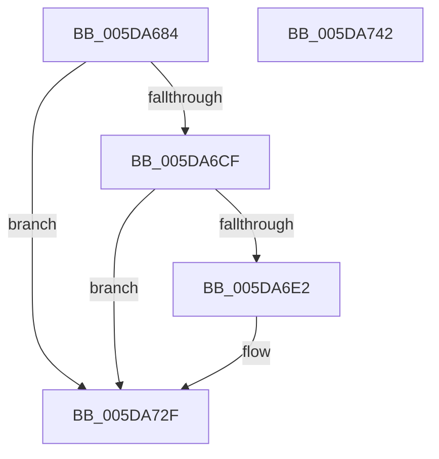

# PpmEventAutonomousModeChange

- RVA: `0x005DA684`–`0x005DA743` (길이 `191` bytes)
- VA: `0x00000001405DA684`
- 실행 섹션: `.text`
- PDB 이름 있음: `예`; PDB Function 태그: `아니요`
- unwind 정보 RVA: `0x000CD2C8`
- 디코드: `42`개 명령, `191/191` bytes 표시
- 미해석 바이트: `0` (있으면 어셈블리에 `.byte`로 보존)

> 이 문서는 커널 이미지의 기계어와 PDB 기호를 분석해 생성했습니다. 4번과 5번은 함수 원형과 자료형을 바이너리 사용 방식에서 추정한 C 해석이며 원본 소스 복구 결과는 아닙니다.

## 1. Dependencies

- 직접 호출 지점: **4**; 고유 호출 대상: **4**
- 직접 호출자로 확인된 함수: **1**
- RIP 상대 이미지 참조: **5**

### Outgoing calls
- `0x005DA6BE` → [PpmEventGetEventDescriptorAndProcessorId](../42/PpmEventGetEventDescriptorAndProcessorId_function_004281B0.md) (function, `0x004281B0`)
- `0x005DA6D9` → [EtwEventEnabled](../39/EtwEventEnabled_function_00392450.md) (function, `0x00392450`)
- `0x005DA72A` → [EtwWriteEx](../25/EtwWriteEx_function_0025F0D0.md) (function, `0x0025F0D0`)
- `0x005DA737` → [_security_check_cookie](../6A/_security_check_cookie_function_006AC640.md) (function, `0x006AC640`)

### Direct callers
- [PpmUpdateTargetProcessorPolicy](../4B/PpmUpdateTargetProcessorPolicy_function_004B1BAC.md) at `0x004B1C99`

### Static image references
- `0x005DA68D` → RVA `0x00E0A740` (`.data`; read)
- `0x005DA6B0` → RVA `0x00020DA0` (`.rdata`; read)
- `0x005DA6B7` → RVA `0x00021968` (`.rdata`; read)
- `0x005DA6C3` → RVA `0x00E67A39` (`.data`; read)
- `0x005DA6CF` → RVA `0x00F083E8` (`.data`; read)

## 2. Other-region calls and transfers

- 다른 실행 섹션으로 향하는 call: **0**
- 별도 외부 분기/꼬리 이동을 확인하지 못했습니다.

## 3. Assembly (complete function range)

```asm
005DA684  89 54 24 10                     mov dword ptr [rsp + 0x10], edx
005DA688  53                              push rbx
005DA689  48 83 EC 70                     sub rsp, 0x70
005DA68D  48 8B 05 AC 00 83 00            mov rax, qword ptr [rip + 0x8300ac]
005DA694  48 33 C4                        xor rax, rsp
005DA697  48 89 44 24 68                  mov qword ptr [rsp + 0x68], rax
005DA69C  83 64 24 40 00                  and dword ptr [rsp + 0x40], 0
005DA6A1  48 8D 44 24 48                  lea rax, [rsp + 0x48]
005DA6A6  4C 8D 4C 24 40                  lea r9, [rsp + 0x40]
005DA6AB  48 89 44 24 20                  mov qword ptr [rsp + 0x20], rax
005DA6B0  4C 8D 05 E9 66 A4 FF            lea r8, [rip - 0x5b9917]
005DA6B7  48 8D 15 AA 72 A4 FF            lea rdx, [rip - 0x5b8d56]
005DA6BE  E8 ED DA E4 FF                  call 0x1404281b0
005DA6C3  80 3D 6F D3 88 00 00            cmp byte ptr [rip + 0x88d36f], 0
005DA6CA  48 8B D8                        mov rbx, rax
005DA6CD  74 60                           je 0x1405da72f
005DA6CF  48 8B 0D 12 DD 92 00            mov rcx, qword ptr [rip + 0x92dd12]
005DA6D6  48 8B D0                        mov rdx, rax
005DA6D9  E8 72 7D DB FF                  call 0x140392450
005DA6DE  84 C0                           test al, al
005DA6E0  74 4D                           je 0x1405da72f
005DA6E2  83 64 24 64 00                  and dword ptr [rsp + 0x64], 0
005DA6E7  48 8D 84 24 88 00 00 00         lea rax, [rsp + 0x88]
005DA6EF  48 8B 0D F2 DC 92 00            mov rcx, qword ptr [rip + 0x92dcf2]
005DA6F6  45 33 C9                        xor r9d, r9d
005DA6F9  48 89 44 24 58                  mov qword ptr [rsp + 0x58], rax
005DA6FE  45 33 C0                        xor r8d, r8d
005DA701  48 8D 44 24 48                  lea rax, [rsp + 0x48]
005DA706  C7 44 24 60 04 00 00 00         mov dword ptr [rsp + 0x60], 4
005DA70E  48 89 44 24 38                  mov qword ptr [rsp + 0x38], rax
005DA713  48 8B D3                        mov rdx, rbx
005DA716  C7 44 24 30 02 00 00 00         mov dword ptr [rsp + 0x30], 2
005DA71E  48 83 64 24 28 00               and qword ptr [rsp + 0x28], 0
005DA724  48 83 64 24 20 00               and qword ptr [rsp + 0x20], 0
005DA72A  E8 A1 49 C8 FF                  call 0x14025f0d0
005DA72F  48 8B 4C 24 68                  mov rcx, qword ptr [rsp + 0x68]
005DA734  48 33 CC                        xor rcx, rsp
005DA737  E8 04 1F 0D 00                  call 0x1406ac640
005DA73C  48 83 C4 70                     add rsp, 0x70
005DA740  5B                              pop rbx
005DA741  C3                              ret
005DA742  CC                              int3
```

## 4. C-style interpretation (structured pseudocode)

```c
__int64 __fastcall PpmEventAutonomousModeChange(__int64 a1, int a2)
{
    __int64 result;
    __int64 v_rsp;
    unsigned __int64 v_stack_m10;
    unsigned int v_stack_m14;
    unsigned int v_stack_m18;
    unsigned __int64 v_stack_m20;
    unsigned __int64 v_stack_m30;
    unsigned int v_stack_m38;
    unsigned __int64 v_stack_m40;
    unsigned int v_stack_m48;
    unsigned __int64 v_stack_m50;
    unsigned __int64 v_stack_m58;
    unsigned int v_stack_p10;

    v_stack_p10 = a2;
    v_rsp = (v_rsp) - (112);
    result = (*(unsigned __int64 *)(v_rip + 8585388)) ^ (v_rsp);
    v_stack_m10 = result;
    v_stack_m58 = v_stack_m30;
    result = PpmEventGetEventDescriptorAndProcessorId(a1, v_rip - 5999958, v_rip - 6002967, v_stack_m38);
    if ((*(unsigned __int8 *)(v_rip + 8967023)) == 0) goto loc_005DA72F;
    result = EtwEventEnabled(*(unsigned __int64 *)(v_rip + 9624850), result, v_rip - 6002967, v_stack_m38);
    if ((unsigned __int8)(result) != 0) {
        result = v_stack_p10;
        a1 = *(unsigned __int64 *)(v_rip + 9624818);
        a4 = 0;
        v_stack_m20 = result;
        a3 = 0;
        result = v_stack_m30;
        v_stack_m18 = 4;
        v_stack_m40 = result;
        a2 = result;
        v_stack_m48 = 2;
        result = EtwWriteEx(a1, a2, a3, a4);
    }
    a1 = (v_stack_m10) ^ (v_rsp);
    result = _security_check_cookie(a1, a2, a3, a4);
    v_rsp = (v_rsp) + (112);
    return result;
}
```

## 5. (Beta) C Style

```c
int64_t PpmEventAutonomousModeChange(int64_t Arg1, int32_t Arg2)
{
    int64_t result;
    int64_t local_rsp;
    uint64_t v_stack_m10;
    uint32_t v_stack_m14;
    uint32_t v_stack_m18;
    uint64_t v_stack_m20;
    uint64_t v_stack_m30;
    uint32_t v_stack_m38;
    uint64_t v_stack_m40;
    uint32_t v_stack_m48;
    uint64_t v_stack_m50;
    uint64_t v_stack_m58;
    uint32_t v_stack_p10;

    v_stack_p10 = Arg2;
    local_rsp = (local_rsp) - (112);
    result = (*(uint64_t *)(v_rip + 0x8300AC)) ^ (local_rsp);
    v_stack_m10 = result;
    v_stack_m58 = v_stack_m30;
    result = PpmEventGetEventDescriptorAndProcessorId(Arg1, v_rip - 5999958, v_rip - 6002967, v_stack_m38);
    if ((*(uint8_t *)(v_rip + 0x88D36F)) == 0) goto loc_005DA72F;
    result = EtwEventEnabled(*(uint64_t *)(v_rip + 0x92DD12), result, v_rip - 6002967, v_stack_m38);
    if ((uint8_t)(result) != 0) {
        result = v_stack_p10;
        Arg1 = *(uint64_t *)(v_rip + 0x92DCF2);
        a4 = 0;
        v_stack_m20 = result;
        a3 = 0;
        result = v_stack_m30;
        v_stack_m18 = 4;
        v_stack_m40 = result;
        Arg2 = result;
        v_stack_m48 = 2;
        result = EtwWriteEx(Arg1, Arg2, a3, a4);
    }
    Arg1 = (v_stack_m10) ^ (local_rsp);
    result = _security_check_cookie(Arg1, Arg2, a3, a4);
    local_rsp = (local_rsp) + (112);
    return result;
}
```

## 6. Execution-region graph

[열기: 2D/3D 그래프와 함수 탐색 컨트롤 패널](../../../control-panel.html?section=text&rva=0x005DA684&view=graph)

- 2D 그래프는 위에서 아래로 흐르고, 3D 그래프는 빈 공간을 드래그해 회전합니다. Shift+드래그는 이동, 휠은 확대·축소, 함수 노드 선택은 대상 보고서 이동입니다.

### Static fallback


