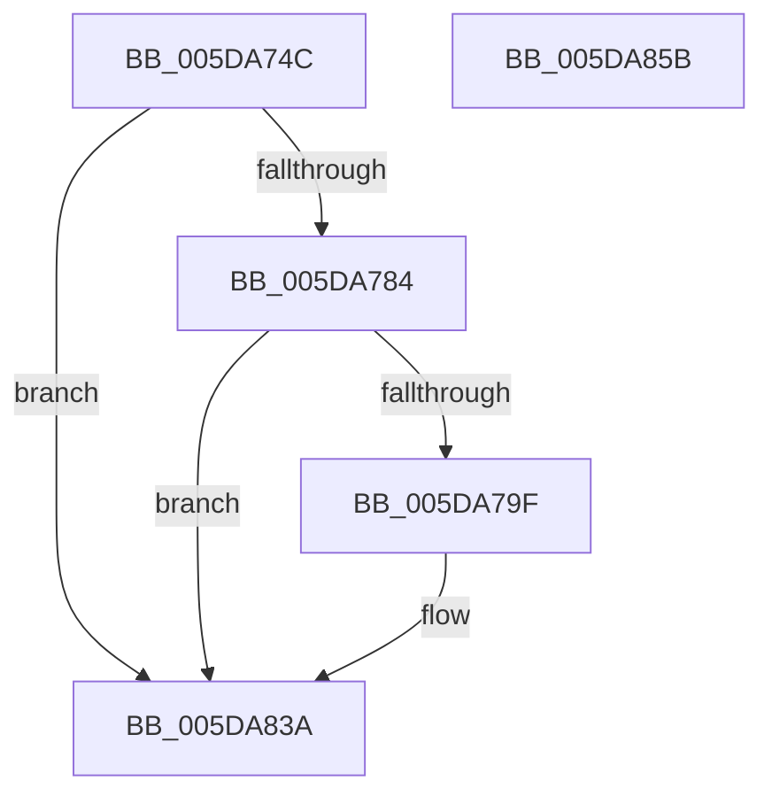

# PpmEventCoreParkingForceParkedStateChange

- RVA: `0x005DA74C`–`0x005DA85C` (길이 `272` bytes)
- VA: `0x00000001405DA74C`
- 실행 섹션: `.text`
- PDB 이름 있음: `예`; PDB Function 태그: `아니요`
- unwind 정보 RVA: `0x00078F20`
- 디코드: `60`개 명령, `272/272` bytes 표시
- 미해석 바이트: `0` (있으면 어셈블리에 `.byte`로 보존)

> 이 문서는 커널 이미지의 기계어와 PDB 기호를 분석해 생성했습니다. 4번과 5번은 함수 원형과 자료형을 바이너리 사용 방식에서 추정한 C 해석이며 원본 소스 복구 결과는 아닙니다.

## 1. Dependencies

- 직접 호출 지점: **3**; 고유 호출 대상: **3**
- 직접 호출자로 확인된 함수: **1**
- RIP 상대 이미지 참조: **5**

### Outgoing calls
- `0x005DA792` → [EtwEventEnabled](../39/EtwEventEnabled_function_00392450.md) (function, `0x00392450`)
- `0x005DA835` → [EtwWriteEx](../25/EtwWriteEx_function_0025F0D0.md) (function, `0x0025F0D0`)
- `0x005DA841` → [_security_check_cookie](../6A/_security_check_cookie_function_006AC640.md) (function, `0x006AC640`)

### Direct callers
- [PpmParkReportForceParkChange](PpmParkReportForceParkChange_function_005DBE30.md) at `0x005DBEE0`

### Static image references
- `0x005DA763` → RVA `0x00E0A740` (`.data`; read)
- `0x005DA771` → RVA `0x00E67A39` (`.data`; read)
- `0x005DA784` → RVA `0x00F083E8` (`.data`; read)
- `0x005DA78B` → RVA `0x00020EE8` (`.rdata`; read)
- `0x005DA7A3` → RVA `0x00F0B260` (`.data`; read)

## 2. Other-region calls and transfers

- 다른 실행 섹션으로 향하는 call: **0**
- 별도 외부 분기/꼬리 이동을 확인하지 못했습니다.

## 3. Assembly (complete function range)

```asm
005DA74C  48 89 5C 24 08                  mov qword ptr [rsp + 8], rbx
005DA751  48 89 7C 24 10                  mov qword ptr [rsp + 0x10], rdi
005DA756  55                              push rbp
005DA757  48 8D 6C 24 A9                  lea rbp, [rsp - 0x57]
005DA75C  48 81 EC A0 00 00 00            sub rsp, 0xa0
005DA763  48 8B 05 D6 FF 82 00            mov rax, qword ptr [rip + 0x82ffd6]
005DA76A  48 33 C4                        xor rax, rsp
005DA76D  48 89 45 47                     mov qword ptr [rbp + 0x47], rax
005DA771  80 3D C1 D2 88 00 00            cmp byte ptr [rip + 0x88d2c1], 0
005DA778  40 8A FA                        mov dil, dl
005DA77B  48 8B D9                        mov rbx, rcx
005DA77E  0F 84 B6 00 00 00               je 0x1405da83a
005DA784  48 8B 0D 5D DC 92 00            mov rcx, qword ptr [rip + 0x92dc5d]
005DA78B  48 8D 15 56 67 A4 FF            lea rdx, [rip - 0x5b98aa]
005DA792  E8 B9 7C DB FF                  call 0x140392450
005DA797  84 C0                           test al, al
005DA799  0F 84 9B 00 00 00               je 0x1405da83a
005DA79F  83 65 13 00                     and dword ptr [rbp + 0x13], 0
005DA7A3  48 8D 05 B6 0A 93 00            lea rax, [rip + 0x930ab6]
005DA7AA  83 65 23 00                     and dword ptr [rbp + 0x23], 0
005DA7AE  48 8D 15 33 67 A4 FF            lea rdx, [rip - 0x5b98cd]
005DA7B5  83 65 33 00                     and dword ptr [rbp + 0x33], 0
005DA7B9  B9 04 00 00 00                  mov ecx, 4
005DA7BE  48 89 45 07                     mov qword ptr [rbp + 7], rax
005DA7C2  0F B6 83 D0 00 00 00            movzx eax, byte ptr [rbx + 0xd0]
005DA7C9  66 89 45 F7                     mov word ptr [rbp - 9], ax
005DA7CD  48 8D 45 F7                     lea rax, [rbp - 9]
005DA7D1  48 89 45 17                     mov qword ptr [rbp + 0x17], rax
005DA7D5  48 8D 83 D1 00 00 00            lea rax, [rbx + 0xd1]
005DA7DC  48 89 45 27                     mov qword ptr [rbp + 0x27], rax
005DA7E0  33 C0                           xor eax, eax
005DA7E2  40 84 FF                        test dil, dil
005DA7E5  89 4D 3F                        mov dword ptr [rbp + 0x3f], ecx
005DA7E8  C7 45 0F 08 00 00 00            mov dword ptr [rbp + 0xf], 8
005DA7EF  0F 95 C0                        setne al
005DA7F2  C7 45 1F 02 00 00 00            mov dword ptr [rbp + 0x1f], 2
005DA7F9  83 65 43 00                     and dword ptr [rbp + 0x43], 0
005DA7FD  45 33 C9                        xor r9d, r9d
005DA800  89 45 FB                        mov dword ptr [rbp - 5], eax
005DA803  45 33 C0                        xor r8d, r8d
005DA806  48 8D 45 FB                     lea rax, [rbp - 5]
005DA80A  C7 45 2F 01 00 00 00            mov dword ptr [rbp + 0x2f], 1
005DA811  48 89 45 37                     mov qword ptr [rbp + 0x37], rax
005DA815  48 8D 45 07                     lea rax, [rbp + 7]
005DA819  48 89 44 24 38                  mov qword ptr [rsp + 0x38], rax
005DA81E  89 4C 24 30                     mov dword ptr [rsp + 0x30], ecx
005DA822  48 83 64 24 28 00               and qword ptr [rsp + 0x28], 0
005DA828  48 83 64 24 20 00               and qword ptr [rsp + 0x20], 0
005DA82E  48 8B 0D B3 DB 92 00            mov rcx, qword ptr [rip + 0x92dbb3]
005DA835  E8 96 48 C8 FF                  call 0x14025f0d0
005DA83A  48 8B 4D 47                     mov rcx, qword ptr [rbp + 0x47]
005DA83E  48 33 CC                        xor rcx, rsp
005DA841  E8 FA 1D 0D 00                  call 0x1406ac640
005DA846  4C 8D 9C 24 A0 00 00 00         lea r11, [rsp + 0xa0]
005DA84E  49 8B 5B 10                     mov rbx, qword ptr [r11 + 0x10]
005DA852  49 8B 7B 18                     mov rdi, qword ptr [r11 + 0x18]
005DA856  49 8B E3                        mov rsp, r11
005DA859  5D                              pop rbp
005DA85A  C3                              ret
005DA85B  CC                              int3
```

## 4. C-style interpretation (structured pseudocode)

```c
__int64 __fastcall PpmEventCoreParkingForceParkedStateChange(__int64 a1, unsigned __int8 a2, int a3, int a4)
{
    __int64 result;
    __int64 v_rsp;
    unsigned __int64 v_stack_m18;
    unsigned int v_stack_m1C;
    unsigned int v_stack_m20;
    unsigned __int64 v_stack_m28;
    unsigned int v_stack_m2C;
    unsigned int v_stack_m30;
    unsigned __int64 v_stack_m38;
    unsigned int v_stack_m3C;
    unsigned int v_stack_m40;
    unsigned __int64 v_stack_m48;
    unsigned int v_stack_m4C;
    unsigned int v_stack_m50;
    unsigned __int64 v_stack_m58;
    unsigned __int64 v_stack_m5F;
    unsigned int v_stack_m64;
    unsigned __int16 v_stack_m68;
    unsigned __int64 v_stack_m70;
    unsigned int v_stack_m78;
    unsigned __int64 v_stack_m8;
    unsigned __int64 v_stack_m80;
    unsigned __int64 v_stack_m88;
    unsigned __int64 v_stack_p10;
    unsigned __int64 v_stack_p8;

    v_stack_p8 = v_rbx;
    v_stack_p10 = v_rdi;
    v_rsp = (v_rsp) - (160);
    result = (*(unsigned __int64 *)(v_rip + 8585174)) ^ (v_rsp);
    v_stack_m18 = result;
    if ((*(unsigned __int8 *)(v_rip + 8966849)) == 0) goto loc_005DA83A;
    result = EtwEventEnabled(*(unsigned __int64 *)(v_rip + 9624669), v_rip - 6002858, a3, a4);
    if ((unsigned __int8)(result) != 0) {
        result = v_rip + 9636534;
        a2 = v_rip - 6002893;
        a1 = 4;
        v_stack_m58 = result;
        result = *(unsigned __int8 *)(a1 + 208);
        v_stack_m68 = (unsigned __int16)(result);
        result = v_stack_m68;
        v_stack_m48 = result;
        result = a1 + 209;
        v_stack_m38 = result;
        result = 0;
        v_stack_m20 = (unsigned int)(a1);
        v_stack_m50 = 8;
        result = (a2 != 0) ? 1 : 0;
        v_stack_m40 = 2;
        a4 = 0;
        v_stack_m64 = (unsigned int)(result);
        a3 = 0;
        result = v_stack_m64;
        v_stack_m30 = 1;
        v_stack_m28 = result;
        result = v_stack_m58;
        v_stack_m70 = result;
        v_stack_m78 = (unsigned int)(a1);
        a1 = *(unsigned __int64 *)(v_rip + 9624499);
        result = EtwWriteEx(a1, a2, a3, a4);
    }
    a1 = (v_stack_m18) ^ (v_rsp);
    result = _security_check_cookie(a1, a2, a3, a4);
    return result;
}
```

## 5. (Beta) C Style

```c
int64_t PpmEventCoreParkingForceParkedStateChange(void *Arg1, uint8_t Arg2, int32_t Arg3, int32_t Arg4)
{
    uint8_t *arg1 = (uint8_t *)Arg1;

    int64_t result;
    int64_t local_rsp;
    uint64_t v_stack_m18;
    uint32_t v_stack_m1C;
    uint32_t v_stack_m20;
    uint64_t v_stack_m28;
    uint32_t v_stack_m2C;
    uint32_t v_stack_m30;
    uint64_t v_stack_m38;
    uint32_t v_stack_m3C;
    uint32_t v_stack_m40;
    uint64_t v_stack_m48;
    uint32_t v_stack_m4C;
    uint32_t v_stack_m50;
    uint64_t v_stack_m58;
    uint64_t v_stack_m5F;
    uint32_t v_stack_m64;
    uint16_t v_stack_m68;
    uint64_t v_stack_m70;
    uint32_t v_stack_m78;
    uint64_t v_stack_m8;
    uint64_t v_stack_m80;
    uint64_t v_stack_m88;
    uint64_t v_stack_p10;
    uint64_t v_stack_p8;

    v_stack_p8 = local_rbx;
    v_stack_p10 = local_rdi;
    local_rsp = (local_rsp) - (160);
    result = (*(uint64_t *)(v_rip + 0x82FFD6)) ^ (local_rsp);
    v_stack_m18 = result;
    if ((*(uint8_t *)(v_rip + 0x88D2C1)) == 0) goto loc_005DA83A;
    result = EtwEventEnabled(*(uint64_t *)(v_rip + 0x92DC5D), v_rip - 6002858, Arg3, Arg4);
    if ((uint8_t)(result) != 0) {
        result = v_rip + 9636534;
        Arg2 = v_rip - 6002893;
        Arg1 = 4;
        v_stack_m58 = result;
        result = *(uint8_t *)(arg1 + 0xD0);
        v_stack_m68 = (uint16_t)(result);
        result = v_stack_m68;
        v_stack_m48 = result;
        result = Arg1 + 209;
        v_stack_m38 = result;
        result = 0;
        v_stack_m20 = (uint32_t)(Arg1);
        v_stack_m50 = 8;
        result = (Arg2 != 0) ? 1 : 0;
        v_stack_m40 = 2;
        Arg4 = 0;
        v_stack_m64 = (uint32_t)(result);
        Arg3 = 0;
        result = v_stack_m64;
        v_stack_m30 = 1;
        v_stack_m28 = result;
        result = v_stack_m58;
        v_stack_m70 = result;
        v_stack_m78 = (uint32_t)(Arg1);
        Arg1 = *(uint64_t *)(v_rip + 0x92DBB3);
        result = EtwWriteEx(Arg1, Arg2, Arg3, Arg4);
    }
    Arg1 = (v_stack_m18) ^ (local_rsp);
    result = _security_check_cookie(Arg1, Arg2, Arg3, Arg4);
    return result;
}
```

### 관측된 메모리 오프셋

구조체 형식이 확인되지 않은 접근은 인자 기준의 오프셋으로만 기록했습니다.

| 기준 인자 | 오프셋 표현 | 폭 (bit) | 접근 |
|---|---:|---:|---|
| `Arg1` | `+ 0xD0` | `8` | `R` |
| `Arg1` | `+ 0xD1` | `64` | `R` |

## 6. Execution-region graph

[열기: 2D/3D 그래프와 함수 탐색 컨트롤 패널](../../../control-panel.html?section=text&rva=0x005DA74C&view=graph)

- 2D 그래프는 위에서 아래로 흐르고, 3D 그래프는 빈 공간을 드래그해 회전합니다. Shift+드래그는 이동, 휠은 확대·축소, 함수 노드 선택은 대상 보고서 이동입니다.

### Static fallback


