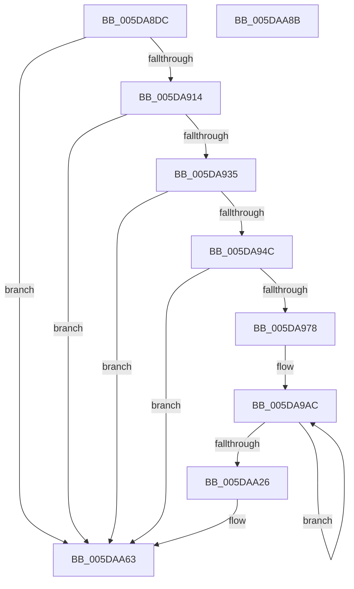

# PpmEventHgsContainmentGroupInfo

- RVA: `0x005DA8DC`–`0x005DAA8C` (길이 `432` bytes)
- VA: `0x00000001405DA8DC`
- 실행 섹션: `.text`
- PDB 이름 있음: `예`; PDB Function 태그: `아니요`
- unwind 정보 RVA: `0x000CD27C`
- 디코드: `102`개 명령, `432/432` bytes 표시
- 미해석 바이트: `0` (있으면 어셈블리에 `.byte`로 보존)

> 이 문서는 커널 이미지의 기계어와 PDB 기호를 분석해 생성했습니다. 4번과 5번은 함수 원형과 자료형을 바이너리 사용 방식에서 추정한 C 해석이며 원본 소스 복구 결과는 아닙니다.

## 1. Dependencies

- 직접 호출 지점: **5**; 고유 호출 대상: **5**
- 직접 호출자로 확인된 함수: **2**
- RIP 상대 이미지 참조: **6**

### Outgoing calls
- `0x005DA93F` → [EtwEventEnabled](../39/EtwEventEnabled_function_00392450.md) (function, `0x00392450`)
- `0x005DA967` → [ExAllocatePool2](../../poolcode/B8/ExAllocatePool2_function_00B820F0.md) (function, `0x00B820F0`)
- `0x005DAA51` → [EtwWriteEx](../25/EtwWriteEx_function_0025F0D0.md) (function, `0x0025F0D0`)
- `0x005DAA5E` → [ExFreePoolWithTag](../../poolcode/B8/ExFreePoolWithTag_function_00B82870.md) (function, `0x00B82870`)
- `0x005DAA6E` → [_security_check_cookie](../6A/_security_check_cookie_function_006AC640.md) (function, `0x006AC640`)

### Direct callers
- [PpmHeteroHgsRegisterContainmentGroups](PpmHeteroHgsRegisterContainmentGroups_function_005D8D14.md) at `0x005D8F47`
- [PpmEventTraceControlCallback](../../page/A5/PpmEventTraceControlCallback_function_00A51F60.md) at `0x00A5216A`

### Static image references
- `0x005DA8F1` → RVA `0x00E0A740` (`.data`; read)
- `0x005DA903` → RVA `0x00FC501C` (`ALMOSTRO`; read)
- `0x005DA916` → RVA `0x00022B28` (`.rdata`; read)
- `0x005DA91D` → RVA `0x000233A8` (`.rdata`; read)
- `0x005DA928` → RVA `0x00E67A39` (`.data`; read)
- `0x005DA935` → RVA `0x00F083E8` (`.data`; read)

## 2. Other-region calls and transfers

- 다른 실행 섹션으로 향하는 call: **2**
  - `0x005DA967` → [ExAllocatePool2](../../poolcode/B8/ExAllocatePool2_function_00B820F0.md) (`.text` → `POOLCODE`)
  - `0x005DAA5E` → [ExFreePoolWithTag](../../poolcode/B8/ExFreePoolWithTag_function_00B82870.md) (`.text` → `POOLCODE`)
- 별도 외부 분기/꼬리 이동을 확인하지 못했습니다.

## 3. Assembly (complete function range)

```asm
005DA8DC  48 89 5C 24 10                  mov qword ptr [rsp + 0x10], rbx
005DA8E1  48 89 6C 24 18                  mov qword ptr [rsp + 0x18], rbp
005DA8E6  56                              push rsi
005DA8E7  57                              push rdi
005DA8E8  41 56                           push r14
005DA8EA  48 81 EC 00 01 00 00            sub rsp, 0x100
005DA8F1  48 8B 05 48 FE 82 00            mov rax, qword ptr [rip + 0x82fe48]
005DA8F8  48 33 C4                        xor rax, rsp
005DA8FB  48 89 84 24 F0 00 00 00         mov qword ptr [rsp + 0xf0], rax
005DA903  8B 05 13 A7 9E 00               mov eax, dword ptr [rip + 0x9ea713]
005DA909  48 8B F1                        mov rsi, rcx
005DA90C  A8 04                           test al, 4
005DA90E  0F 84 4F 01 00 00               je 0x1405daa63
005DA914  84 D2                           test dl, dl
005DA916  48 8D 05 0B 82 A4 FF            lea rax, [rip - 0x5b7df5]
005DA91D  48 8D 1D 84 8A A4 FF            lea rbx, [rip - 0x5b757c]
005DA924  48 0F 44 D8                     cmove rbx, rax
005DA928  80 3D 0A D1 88 00 00            cmp byte ptr [rip + 0x88d10a], 0
005DA92F  0F 84 2E 01 00 00               je 0x1405daa63
005DA935  48 8B 0D AC DA 92 00            mov rcx, qword ptr [rip + 0x92daac]
005DA93C  48 8B D3                        mov rdx, rbx
005DA93F  E8 0C 7B DB FF                  call 0x140392450
005DA944  84 C0                           test al, al
005DA946  0F 84 17 01 00 00               je 0x1405daa63
005DA94C  48 8B B6 00 05 00 00            mov rsi, qword ptr [rsi + 0x500]
005DA953  B9 40 00 00 00                  mov ecx, 0x40
005DA958  41 B8 50 50 4D 65               mov r8d, 0x654d5050
005DA95E  8B 06                           mov eax, dword ptr [rsi]
005DA960  6B D0 0D                        imul edx, eax, 0xd
005DA963  89 44 24 40                     mov dword ptr [rsp + 0x40], eax
005DA967  E8 84 77 5A 00                  call 0x140b820f0
005DA96C  48 8B F8                        mov rdi, rax
005DA96F  48 85 C0                        test rax, rax
005DA972  0F 84 EB 00 00 00               je 0x1405daa63
005DA978  83 64 24 5C 00                  and dword ptr [rsp + 0x5c], 0
005DA97D  48 8D 44 24 40                  lea rax, [rsp + 0x40]
005DA982  BA 01 00 00 00                  mov edx, 1
005DA987  48 89 44 24 50                  mov qword ptr [rsp + 0x50], rax
005DA98C  45 33 DB                        xor r11d, r11d
005DA98F  C7 44 24 58 04 00 00 00         mov dword ptr [rsp + 0x58], 4
005DA997  4C 8D 47 05                     lea r8, [rdi + 5]
005DA99B  44 8B CA                        mov r9d, edx
005DA99E  4C 8D 76 18                     lea r14, [rsi + 0x18]
005DA9A2  4D 8B D0                        mov r10, r8
005DA9A5  8D 6A 02                        lea ebp, [rdx + 2]
005DA9A8  48 83 C6 08                     add rsi, 8
005DA9AC  45 89 58 FB                     mov dword ptr [r8 - 5], r11d
005DA9B0  49 8D 42 FB                     lea rax, [r10 - 5]
005DA9B4  41 8B C9                        mov ecx, r9d
005DA9B7  44 03 DA                        add r11d, edx
005DA9BA  48 03 C9                        add rcx, rcx
005DA9BD  41 83 C1 03                     add r9d, 3
005DA9C1  83 64 CC 5C 00                  and dword ptr [rsp + rcx*8 + 0x5c], 0
005DA9C6  48 89 44 CC 50                  mov qword ptr [rsp + rcx*8 + 0x50], rax
005DA9CB  89 54 CC 58                     mov dword ptr [rsp + rcx*8 + 0x58], edx
005DA9CF  8D 4D FF                        lea ecx, [rbp - 1]
005DA9D2  8A 06                           mov al, byte ptr [rsi]
005DA9D4  48 03 C9                        add rcx, rcx
005DA9D7  41 88 40 FF                     mov byte ptr [r8 - 1], al
005DA9DB  48 8D 76 02                     lea rsi, [rsi + 2]
005DA9DF  49 8D 42 FF                     lea rax, [r10 - 1]
005DA9E3  83 64 CC 5C 00                  and dword ptr [rsp + rcx*8 + 0x5c], 0
005DA9E8  48 89 44 CC 50                  mov qword ptr [rsp + rcx*8 + 0x50], rax
005DA9ED  89 54 CC 58                     mov dword ptr [rsp + rcx*8 + 0x58], edx
005DA9F1  49 8B 06                        mov rax, qword ptr [r14]
005DA9F4  4D 8D B6 08 01 00 00            lea r14, [r14 + 0x108]
005DA9FB  49 89 00                        mov qword ptr [r8], rax
005DA9FE  4D 8D 40 0D                     lea r8, [r8 + 0xd]
005DAA02  8B C5                           mov eax, ebp
005DAA04  83 C5 03                        add ebp, 3
005DAA07  48 03 C0                        add rax, rax
005DAA0A  83 64 C4 5C 00                  and dword ptr [rsp + rax*8 + 0x5c], 0
005DAA0F  4C 89 54 C4 50                  mov qword ptr [rsp + rax*8 + 0x50], r10
005DAA14  49 83 C2 0D                     add r10, 0xd
005DAA18  C7 44 C4 58 08 00 00 00         mov dword ptr [rsp + rax*8 + 0x58], 8
005DAA20  41 83 FB 03                     cmp r11d, 3
005DAA24  7C 86                           jl 0x1405da9ac
005DAA26  48 8B 0D BB D9 92 00            mov rcx, qword ptr [rip + 0x92d9bb]
005DAA2D  48 8D 44 24 50                  lea rax, [rsp + 0x50]
005DAA32  48 89 44 24 38                  mov qword ptr [rsp + 0x38], rax
005DAA37  45 33 C0                        xor r8d, r8d
005DAA3A  44 89 4C 24 30                  mov dword ptr [rsp + 0x30], r9d
005DAA3F  48 8B D3                        mov rdx, rbx
005DAA42  48 83 64 24 28 00               and qword ptr [rsp + 0x28], 0
005DAA48  45 33 C9                        xor r9d, r9d
005DAA4B  48 83 64 24 20 00               and qword ptr [rsp + 0x20], 0
005DAA51  E8 7A 46 C8 FF                  call 0x14025f0d0
005DAA56  BA 50 50 4D 65                  mov edx, 0x654d5050
005DAA5B  48 8B CF                        mov rcx, rdi
005DAA5E  E8 0D 7E 5A 00                  call 0x140b82870
005DAA63  48 8B 8C 24 F0 00 00 00         mov rcx, qword ptr [rsp + 0xf0]
005DAA6B  48 33 CC                        xor rcx, rsp
005DAA6E  E8 CD 1B 0D 00                  call 0x1406ac640
005DAA73  4C 8D 9C 24 00 01 00 00         lea r11, [rsp + 0x100]
005DAA7B  49 8B 5B 28                     mov rbx, qword ptr [r11 + 0x28]
005DAA7F  49 8B 6B 30                     mov rbp, qword ptr [r11 + 0x30]
005DAA83  49 8B E3                        mov rsp, r11
005DAA86  41 5E                           pop r14
005DAA88  5F                              pop rdi
005DAA89  5E                              pop rsi
005DAA8A  C3                              ret
005DAA8B  CC                              int3
```

## 4. C-style interpretation (structured pseudocode)

```c
__int64 __fastcall PpmEventHgsContainmentGroupInfo(__int64 a1, unsigned __int8 a2)
{
    __int64 result;
    __int64 v_r10;
    __int64 v_r11;
    __int64 v_rbp;
    __int64 v_rbx;
    __int64 v_rsi;
    __int64 v_rsp;
    unsigned __int64 v_stack_m18;
    unsigned __int64 v_stack_m28;
    unsigned int v_stack_mBC;
    unsigned int v_stack_mC0;
    unsigned __int64 v_stack_mC8;
    unsigned int v_stack_mD8;
    unsigned __int64 v_stack_mE0;
    unsigned int v_stack_mE8;
    unsigned __int64 v_stack_mF0;
    unsigned __int64 v_stack_mF8;
    unsigned __int64 v_stack_p10;
    unsigned __int64 v_stack_p18;

    v_stack_p10 = v_rbx;
    v_stack_p18 = v_rbp;
    v_rsp = (v_rsp) - (256);
    result = (*(unsigned __int64 *)(v_rip + 8584776)) ^ (v_rsp);
    v_stack_m28 = result;
    if ((((unsigned __int8)((unsigned int)(*(unsigned int *)(v_rip + 10397459)))) & (4)) == 0) goto loc_005DAA63;
    v_rbx = v_rip - 5993852;
    if (a2 == 0) { v_rbx = v_rip - 5996021; }
    if ((*(unsigned __int8 *)(v_rip + 8966410)) == 0) goto loc_005DAA63;
    result = EtwEventEnabled(*(unsigned __int64 *)(v_rip + 9624236), v_rbx, a3, a4);
    if ((unsigned __int8)(result) == 0) goto loc_005DAA63;
    a2 = (unsigned int)((v_rbx) * ((unsigned int)((unsigned int)(*(unsigned int *)(*(unsigned __int64 *)(a1 + 1280))))));
    v_stack_mD8 = (unsigned int)((unsigned int)(*(unsigned int *)(*(unsigned __int64 *)(a1 + 1280))));
    result = ExAllocatePool2(64, a2, (unsigned int)(0x654D5050ULL), a4);
    if (result == 0) goto loc_005DAA63;
    v_stack_mC8 = v_stack_mD8;
    v_r11 = 0;
    v_stack_mC0 = 4;
    v_rsi = (*(unsigned __int64 *)(a1 + 1280)) + (8);
loc_005DA9AC:
    *(unsigned int *)(result + 5 - 5) = 0;
    v_r11 = (unsigned int)((v_r11) + (1));
    a1 = (1) + (1);
    a4 = (unsigned int)((1) + (3));
    *(unsigned __int64 *)(v_rsp + a1 * 8 + 80) = result + 5 - 5;
    *(unsigned int *)(v_rsp + a1 * 8 + 88) = 1;
    a1 = (1 + 2 - 1) + (1 + 2 - 1);
    *(unsigned __int8 *)(result + 5 - 1) = (unsigned __int8)(*(unsigned __int8 *)(v_rsi));
    *(unsigned __int64 *)(v_rsp + a1 * 8 + 80) = result + 5 - 1;
    *(unsigned int *)(v_rsp + a1 * 8 + 88) = 1;
    *(unsigned __int64 *)(result + 5) = *(unsigned __int64 *)(*(unsigned __int64 *)(a1 + 1280) + 24);
    v_rbp = (unsigned int)((1 + 2) + (3));
    result = ((unsigned int)((unsigned int)(1 + 2))) + ((unsigned int)((unsigned int)(1 + 2)));
    *(unsigned __int64 *)(v_rsp + result * 8 + 80) = result + 5;
    v_r10 = (result + 5) + (13);
    *(unsigned int *)(v_rsp + result * 8 + 88) = 8;
    if (((unsigned int)(v_r11)) < 3) goto loc_005DA9AC;
    v_stack_mE0 = v_stack_mC8;
    a3 = 0;
    v_stack_mE8 = (unsigned int)(a4);
    a4 = 0;
    result = EtwWriteEx(*(unsigned __int64 *)(v_rip + 9623995), v_rbx, a3, a4);
    result = ExFreePoolWithTag(result, (unsigned int)(0x654D5050ULL), a3, a4);
loc_005DAA63:
    a1 = (v_stack_m28) ^ (v_rsp);
    result = _security_check_cookie(a1, (unsigned int)(0x654D5050ULL), a3, a4);
    return result;
}
```

## 5. (Beta) C Style

```c
int64_t PpmEventHgsContainmentGroupInfo(void *Arg1, uint8_t Arg2)
{
    uint8_t *arg1 = (uint8_t *)Arg1;

    int64_t result;
    int64_t local_r10;
    int64_t local_r11;
    int64_t local_rbp;
    int64_t local_rbx;
    int64_t local_rsi;
    int64_t local_rsp;
    uint64_t v_stack_m18;
    uint64_t v_stack_m28;
    uint32_t v_stack_mBC;
    uint32_t v_stack_mC0;
    uint64_t v_stack_mC8;
    uint32_t v_stack_mD8;
    uint64_t v_stack_mE0;
    uint32_t v_stack_mE8;
    uint64_t v_stack_mF0;
    uint64_t v_stack_mF8;
    uint64_t v_stack_p10;
    uint64_t v_stack_p18;

    v_stack_p10 = local_rbx;
    v_stack_p18 = local_rbp;
    local_rsp = (local_rsp) - (256);
    result = (*(uint64_t *)(v_rip + 0x82FE48)) ^ (local_rsp);
    v_stack_m28 = result;
    if ((((uint8_t)((uint32_t)(*(uint32_t *)(v_rip + 0x9EA713)))) & (4)) == 0) goto loc_005DAA63;
    local_rbx = v_rip - 5993852;
    if (Arg2 == 0) { local_rbx = v_rip - 5996021; }
    if ((*(uint8_t *)(v_rip + 0x88D10A)) == 0) goto loc_005DAA63;
    result = EtwEventEnabled(*(uint64_t *)(v_rip + 0x92DAAC), local_rbx, a3, a4);
    if ((uint8_t)(result) == 0) goto loc_005DAA63;
    Arg2 = (uint32_t)((local_rbx) * ((uint32_t)((uint32_t)(*(uint32_t *)(*(uint64_t *)(arg1 + 0x500))))));
    v_stack_mD8 = (uint32_t)((uint32_t)(*(uint32_t *)(*(uint64_t *)(arg1 + 0x500))));
    result = ExAllocatePool2(64, Arg2, (uint32_t)(0x654D5050ULL), a4);
    if (result == 0) goto loc_005DAA63;
    v_stack_mC8 = v_stack_mD8;
    local_r11 = 0;
    v_stack_mC0 = 4;
    local_rsi = (*(uint64_t *)(arg1 + 0x500)) + (8);
loc_005DA9AC:
    *(uint32_t *)(result + 0x5 - 0x5) = 0;
    local_r11 = (uint32_t)((local_r11) + (1));
    Arg1 = (1) + (1);
    a4 = (uint32_t)((1) + (3));
    *(uint64_t *)(local_rsp + arg1 * 8 + 0x50) = result + 5 - 5;
    *(uint32_t *)(local_rsp + arg1 * 8 + 0x58) = 1;
    Arg1 = (1 + 2 - 1) + (1 + 2 - 1);
    *(uint8_t *)(result + 0x5 - 0x1) = (uint8_t)(*(uint8_t *)(local_rsi));
    *(uint64_t *)(local_rsp + arg1 * 8 + 0x50) = result + 5 - 1;
    *(uint32_t *)(local_rsp + arg1 * 8 + 0x58) = 1;
    *(uint64_t *)(result + 0x5) = *(uint64_t *)(*(uint64_t *)(arg1 + 0x500) + 0x18);
    local_rbp = (uint32_t)((1 + 2) + (3));
    result = ((uint32_t)((uint32_t)(1 + 2))) + ((uint32_t)((uint32_t)(1 + 2)));
    *(uint64_t *)(local_rsp + result * 8 + 0x50) = result + 5;
    local_r10 = (result + 5) + (13);
    *(uint32_t *)(local_rsp + result * 8 + 0x58) = 8;
    if (((uint32_t)(local_r11)) < 3) goto loc_005DA9AC;
    v_stack_mE0 = v_stack_mC8;
    a3 = 0;
    v_stack_mE8 = (uint32_t)(a4);
    a4 = 0;
    result = EtwWriteEx(*(uint64_t *)(v_rip + 0x92D9BB), local_rbx, a3, a4);
    result = ExFreePoolWithTag(result, (uint32_t)(0x654D5050ULL), a3, a4);
loc_005DAA63:
    Arg1 = (v_stack_m28) ^ (local_rsp);
    result = _security_check_cookie(Arg1, (uint32_t)(0x654D5050ULL), a3, a4);
    return result;
}
```

### 관측된 메모리 오프셋

구조체 형식이 확인되지 않은 접근은 인자 기준의 오프셋으로만 기록했습니다.

| 기준 인자 | 오프셋 표현 | 폭 (bit) | 접근 |
|---|---:|---:|---|
| `Arg1` | `+ 0x500` | `64` | `R` |

## 6. Execution-region graph

[열기: 2D/3D 그래프와 함수 탐색 컨트롤 패널](../../../control-panel.html?section=text&rva=0x005DA8DC&view=graph)

- 2D 그래프는 위에서 아래로 흐르고, 3D 그래프는 빈 공간을 드래그해 회전합니다. Shift+드래그는 이동, 휠은 확대·축소, 함수 노드 선택은 대상 보고서 이동입니다.

### Static fallback


