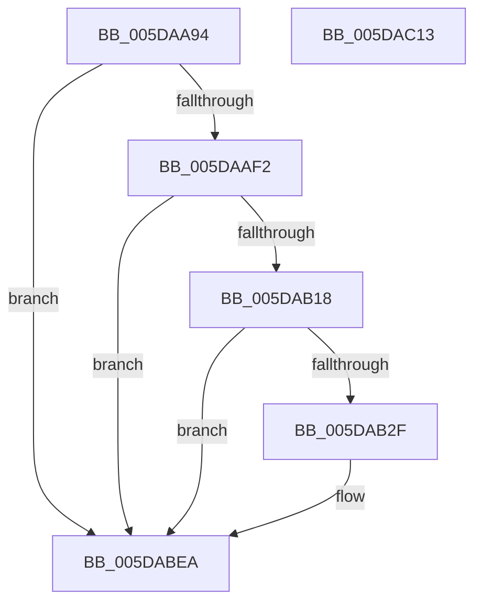

# PpmEventHgsContainmentPolicyChange

- RVA: `0x005DAA94`–`0x005DAC14` (길이 `384` bytes)
- VA: `0x00000001405DAA94`
- 실행 섹션: `.text`
- PDB 이름 있음: `예`; PDB Function 태그: `아니요`
- unwind 정보 RVA: `0x000CD2A0`
- 디코드: `94`개 명령, `384/384` bytes 표시
- 미해석 바이트: `0` (있으면 어셈블리에 `.byte`로 보존)

> 이 문서는 커널 이미지의 기계어와 PDB 기호를 분석해 생성했습니다. 4번과 5번은 함수 원형과 자료형을 바이너리 사용 방식에서 추정한 C 해석이며 원본 소스 복구 결과는 아닙니다.

## 1. Dependencies

- 직접 호출 지점: **3**; 고유 호출 대상: **3**
- 직접 호출자로 확인된 함수: **2**
- RIP 상대 이미지 참조: **10**

### Outgoing calls
- `0x005DAB22` → [EtwEventEnabled](../39/EtwEventEnabled_function_00392450.md) (function, `0x00392450`)
- `0x005DABE5` → [EtwWriteEx](../25/EtwWriteEx_function_0025F0D0.md) (function, `0x0025F0D0`)
- `0x005DABF1` → [_security_check_cookie](../6A/_security_check_cookie_function_006AC640.md) (function, `0x006AC640`)

### Direct callers
- [PpmHeteroHgsEvaluateContainmentDecision](../4F/PpmHeteroHgsEvaluateContainmentDecision_function_004FBDE4.md) at `0x004FBE6C`
- [PpmEventTraceControlCallback](../../page/A5/PpmEventTraceControlCallback_function_00A51F60.md) at `0x00A521A4`

### Static image references
- `0x005DAAB3` → RVA `0x00E0A740` (`.data`; read)
- `0x005DAAC1` → RVA `0x00F0B24C` (`.data`; read)
- `0x005DAACD` → RVA `0x00F0E0F0` (`.data`; read)
- `0x005DAADA` → RVA `0x00FC5038` (`ALMOSTRO`; read)
- `0x005DAAE3` → RVA `0x00FC501C` (`ALMOSTRO`; read)
- `0x005DAAF5` → RVA `0x00021230` (`.rdata`; read)
- `0x005DAB00` → RVA `0x00021F28` (`.rdata`; read)
- `0x005DAB0B` → RVA `0x00E67A39` (`.data`; read)
- `0x005DAB18` → RVA `0x00F083E8` (`.data`; read)
- `0x005DABB7` → RVA `0x00FC5188` (`ALMOSTRO`; read)

## 2. Other-region calls and transfers

- 다른 실행 섹션으로 향하는 call: **0**
- 별도 외부 분기/꼬리 이동을 확인하지 못했습니다.

## 3. Assembly (complete function range)

```asm
005DAA94  48 8B C4                        mov rax, rsp
005DAA97  48 89 58 08                     mov qword ptr [rax + 8], rbx
005DAA9B  48 89 70 10                     mov qword ptr [rax + 0x10], rsi
005DAA9F  48 89 78 18                     mov qword ptr [rax + 0x18], rdi
005DAAA3  55                              push rbp
005DAAA4  41 56                           push r14
005DAAA6  41 57                           push r15
005DAAA8  48 8D 68 B1                     lea rbp, [rax - 0x4f]
005DAAAC  48 81 EC F0 00 00 00            sub rsp, 0xf0
005DAAB3  48 8B 05 86 FC 82 00            mov rax, qword ptr [rip + 0x82fc86]
005DAABA  48 33 C4                        xor rax, rsp
005DAABD  48 89 45 27                     mov qword ptr [rbp + 0x27], rax
005DAAC1  8B 05 85 07 93 00               mov eax, dword ptr [rip + 0x930785]
005DAAC7  41 BF 04 00 00 00               mov r15d, 4
005DAACD  40 8A 35 1C 36 93 00            mov sil, byte ptr [rip + 0x93361c]
005DAAD4  41 8A F9                        mov dil, r9b
005DAAD7  89 45 9F                        mov dword ptr [rbp - 0x61], eax
005DAADA  8B 05 58 A5 9E 00               mov eax, dword ptr [rip + 0x9ea558]
005DAAE0  89 45 8F                        mov dword ptr [rbp - 0x71], eax
005DAAE3  8B 05 33 A5 9E 00               mov eax, dword ptr [rip + 0x9ea533]
005DAAE9  41 84 C7                        test r15b, al
005DAAEC  0F 84 F8 00 00 00               je 0x1405dabea
005DAAF2  45 33 F6                        xor r14d, r14d
005DAAF5  48 8D 05 34 67 A4 FF            lea rax, [rip - 0x5b98cc]
005DAAFC  44 38 75 7F                     cmp byte ptr [rbp + 0x7f], r14b
005DAB00  48 8D 1D 21 74 A4 FF            lea rbx, [rip - 0x5b8bdf]
005DAB07  48 0F 44 D8                     cmove rbx, rax
005DAB0B  44 38 35 27 CF 88 00            cmp byte ptr [rip + 0x88cf27], r14b
005DAB12  0F 84 D2 00 00 00               je 0x1405dabea
005DAB18  48 8B 0D C9 D8 92 00            mov rcx, qword ptr [rip + 0x92d8c9]
005DAB1F  48 8B D3                        mov rdx, rbx
005DAB22  E8 29 79 DB FF                  call 0x140392450
005DAB27  84 C0                           test al, al
005DAB29  0F 84 BB 00 00 00               je 0x1405dabea
005DAB2F  48 8B 0D B2 D8 92 00            mov rcx, qword ptr [rip + 0x92d8b2]
005DAB36  40 84 F6                        test sil, sil
005DAB39  41 8B C6                        mov eax, r14d
005DAB3C  4C 89 7D BF                     mov qword ptr [rbp - 0x41], r15
005DAB40  0F 95 C0                        setne al
005DAB43  4C 89 7D CF                     mov qword ptr [rbp - 0x31], r15
005DAB47  89 45 97                        mov dword ptr [rbp - 0x69], eax
005DAB4A  40 84 FF                        test dil, dil
005DAB4D  41 8B C6                        mov eax, r14d
005DAB50  4C 89 7D DF                     mov qword ptr [rbp - 0x21], r15
005DAB54  0F 95 C0                        setne al
005DAB57  4C 89 7D EF                     mov qword ptr [rbp - 0x11], r15
005DAB5B  89 45 A7                        mov dword ptr [rbp - 0x59], eax
005DAB5E  48 8B D3                        mov rdx, rbx
005DAB61  8B 05 B5 A4 9E 00               mov eax, dword ptr [rip + 0x9ea4b5]
005DAB67  C1 E8 03                        shr eax, 3
005DAB6A  83 E0 01                        and eax, 1
005DAB6D  4C 89 7D FF                     mov qword ptr [rbp - 1], r15
005DAB71  44 38 75 77                     cmp byte ptr [rbp + 0x77], r14b
005DAB75  89 45 87                        mov dword ptr [rbp - 0x79], eax
005DAB78  41 8B C6                        mov eax, r14d
005DAB7B  0F 95 C0                        setne al
005DAB7E  4C 89 7D 0F                     mov qword ptr [rbp + 0xf], r15
005DAB82  89 45 AB                        mov dword ptr [rbp - 0x55], eax
005DAB85  45 33 C9                        xor r9d, r9d
005DAB88  48 8D 45 87                     lea rax, [rbp - 0x79]
005DAB8C  4C 89 7D 1F                     mov qword ptr [rbp + 0x1f], r15
005DAB90  48 89 45 B7                     mov qword ptr [rbp - 0x49], rax
005DAB94  45 33 C0                        xor r8d, r8d
005DAB97  48 8D 45 8F                     lea rax, [rbp - 0x71]
005DAB9B  48 89 45 C7                     mov qword ptr [rbp - 0x39], rax
005DAB9F  48 8D 45 97                     lea rax, [rbp - 0x69]
005DABA3  48 89 45 D7                     mov qword ptr [rbp - 0x29], rax
005DABA7  48 8D 45 9F                     lea rax, [rbp - 0x61]
005DABAB  48 89 45 E7                     mov qword ptr [rbp - 0x19], rax
005DABAF  48 8D 45 A7                     lea rax, [rbp - 0x59]
005DABB3  48 89 45 F7                     mov qword ptr [rbp - 9], rax
005DABB7  48 8D 05 CA A5 9E 00            lea rax, [rip + 0x9ea5ca]
005DABBE  48 89 45 07                     mov qword ptr [rbp + 7], rax
005DABC2  48 8D 45 AB                     lea rax, [rbp - 0x55]
005DABC6  48 89 45 17                     mov qword ptr [rbp + 0x17], rax
005DABCA  48 8D 45 B7                     lea rax, [rbp - 0x49]
005DABCE  48 89 44 24 38                  mov qword ptr [rsp + 0x38], rax
005DABD3  C7 44 24 30 07 00 00 00         mov dword ptr [rsp + 0x30], 7
005DABDB  4C 89 74 24 28                  mov qword ptr [rsp + 0x28], r14
005DABE0  4C 89 74 24 20                  mov qword ptr [rsp + 0x20], r14
005DABE5  E8 E6 44 C8 FF                  call 0x14025f0d0
005DABEA  48 8B 4D 27                     mov rcx, qword ptr [rbp + 0x27]
005DABEE  48 33 CC                        xor rcx, rsp
005DABF1  E8 4A 1A 0D 00                  call 0x1406ac640
005DABF6  4C 8D 9C 24 F0 00 00 00         lea r11, [rsp + 0xf0]
005DABFE  49 8B 5B 20                     mov rbx, qword ptr [r11 + 0x20]
005DAC02  49 8B 73 28                     mov rsi, qword ptr [r11 + 0x28]
005DAC06  49 8B 7B 30                     mov rdi, qword ptr [r11 + 0x30]
005DAC0A  49 8B E3                        mov rsp, r11
005DAC0D  41 5F                           pop r15
005DAC0F  41 5E                           pop r14
005DAC11  5D                              pop rbp
005DAC12  C3                              ret
005DAC13  CC                              int3
```

## 4. C-style interpretation (structured pseudocode)

```c
__int64 __fastcall PpmEventHgsContainmentPolicyChange(__int64 a1, __int64 a2, int a3, int a4)
{
    __int64 result;
    __int64 v_r14;
    __int64 v_rbx;
    __int64 v_rsp;
    unsigned __int64 v_stack_m18;
    unsigned __int64 v_stack_mD0;
    unsigned int v_stack_mD8;
    unsigned __int64 v_stack_mE0;
    unsigned __int64 v_stack_mE8;

    *(unsigned __int64 *)(v_rsp + 8) = v_rbx;
    *(unsigned __int64 *)(v_rsp + 16) = v_rsi;
    *(unsigned __int64 *)(v_rsp + 24) = v_rdi;
    v_rsp = (v_rsp) - (240);
    result = (*(unsigned __int64 *)(v_rip + 8584326)) ^ (v_rsp);
    *(unsigned __int64 *)(v_rsp - 79 + 39) = result;
    *(unsigned int *)(v_rsp - 79 - 97) = (unsigned int)((unsigned int)(*(unsigned int *)(v_rip + 9635717)));
    *(unsigned int *)(v_rsp - 79 - 113) = (unsigned int)((unsigned int)(*(unsigned int *)(v_rip + 10397016)));
    if (((4) & ((unsigned __int8)((unsigned int)(*(unsigned int *)(v_rip + 10396979))))) == 0) goto loc_005DABEA;
    v_r14 = 0;
    v_rbx = v_rip - 5999583;
    if ((*(unsigned __int8 *)(v_rsp - 79 + 127)) == 0) { v_rbx = v_rip - 6002892; }
    if ((*(unsigned __int8 *)(v_rip + 8965927)) == 0) goto loc_005DABEA;
    result = EtwEventEnabled(*(unsigned __int64 *)(v_rip + 9623753), v_rbx, a3, a4);
    if ((unsigned __int8)(result) != 0) {
        a1 = *(unsigned __int64 *)(v_rip + 9623730);
        result = 0;
        *(unsigned __int64 *)(v_rsp - 79 - 65) = 4;
        result = ((unsigned __int8)(*(unsigned __int8 *)(v_rip + 9647644)) != 0) ? 1 : 0;
        *(unsigned __int64 *)(v_rsp - 79 - 49) = 4;
        *(unsigned int *)(v_rsp - 79 - 105) = (unsigned int)(result);
        result = 0;
        *(unsigned __int64 *)(v_rsp - 79 - 33) = 4;
        result = ((unsigned __int8)((unsigned __int8)(a4)) != 0) ? 1 : 0;
        *(unsigned __int64 *)(v_rsp - 79 - 17) = 4;
        *(unsigned int *)(v_rsp - 79 - 89) = (unsigned int)(result);
        a2 = v_rbx;
        result = *(unsigned int *)(v_rip + 10396853);
        result = (unsigned int)((result) >> (3));
        result = (unsigned int)((result) & (1));
        *(unsigned __int64 *)(v_rsp - 79 - 1) = 4;
        *(unsigned int *)(v_rsp - 79 - 121) = (unsigned int)(result);
        result = 0;
        result = ((*(unsigned __int8 *)(v_rsp - 79 + 119)) != 0) ? 1 : 0;
        *(unsigned __int64 *)(v_rsp - 79 + 15) = 4;
        *(unsigned int *)(v_rsp - 79 - 85) = (unsigned int)(result);
        a4 = 0;
        result = v_rsp - 79 - 121;
        *(unsigned __int64 *)(v_rsp - 79 + 31) = 4;
        *(unsigned __int64 *)(v_rsp - 79 - 73) = result;
        a3 = 0;
        result = v_rsp - 79 - 113;
        *(unsigned __int64 *)(v_rsp - 79 - 57) = result;
        result = v_rsp - 79 - 105;
        *(unsigned __int64 *)(v_rsp - 79 - 41) = result;
        result = v_rsp - 79 - 97;
        *(unsigned __int64 *)(v_rsp - 79 - 25) = result;
        result = v_rsp - 79 - 89;
        *(unsigned __int64 *)(v_rsp - 79 - 9) = result;
        result = v_rip + 10397130;
        *(unsigned __int64 *)(v_rsp - 79 + 7) = result;
        result = v_rsp - 79 - 85;
        *(unsigned __int64 *)(v_rsp - 79 + 23) = result;
        result = v_rsp - 79 - 73;
        v_stack_mD0 = result;
        v_stack_mD8 = 7;
        v_stack_mE0 = 0;
        v_stack_mE8 = 0;
        result = EtwWriteEx(a1, a2, a3, a4);
    }
    a1 = (*(unsigned __int64 *)(v_rsp - 79 + 39)) ^ (v_rsp);
    result = _security_check_cookie(a1, a2, a3, a4);
    return result;
}
```

## 5. (Beta) C Style

```c
int64_t PpmEventHgsContainmentPolicyChange(int64_t Arg1, int64_t Arg2, int32_t Arg3, int32_t Arg4)
{
    int64_t result;
    int64_t local_r14;
    int64_t local_rbx;
    int64_t local_rsp;
    uint64_t v_stack_m18;
    uint64_t v_stack_mD0;
    uint32_t v_stack_mD8;
    uint64_t v_stack_mE0;
    uint64_t v_stack_mE8;

    *(uint64_t *)(local_rsp + 0x8) = local_rbx;
    *(uint64_t *)(local_rsp + 0x10) = local_rsi;
    *(uint64_t *)(local_rsp + 0x18) = local_rdi;
    local_rsp = (local_rsp) - (240);
    result = (*(uint64_t *)(v_rip + 0x82FC86)) ^ (local_rsp);
    *(uint64_t *)(local_rsp - 0x4F + 0x27) = result;
    *(uint32_t *)(local_rsp - 0x4F - 0x61) = (uint32_t)((uint32_t)(*(uint32_t *)(v_rip + 0x930785)));
    *(uint32_t *)(local_rsp - 0x4F - 0x71) = (uint32_t)((uint32_t)(*(uint32_t *)(v_rip + 0x9EA558)));
    if (((4) & ((uint8_t)((uint32_t)(*(uint32_t *)(v_rip + 0x9EA533))))) == 0) goto loc_005DABEA;
    local_r14 = 0;
    local_rbx = v_rip - 5999583;
    if ((*(uint8_t *)(local_rsp - 0x4F + 0x7F)) == 0) { local_rbx = v_rip - 6002892; }
    if ((*(uint8_t *)(v_rip + 0x88CF27)) == 0) goto loc_005DABEA;
    result = EtwEventEnabled(*(uint64_t *)(v_rip + 0x92D8C9), local_rbx, Arg3, Arg4);
    if ((uint8_t)(result) != 0) {
        Arg1 = *(uint64_t *)(v_rip + 0x92D8B2);
        result = 0;
        *(uint64_t *)(local_rsp - 0x4F - 0x41) = 4;
        result = ((uint8_t)(*(uint8_t *)(v_rip + 0x93361C)) != 0) ? 1 : 0;
        *(uint64_t *)(local_rsp - 0x4F - 0x31) = 4;
        *(uint32_t *)(local_rsp - 0x4F - 0x69) = (uint32_t)(result);
        result = 0;
        *(uint64_t *)(local_rsp - 0x4F - 0x21) = 4;
        result = ((uint8_t)((uint8_t)(Arg4)) != 0) ? 1 : 0;
        *(uint64_t *)(local_rsp - 0x4F - 0x11) = 4;
        *(uint32_t *)(local_rsp - 0x4F - 0x59) = (uint32_t)(result);
        Arg2 = local_rbx;
        result = *(uint32_t *)(v_rip + 0x9EA4B5);
        result = (uint32_t)((result) >> (3));
        result = (uint32_t)((result) & (1));
        *(uint64_t *)(local_rsp - 0x4F - 0x1) = 4;
        *(uint32_t *)(local_rsp - 0x4F - 0x79) = (uint32_t)(result);
        result = 0;
        result = ((*(uint8_t *)(local_rsp - 0x4F + 0x77)) != 0) ? 1 : 0;
        *(uint64_t *)(local_rsp - 0x4F + 0xF) = 4;
        *(uint32_t *)(local_rsp - 0x4F - 0x55) = (uint32_t)(result);
        Arg4 = 0;
        result = local_rsp - 79 - 121;
        *(uint64_t *)(local_rsp - 0x4F + 0x1F) = 4;
        *(uint64_t *)(local_rsp - 0x4F - 0x49) = result;
        Arg3 = 0;
        result = local_rsp - 79 - 113;
        *(uint64_t *)(local_rsp - 0x4F - 0x39) = result;
        result = local_rsp - 79 - 105;
        *(uint64_t *)(local_rsp - 0x4F - 0x29) = result;
        result = local_rsp - 79 - 97;
        *(uint64_t *)(local_rsp - 0x4F - 0x19) = result;
        result = local_rsp - 79 - 89;
        *(uint64_t *)(local_rsp - 0x4F - 0x9) = result;
        result = v_rip + 10397130;
        *(uint64_t *)(local_rsp - 0x4F + 0x7) = result;
        result = local_rsp - 79 - 85;
        *(uint64_t *)(local_rsp - 0x4F + 0x17) = result;
        result = local_rsp - 79 - 73;
        v_stack_mD0 = result;
        v_stack_mD8 = 7;
        v_stack_mE0 = 0;
        v_stack_mE8 = 0;
        result = EtwWriteEx(Arg1, Arg2, Arg3, Arg4);
    }
    Arg1 = (*(uint64_t *)(local_rsp - 0x4F + 0x27)) ^ (local_rsp);
    result = _security_check_cookie(Arg1, Arg2, Arg3, Arg4);
    return result;
}
```

## 6. Execution-region graph

[열기: 2D/3D 그래프와 함수 탐색 컨트롤 패널](../../../control-panel.html?section=text&rva=0x005DAA94&view=graph)

- 2D 그래프는 위에서 아래로 흐르고, 3D 그래프는 빈 공간을 드래그해 회전합니다. Shift+드래그는 이동, 휠은 확대·축소, 함수 노드 선택은 대상 보고서 이동입니다.

### Static fallback


