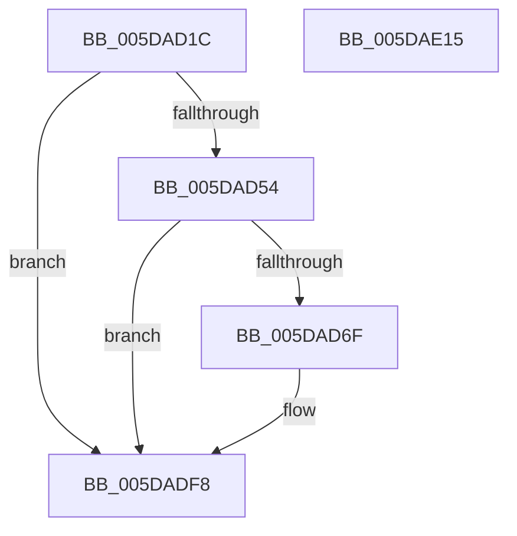

# PpmEventHiddenProcessorThermalCapChange

- RVA: `0x005DAD1C`–`0x005DAE16` (길이 `250` bytes)
- VA: `0x00000001405DAD1C`
- 실행 섹션: `.text`
- PDB 이름 있음: `예`; PDB Function 태그: `아니요`
- unwind 정보 RVA: `0x000BC1C8`
- 디코드: `55`개 명령, `250/250` bytes 표시
- 미해석 바이트: `0` (있으면 어셈블리에 `.byte`로 보존)

> 이 문서는 커널 이미지의 기계어와 PDB 기호를 분석해 생성했습니다. 4번과 5번은 함수 원형과 자료형을 바이너리 사용 방식에서 추정한 C 해석이며 원본 소스 복구 결과는 아닙니다.

## 1. Dependencies

- 직접 호출 지점: **3**; 고유 호출 대상: **3**
- 직접 호출자로 확인된 함수: **1**
- RIP 상대 이미지 참조: **4**

### Outgoing calls
- `0x005DAD62` → [EtwEventEnabled](../39/EtwEventEnabled_function_00392450.md) (function, `0x00392450`)
- `0x005DADF3` → [EtwWriteEx](../25/EtwWriteEx_function_0025F0D0.md) (function, `0x0025F0D0`)
- `0x005DADFF` → [_security_check_cookie](../6A/_security_check_cookie_function_006AC640.md) (function, `0x006AC640`)

### Direct callers
- [PpmRegisterPerfCap](../42/PpmRegisterPerfCap_function_0042B0D0.md) at `0x0042B29D`

### Static image references
- `0x005DAD36` → RVA `0x00E0A740` (`.data`; read)
- `0x005DAD44` → RVA `0x00E67A39` (`.data`; read)
- `0x005DAD54` → RVA `0x00F083E8` (`.data`; read)
- `0x005DAD5B` → RVA `0x000223C8` (`.rdata`; read)

## 2. Other-region calls and transfers

- 다른 실행 섹션으로 향하는 call: **0**
- 별도 외부 분기/꼬리 이동을 확인하지 못했습니다.

## 3. Assembly (complete function range)

```asm
005DAD1C  48 8B C4                        mov rax, rsp
005DAD1F  48 89 58 08                     mov qword ptr [rax + 8], rbx
005DAD23  44 89 40 18                     mov dword ptr [rax + 0x18], r8d
005DAD27  89 50 10                        mov dword ptr [rax + 0x10], edx
005DAD2A  55                              push rbp
005DAD2B  48 8D 68 A1                     lea rbp, [rax - 0x5f]
005DAD2F  48 81 EC A0 00 00 00            sub rsp, 0xa0
005DAD36  48 8B 05 03 FA 82 00            mov rax, qword ptr [rip + 0x82fa03]
005DAD3D  48 33 C4                        xor rax, rsp
005DAD40  48 89 45 47                     mov qword ptr [rbp + 0x47], rax
005DAD44  80 3D EE CC 88 00 00            cmp byte ptr [rip + 0x88ccee], 0
005DAD4B  48 8B D9                        mov rbx, rcx
005DAD4E  0F 84 A4 00 00 00               je 0x1405dadf8
005DAD54  48 8B 0D 8D D6 92 00            mov rcx, qword ptr [rip + 0x92d68d]
005DAD5B  48 8D 15 66 76 A4 FF            lea rdx, [rip - 0x5b899a]
005DAD62  E8 E9 76 DB FF                  call 0x140392450
005DAD67  84 C0                           test al, al
005DAD69  0F 84 89 00 00 00               je 0x1405dadf8
005DAD6F  0F B6 83 D0 00 00 00            movzx eax, byte ptr [rbx + 0xd0]
005DAD76  48 8D 15 4B 76 A4 FF            lea rdx, [rip - 0x5b89b5]
005DAD7D  83 65 13 00                     and dword ptr [rbp + 0x13], 0
005DAD81  B9 04 00 00 00                  mov ecx, 4
005DAD86  83 65 23 00                     and dword ptr [rbp + 0x23], 0
005DAD8A  45 33 C9                        xor r9d, r9d
005DAD8D  83 65 33 00                     and dword ptr [rbp + 0x33], 0
005DAD91  45 33 C0                        xor r8d, r8d
005DAD94  83 65 43 00                     and dword ptr [rbp + 0x43], 0
005DAD98  66 89 45 F7                     mov word ptr [rbp - 9], ax
005DAD9C  48 8D 45 F7                     lea rax, [rbp - 9]
005DADA0  48 89 45 07                     mov qword ptr [rbp + 7], rax
005DADA4  48 8D 83 D1 00 00 00            lea rax, [rbx + 0xd1]
005DADAB  48 89 45 17                     mov qword ptr [rbp + 0x17], rax
005DADAF  48 8D 45 6F                     lea rax, [rbp + 0x6f]
005DADB3  48 89 45 27                     mov qword ptr [rbp + 0x27], rax
005DADB7  48 8D 45 77                     lea rax, [rbp + 0x77]
005DADBB  48 89 45 37                     mov qword ptr [rbp + 0x37], rax
005DADBF  48 8D 45 07                     lea rax, [rbp + 7]
005DADC3  48 89 44 24 38                  mov qword ptr [rsp + 0x38], rax
005DADC8  89 4C 24 30                     mov dword ptr [rsp + 0x30], ecx
005DADCC  48 83 64 24 28 00               and qword ptr [rsp + 0x28], 0
005DADD2  48 83 64 24 20 00               and qword ptr [rsp + 0x20], 0
005DADD8  89 4D 2F                        mov dword ptr [rbp + 0x2f], ecx
005DADDB  89 4D 3F                        mov dword ptr [rbp + 0x3f], ecx
005DADDE  48 8B 0D 03 D6 92 00            mov rcx, qword ptr [rip + 0x92d603]
005DADE5  C7 45 0F 02 00 00 00            mov dword ptr [rbp + 0xf], 2
005DADEC  C7 45 1F 01 00 00 00            mov dword ptr [rbp + 0x1f], 1
005DADF3  E8 D8 42 C8 FF                  call 0x14025f0d0
005DADF8  48 8B 4D 47                     mov rcx, qword ptr [rbp + 0x47]
005DADFC  48 33 CC                        xor rcx, rsp
005DADFF  E8 3C 18 0D 00                  call 0x1406ac640
005DAE04  48 8B 9C 24 B0 00 00 00         mov rbx, qword ptr [rsp + 0xb0]
005DAE0C  48 81 C4 A0 00 00 00            add rsp, 0xa0
005DAE13  5D                              pop rbp
005DAE14  C3                              ret
005DAE15  CC                              int3
```

## 4. C-style interpretation (structured pseudocode)

```c
__int64 __fastcall PpmEventHiddenProcessorThermalCapChange(__int64 a1, int a2, int a3, int a4)
{
    __int64 result;
    __int64 v_rsp;
    unsigned __int64 v_stack_m70;
    unsigned int v_stack_m78;
    unsigned __int64 v_stack_m80;
    unsigned __int64 v_stack_m88;
    unsigned __int64 v_stack_p8;

    *(unsigned __int64 *)(v_rsp + 8) = v_rbx;
    *(unsigned int *)(v_rsp + 24) = a3;
    *(unsigned int *)(v_rsp + 16) = a2;
    v_rsp = (v_rsp) - (160);
    result = (*(unsigned __int64 *)(v_rip + 8583683)) ^ (v_rsp);
    *(unsigned __int64 *)(v_rsp - 95 + 71) = result;
    if ((*(unsigned __int8 *)(v_rip + 8965358)) == 0) goto loc_005DADF8;
    result = EtwEventEnabled(*(unsigned __int64 *)(v_rip + 9623181), v_rip - 5999002, a3, a4);
    if ((unsigned __int8)(result) != 0) {
        result = *(unsigned __int8 *)(a1 + 208);
        a2 = v_rip - 5999029;
        a1 = 4;
        a4 = 0;
        a3 = 0;
        *(unsigned __int16 *)(v_rsp - 95 - 9) = (unsigned __int16)(result);
        result = v_rsp - 95 - 9;
        *(unsigned __int64 *)(v_rsp - 95 + 7) = result;
        result = a1 + 209;
        *(unsigned __int64 *)(v_rsp - 95 + 23) = result;
        result = v_rsp - 95 + 111;
        *(unsigned __int64 *)(v_rsp - 95 + 39) = result;
        result = v_rsp - 95 + 119;
        *(unsigned __int64 *)(v_rsp - 95 + 55) = result;
        result = v_rsp - 95 + 7;
        v_stack_m70 = result;
        v_stack_m78 = (unsigned int)(a1);
        *(unsigned int *)(v_rsp - 95 + 47) = (unsigned int)(a1);
        *(unsigned int *)(v_rsp - 95 + 63) = (unsigned int)(a1);
        a1 = *(unsigned __int64 *)(v_rip + 9623043);
        *(unsigned int *)(v_rsp - 95 + 15) = 2;
        *(unsigned int *)(v_rsp - 95 + 31) = 1;
        result = EtwWriteEx(a1, a2, a3, a4);
    }
    a1 = (*(unsigned __int64 *)(v_rsp - 95 + 71)) ^ (v_rsp);
    result = _security_check_cookie(a1, a2, a3, a4);
    v_rsp = (v_rsp) + (160);
    return result;
}
```

## 5. (Beta) C Style

```c
int64_t PpmEventHiddenProcessorThermalCapChange(void *Arg1, int32_t Arg2, int32_t Arg3, int32_t Arg4)
{
    uint8_t *arg1 = (uint8_t *)Arg1;

    int64_t result;
    int64_t local_rsp;
    uint64_t v_stack_m70;
    uint32_t v_stack_m78;
    uint64_t v_stack_m80;
    uint64_t v_stack_m88;
    uint64_t v_stack_p8;

    *(uint64_t *)(local_rsp + 0x8) = local_rbx;
    *(uint32_t *)(local_rsp + 0x18) = Arg3;
    *(uint32_t *)(local_rsp + 0x10) = Arg2;
    local_rsp = (local_rsp) - (160);
    result = (*(uint64_t *)(v_rip + 0x82FA03)) ^ (local_rsp);
    *(uint64_t *)(local_rsp - 0x5F + 0x47) = result;
    if ((*(uint8_t *)(v_rip + 0x88CCEE)) == 0) goto loc_005DADF8;
    result = EtwEventEnabled(*(uint64_t *)(v_rip + 0x92D68D), v_rip - 5999002, Arg3, Arg4);
    if ((uint8_t)(result) != 0) {
        result = *(uint8_t *)(arg1 + 0xD0);
        Arg2 = v_rip - 5999029;
        Arg1 = 4;
        Arg4 = 0;
        Arg3 = 0;
        *(uint16_t *)(local_rsp - 0x5F - 0x9) = (uint16_t)(result);
        result = local_rsp - 95 - 9;
        *(uint64_t *)(local_rsp - 0x5F + 0x7) = result;
        result = Arg1 + 209;
        *(uint64_t *)(local_rsp - 0x5F + 0x17) = result;
        result = local_rsp - 95 + 111;
        *(uint64_t *)(local_rsp - 0x5F + 0x27) = result;
        result = local_rsp - 95 + 119;
        *(uint64_t *)(local_rsp - 0x5F + 0x37) = result;
        result = local_rsp - 95 + 7;
        v_stack_m70 = result;
        v_stack_m78 = (uint32_t)(Arg1);
        *(uint32_t *)(local_rsp - 0x5F + 0x2F) = (uint32_t)(Arg1);
        *(uint32_t *)(local_rsp - 0x5F + 0x3F) = (uint32_t)(Arg1);
        Arg1 = *(uint64_t *)(v_rip + 0x92D603);
        *(uint32_t *)(local_rsp - 0x5F + 0xF) = 2;
        *(uint32_t *)(local_rsp - 0x5F + 0x1F) = 1;
        result = EtwWriteEx(Arg1, Arg2, Arg3, Arg4);
    }
    Arg1 = (*(uint64_t *)(local_rsp - 0x5F + 0x47)) ^ (local_rsp);
    result = _security_check_cookie(Arg1, Arg2, Arg3, Arg4);
    local_rsp = (local_rsp) + (160);
    return result;
}
```

### 관측된 메모리 오프셋

구조체 형식이 확인되지 않은 접근은 인자 기준의 오프셋으로만 기록했습니다.

| 기준 인자 | 오프셋 표현 | 폭 (bit) | 접근 |
|---|---:|---:|---|
| `Arg1` | `+ 0xD0` | `8` | `R` |
| `Arg1` | `+ 0xD1` | `64` | `R` |

## 6. Execution-region graph

[열기: 2D/3D 그래프와 함수 탐색 컨트롤 패널](../../../control-panel.html?section=text&rva=0x005DAD1C&view=graph)

- 2D 그래프는 위에서 아래로 흐르고, 3D 그래프는 빈 공간을 드래그해 회전합니다. Shift+드래그는 이동, 휠은 확대·축소, 함수 노드 선택은 대상 보고서 이동입니다.

### Static fallback


