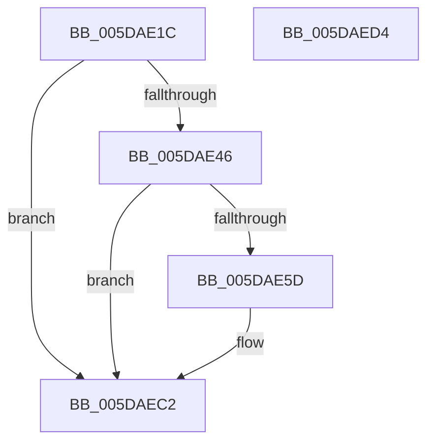

# PpmEventLPICoreParking

- RVA: `0x005DAE1C`–`0x005DAED5` (길이 `185` bytes)
- VA: `0x00000001405DAE1C`
- 실행 섹션: `.text`
- PDB 이름 있음: `예`; PDB Function 태그: `아니요`
- unwind 정보 RVA: `0x000CD268`
- 디코드: `39`개 명령, `185/185` bytes 표시
- 미해석 바이트: `0` (있으면 어셈블리에 `.byte`로 보존)

> 이 문서는 커널 이미지의 기계어와 PDB 기호를 분석해 생성했습니다. 4번과 5번은 함수 원형과 자료형을 바이너리 사용 방식에서 추정한 C 해석이며 원본 소스 복구 결과는 아닙니다.

## 1. Dependencies

- 직접 호출 지점: **3**; 고유 호출 대상: **3**
- 직접 호출자로 확인된 함수: **2**
- RIP 상대 이미지 참조: **5**

### Outgoing calls
- `0x005DAE54` → [EtwEventEnabled](../39/EtwEventEnabled_function_00392450.md) (function, `0x00392450`)
- `0x005DAEBD` → [EtwWriteEx](../25/EtwWriteEx_function_0025F0D0.md) (function, `0x0025F0D0`)
- `0x005DAECA` → [_security_check_cookie](../6A/_security_check_cookie_function_006AC640.md) (function, `0x006AC640`)

### Direct callers
- [PpmParkCalculateCoreParkingMaskEx](PpmParkCalculateCoreParkingMaskEx_function_005DFBE0.md) at `0x005E059E`
- [sub_006F6620](../6F/Unknown_function_006F6620.md) at `0x006F6C46`

### Static image references
- `0x005DAE24` → RVA `0x00E0A740` (`.data`; read)
- `0x005DAE33` → RVA `0x00E67A39` (`.data`; read)
- `0x005DAE3A` → RVA `0x00E67A40` (`.data`; read)
- `0x005DAE46` → RVA `0x00F083E8` (`.data`; read)
- `0x005DAE4D` → RVA `0x000225F0` (`.rdata`; read)

## 2. Other-region calls and transfers

- 다른 실행 섹션으로 향하는 call: **0**
- 별도 외부 분기/꼬리 이동을 확인하지 못했습니다.

## 3. Assembly (complete function range)

```asm
005DAE1C  89 54 24 10                     mov dword ptr [rsp + 0x10], edx
005DAE20  48 83 EC 78                     sub rsp, 0x78
005DAE24  48 8B 05 15 F9 82 00            mov rax, qword ptr [rip + 0x82f915]
005DAE2B  48 33 C4                        xor rax, rsp
005DAE2E  48 89 44 24 68                  mov qword ptr [rsp + 0x68], rax
005DAE33  80 3D FF CB 88 00 00            cmp byte ptr [rip + 0x88cbff], 0
005DAE3A  8B 05 00 CC 88 00               mov eax, dword ptr [rip + 0x88cc00]
005DAE40  89 44 24 40                     mov dword ptr [rsp + 0x40], eax
005DAE44  74 7C                           je 0x1405daec2
005DAE46  48 8B 0D 9B D5 92 00            mov rcx, qword ptr [rip + 0x92d59b]
005DAE4D  48 8D 15 9C 77 A4 FF            lea rdx, [rip - 0x5b8864]
005DAE54  E8 F7 75 DB FF                  call 0x140392450
005DAE59  84 C0                           test al, al
005DAE5B  74 65                           je 0x1405daec2
005DAE5D  83 64 24 54 00                  and dword ptr [rsp + 0x54], 0
005DAE62  48 8D 44 24 40                  lea rax, [rsp + 0x40]
005DAE67  83 64 24 64 00                  and dword ptr [rsp + 0x64], 0
005DAE6C  48 8D 15 7D 77 A4 FF            lea rdx, [rip - 0x5b8883]
005DAE73  48 89 44 24 48                  mov qword ptr [rsp + 0x48], rax
005DAE78  B9 04 00 00 00                  mov ecx, 4
005DAE7D  48 8D 84 24 88 00 00 00         lea rax, [rsp + 0x88]
005DAE85  89 4C 24 50                     mov dword ptr [rsp + 0x50], ecx
005DAE89  48 89 44 24 58                  mov qword ptr [rsp + 0x58], rax
005DAE8E  45 33 C9                        xor r9d, r9d
005DAE91  48 8D 44 24 48                  lea rax, [rsp + 0x48]
005DAE96  89 4C 24 60                     mov dword ptr [rsp + 0x60], ecx
005DAE9A  48 8B 0D 47 D5 92 00            mov rcx, qword ptr [rip + 0x92d547]
005DAEA1  45 33 C0                        xor r8d, r8d
005DAEA4  48 89 44 24 38                  mov qword ptr [rsp + 0x38], rax
005DAEA9  C7 44 24 30 02 00 00 00         mov dword ptr [rsp + 0x30], 2
005DAEB1  48 83 64 24 28 00               and qword ptr [rsp + 0x28], 0
005DAEB7  48 83 64 24 20 00               and qword ptr [rsp + 0x20], 0
005DAEBD  E8 0E 42 C8 FF                  call 0x14025f0d0
005DAEC2  48 8B 4C 24 68                  mov rcx, qword ptr [rsp + 0x68]
005DAEC7  48 33 CC                        xor rcx, rsp
005DAECA  E8 71 17 0D 00                  call 0x1406ac640
005DAECF  48 83 C4 78                     add rsp, 0x78
005DAED3  C3                              ret
005DAED4  CC                              int3
```

## 4. C-style interpretation (structured pseudocode)

```c
__int64 __fastcall PpmEventLPICoreParking(__int64 a1, int a2, int a3, int a4)
{
    __int64 result;
    __int64 v_rsp;
    unsigned __int64 v_stack_m10;
    unsigned int v_stack_m14;
    unsigned int v_stack_m18;
    unsigned __int64 v_stack_m20;
    unsigned int v_stack_m24;
    unsigned int v_stack_m28;
    unsigned __int64 v_stack_m30;
    unsigned int v_stack_m38;
    unsigned __int64 v_stack_m40;
    unsigned int v_stack_m48;
    unsigned __int64 v_stack_m50;
    unsigned __int64 v_stack_m58;
    unsigned int v_stack_p10;

    v_stack_p10 = a2;
    v_rsp = (v_rsp) - (120);
    result = (*(unsigned __int64 *)(v_rip + 8583445)) ^ (v_rsp);
    v_stack_m10 = result;
    v_stack_m38 = (unsigned int)((unsigned int)(*(unsigned int *)(v_rip + 8965120)));
    if ((*(unsigned __int8 *)(v_rip + 8965119)) == 0) goto loc_005DAEC2;
    result = EtwEventEnabled(*(unsigned __int64 *)(v_rip + 9622939), v_rip - 5998692, a3, a4);
    if ((unsigned __int8)(result) != 0) {
        result = v_stack_m38;
        a2 = v_rip - 5998723;
        v_stack_m30 = result;
        a1 = 4;
        result = v_stack_p10;
        v_stack_m28 = (unsigned int)(a1);
        v_stack_m20 = result;
        a4 = 0;
        result = v_stack_m30;
        v_stack_m18 = (unsigned int)(a1);
        a1 = *(unsigned __int64 *)(v_rip + 9622855);
        a3 = 0;
        v_stack_m40 = result;
        v_stack_m48 = 2;
        result = EtwWriteEx(a1, a2, a3, a4);
    }
    a1 = (v_stack_m10) ^ (v_rsp);
    result = _security_check_cookie(a1, a2, a3, a4);
    v_rsp = (v_rsp) + (120);
    return result;
}
```

## 5. (Beta) C Style

```c
int64_t PpmEventLPICoreParking(int64_t Arg1, int32_t Arg2, int32_t Arg3, int32_t Arg4)
{
    int64_t result;
    int64_t local_rsp;
    uint64_t v_stack_m10;
    uint32_t v_stack_m14;
    uint32_t v_stack_m18;
    uint64_t v_stack_m20;
    uint32_t v_stack_m24;
    uint32_t v_stack_m28;
    uint64_t v_stack_m30;
    uint32_t v_stack_m38;
    uint64_t v_stack_m40;
    uint32_t v_stack_m48;
    uint64_t v_stack_m50;
    uint64_t v_stack_m58;
    uint32_t v_stack_p10;

    v_stack_p10 = Arg2;
    local_rsp = (local_rsp) - (120);
    result = (*(uint64_t *)(v_rip + 0x82F915)) ^ (local_rsp);
    v_stack_m10 = result;
    v_stack_m38 = (uint32_t)((uint32_t)(*(uint32_t *)(v_rip + 0x88CC00)));
    if ((*(uint8_t *)(v_rip + 0x88CBFF)) == 0) goto loc_005DAEC2;
    result = EtwEventEnabled(*(uint64_t *)(v_rip + 0x92D59B), v_rip - 5998692, Arg3, Arg4);
    if ((uint8_t)(result) != 0) {
        result = v_stack_m38;
        Arg2 = v_rip - 5998723;
        v_stack_m30 = result;
        Arg1 = 4;
        result = v_stack_p10;
        v_stack_m28 = (uint32_t)(Arg1);
        v_stack_m20 = result;
        Arg4 = 0;
        result = v_stack_m30;
        v_stack_m18 = (uint32_t)(Arg1);
        Arg1 = *(uint64_t *)(v_rip + 0x92D547);
        Arg3 = 0;
        v_stack_m40 = result;
        v_stack_m48 = 2;
        result = EtwWriteEx(Arg1, Arg2, Arg3, Arg4);
    }
    Arg1 = (v_stack_m10) ^ (local_rsp);
    result = _security_check_cookie(Arg1, Arg2, Arg3, Arg4);
    local_rsp = (local_rsp) + (120);
    return result;
}
```

## 6. Execution-region graph

[열기: 2D/3D 그래프와 함수 탐색 컨트롤 패널](../../../control-panel.html?section=text&rva=0x005DAE1C&view=graph)

- 2D 그래프는 위에서 아래로 흐르고, 3D 그래프는 빈 공간을 드래그해 회전합니다. Shift+드래그는 이동, 휠은 확대·축소, 함수 노드 선택은 대상 보고서 이동입니다.

### Static fallback


