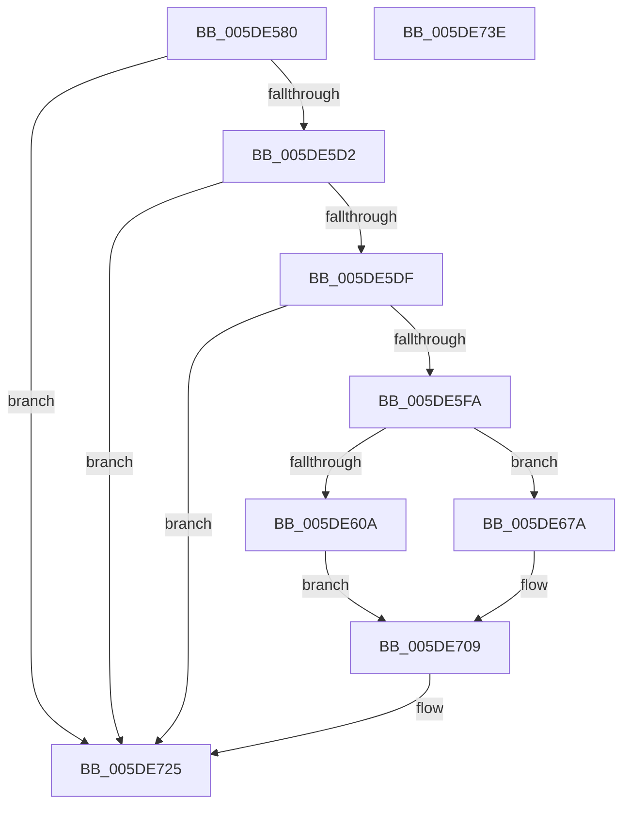

# PpmEventParkNodeCapChangeEx

- RVA: `0x005DE580`–`0x005DE73F` (길이 `447` bytes)
- VA: `0x00000001405DE580`
- 실행 섹션: `.text`
- PDB 이름 있음: `예`; PDB Function 태그: `아니요`
- unwind 정보 RVA: `0x000CD8A0`
- 디코드: `103`개 명령, `447/447` bytes 표시
- 미해석 바이트: `0` (있으면 어셈블리에 `.byte`로 보존)

> 이 문서는 커널 이미지의 기계어와 PDB 기호를 분석해 생성했습니다. 4번과 5번은 함수 원형과 자료형을 바이너리 사용 방식에서 추정한 C 해석이며 원본 소스 복구 결과는 아닙니다.

## 1. Dependencies

- 직접 호출 지점: **5**; 고유 호출 대상: **5**
- 직접 호출자로 확인된 함수: **1**
- RIP 상대 이미지 참조: **6**

### Outgoing calls
- `0x005DE5ED` → [EtwEventEnabled](../39/EtwEventEnabled_function_00392450.md) (function, `0x00392450`)
- `0x005DE601` → [KeIsSingleGroupAffinityEx](../47/KeIsSingleGroupAffinityEx_function_0047AC50.md) (function, `0x0047AC50`)
- `0x005DE6BD` → [PpmEventAddAffinityMaskAsSubset](../4E/PpmEventAddAffinityMaskAsSubset_function_004EF628.md) (function, `0x004EF628`)
- `0x005DE720` → [EtwWriteEx](../25/EtwWriteEx_function_0025F0D0.md) (function, `0x0025F0D0`)
- `0x005DE72C` → [_security_check_cookie](../6A/_security_check_cookie_function_006AC640.md) (function, `0x006AC640`)

### Direct callers
- [PpmParkApplyPolicyEx](../4F/PpmParkApplyPolicyEx_function_004F3090.md) at `0x004F380A`

### Static image references
- `0x005DE5A1` → RVA `0x00E0A740` (`.data`; read)
- `0x005DE5AF` → RVA `0x00E67A70` (`.data`; read)
- `0x005DE5D2` → RVA `0x00E67A39` (`.data`; read)
- `0x005DE5DF` → RVA `0x00F083E8` (`.data`; read)
- `0x005DE5E6` → RVA `0x00021168` (`.rdata`; read)
- `0x005DE616` → RVA `0x00022228` (`.rdata`; read)

## 2. Other-region calls and transfers

- 다른 실행 섹션으로 향하는 call: **0**
- 별도 외부 분기/꼬리 이동을 확인하지 못했습니다.

## 3. Assembly (complete function range)

```asm
005DE580  48 8B C4                        mov rax, rsp
005DE583  66 44 89 48 20                  mov word ptr [rax + 0x20], r9w
005DE588  66 44 89 40 18                  mov word ptr [rax + 0x18], r8w
005DE58D  66 89 48 08                     mov word ptr [rax + 8], cx
005DE591  55                              push rbp
005DE592  53                              push rbx
005DE593  57                              push rdi
005DE594  41 56                           push r14
005DE596  48 8D 68 A1                     lea rbp, [rax - 0x5f]
005DE59A  48 81 EC F8 00 00 00            sub rsp, 0xf8
005DE5A1  48 8B 05 98 C1 82 00            mov rax, qword ptr [rip + 0x82c198]
005DE5A8  48 33 C4                        xor rax, rsp
005DE5AB  48 89 45 27                     mov qword ptr [rbp + 0x27], rax
005DE5AF  48 8B 1D BA 94 88 00            mov rbx, qword ptr [rip + 0x8894ba]
005DE5B6  45 33 F6                        xor r14d, r14d
005DE5B9  66 44 89 75 8B                  mov word ptr [rbp - 0x75], r14w
005DE5BE  48 8B FA                        mov rdi, rdx
005DE5C1  44 89 75 9B                     mov dword ptr [rbp - 0x65], r14d
005DE5C5  44 89 75 97                     mov dword ptr [rbp - 0x69], r14d
005DE5C9  48 85 DB                        test rbx, rbx
005DE5CC  0F 84 53 01 00 00               je 0x1405de725
005DE5D2  44 38 35 60 94 88 00            cmp byte ptr [rip + 0x889460], r14b
005DE5D9  0F 84 46 01 00 00               je 0x1405de725
005DE5DF  48 8B 0D 02 9E 92 00            mov rcx, qword ptr [rip + 0x929e02]
005DE5E6  48 8D 15 7B 2B A4 FF            lea rdx, [rip - 0x5bd485]
005DE5ED  E8 5E 3E DB FF                  call 0x140392450
005DE5F2  84 C0                           test al, al
005DE5F4  0F 84 2B 01 00 00               je 0x1405de725
005DE5FA  48 8D 55 8B                     lea rdx, [rbp - 0x75]
005DE5FE  48 8B CF                        mov rcx, rdi
005DE601  E8 4A C6 E9 FF                  call 0x14047ac50
005DE606  85 C0                           test eax, eax
005DE608  74 70                           je 0x1405de67a
005DE60A  0F B7 4D 8B                     movzx ecx, word ptr [rbp - 0x75]
005DE60E  48 8D 45 8B                     lea rax, [rbp - 0x75]
005DE612  48 89 45 A7                     mov qword ptr [rbp - 0x59], rax
005DE616  48 8D 15 0B 3C A4 FF            lea rdx, [rip - 0x5bc3f5]
005DE61D  8A 45 77                        mov al, byte ptr [rbp + 0x77]
005DE620  48 FF C1                        inc rcx
005DE623  88 45 87                        mov byte ptr [rbp - 0x79], al
005DE626  8A 45 7F                        mov al, byte ptr [rbp + 0x7f]
005DE629  88 45 88                        mov byte ptr [rbp - 0x78], al
005DE62C  48 8D 45 87                     lea rax, [rbp - 0x79]
005DE630  48 89 45 C7                     mov qword ptr [rbp - 0x39], rax
005DE634  48 8D 0C CF                     lea rcx, [rdi + rcx*8]
005DE638  48 8D 45 88                     lea rax, [rbp - 0x78]
005DE63C  48 C7 45 AF 02 00 00 00         mov qword ptr [rbp - 0x51], 2
005DE644  48 89 45 D7                     mov qword ptr [rbp - 0x29], rax
005DE648  48 8D 45 A7                     lea rax, [rbp - 0x59]
005DE64C  48 89 44 24 38                  mov qword ptr [rsp + 0x38], rax
005DE651  C7 44 24 30 04 00 00 00         mov dword ptr [rsp + 0x30], 4
005DE659  48 89 4D B7                     mov qword ptr [rbp - 0x49], rcx
005DE65D  48 C7 45 BF 08 00 00 00         mov qword ptr [rbp - 0x41], 8
005DE665  48 C7 45 CF 01 00 00 00         mov qword ptr [rbp - 0x31], 1
005DE66D  48 C7 45 DF 01 00 00 00         mov qword ptr [rbp - 0x21], 1
005DE675  E9 8F 00 00 00                  jmp 0x1405de709
005DE67A  48 8D 45 67                     lea rax, [rbp + 0x67]
005DE67E  48 C7 43 08 02 00 00 00         mov qword ptr [rbx + 8], 2
005DE686  48 89 03                        mov qword ptr [rbx], rax
005DE689  4C 8D 4D E7                     lea r9, [rbp - 0x19]
005DE68D  48 8D 45 8F                     lea rax, [rbp - 0x71]
005DE691  C7 45 8F 01 00 00 00            mov dword ptr [rbp - 0x71], 1
005DE698  48 89 44 24 38                  mov qword ptr [rsp + 0x38], rax
005DE69D  4C 8D 45 93                     lea r8, [rbp - 0x6d]
005DE6A1  48 8D 45 97                     lea rax, [rbp - 0x69]
005DE6A5  48 8B D7                        mov rdx, rdi
005DE6A8  48 89 44 24 30                  mov qword ptr [rsp + 0x30], rax
005DE6AD  33 C9                           xor ecx, ecx
005DE6AF  48 8D 45 9B                     lea rax, [rbp - 0x65]
005DE6B3  48 89 44 24 28                  mov qword ptr [rsp + 0x28], rax
005DE6B8  48 89 5C 24 20                  mov qword ptr [rsp + 0x20], rbx
005DE6BD  E8 66 0F F1 FF                  call 0x1404ef628
005DE6C2  44 8B 45 8F                     mov r8d, dword ptr [rbp - 0x71]
005DE6C6  48 8D 4D 77                     lea rcx, [rbp + 0x77]
005DE6CA  41 8B C0                        mov eax, r8d
005DE6CD  48 89 5C 24 38                  mov qword ptr [rsp + 0x38], rbx
005DE6D2  48 03 C0                        add rax, rax
005DE6D5  48 8D 15 8C 2A A4 FF            lea rdx, [rip - 0x5bd574]
005DE6DC  48 89 0C C3                     mov qword ptr [rbx + rax*8], rcx
005DE6E0  41 8D 48 01                     lea ecx, [r8 + 1]
005DE6E4  48 C7 44 C3 08 02 00 00 00      mov qword ptr [rbx + rax*8 + 8], 2
005DE6ED  48 03 C9                        add rcx, rcx
005DE6F0  48 8D 45 7F                     lea rax, [rbp + 0x7f]
005DE6F4  48 89 04 CB                     mov qword ptr [rbx + rcx*8], rax
005DE6F8  41 8D 40 02                     lea eax, [r8 + 2]
005DE6FC  89 44 24 30                     mov dword ptr [rsp + 0x30], eax
005DE700  48 C7 44 CB 08 02 00 00 00      mov qword ptr [rbx + rcx*8 + 8], 2
005DE709  48 8B 0D D8 9C 92 00            mov rcx, qword ptr [rip + 0x929cd8]
005DE710  45 33 C9                        xor r9d, r9d
005DE713  4C 89 74 24 28                  mov qword ptr [rsp + 0x28], r14
005DE718  45 33 C0                        xor r8d, r8d
005DE71B  4C 89 74 24 20                  mov qword ptr [rsp + 0x20], r14
005DE720  E8 AB 09 C8 FF                  call 0x14025f0d0
005DE725  48 8B 4D 27                     mov rcx, qword ptr [rbp + 0x27]
005DE729  48 33 CC                        xor rcx, rsp
005DE72C  E8 0F DF 0C 00                  call 0x1406ac640
005DE731  48 81 C4 F8 00 00 00            add rsp, 0xf8
005DE738  41 5E                           pop r14
005DE73A  5F                              pop rdi
005DE73B  5B                              pop rbx
005DE73C  5D                              pop rbp
005DE73D  C3                              ret
005DE73E  CC                              int3
```

## 4. C-style interpretation (structured pseudocode)

```c
__int64 __fastcall PpmEventParkNodeCapChangeEx(unsigned __int16 a1, __int64 a2, unsigned __int16 a3, unsigned __int16 a4)
{
    __int64 result;
    __int64 v_r14;
    __int64 v_rsp;
    unsigned __int64 v_stack_mE0;
    unsigned int v_stack_mE8;
    unsigned __int64 v_stack_mF0;
    unsigned __int64 v_stack_mF8;

    *(unsigned __int16 *)(v_rsp + 32) = a4;
    *(unsigned __int16 *)(v_rsp + 24) = a3;
    *(unsigned __int16 *)(v_rsp + 8) = a1;
    v_rsp = (v_rsp) - (248);
    result = (*(unsigned __int64 *)(v_rip + 8569240)) ^ (v_rsp);
    *(unsigned __int64 *)(v_rsp - 95 + 39) = result;
    v_r14 = 0;
    *(unsigned __int16 *)(v_rsp - 95 - 117) = 0;
    *(unsigned int *)(v_rsp - 95 - 101) = 0;
    *(unsigned int *)(v_rsp - 95 - 105) = 0;
    if (*(unsigned __int64 *)(v_rip + 8950970) == 0) goto loc_005DE725;
    if ((*(unsigned __int8 *)(v_rip + 8950880)) == 0) goto loc_005DE725;
    result = EtwEventEnabled(*(unsigned __int64 *)(v_rip + 9608706), v_rip - 6018181, a3, a4);
    if ((unsigned __int8)(result) == 0) goto loc_005DE725;
    result = KeIsSingleGroupAffinityEx(a2, v_rsp - 95 - 117, a3, a4);
    if ((unsigned int)(result) == 0) goto loc_005DE67A;
    *(unsigned __int64 *)(v_rsp - 95 - 89) = v_rsp - 95 - 117;
    a1 = (*(unsigned __int16 *)(v_rsp - 95 - 117)) + 1;
    *(unsigned __int8 *)(v_rsp - 95 - 121) = (unsigned __int8)(*(unsigned __int8 *)(v_rsp - 95 + 119));
    *(unsigned __int8 *)(v_rsp - 95 - 120) = (unsigned __int8)(*(unsigned __int8 *)(v_rsp - 95 + 127));
    *(unsigned __int64 *)(v_rsp - 95 - 57) = v_rsp - 95 - 121;
    *(unsigned __int64 *)(v_rsp - 95 - 81) = 2;
    *(unsigned __int64 *)(v_rsp - 95 - 41) = v_rsp - 95 - 120;
    v_stack_mE0 = v_rsp - 95 - 89;
    v_stack_mE8 = 4;
    *(unsigned __int64 *)(v_rsp - 95 - 73) = a2 + a1 * 8;
    *(unsigned __int64 *)(v_rsp - 95 - 65) = 8;
    *(unsigned __int64 *)(v_rsp - 95 - 49) = 1;
    *(unsigned __int64 *)(v_rsp - 95 - 33) = 1;
    goto loc_005DE709;
loc_005DE67A:
    *(unsigned __int64 *)(*(unsigned __int64 *)(v_rip + 8950970) + 8) = 2;
    *(unsigned __int64 *)(*(unsigned __int64 *)(v_rip + 8950970)) = v_rsp - 95 + 103;
    *(unsigned int *)(v_rsp - 95 - 113) = 1;
    v_stack_mE0 = v_rsp - 95 - 113;
    v_stack_mE8 = v_rsp - 95 - 105;
    a1 = 0;
    v_stack_mF0 = v_rsp - 95 - 101;
    v_stack_mF8 = *(unsigned __int64 *)(v_rip + 8950970);
    result = PpmEventAddAffinityMaskAsSubset(a1, a2, v_rsp - 95 - 109, v_rsp - 95 - 25);
    v_stack_mE0 = *(unsigned __int64 *)(v_rip + 8950970);
    result = ((unsigned int)((unsigned int)((unsigned int)(*(unsigned int *)(v_rsp - 95 - 113))))) + ((unsigned int)((unsigned int)((unsigned int)(*(unsigned int *)(v_rsp - 95 - 113)))));
    *(unsigned __int64 *)(*(unsigned __int64 *)(v_rip + 8950970) + result * 8) = v_rsp - 95 + 119;
    *(unsigned __int64 *)(*(unsigned __int64 *)(v_rip + 8950970) + result * 8 + 8) = 2;
    a1 = ((unsigned int)(*(unsigned int *)(v_rsp - 95 - 113)) + 1) + ((unsigned int)(*(unsigned int *)(v_rsp - 95 - 113)) + 1);
    *(unsigned __int64 *)(*(unsigned __int64 *)(v_rip + 8950970) + a1 * 8) = v_rsp - 95 + 127;
    v_stack_mE8 = (unsigned int)((unsigned int)(*(unsigned int *)(v_rsp - 95 - 113)) + 2);
    *(unsigned __int64 *)(*(unsigned __int64 *)(v_rip + 8950970) + a1 * 8 + 8) = 2;
loc_005DE709:
    a4 = 0;
    v_stack_mF0 = 0;
    a3 = 0;
    v_stack_mF8 = 0;
    result = EtwWriteEx(*(unsigned __int64 *)(v_rip + 9608408), v_rip - 6018420, a3, a4);
loc_005DE725:
    a1 = (*(unsigned __int64 *)(v_rsp - 95 + 39)) ^ (v_rsp);
    result = _security_check_cookie(a1, v_rip - 6018420, a3, a4);
    v_rsp = (v_rsp) + (248);
    return result;
}
```

## 5. (Beta) C Style

```c
int64_t PpmEventParkNodeCapChangeEx(uint16_t Arg1, void *Arg2, uint16_t Arg3, uint16_t Arg4)
{
    uint8_t *arg2 = (uint8_t *)Arg2;

    int64_t result;
    int64_t local_r14;
    int64_t local_rsp;
    uint64_t v_stack_mE0;
    uint32_t v_stack_mE8;
    uint64_t v_stack_mF0;
    uint64_t v_stack_mF8;

    *(uint16_t *)(local_rsp + 0x20) = Arg4;
    *(uint16_t *)(local_rsp + 0x18) = Arg3;
    *(uint16_t *)(local_rsp + 0x8) = Arg1;
    local_rsp = (local_rsp) - (248);
    result = (*(uint64_t *)(v_rip + 0x82C198)) ^ (local_rsp);
    *(uint64_t *)(local_rsp - 0x5F + 0x27) = result;
    local_r14 = 0;
    *(uint16_t *)(local_rsp - 0x5F - 0x75) = 0;
    *(uint32_t *)(local_rsp - 0x5F - 0x65) = 0;
    *(uint32_t *)(local_rsp - 0x5F - 0x69) = 0;
    if (*(uint64_t *)(v_rip + 0x8894BA) == 0) goto loc_005DE725;
    if ((*(uint8_t *)(v_rip + 0x889460)) == 0) goto loc_005DE725;
    result = EtwEventEnabled(*(uint64_t *)(v_rip + 0x929E02), v_rip - 6018181, Arg3, Arg4);
    if ((uint8_t)(result) == 0) goto loc_005DE725;
    result = KeIsSingleGroupAffinityEx(Arg2, local_rsp - 95 - 117, Arg3, Arg4);
    if ((uint32_t)(result) == 0) goto loc_005DE67A;
    *(uint64_t *)(local_rsp - 0x5F - 0x59) = local_rsp - 95 - 117;
    Arg1 = (*(uint16_t *)(local_rsp - 0x5F - 0x75)) + 1;
    *(uint8_t *)(local_rsp - 0x5F - 0x79) = (uint8_t)(*(uint8_t *)(local_rsp - 0x5F + 0x77));
    *(uint8_t *)(local_rsp - 0x5F - 0x78) = (uint8_t)(*(uint8_t *)(local_rsp - 0x5F + 0x7F));
    *(uint64_t *)(local_rsp - 0x5F - 0x39) = local_rsp - 95 - 121;
    *(uint64_t *)(local_rsp - 0x5F - 0x51) = 2;
    *(uint64_t *)(local_rsp - 0x5F - 0x29) = local_rsp - 95 - 120;
    v_stack_mE0 = local_rsp - 95 - 89;
    v_stack_mE8 = 4;
    *(void **)(local_rsp - 0x5F - 0x49) = Arg2 + Arg1 * 8;
    *(uint64_t *)(local_rsp - 0x5F - 0x41) = 8;
    *(uint64_t *)(local_rsp - 0x5F - 0x31) = 1;
    *(uint64_t *)(local_rsp - 0x5F - 0x21) = 1;
    goto loc_005DE709;
loc_005DE67A:
    *(uint64_t *)(*(uint64_t *)(v_rip + 0x8894BA) + 0x8) = 2;
    *(uint64_t *)(*(uint64_t *)(v_rip + 0x8894BA)) = local_rsp - 95 + 103;
    *(uint32_t *)(local_rsp - 0x5F - 0x71) = 1;
    v_stack_mE0 = local_rsp - 95 - 113;
    v_stack_mE8 = local_rsp - 95 - 105;
    Arg1 = 0;
    v_stack_mF0 = local_rsp - 95 - 101;
    v_stack_mF8 = *(uint64_t *)(v_rip + 0x8894BA);
    result = PpmEventAddAffinityMaskAsSubset(Arg1, Arg2, local_rsp - 95 - 109, local_rsp - 95 - 25);
    v_stack_mE0 = *(uint64_t *)(v_rip + 0x8894BA);
    result = ((uint32_t)((uint32_t)((uint32_t)(*(uint32_t *)(local_rsp - 0x5F - 0x71))))) + ((uint32_t)((uint32_t)((uint32_t)(*(uint32_t *)(local_rsp - 0x5F - 0x71)))));
    *(uint64_t *)(*(uint64_t *)(v_rip + 0x8894BA) + result * 8) = local_rsp - 95 + 119;
    *(uint64_t *)(*(uint64_t *)(v_rip + 0x8894BA) + result * 8 + 0x8) = 2;
    Arg1 = ((uint32_t)(*(uint32_t *)(local_rsp - 0x5F - 0x71)) + 1) + ((uint32_t)(*(uint32_t *)(local_rsp - 0x5F - 0x71)) + 1);
    *(uint64_t *)(*(uint64_t *)(v_rip + 0x8894BA) + Arg1 * 8) = local_rsp - 95 + 127;
    v_stack_mE8 = (uint32_t)((uint32_t)(*(uint32_t *)(local_rsp - 0x5F - 0x71)) + 2);
    *(uint64_t *)(*(uint64_t *)(v_rip + 0x8894BA) + Arg1 * 8 + 0x8) = 2;
loc_005DE709:
    Arg4 = 0;
    v_stack_mF0 = 0;
    Arg3 = 0;
    v_stack_mF8 = 0;
    result = EtwWriteEx(*(uint64_t *)(v_rip + 0x929CD8), v_rip - 6018420, Arg3, Arg4);
loc_005DE725:
    Arg1 = (*(uint64_t *)(local_rsp - 0x5F + 0x27)) ^ (local_rsp);
    result = _security_check_cookie(Arg1, v_rip - 6018420, Arg3, Arg4);
    local_rsp = (local_rsp) + (248);
    return result;
}
```

### 관측된 메모리 오프셋

구조체 형식이 확인되지 않은 접근은 인자 기준의 오프셋으로만 기록했습니다.

| 기준 인자 | 오프셋 표현 | 폭 (bit) | 접근 |
|---|---:|---:|---|
| `Arg2` | `+ 0x0 + rcx*8` | `64` | `R` |

## 6. Execution-region graph

[열기: 2D/3D 그래프와 함수 탐색 컨트롤 패널](../../../control-panel.html?section=text&rva=0x005DE580&view=graph)

- 2D 그래프는 위에서 아래로 흐르고, 3D 그래프는 빈 공간을 드래그해 회전합니다. Shift+드래그는 이동, 휠은 확대·축소, 함수 노드 선택은 대상 보고서 이동입니다.

### Static fallback


