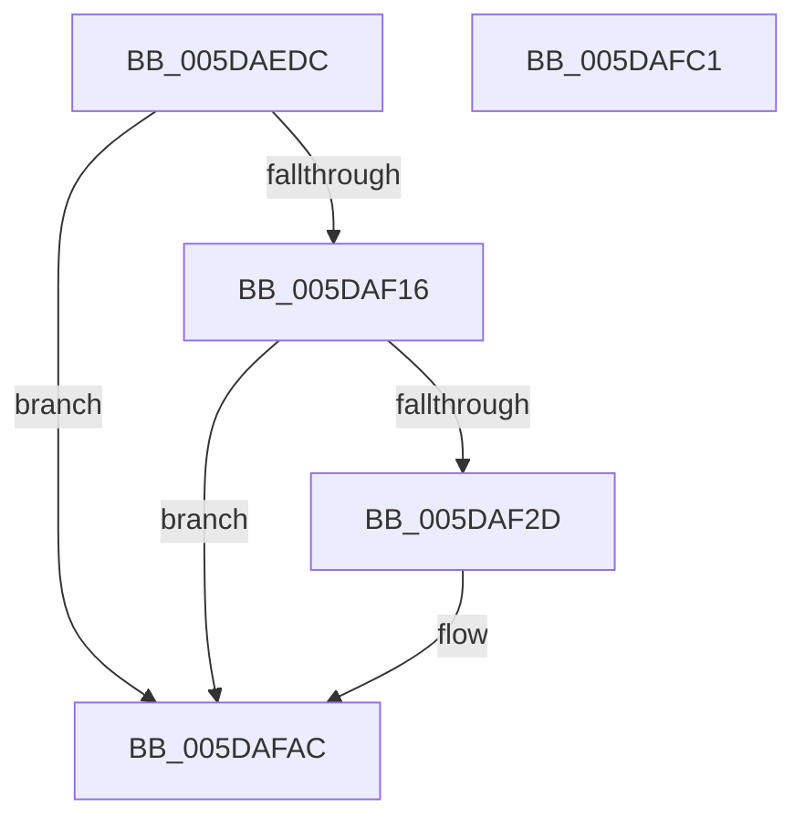

# PpmEventParkNodeCapChange

- RVA: `0x005DAEDC`–`0x005DAFC2` (길이 `230` bytes)
- VA: `0x00000001405DAEDC`
- 실행 섹션: `.text`
- PDB 이름 있음: `예`; PDB Function 태그: `아니요`
- unwind 정보 RVA: `0x000BC734`
- 디코드: `52`개 명령, `230/230` bytes 표시
- 미해석 바이트: `0` (있으면 어셈블리에 `.byte`로 보존)

> 이 문서는 커널 이미지의 기계어와 PDB 기호를 분석해 생성했습니다. 4번과 5번은 함수 원형과 자료형을 바이너리 사용 방식에서 추정한 C 해석이며 원본 소스 복구 결과는 아닙니다.

## 1. Dependencies

- 직접 호출 지점: **3**; 고유 호출 대상: **3**
- 직접 호출자로 확인된 함수: **1**
- RIP 상대 이미지 참조: **4**

### Outgoing calls
- `0x005DAF24` → [EtwEventEnabled](../39/EtwEventEnabled_function_00392450.md) (function, `0x00392450`)
- `0x005DAFA7` → [EtwWriteEx](../25/EtwWriteEx_function_0025F0D0.md) (function, `0x0025F0D0`)
- `0x005DAFB3` → [_security_check_cookie](../6A/_security_check_cookie_function_006AC640.md) (function, `0x006AC640`)

### Direct callers
- [PpmParkApplyPolicy](../4B/PpmParkApplyPolicy_function_004B613C.md) at `0x004B6744`

### Static image references
- `0x005DAEFB` → RVA `0x00E0A740` (`.data`; read)
- `0x005DAF09` → RVA `0x00E67A39` (`.data`; read)
- `0x005DAF16` → RVA `0x00F083E8` (`.data`; read)
- `0x005DAF1D` → RVA `0x00022228` (`.rdata`; read)

## 2. Other-region calls and transfers

- 다른 실행 섹션으로 향하는 call: **0**
- 별도 외부 분기/꼬리 이동을 확인하지 못했습니다.

## 3. Assembly (complete function range)

```asm
005DAEDC  48 8B C4                        mov rax, rsp
005DAEDF  44 88 48 20                     mov byte ptr [rax + 0x20], r9b
005DAEE3  44 88 40 18                     mov byte ptr [rax + 0x18], r8b
005DAEE7  48 89 50 10                     mov qword ptr [rax + 0x10], rdx
005DAEEB  66 89 48 08                     mov word ptr [rax + 8], cx
005DAEEF  55                              push rbp
005DAEF0  48 8D 68 A1                     lea rbp, [rax - 0x5f]
005DAEF4  48 81 EC 90 00 00 00            sub rsp, 0x90
005DAEFB  48 8B 05 3E F8 82 00            mov rax, qword ptr [rip + 0x82f83e]
005DAF02  48 33 C4                        xor rax, rsp
005DAF05  48 89 45 47                     mov qword ptr [rbp + 0x47], rax
005DAF09  80 3D 29 CB 88 00 00            cmp byte ptr [rip + 0x88cb29], 0
005DAF10  0F 84 96 00 00 00               je 0x1405dafac
005DAF16  48 8B 0D CB D4 92 00            mov rcx, qword ptr [rip + 0x92d4cb]
005DAF1D  48 8D 15 04 73 A4 FF            lea rdx, [rip - 0x5b8cfc]
005DAF24  E8 27 75 DB FF                  call 0x140392450
005DAF29  84 C0                           test al, al
005DAF2B  74 7F                           je 0x1405dafac
005DAF2D  83 65 13 00                     and dword ptr [rbp + 0x13], 0
005DAF31  48 8D 45 67                     lea rax, [rbp + 0x67]
005DAF35  83 65 23 00                     and dword ptr [rbp + 0x23], 0
005DAF39  48 8D 15 E8 72 A4 FF            lea rdx, [rip - 0x5b8d18]
005DAF40  83 65 33 00                     and dword ptr [rbp + 0x33], 0
005DAF44  B9 01 00 00 00                  mov ecx, 1
005DAF49  83 65 43 00                     and dword ptr [rbp + 0x43], 0
005DAF4D  45 33 C9                        xor r9d, r9d
005DAF50  48 89 45 07                     mov qword ptr [rbp + 7], rax
005DAF54  45 33 C0                        xor r8d, r8d
005DAF57  48 8D 45 6F                     lea rax, [rbp + 0x6f]
005DAF5B  89 4D 2F                        mov dword ptr [rbp + 0x2f], ecx
005DAF5E  48 89 45 17                     mov qword ptr [rbp + 0x17], rax
005DAF62  48 8D 45 77                     lea rax, [rbp + 0x77]
005DAF66  48 89 45 27                     mov qword ptr [rbp + 0x27], rax
005DAF6A  48 8D 45 7F                     lea rax, [rbp + 0x7f]
005DAF6E  48 89 45 37                     mov qword ptr [rbp + 0x37], rax
005DAF72  48 8D 45 07                     lea rax, [rbp + 7]
005DAF76  48 89 44 24 38                  mov qword ptr [rsp + 0x38], rax
005DAF7B  C7 44 24 30 04 00 00 00         mov dword ptr [rsp + 0x30], 4
005DAF83  48 83 64 24 28 00               and qword ptr [rsp + 0x28], 0
005DAF89  48 83 64 24 20 00               and qword ptr [rsp + 0x20], 0
005DAF8F  89 4D 3F                        mov dword ptr [rbp + 0x3f], ecx
005DAF92  48 8B 0D 4F D4 92 00            mov rcx, qword ptr [rip + 0x92d44f]
005DAF99  C7 45 0F 02 00 00 00            mov dword ptr [rbp + 0xf], 2
005DAFA0  C7 45 1F 08 00 00 00            mov dword ptr [rbp + 0x1f], 8
005DAFA7  E8 24 41 C8 FF                  call 0x14025f0d0
005DAFAC  48 8B 4D 47                     mov rcx, qword ptr [rbp + 0x47]
005DAFB0  48 33 CC                        xor rcx, rsp
005DAFB3  E8 88 16 0D 00                  call 0x1406ac640
005DAFB8  48 81 C4 90 00 00 00            add rsp, 0x90
005DAFBF  5D                              pop rbp
005DAFC0  C3                              ret
005DAFC1  CC                              int3
```

## 4. C-style interpretation (structured pseudocode)

```c
__int64 __fastcall PpmEventParkNodeCapChange(unsigned __int16 a1, __int64 a2, int a3, int a4)
{
    __int64 result;
    __int64 v_rsp;
    unsigned __int64 v_stack_m60;
    unsigned int v_stack_m68;
    unsigned __int64 v_stack_m70;
    unsigned __int64 v_stack_m78;

    *(unsigned __int8 *)(v_rsp + 32) = (unsigned __int8)(a4);
    *(unsigned __int8 *)(v_rsp + 24) = (unsigned __int8)(a3);
    *(unsigned __int64 *)(v_rsp + 16) = a2;
    *(unsigned __int16 *)(v_rsp + 8) = a1;
    v_rsp = (v_rsp) - (144);
    result = (*(unsigned __int64 *)(v_rip + 8583230)) ^ (v_rsp);
    *(unsigned __int64 *)(v_rsp - 95 + 71) = result;
    if ((*(unsigned __int8 *)(v_rip + 8964905)) == 0) goto loc_005DAFAC;
    result = EtwEventEnabled(*(unsigned __int64 *)(v_rip + 9622731), v_rip - 5999868, a3, a4);
    if ((unsigned __int8)(result) != 0) {
        result = v_rsp - 95 + 103;
        a2 = v_rip - 5999896;
        a1 = 1;
        a4 = 0;
        *(unsigned __int64 *)(v_rsp - 95 + 7) = result;
        a3 = 0;
        result = v_rsp - 95 + 111;
        *(unsigned int *)(v_rsp - 95 + 47) = a1;
        *(unsigned __int64 *)(v_rsp - 95 + 23) = result;
        result = v_rsp - 95 + 119;
        *(unsigned __int64 *)(v_rsp - 95 + 39) = result;
        result = v_rsp - 95 + 127;
        *(unsigned __int64 *)(v_rsp - 95 + 55) = result;
        result = v_rsp - 95 + 7;
        v_stack_m60 = result;
        v_stack_m68 = 4;
        *(unsigned int *)(v_rsp - 95 + 63) = a1;
        a1 = *(unsigned __int64 *)(v_rip + 9622607);
        *(unsigned int *)(v_rsp - 95 + 15) = 2;
        *(unsigned int *)(v_rsp - 95 + 31) = 8;
        result = EtwWriteEx(a1, a2, a3, a4);
    }
    a1 = (*(unsigned __int64 *)(v_rsp - 95 + 71)) ^ (v_rsp);
    result = _security_check_cookie(a1, a2, a3, a4);
    v_rsp = (v_rsp) + (144);
    return result;
}
```

## 5. (Beta) C Style

```c
int64_t PpmEventParkNodeCapChange(uint16_t Arg1, int64_t Arg2, int32_t Arg3, int32_t Arg4)
{
    int64_t result;
    int64_t local_rsp;
    uint64_t v_stack_m60;
    uint32_t v_stack_m68;
    uint64_t v_stack_m70;
    uint64_t v_stack_m78;

    *(uint8_t *)(local_rsp + 0x20) = (uint8_t)(Arg4);
    *(uint8_t *)(local_rsp + 0x18) = (uint8_t)(Arg3);
    *(uint64_t *)(local_rsp + 0x10) = Arg2;
    *(uint16_t *)(local_rsp + 0x8) = Arg1;
    local_rsp = (local_rsp) - (144);
    result = (*(uint64_t *)(v_rip + 0x82F83E)) ^ (local_rsp);
    *(uint64_t *)(local_rsp - 0x5F + 0x47) = result;
    if ((*(uint8_t *)(v_rip + 0x88CB29)) == 0) goto loc_005DAFAC;
    result = EtwEventEnabled(*(uint64_t *)(v_rip + 0x92D4CB), v_rip - 5999868, Arg3, Arg4);
    if ((uint8_t)(result) != 0) {
        result = local_rsp - 95 + 103;
        Arg2 = v_rip - 5999896;
        Arg1 = 1;
        Arg4 = 0;
        *(uint64_t *)(local_rsp - 0x5F + 0x7) = result;
        Arg3 = 0;
        result = local_rsp - 95 + 111;
        *(uint32_t *)(local_rsp - 0x5F + 0x2F) = Arg1;
        *(uint64_t *)(local_rsp - 0x5F + 0x17) = result;
        result = local_rsp - 95 + 119;
        *(uint64_t *)(local_rsp - 0x5F + 0x27) = result;
        result = local_rsp - 95 + 127;
        *(uint64_t *)(local_rsp - 0x5F + 0x37) = result;
        result = local_rsp - 95 + 7;
        v_stack_m60 = result;
        v_stack_m68 = 4;
        *(uint32_t *)(local_rsp - 0x5F + 0x3F) = Arg1;
        Arg1 = *(uint64_t *)(v_rip + 0x92D44F);
        *(uint32_t *)(local_rsp - 0x5F + 0xF) = 2;
        *(uint32_t *)(local_rsp - 0x5F + 0x1F) = 8;
        result = EtwWriteEx(Arg1, Arg2, Arg3, Arg4);
    }
    Arg1 = (*(uint64_t *)(local_rsp - 0x5F + 0x47)) ^ (local_rsp);
    result = _security_check_cookie(Arg1, Arg2, Arg3, Arg4);
    local_rsp = (local_rsp) + (144);
    return result;
}
```

## 6. Execution-region graph

[열기: 2D/3D 그래프와 함수 탐색 컨트롤 패널](../../../control-panel.html?section=text&rva=0x005DAEDC&view=graph)

- 2D 그래프는 위에서 아래로 흐르고, 3D 그래프는 빈 공간을 드래그해 회전합니다. Shift+드래그는 이동, 휠은 확대·축소, 함수 노드 선택은 대상 보고서 이동입니다.

### Static fallback


