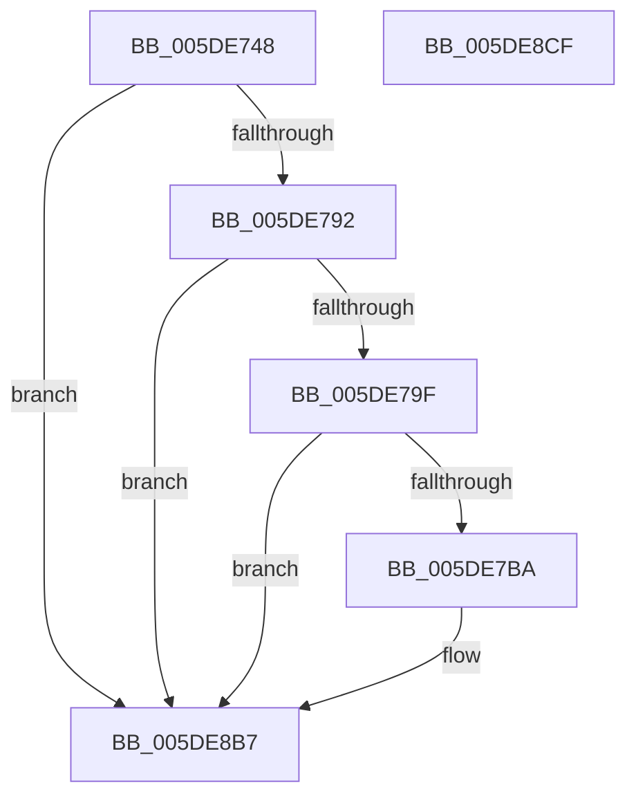

# PpmEventParkNodeClassRecordedStatsEx

- RVA: `0x005DE748`–`0x005DE8D0` (길이 `392` bytes)
- VA: `0x00000001405DE748`
- 실행 섹션: `.text`
- PDB 이름 있음: `예`; PDB Function 태그: `아니요`
- unwind 정보 RVA: `0x000CD8BC`
- 디코드: `95`개 명령, `392/392` bytes 표시
- 미해석 바이트: `0` (있으면 어셈블리에 `.byte`로 보존)

> 이 문서는 커널 이미지의 기계어와 PDB 기호를 분석해 생성했습니다. 4번과 5번은 함수 원형과 자료형을 바이너리 사용 방식에서 추정한 C 해석이며 원본 소스 복구 결과는 아닙니다.

## 1. Dependencies

- 직접 호출 지점: **4**; 고유 호출 대상: **4**
- 직접 호출자로 확인된 함수: **1**
- RIP 상대 이미지 참조: **5**

### Outgoing calls
- `0x005DE7AD` → [EtwEventEnabled](../39/EtwEventEnabled_function_00392450.md) (function, `0x00392450`)
- `0x005DE7E7` → [PpmEventAddAffinityMaskAsSubset](../4E/PpmEventAddAffinityMaskAsSubset_function_004EF628.md) (function, `0x004EF628`)
- `0x005DE8B2` → [EtwWriteEx](../25/EtwWriteEx_function_0025F0D0.md) (function, `0x0025F0D0`)
- `0x005DE8BE` → [_security_check_cookie](../6A/_security_check_cookie_function_006AC640.md) (function, `0x006AC640`)

### Direct callers
- [sub_006EC724](../6E/Unknown_function_006EC724.md) at `0x006EC7A2`

### Static image references
- `0x005DE766` → RVA `0x00E0A740` (`.data`; read)
- `0x005DE774` → RVA `0x00E67A70` (`.data`; read)
- `0x005DE792` → RVA `0x00E67A39` (`.data`; read)
- `0x005DE79F` → RVA `0x00F083E8` (`.data`; read)
- `0x005DE7A6` → RVA `0x00021978` (`.rdata`; read)

## 2. Other-region calls and transfers

- 다른 실행 섹션으로 향하는 call: **0**
- 별도 외부 분기/꼬리 이동을 확인하지 못했습니다.

## 3. Assembly (complete function range)

```asm
005DE748  48 8B C4                        mov rax, rsp
005DE74B  44 88 48 20                     mov byte ptr [rax + 0x20], r9b
005DE74F  66 44 89 40 18                  mov word ptr [rax + 0x18], r8w
005DE754  88 50 10                        mov byte ptr [rax + 0x10], dl
005DE757  55                              push rbp
005DE758  53                              push rbx
005DE759  56                              push rsi
005DE75A  57                              push rdi
005DE75B  48 8D 68 B1                     lea rbp, [rax - 0x4f]
005DE75F  48 81 EC A8 00 00 00            sub rsp, 0xa8
005DE766  48 8B 05 D3 BF 82 00            mov rax, qword ptr [rip + 0x82bfd3]
005DE76D  48 33 C4                        xor rax, rsp
005DE770  48 89 45 17                     mov qword ptr [rbp + 0x17], rax
005DE774  48 8B 1D F5 92 88 00            mov rbx, qword ptr [rip + 0x8892f5]
005DE77B  33 F6                           xor esi, esi
005DE77D  89 75 D3                        mov dword ptr [rbp - 0x2d], esi
005DE780  48 8B F9                        mov rdi, rcx
005DE783  89 75 CF                        mov dword ptr [rbp - 0x31], esi
005DE786  89 75 C7                        mov dword ptr [rbp - 0x39], esi
005DE789  48 85 DB                        test rbx, rbx
005DE78C  0F 84 25 01 00 00               je 0x1405de8b7
005DE792  40 38 35 A0 92 88 00            cmp byte ptr [rip + 0x8892a0], sil
005DE799  0F 84 18 01 00 00               je 0x1405de8b7
005DE79F  48 8B 0D 42 9C 92 00            mov rcx, qword ptr [rip + 0x929c42]
005DE7A6  48 8D 15 CB 31 A4 FF            lea rdx, [rip - 0x5bce35]
005DE7AD  E8 9E 3C DB FF                  call 0x140392450
005DE7B2  84 C0                           test al, al
005DE7B4  0F 84 FD 00 00 00               je 0x1405de8b7
005DE7BA  48 8D 45 C7                     lea rax, [rbp - 0x39]
005DE7BE  48 8B D7                        mov rdx, rdi
005DE7C1  48 89 44 24 38                  mov qword ptr [rsp + 0x38], rax
005DE7C6  4C 8D 4D D7                     lea r9, [rbp - 0x29]
005DE7CA  48 8D 45 CF                     lea rax, [rbp - 0x31]
005DE7CE  33 C9                           xor ecx, ecx
005DE7D0  48 89 44 24 30                  mov qword ptr [rsp + 0x30], rax
005DE7D5  4C 8D 45 CB                     lea r8, [rbp - 0x35]
005DE7D9  48 8D 45 D3                     lea rax, [rbp - 0x2d]
005DE7DD  48 89 44 24 28                  mov qword ptr [rsp + 0x28], rax
005DE7E2  48 89 5C 24 20                  mov qword ptr [rsp + 0x20], rbx
005DE7E7  E8 3C 0E F1 FF                  call 0x1404ef628
005DE7EC  44 8B 4D C7                     mov r9d, dword ptr [rbp - 0x39]
005DE7F0  48 8D 4D 5F                     lea rcx, [rbp + 0x5f]
005DE7F4  4C 8B 45 77                     mov r8, qword ptr [rbp + 0x77]
005DE7F8  41 8B C1                        mov eax, r9d
005DE7FB  48 03 C0                        add rax, rax
005DE7FE  48 89 5C 24 38                  mov qword ptr [rsp + 0x38], rbx
005DE803  48 89 0C C3                     mov qword ptr [rbx + rax*8], rcx
005DE807  41 8D 49 01                     lea ecx, [r9 + 1]
005DE80B  48 C7 44 C3 08 01 00 00 00      mov qword ptr [rbx + rax*8 + 8], 1
005DE814  48 03 C9                        add rcx, rcx
005DE817  48 8D 45 7F                     lea rax, [rbp + 0x7f]
005DE81B  48 89 04 CB                     mov qword ptr [rbx + rcx*8], rax
005DE81F  49 8D 40 30                     lea rax, [r8 + 0x30]
005DE823  48 C7 44 CB 08 02 00 00 00      mov qword ptr [rbx + rcx*8 + 8], 2
005DE82C  41 8D 49 02                     lea ecx, [r9 + 2]
005DE830  48 03 C9                        add rcx, rcx
005DE833  48 89 04 CB                     mov qword ptr [rbx + rcx*8], rax
005DE837  48 C7 44 CB 08 04 00 00 00      mov qword ptr [rbx + rcx*8 + 8], 4
005DE840  41 8D 49 03                     lea ecx, [r9 + 3]
005DE844  8B 10                           mov edx, dword ptr [rax]
005DE846  48 03 C9                        add rcx, rcx
005DE849  49 8B 40 08                     mov rax, qword ptr [r8 + 8]
005DE84D  45 33 C0                        xor r8d, r8d
005DE850  C1 E2 03                        shl edx, 3
005DE853  48 89 04 CB                     mov qword ptr [rbx + rcx*8], rax
005DE857  48 8D 45 67                     lea rax, [rbp + 0x67]
005DE85B  89 54 CB 08                     mov dword ptr [rbx + rcx*8 + 8], edx
005DE85F  48 8D 15 12 31 A4 FF            lea rdx, [rip - 0x5bceee]
005DE866  89 74 CB 0C                     mov dword ptr [rbx + rcx*8 + 0xc], esi
005DE86A  41 8D 49 04                     lea ecx, [r9 + 4]
005DE86E  48 03 C9                        add rcx, rcx
005DE871  48 89 04 CB                     mov qword ptr [rbx + rcx*8], rax
005DE875  48 8D 45 6F                     lea rax, [rbp + 0x6f]
005DE879  48 C7 44 CB 08 02 00 00 00      mov qword ptr [rbx + rcx*8 + 8], 2
005DE882  41 8D 49 05                     lea ecx, [r9 + 5]
005DE886  48 03 C9                        add rcx, rcx
005DE889  48 89 04 CB                     mov qword ptr [rbx + rcx*8], rax
005DE88D  41 8D 41 06                     lea eax, [r9 + 6]
005DE891  89 44 24 30                     mov dword ptr [rsp + 0x30], eax
005DE895  45 33 C9                        xor r9d, r9d
005DE898  48 C7 44 CB 08 01 00 00 00      mov qword ptr [rbx + rcx*8 + 8], 1
005DE8A1  48 8B 0D 40 9B 92 00            mov rcx, qword ptr [rip + 0x929b40]
005DE8A8  48 89 74 24 28                  mov qword ptr [rsp + 0x28], rsi
005DE8AD  48 89 74 24 20                  mov qword ptr [rsp + 0x20], rsi
005DE8B2  E8 19 08 C8 FF                  call 0x14025f0d0
005DE8B7  48 8B 4D 17                     mov rcx, qword ptr [rbp + 0x17]
005DE8BB  48 33 CC                        xor rcx, rsp
005DE8BE  E8 7D DD 0C 00                  call 0x1406ac640
005DE8C3  48 81 C4 A8 00 00 00            add rsp, 0xa8
005DE8CA  5F                              pop rdi
005DE8CB  5E                              pop rsi
005DE8CC  5B                              pop rbx
005DE8CD  5D                              pop rbp
005DE8CE  C3                              ret
005DE8CF  CC                              int3
```

## 4. C-style interpretation (structured pseudocode)

```c
__int64 __fastcall PpmEventParkNodeClassRecordedStatsEx(__int64 a1, unsigned __int8 a2, unsigned __int16 a3, unsigned __int8 a4)
{
    __int64 result;
    __int64 v_rsi;
    __int64 v_rsp;
    unsigned __int64 v_stack_m90;
    unsigned __int64 v_stack_m98;
    unsigned __int64 v_stack_mA0;
    unsigned __int64 v_stack_mA8;

    *(unsigned __int8 *)(v_rsp + 32) = a4;
    *(unsigned __int16 *)(v_rsp + 24) = a3;
    *(unsigned __int8 *)(v_rsp + 16) = a2;
    v_rsp = (v_rsp) - (168);
    result = (*(unsigned __int64 *)(v_rip + 8568787)) ^ (v_rsp);
    *(unsigned __int64 *)(v_rsp - 79 + 23) = result;
    v_rsi = 0;
    *(unsigned int *)(v_rsp - 79 - 45) = 0;
    *(unsigned int *)(v_rsp - 79 - 49) = 0;
    *(unsigned int *)(v_rsp - 79 - 57) = 0;
    if (*(unsigned __int64 *)(v_rip + 8950517) == 0) goto loc_005DE8B7;
    if ((*(unsigned __int8 *)(v_rip + 8950432)) == 0) goto loc_005DE8B7;
    result = EtwEventEnabled(*(unsigned __int64 *)(v_rip + 9608258), v_rip - 6016565, a3, a4);
    if ((unsigned __int8)(result) != 0) {
        result = v_rsp - 79 - 57;
        a2 = a1;
        v_stack_m90 = result;
        a4 = v_rsp - 79 - 41;
        result = v_rsp - 79 - 49;
        a1 = 0;
        v_stack_m98 = result;
        a3 = v_rsp - 79 - 53;
        result = v_rsp - 79 - 45;
        v_stack_mA0 = result;
        v_stack_mA8 = *(unsigned __int64 *)(v_rip + 8950517);
        result = PpmEventAddAffinityMaskAsSubset(a1, a2, a3, a4);
        a4 = *(unsigned int *)(v_rsp - 79 - 57);
        a1 = v_rsp - 79 + 95;
        a3 = *(unsigned __int64 *)(v_rsp - 79 + 119);
        result = a4;
        result = (result) + (result);
        v_stack_m90 = *(unsigned __int64 *)(v_rip + 8950517);
        *(unsigned __int64 *)(*(unsigned __int64 *)(v_rip + 8950517) + result * 8) = a1;
        a1 = a4 + 1;
        *(unsigned __int64 *)(*(unsigned __int64 *)(v_rip + 8950517) + result * 8 + 8) = 1;
        a1 = (a1) + (a1);
        result = v_rsp - 79 + 127;
        *(unsigned __int64 *)(*(unsigned __int64 *)(v_rip + 8950517) + a1 * 8) = result;
        result = a3 + 48;
        *(unsigned __int64 *)(*(unsigned __int64 *)(v_rip + 8950517) + a1 * 8 + 8) = 2;
        a1 = a4 + 2;
        a1 = (a1) + (a1);
        *(unsigned __int64 *)(*(unsigned __int64 *)(v_rip + 8950517) + a1 * 8) = result;
        *(unsigned __int64 *)(*(unsigned __int64 *)(v_rip + 8950517) + a1 * 8 + 8) = 4;
        a1 = a4 + 3;
        a2 = *(unsigned int *)(result);
        a1 = (a1) + (a1);
        result = *(unsigned __int64 *)(a3 + 8);
        a3 = 0;
        a2 = (unsigned int)((a2) << (3));
        *(unsigned __int64 *)(*(unsigned __int64 *)(v_rip + 8950517) + a1 * 8) = result;
        result = v_rsp - 79 + 103;
        *(unsigned int *)(*(unsigned __int64 *)(v_rip + 8950517) + a1 * 8 + 8) = a2;
        a2 = v_rip - 6016750;
        *(unsigned int *)(*(unsigned __int64 *)(v_rip + 8950517) + a1 * 8 + 12) = 0;
        a1 = a4 + 4;
        a1 = (a1) + (a1);
        *(unsigned __int64 *)(*(unsigned __int64 *)(v_rip + 8950517) + a1 * 8) = result;
        result = v_rsp - 79 + 111;
        *(unsigned __int64 *)(*(unsigned __int64 *)(v_rip + 8950517) + a1 * 8 + 8) = 2;
        a1 = a4 + 5;
        a1 = (a1) + (a1);
        *(unsigned __int64 *)(*(unsigned __int64 *)(v_rip + 8950517) + a1 * 8) = result;
        result = a4 + 6;
        v_stack_m98 = (unsigned int)(result);
        a4 = 0;
        *(unsigned __int64 *)(*(unsigned __int64 *)(v_rip + 8950517) + a1 * 8 + 8) = 1;
        a1 = *(unsigned __int64 *)(v_rip + 9608000);
        v_stack_mA0 = 0;
        v_stack_mA8 = 0;
        result = EtwWriteEx(a1, a2, a3, a4);
    }
    a1 = (*(unsigned __int64 *)(v_rsp - 79 + 23)) ^ (v_rsp);
    result = _security_check_cookie(a1, a2, a3, a4);
    v_rsp = (v_rsp) + (168);
    return result;
}
```

## 5. (Beta) C Style

```c
int64_t PpmEventParkNodeClassRecordedStatsEx(int64_t Arg1, uint8_t Arg2, uint16_t Arg3, uint8_t Arg4)
{
    int64_t result;
    int64_t local_rsi;
    int64_t local_rsp;
    uint64_t v_stack_m90;
    uint64_t v_stack_m98;
    uint64_t v_stack_mA0;
    uint64_t v_stack_mA8;

    *(uint8_t *)(local_rsp + 0x20) = Arg4;
    *(uint16_t *)(local_rsp + 0x18) = Arg3;
    *(uint8_t *)(local_rsp + 0x10) = Arg2;
    local_rsp = (local_rsp) - (168);
    result = (*(uint64_t *)(v_rip + 0x82BFD3)) ^ (local_rsp);
    *(uint64_t *)(local_rsp - 0x4F + 0x17) = result;
    local_rsi = 0;
    *(uint32_t *)(local_rsp - 0x4F - 0x2D) = 0;
    *(uint32_t *)(local_rsp - 0x4F - 0x31) = 0;
    *(uint32_t *)(local_rsp - 0x4F - 0x39) = 0;
    if (*(uint64_t *)(v_rip + 0x8892F5) == 0) goto loc_005DE8B7;
    if ((*(uint8_t *)(v_rip + 0x8892A0)) == 0) goto loc_005DE8B7;
    result = EtwEventEnabled(*(uint64_t *)(v_rip + 0x929C42), v_rip - 6016565, Arg3, Arg4);
    if ((uint8_t)(result) != 0) {
        result = local_rsp - 79 - 57;
        Arg2 = Arg1;
        v_stack_m90 = result;
        Arg4 = local_rsp - 79 - 41;
        result = local_rsp - 79 - 49;
        Arg1 = 0;
        v_stack_m98 = result;
        Arg3 = local_rsp - 79 - 53;
        result = local_rsp - 79 - 45;
        v_stack_mA0 = result;
        v_stack_mA8 = *(uint64_t *)(v_rip + 0x8892F5);
        result = PpmEventAddAffinityMaskAsSubset(Arg1, Arg2, Arg3, Arg4);
        Arg4 = *(uint32_t *)(local_rsp - 0x4F - 0x39);
        Arg1 = local_rsp - 79 + 95;
        Arg3 = *(uint64_t *)(local_rsp - 0x4F + 0x77);
        result = Arg4;
        result = (result) + (result);
        v_stack_m90 = *(uint64_t *)(v_rip + 0x8892F5);
        *(uint64_t *)(*(uint64_t *)(v_rip + 0x8892F5) + result * 8) = Arg1;
        Arg1 = Arg4 + 1;
        *(uint64_t *)(*(uint64_t *)(v_rip + 0x8892F5) + result * 8 + 0x8) = 1;
        Arg1 = (Arg1) + (Arg1);
        result = local_rsp - 79 + 127;
        *(uint64_t *)(*(uint64_t *)(v_rip + 0x8892F5) + Arg1 * 8) = result;
        result = Arg3 + 48;
        *(uint64_t *)(*(uint64_t *)(v_rip + 0x8892F5) + Arg1 * 8 + 0x8) = 2;
        Arg1 = Arg4 + 2;
        Arg1 = (Arg1) + (Arg1);
        *(uint64_t *)(*(uint64_t *)(v_rip + 0x8892F5) + Arg1 * 8) = result;
        *(uint64_t *)(*(uint64_t *)(v_rip + 0x8892F5) + Arg1 * 8 + 0x8) = 4;
        Arg1 = Arg4 + 3;
        Arg2 = *(uint32_t *)(result);
        Arg1 = (Arg1) + (Arg1);
        result = *(uint64_t *)(Arg3 + 0x8);
        Arg3 = 0;
        Arg2 = (uint32_t)((Arg2) << (3));
        *(uint64_t *)(*(uint64_t *)(v_rip + 0x8892F5) + Arg1 * 8) = result;
        result = local_rsp - 79 + 103;
        *(uint32_t *)(*(uint64_t *)(v_rip + 0x8892F5) + Arg1 * 8 + 0x8) = Arg2;
        Arg2 = v_rip - 6016750;
        *(uint32_t *)(*(uint64_t *)(v_rip + 0x8892F5) + Arg1 * 8 + 0xC) = 0;
        Arg1 = Arg4 + 4;
        Arg1 = (Arg1) + (Arg1);
        *(uint64_t *)(*(uint64_t *)(v_rip + 0x8892F5) + Arg1 * 8) = result;
        result = local_rsp - 79 + 111;
        *(uint64_t *)(*(uint64_t *)(v_rip + 0x8892F5) + Arg1 * 8 + 0x8) = 2;
        Arg1 = Arg4 + 5;
        Arg1 = (Arg1) + (Arg1);
        *(uint64_t *)(*(uint64_t *)(v_rip + 0x8892F5) + Arg1 * 8) = result;
        result = Arg4 + 6;
        v_stack_m98 = (uint32_t)(result);
        Arg4 = 0;
        *(uint64_t *)(*(uint64_t *)(v_rip + 0x8892F5) + Arg1 * 8 + 0x8) = 1;
        Arg1 = *(uint64_t *)(v_rip + 0x929B40);
        v_stack_mA0 = 0;
        v_stack_mA8 = 0;
        result = EtwWriteEx(Arg1, Arg2, Arg3, Arg4);
    }
    Arg1 = (*(uint64_t *)(local_rsp - 0x4F + 0x17)) ^ (local_rsp);
    result = _security_check_cookie(Arg1, Arg2, Arg3, Arg4);
    local_rsp = (local_rsp) + (168);
    return result;
}
```

## 6. Execution-region graph

[열기: 2D/3D 그래프와 함수 탐색 컨트롤 패널](../../../control-panel.html?section=text&rva=0x005DE748&view=graph)

- 2D 그래프는 위에서 아래로 흐르고, 3D 그래프는 빈 공간을 드래그해 회전합니다. Shift+드래그는 이동, 휠은 확대·축소, 함수 노드 선택은 대상 보고서 이동입니다.

### Static fallback


